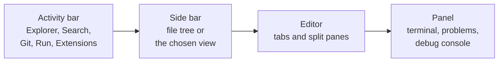
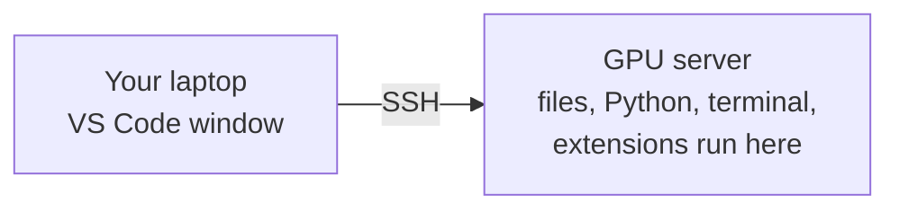

Visual Studio Code is the most widely used code editor in the world, and the default choice for Python and AI work. It is free, fast, and extended by plugins into a complete environment: editing, running, debugging, notebooks, Git and remote servers in one window. Time spent learning your editor pays back every day you write code.

## Installing and the Python extension

Download VS Code from [code.visualstudio.com](https://code.visualstudio.com). Out of the box it is a text editor. The **Python extension** from Microsoft turns it into a Python environment. Open the Extensions view (the square icon in the left bar), search for "Python" and install it. It brings two companions with it:

| Extension | Provides |
| --- | --- |
| Python | Running code, selecting environments, testing |
| Pylance | Autocompletion, go-to-definition, type checking as you type |
| Python Debugger | Breakpoints and stepping through code |

Two more are worth installing for this curriculum:

| Extension | Provides |
| --- | --- |
| Jupyter | Running notebooks inside VS Code |
| Ruff | Fast formatting and linting |

On macOS, open the command palette and run **Shell Command: Install 'code' command in PATH**. You can then open any folder from the terminal with `code .`

## The layout



Always open a **folder**, your project root, rather than individual files. VS Code then knows where your virtual environment, settings and Git repository are.

## The command palette

Press `Ctrl+Shift+P` (`Cmd+Shift+P` on macOS) to open the **command palette**. Every action in VS Code is in it, so you never need to hunt through menus. Start typing what you want: "format", "select interpreter", "toggle terminal".

If you remember one shortcut, remember this one.

## Selecting the Python interpreter

VS Code needs to know which Python to use, and that must be your project's virtual environment. Otherwise imports show red squiggles and code runs with the wrong packages.

1. Open the command palette.
2. Run **Python: Select Interpreter**.
3. Choose the one inside `.venv`.

The chosen interpreter appears in the status bar at the bottom right. VS Code also activates it automatically in each new integrated terminal.

> [!TIP]
> If `import pandas` is underlined as missing but the package is installed, the wrong interpreter is selected almost every time. Check the status bar first.

## Shortcuts worth learning

On macOS, replace `Ctrl` with `Cmd`.

| Action | Shortcut |
| --- | --- |
| Command palette | `Ctrl+Shift+P` |
| Open a file by name | `Ctrl+P` |
| Toggle the integrated terminal | `` Ctrl+` `` |
| Toggle the side bar | `Ctrl+B` |
| Search across all files | `Ctrl+Shift+F` |
| Go to definition | `F12` |
| Find all references | `Shift+F12` |
| Rename a symbol everywhere | `F2` |
| Comment or uncomment lines | `Ctrl+/` |
| Move a line up or down | `Alt+Up` / `Alt+Down` |
| Select the next match of the current word | `Ctrl+D` |
| Add a cursor above or below | `Ctrl+Alt+Up` / `Ctrl+Alt+Down` (macOS: `Cmd+Option`) |
| Split the editor | `Ctrl+\` |

**Rename symbol** (`F2`) deserves special mention. It renames a variable or function everywhere it is used, correctly, even across files. It is much safer than find-and-replace, which also changes unrelated words that happen to match.

**Multiple cursors** let you edit several places at once. Press `Ctrl+D` repeatedly to select successive matches of a word, then type once to change them all.

## Running code

| Method | How | Best for |
| --- | --- | --- |
| Run button | The triangle at the top right of a Python file | Running the current script |
| Integrated terminal | `` Ctrl+` ``, then `python main.py` | Scripts with arguments, anything repeatable |
| Run selection | Select lines, press `Shift+Enter` | Trying a few lines interactively |
| Debugger | `F5` | Investigating a bug (next lessons) |

The integrated terminal is a normal shell. Everything from the terminal lesson works in it, and it starts in your project folder.

## Formatting and linting

A **formatter** rewrites your code into a consistent style: spacing, line breaks, quotes. A **linter** reads your code and warns about likely bugs and bad practice, such as unused imports or variables used before assignment. **Ruff** does both, very quickly.

```python
# before formatting
def train(model,data , epochs = 10):
  for i in range( epochs ):
      loss=model.step(data)
  return loss
```

```python
# after formatting with Ruff
def train(model, data, epochs=10):
    for i in range(epochs):
        loss = model.step(data)
    return loss
```

Set VS Code to format on every save, so you never think about style again.

## Settings

Settings live in a JSON file. Open the command palette and run **Preferences: Open User Settings (JSON)** for your personal settings, or create `.vscode/settings.json` in a project to share settings with the team.

```json
{
  "editor.formatOnSave": true,
  "[python]": {
    "editor.defaultFormatter": "charliermarsh.ruff",
    "editor.codeActionsOnSave": {
      "source.organizeImports": "explicit"
    }
  },
  "python.analysis.typeCheckingMode": "basic",
  "editor.rulers": [88],
  "files.trimTrailingWhitespace": true
}
```

| Setting | Effect |
| --- | --- |
| `editor.formatOnSave` | Format every time you save |
| `source.organizeImports` | Sort imports and remove unused ones on save |
| `python.analysis.typeCheckingMode` | Pylance checks your type hints as you type |
| `editor.rulers` | A faint vertical line at 88 characters, Ruff's default line length |

With type checking on, the `str | None` mistakes from the type hints lesson are underlined before you run anything.

## Git inside VS Code

The **Source Control** view (the branch icon in the activity bar) shows every changed file. Click a file to see a side-by-side diff. Use the `+` button to stage, type a message, and commit. The branch name in the status bar switches branches. Merge conflicts appear with **Accept Current**, **Accept Incoming** and **Accept Both** buttons above each conflict.

Use it for reviewing diffs, which it shows beautifully. Keep using the command line too, so you understand what each button does.

## Notebooks in VS Code

With the Jupyter extension, opening a `.ipynb` file shows a full notebook interface. Choose the kernel at the top right, and pick your project's `.venv`. You get the editor's autocompletion, refactoring and debugger inside notebook cells. The next lesson covers notebooks in depth.

## Working on remote machines

Three extensions let VS Code run on one machine while showing its interface on yours:

| Extension | Connects to |
| --- | --- |
| Remote - SSH | A cloud server or GPU machine |
| WSL | Your Linux environment on Windows |
| Dev Containers | A Docker container defined in your project |



With **Remote - SSH**, you edit files that live on a GPU server, the terminal runs there, and the debugger runs your code there, while the window feels exactly local. This is how many AI engineers work with cloud GPUs.

## AI coding assistants

VS Code supports AI assistants that complete code, explain errors and make edits across files. They are genuinely useful, and also a risk while you are learning: accepting code you do not understand teaches you nothing and plants bugs you cannot find.

> [!KEY]
> While working through this curriculum, write the code yourself first. Use an assistant to explain an error message or review what you wrote, not to write it for you. Once the fundamentals are solid, assistants make you much faster, because you can judge what they produce.

## Exercises

**1.** Open a project folder in VS Code, create a virtual environment in the integrated terminal, and select it as the interpreter. Confirm the status bar shows `.venv`.

<details>
<summary>Show solution</summary>

```bash
python3 -m venv .venv
```

Then open the command palette, run **Python: Select Interpreter**, and choose the `.venv` entry. Open a new terminal: its prompt should show `(.venv)`.

</details>

**2.** Create `.vscode/settings.json` that formats Python with Ruff on save and turns on basic type checking.

<details>
<summary>Show solution</summary>

```json
{
  "[python]": {
    "editor.defaultFormatter": "charliermarsh.ruff",
    "editor.formatOnSave": true
  },
  "python.analysis.typeCheckingMode": "basic"
}
```

</details>

**3.** In a file containing a function called `load_data` used in several places, rename it to `load_dataset` everywhere using one command.

<details>
<summary>Show solution</summary>

Put the cursor on any use of `load_data`, press `F2`, type `load_dataset` and press Enter. Every reference is updated, including in other files that import it.

</details>

```quiz
[
  {
    "q": "Which shortcut opens the command palette?",
    "options": ["`Ctrl+P`", "`Ctrl+Shift+P`", "`Ctrl+B`", "`F5`"],
    "answer": 1,
    "why": "`Ctrl+Shift+P` (or `Cmd+Shift+P` on macOS) opens the palette. `Ctrl+P` opens files by name."
  },
  {
    "q": "VS Code underlines `import numpy` as unresolved, but NumPy is installed in your `.venv`. What is the most likely fix?",
    "options": [
      "Reinstall VS Code",
      "Select the `.venv` interpreter with Python: Select Interpreter",
      "Install NumPy with `sudo pip`",
      "Rename the file"
    ],
    "answer": 1,
    "why": "The editor is analysing your code with a different Python that lacks NumPy."
  },
  {
    "q": "What is the difference between a formatter and a linter?",
    "options": [
      "There is none",
      "A formatter fixes code style; a linter warns about likely bugs and bad practice",
      "A linter runs code; a formatter compiles it",
      "A formatter is only for JSON"
    ],
    "answer": 1,
    "why": "Formatting changes layout without changing meaning. Linting analyses the code for problems."
  },
  {
    "q": "Why is Rename Symbol (`F2`) safer than find-and-replace?",
    "options": [
      "It is faster",
      "It only renames that specific variable or function and its real references",
      "It also renames files",
      "It creates a Git commit"
    ],
    "answer": 1,
    "why": "Rename understands the code, so it will not change unrelated text that happens to match."
  }
]
```
