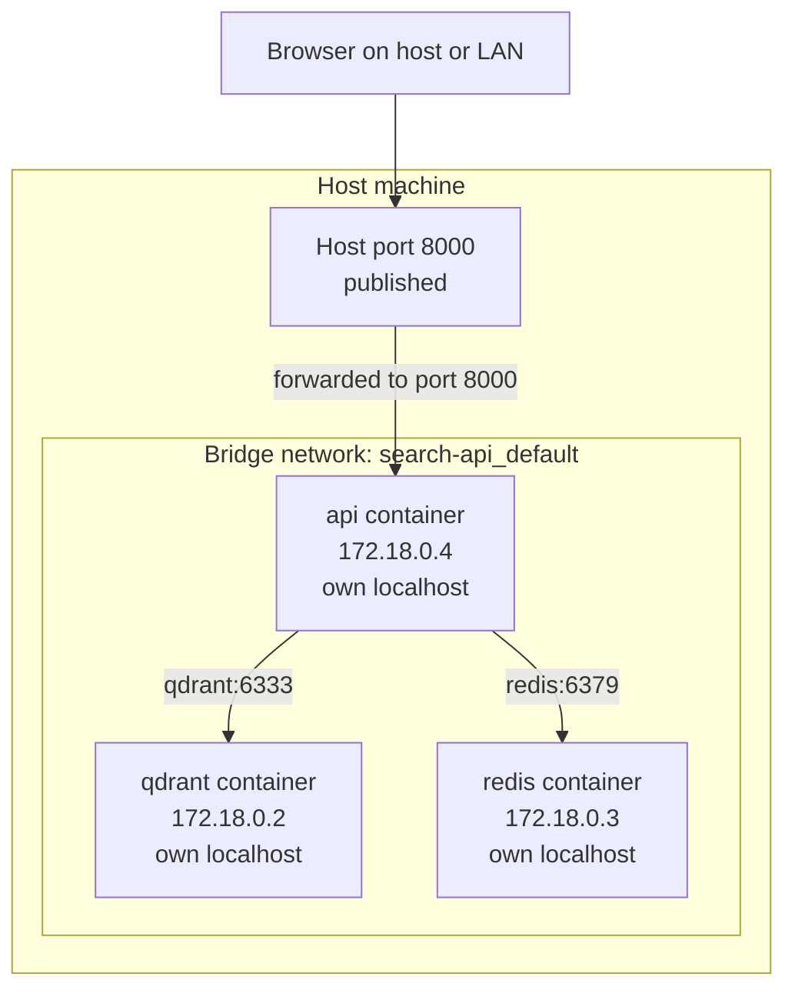
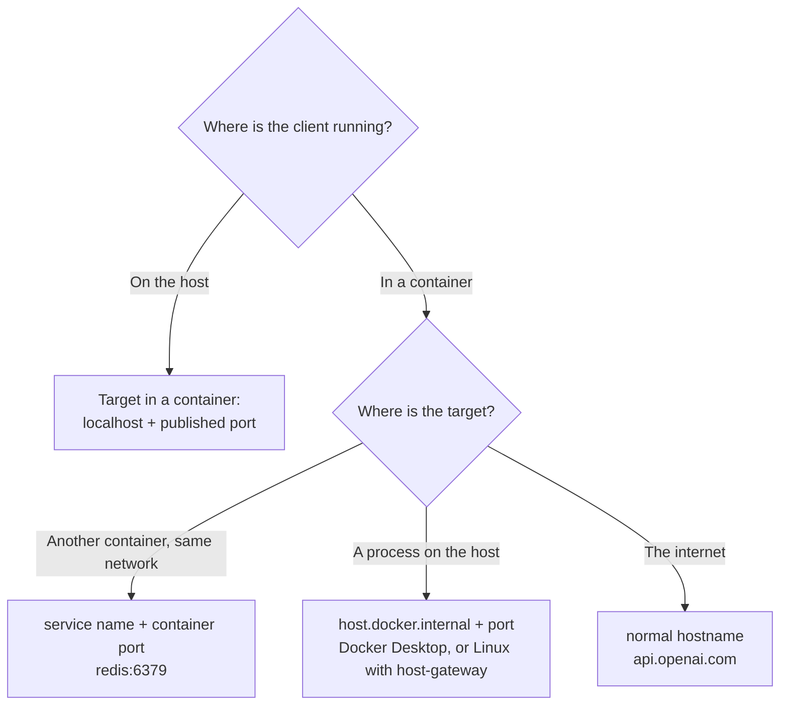

The most common Docker question on any forum is some version of "my container is running, so why can't I connect to it?". The answer is nearly always networking: the app is listening on the wrong address, the port is not published, or one container is trying to reach another through `localhost`. Each container has its **own network namespace**, with its own interfaces, its own IP address and its own `localhost`. Once you hold that picture in your head, the rules for connecting things become predictable. This lesson covers bridge networks, how containers find each other by name, publishing ports to the host, and the `localhost` trap that catches everyone once.

## Every container is its own host

Recall from [Docker fundamentals](/learn/docker-and-containers/docker-fundamentals) that the network namespace gives a container a private network stack. From the network's point of view, each container behaves like a separate small machine plugged into a virtual switch on the host.



The IP addresses shown are illustrative. Docker assigns them from a private range and they change whenever containers are recreated, so you should never hard-code them. That is what DNS is for.

## Network drivers

Docker supports several network drivers. Two matter for everyday work:

| Driver | What it gives you | When to use |
| --- | --- | --- |
| `bridge` | A private virtual network on one host. Containers on it can talk to each other; the host reaches them through published ports | Almost always: single-host apps, development, Compose |
| `host` | No network isolation; the container uses the host's network stack directly | Rare performance or discovery cases. Full support is on Linux |
| `none` | No networking at all | Batch jobs that must not touch the network |
| `overlay` | A network spanning several hosts | Docker Swarm clusters; Kubernetes uses its own networking instead |

### The default bridge versus user-defined bridges

When you `docker run` without a `--network` flag, the container joins the built-in network called `bridge`. That default network has one important limitation: **no automatic DNS between containers**. Containers on it can only reach each other by IP address.

A **user-defined bridge network**, which you create yourself, adds an embedded DNS server, so containers can reach each other by name:

```bash
docker network create search-net
docker run -d --name redis --network search-net redis:7.4
docker run --rm -it --network search-net redis:7.4 redis-cli -h redis ping
```

The second container resolves the hostname `redis` to the first container's current IP address. Compose creates a user-defined network for every project automatically (named `<project>_default`, for example `search-api_default`), which is why services in a `compose.yaml` can call each other by service name with no extra configuration.

> [!KEY]
> On a user-defined network, the container name (or Compose service name) is a hostname. Connect to `redis:6379`, `qdrant:6333`, `postgres:5432`. Never hard-code container IP addresses.

## Publishing ports

By default nothing outside Docker's networks can reach a container. To let your browser, `curl` or another machine reach the API, you **publish** a port with `-p host_port:container_port` (or `ports:` in Compose):

```bash
docker run -d -p 8000:8000 search-api:0.3          # host 8000 -> container 8000
docker run -d -p 9000:8000 search-api:0.3          # host 9000 -> container 8000
docker run -d -p 127.0.0.1:8000:8000 search-api:0.3  # only reachable from this machine
```

The order is always **host first, container second**. The container port is whatever your app listens on inside; the host port is whatever you want to type in the browser. Several containers can all listen on 8000 internally, as each has its own network namespace, but only one can be published on a given host port.

| | `EXPOSE 8000` in a Dockerfile | `-p 8000:8000` / `ports:` |
| --- | --- | --- |
| Effect | Documentation metadata | Actually forwards traffic from the host |
| Needed for container-to-container traffic? | No | No |
| Needed for host or outside access? | No | Yes |

That middle row surprises people: containers on the same network reach each other on **any** port the target is listening on. The API does not need Qdrant or Redis to publish anything. In fact, it is safer if they do not.

> [!WARNING]
> `-p 6379:6379` publishes on all host interfaces (`0.0.0.0`), so on a cloud VM with a public IP your unauthenticated Redis is open to the internet. On Linux, Docker's port forwarding rules are also applied before many host firewall front-ends such as `ufw`, so the firewall may not block it. Publish only what must be reachable from outside, and bind development-only ports to `127.0.0.1`.

For the running example, a sensible development setup publishes the API, and publishes Qdrant only on localhost so you can open its web dashboard:

```yaml
services:
  api:
    ports:
      - "8000:8000"
  qdrant:
    ports:
      - "127.0.0.1:6333:6333"
  redis: {}   # not published: only the api needs it
```

## The localhost trap

`localhost` (127.0.0.1) always means "this network namespace". Inside a container, that is the container itself, not your laptop and not another container. This produces two classic bugs.

**Bug 1: the app listens on localhost inside the container.** Uvicorn defaults to `--host 127.0.0.1`. Inside the container that means "accept connections only from inside this container". The published port forwards traffic to the container's network interface, not to its loopback, so your browser gets "connection reset" even though the logs say the server is running. The fix is to listen on all interfaces inside the container:

```dockerfile
CMD ["uvicorn", "app.main:app", "--host", "0.0.0.0", "--port", "8000"]
```

Listening on `0.0.0.0` inside a container is normal and safe; what is reachable from outside is controlled by `-p`.

**Bug 2: one container connects to another via localhost.** You developed the API on your laptop with Redis running locally, so `REDIS_URL=redis://localhost:6379` worked. Inside a container, `localhost` is the API container, which has no Redis, so you get "connection refused". Use the service name instead.



| Client | Target | Address to use |
| --- | --- | --- |
| Browser on your laptop | API container with `-p 8000:8000` | `http://localhost:8000` |
| API container | Redis container (same network) | `redis://redis:6379` |
| API container | Ollama or a database running directly on your laptop | `http://host.docker.internal:11434` |
| API container | External LLM API | Its normal public URL |

On Docker Desktop, `host.docker.internal` resolves to the host automatically. On Linux you can enable it per container with `--add-host=host.docker.internal:host-gateway`, or in Compose with `extra_hosts: ["host.docker.internal:host-gateway"]`.

## Isolating services with multiple networks

A container can join several networks. You can use this to make sure only the services that need a database can reach it:

```yaml
services:
  web:
    image: search-ui:0.1
    ports: ["3000:3000"]
    networks: [frontend]
  api:
    image: search-api:0.3
    networks: [frontend, backend]
  qdrant:
    image: qdrant/qdrant:v1.12.4
    networks: [backend]
  redis:
    image: redis:7.4
    networks: [backend]

networks:
  frontend:
  backend:
```

The web front end can reach `api` but cannot resolve or connect to `qdrant` or `redis`, which share only the `backend` network with the API. This is the same least-privilege idea as limiting database users, applied to the network.

## Debugging connectivity

Work from the inside out:

```bash
docker compose ps                                  # are all services up and healthy?
docker compose logs api                            # what address is uvicorn listening on?
docker network ls                                  # which networks exist?
docker network inspect search-api_default          # which containers are attached, with IPs
docker compose exec api python -c "import socket; print(socket.gethostbyname('qdrant'))"
docker compose exec api python -c "import urllib.request; print(urllib.request.urlopen('http://qdrant:6333/').status)"
```

The last two commands run inside the API container, so they test exactly what your app sees: DNS resolution of the service name, then an HTTP request. Slim images often lack `ping`, `curl` and `nslookup`, but they always have Python, which is enough. If DNS fails, the containers are not on the same user-defined network. If DNS works but the connection is refused, the target is not listening on that port or is listening on `127.0.0.1`.

## Exercises

**1.** `docker logs api` shows `Uvicorn running on http://127.0.0.1:8000`. The container was started with `-p 8000:8000`, but `curl http://localhost:8000/health` on the host fails. Explain and fix.

<details>
<summary>Show solution</summary>

Uvicorn is bound to the container's own loopback interface, so it only accepts connections from inside the container. Traffic from the published port arrives on the container's network interface and is refused. Start Uvicorn with `--host 0.0.0.0`, for example in the Dockerfile's `CMD`.

</details>

**2.** You start Redis and the API with two plain `docker run` commands and no `--network` flag. Setting `REDIS_URL=redis://redis:6379` gives "Name or service not known". Why, and what are two fixes?

<details>
<summary>Show solution</summary>

Both containers are on the default `bridge` network, which has no DNS for container names. Fix by creating a user-defined network (`docker network create search-net`) and starting both containers with `--network search-net`, or by defining both services in a `compose.yaml`, which creates a user-defined network automatically.

</details>

**3.** Rewrite this Compose fragment so Redis is not reachable from outside the host at all, while the API can still use it.

```yaml
services:
  redis:
    image: redis:7.4
    ports:
      - "6379:6379"
```

<details>
<summary>Show solution</summary>

Remove the `ports:` section. The API reaches Redis over the project network at `redis:6379` without any published port.

```yaml
services:
  redis:
    image: redis:7.4
```

If you need to inspect it from the host during development, publish it on loopback only: `"127.0.0.1:6379:6379"`.

</details>

```quiz
[
  {
    "q": "In `docker run -p 9000:8000 search-api`, which port does your app listen on inside the container?",
    "options": ["9000", "8000", "Both", "Whichever is free"],
    "answer": 1,
    "why": "The format is host:container. Host port 9000 forwards to container port 8000."
  },
  {
    "q": "Why can two containers on Docker's default `bridge` network not reach each other by name?",
    "options": [
      "The default bridge has no built-in DNS for container names",
      "Containers can never communicate without published ports",
      "Names only work with the `host` driver",
      "DNS requires `EXPOSE`"
    ],
    "answer": 0,
    "why": "Automatic name resolution is provided on user-defined networks, including those Compose creates, not on the default bridge."
  },
  {
    "q": "Inside the `api` container, what does `localhost:6379` refer to?",
    "options": [
      "The Redis container",
      "The host machine",
      "The `api` container itself",
      "Whichever container published port 6379"
    ],
    "answer": 2,
    "why": "Each container has its own network namespace, so localhost is the container itself."
  },
  {
    "q": "Does the `api` service need Qdrant to publish port 6333 in order to query it?",
    "options": [
      "Yes, all container traffic goes through published ports",
      "Yes, unless Qdrant uses `EXPOSE`",
      "No, containers on the same network can reach any listening port",
      "No, but only on the `host` driver"
    ],
    "answer": 2,
    "why": "Publishing is only for traffic from outside Docker's networks. Container-to-container traffic on a shared network needs no published ports."
  }
]
```
