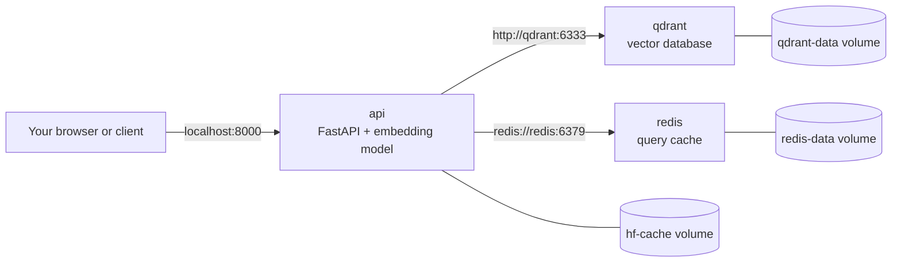
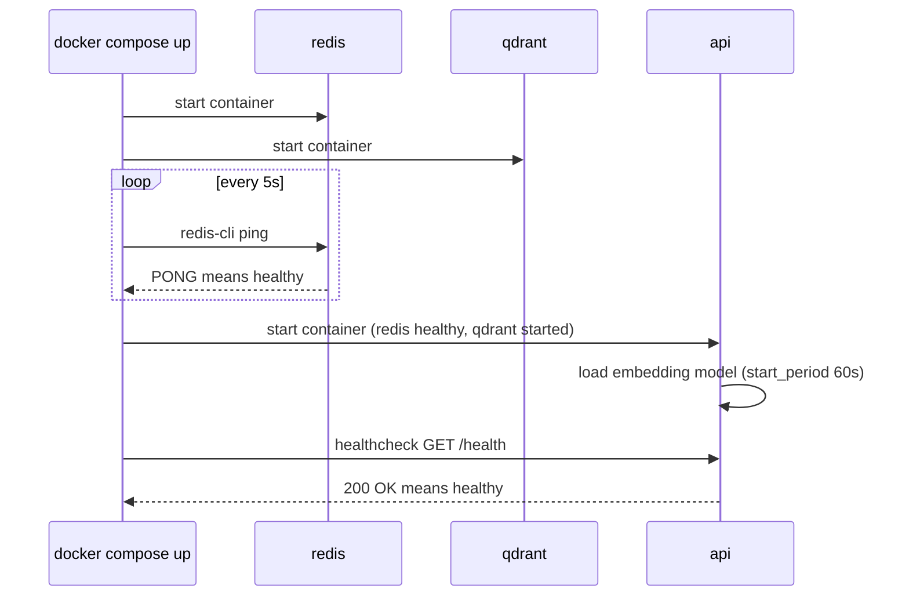

Real AI services are rarely one container. The search API from the previous lesson needs a vector database to store embeddings and a cache so repeated queries do not re-run the model. You could start each with a long `docker run` command and remember the right flags, networks and volumes every time, but nobody does. **Docker Compose** lets you describe the whole multi-container application in one YAML file and manage it with a few commands. It is the standard tool for local development of multi-service AI apps, for integration tests in CI, and for small single-host deployments.

## From docker run to compose.yaml

Without Compose, running the stack means something like this, every time, in the right order:

```bash
docker network create search-net
docker volume create qdrant-data
docker run -d --name qdrant --network search-net -v qdrant-data:/qdrant/storage qdrant/qdrant:v1.12.4
docker run -d --name redis --network search-net redis:7.4
docker run -d --name api --network search-net -p 8000:8000 \
  -e QDRANT_URL=http://qdrant:6333 -e REDIS_URL=redis://redis:6379/0 search-api:0.2
```

Compose turns the same intent into a declarative file, `compose.yaml`, which lives in the root directory of the repository:

```yaml
services:
  api:
    build: .
    image: search-api:0.3
    ports:
      - "8000:8000"
    env_file:
      - .env
    environment:
      QDRANT_URL: http://qdrant:6333
      REDIS_URL: redis://redis:6379/0
    depends_on:
      qdrant:
        condition: service_started
      redis:
        condition: service_healthy
    healthcheck:
      test: ["CMD", "python", "-c", "import urllib.request; urllib.request.urlopen('http://localhost:8000/health')"]
      interval: 10s
      timeout: 5s
      retries: 5
      start_period: 60s
    volumes:
      - hf-cache:/home/app/.cache/huggingface
    restart: unless-stopped

  qdrant:
    image: qdrant/qdrant:v1.12.4
    volumes:
      - qdrant-data:/qdrant/storage

  redis:
    image: redis:7.4
    command: ["redis-server", "--appendonly", "yes"]
    healthcheck:
      test: ["CMD", "redis-cli", "ping"]
      interval: 5s
      timeout: 3s
      retries: 5
    volumes:
      - redis-data:/data

volumes:
  hf-cache:
  qdrant-data:
  redis-data:
```

Pin versions of third-party images, as discussed in [images and containers](/learn/docker-and-containers/images-and-containers); the tags here are examples, so use the versions you have tested.



Inside the app, the connection details come from the environment, so the same code runs in Compose, in tests and in the cloud:

```python
import os

import redis
from qdrant_client import QdrantClient

cache = redis.Redis.from_url(os.environ["REDIS_URL"])
vectors = QdrantClient(url=os.environ["QDRANT_URL"])
```

> [!NOTE]
> Older tutorials use a separate `docker-compose` program and a `docker-compose.yml` file starting with a `version:` key. The current tool is the `docker compose` plugin (with a space). It reads `compose.yaml` by default, still accepts the old file name, and ignores the obsolete `version:` key.

## The keys you will use

| Key | Purpose |
| --- | --- |
| `services` | One entry per container. The key (`api`, `qdrant`) is the service name |
| `image` | Image to run, or the name to tag a built image with |
| `build` | Build from a Dockerfile; `.` means the current directory as context |
| `ports` | Publish ports, `"host:container"`. Quote them, because YAML can misread some `a:b` numbers |
| `environment` | Environment variables set directly |
| `env_file` | Load variables from a file into the container |
| `volumes` | Mount named volumes or bind mounts |
| `depends_on` | Start order, optionally waiting for a healthy dependency |
| `healthcheck` | A command Docker runs periodically to decide if the service is healthy |
| `command` | Override the image's `CMD` |
| `restart` | Restart policy: `no`, `on-failure`, `always`, `unless-stopped` |
| `profiles` | Only start this service when a named profile is active |

All services in the file join a project network automatically and can reach each other **by service name**. That is why the API connects to `http://qdrant:6333` rather than an IP address. [Container networking](/learn/docker-and-containers/container-networking) explains how.

## Start-up order and healthchecks

Plain `depends_on: [redis]` only means "start the Redis container first". It does not wait for Redis to be ready to accept connections, and a database can take seconds to initialise after its process starts. With `condition: service_healthy`, Compose waits until the dependency's healthcheck passes:



| `condition` | Waits until |
| --- | --- |
| `service_started` | The dependency's container has started (the default) |
| `service_healthy` | Its healthcheck reports healthy. Requires a `healthcheck` on that service |
| `service_completed_successfully` | It has run to completion with exit code 0, useful for migration or seeding jobs |

The healthcheck command runs **inside** the container, so it can only use tools that exist in that image. The Redis image includes `redis-cli`. The slim Python image does not include `curl`, which is why the API's check uses Python's `urllib`. Here Qdrant uses `service_started`: check its image for available tools before writing a healthcheck for it, and in any case make your app retry its first connection, because healthchecks reduce start-up races but cannot eliminate every failure.

The `start_period` gives the API time to load the model before failed checks count against it.

> [!TIP]
> Healthchecks are not just for start-up. `docker compose ps` shows each service as `healthy` or `unhealthy`, which is often the quickest way to notice that a model server has hung.

## Environment files and variables

Two different mechanisms both involve a file called `.env`, which confuses many people:

| Mechanism | What it does |
| --- | --- |
| `.env` in the project directory | Compose reads it automatically to **substitute** `${VARIABLE}` placeholders in `compose.yaml` |
| `env_file: [.env]` on a service | Passes every variable in the file **into the container's environment** |

Substitution lets you vary the file itself between machines:

```yaml
services:
  api:
    image: search-api:${API_TAG:-dev}
    ports:
      - "${API_PORT:-8000}:8000"
```

`${API_PORT:-8000}` means "use `API_PORT` from the shell or `.env`, or 8000 if unset". A `.env` file might contain:

```text
API_TAG=0.3
API_PORT=8000
OPENAI_API_KEY=sk-replace-me
MODEL_NAME=sentence-transformers/all-MiniLM-L6-v2
```

Commit a `.env.example` with dummy values and add the real `.env` to both `.gitignore` and `.dockerignore`. Run `docker compose config` to print the fully resolved file, which is the fastest way to debug substitution.

## Profiles for optional services

Some services are only needed sometimes, such as a job that seeds the vector database with documents. Give them a profile and they are skipped by a plain `docker compose up`:

```yaml
services:
  seed:
    image: search-api:0.3
    command: ["python", "-m", "app.seed", "--source", "/data/docs"]
    environment:
      QDRANT_URL: http://qdrant:6333
    volumes:
      - ./docs:/data/docs:ro
    depends_on:
      - qdrant
    profiles: ["tools"]
```

```bash
docker compose --profile tools up -d   # start everything including the seed job
docker compose run --rm seed           # or run just this one-off job
```

## Everyday commands

Run these from the directory containing `compose.yaml`:

| Command | What it does |
| --- | --- |
| `docker compose up -d` | Create networks and volumes, then start all services in the background |
| `docker compose up -d --build` | Rebuild images with a `build:` section first |
| `docker compose ps` | Status of each service, including health |
| `docker compose logs -f api` | Follow logs of one service (omit the name for all) |
| `docker compose exec api bash` | Open a shell in the running `api` container |
| `docker compose restart api` | Restart one service |
| `docker compose down` | Stop and remove containers and the project network. **Volumes are kept** |
| `docker compose down -v` | Also delete the named volumes, and all data in them |

Compose names everything after the **project**, by default the directory name, so the volume `qdrant-data` in a folder called `search-api` becomes `search-api_qdrant-data`.

### A development override

Compose automatically merges `compose.override.yaml` on top of `compose.yaml` if it exists. Use it for development-only settings, such as mounting your source code and enabling auto-reload, so the main file stays deployable:

```yaml
# compose.override.yaml
services:
  api:
    volumes:
      - ./app:/home/app/service/app
    command: ["uvicorn", "app.main:app", "--host", "0.0.0.0", "--port", "8000", "--reload"]
```

### GPUs in Compose

To give a service GPUs (on a host with the NVIDIA Container Toolkit), reserve devices:

```yaml
services:
  api:
    deploy:
      resources:
        reservations:
          devices:
            - driver: nvidia
              count: all
              capabilities: [gpu]
```

## Exercises

**1.** Your API crashes on start-up with "connection refused" to Redis about one time in three, even though `depends_on: [redis]` is set. Explain and fix.

<details>
<summary>Show solution</summary>

Short-form `depends_on` only waits for the Redis container to start, not for Redis to accept connections. Add a healthcheck to Redis and wait for it:

```yaml
  redis:
    image: redis:7.4
    healthcheck:
      test: ["CMD", "redis-cli", "ping"]
      interval: 5s
      retries: 5
  api:
    depends_on:
      redis:
        condition: service_healthy
```

Also make the app retry its initial connection, since dependencies can restart later too.

</details>

**2.** You run `docker compose down -v` to "clean up" before lunch. After `docker compose up -d`, your indexed documents are gone and the model downloads again. Why?

<details>
<summary>Show solution</summary>

`-v` deletes the named volumes declared in the file, here `qdrant-data` (the vector index) and `hf-cache` (the downloaded model). Plain `docker compose down` removes containers and the network but keeps volumes, so data survives.

</details>

**3.** Make the published host port configurable, defaulting to 8000, while the container always listens on 8000.

<details>
<summary>Show solution</summary>

```yaml
services:
  api:
    ports:
      - "${API_PORT:-8000}:8000"
```

Set `API_PORT=8080` in `.env` or the shell to publish on 8080. Check the result with `docker compose config`.

</details>

```quiz
[
  {
    "q": "In the example `compose.yaml`, how does the `api` service reach Qdrant?",
    "options": [
      "`http://localhost:6333`",
      "`http://qdrant:6333`, using the service name as a hostname",
      "Through the host's published port only",
      "By Qdrant's container ID"
    ],
    "answer": 1,
    "why": "Services on the same Compose network resolve each other by service name through Docker's built-in DNS."
  },
  {
    "q": "What does `depends_on` with `condition: service_healthy` require?",
    "options": [
      "A `healthcheck` defined on the dependency",
      "A `restart: always` policy",
      "A published port on the dependency",
      "The `tools` profile"
    ],
    "answer": 0,
    "why": "Compose can only wait for healthy if the dependency has a healthcheck that reports its status."
  },
  {
    "q": "What does `docker compose down` do to named volumes by default?",
    "options": [
      "Deletes them",
      "Backs them up",
      "Keeps them",
      "Converts them to bind mounts"
    ],
    "answer": 2,
    "why": "Volumes survive `down`. Only `down -v` removes them."
  },
  {
    "q": "What is the difference between the project `.env` file and `env_file:`?",
    "options": [
      "There is none",
      "`.env` substitutes `${VARS}` in the Compose file; `env_file:` injects variables into a container",
      "`.env` is for secrets; `env_file:` is for ports",
      "`env_file:` only works with profiles"
    ],
    "answer": 1,
    "why": "The project `.env` drives interpolation of the YAML. `env_file:` sets the container's environment."
  }
]
```
