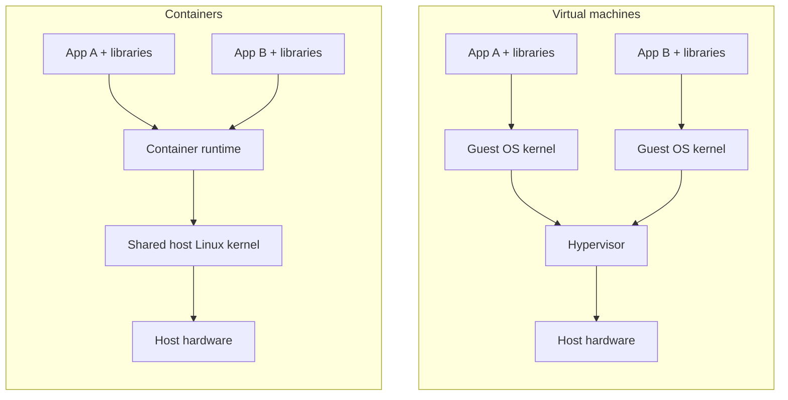
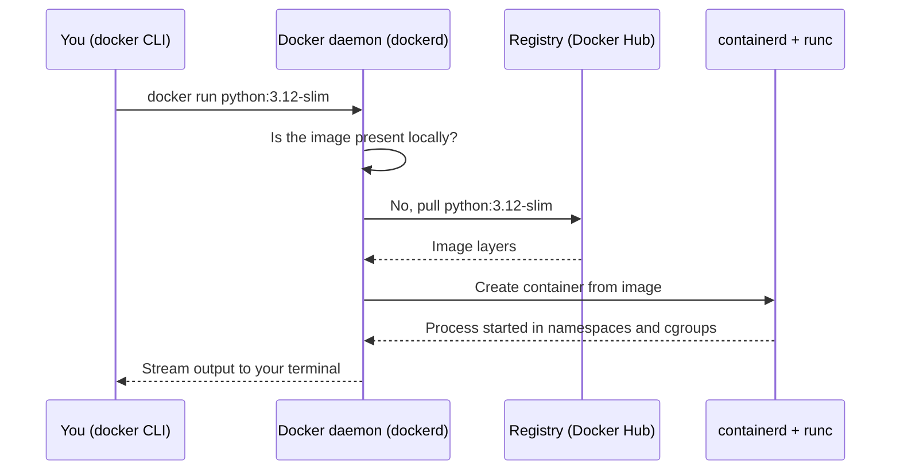
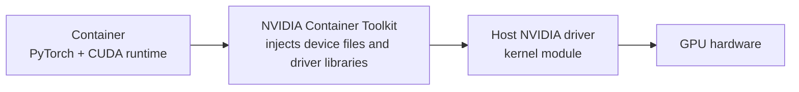

You have a FastAPI service that serves an embedding model. It runs perfectly on your laptop. Then a colleague clones the repository and gets a different version of PyTorch, a server has Python 3.10 instead of 3.12, and the cloud machine is missing a system library that `pip` silently assumed was there. Hours disappear into "but it works on my machine". **Containers** fix this by shipping the application together with everything it needs to run, as a single artefact that behaves the same on every machine that can run containers. **Docker** is the tool most teams use to build and run them.

For an AI engineer, containers are not optional extras. Almost every way of deploying a model, from a single cloud VM to Kubernetes, managed model hosting and serverless platforms, takes a container image as its input. Across this module you will containerise one running example: a **FastAPI semantic search service** that embeds text with a small sentence-transformers model, stores vectors in Qdrant and caches results in Redis. This lesson explains what a container actually is and how Docker is put together.

## The "works on my machine" problem

A Python application depends on far more than its own code:

| Layer | Example | Captured by `requirements.txt`? |
| --- | --- | --- |
| Your code | `app/main.py` | Yes, it is in Git |
| Python packages | `fastapi`, `sentence-transformers` | Yes, if pinned |
| Python interpreter | 3.12.x | No |
| System libraries | `libgomp`, `libssl`, CUDA runtime | No |
| Operating system userland | Debian, Ubuntu, Alpine | No |
| Configuration | environment variables, file paths | Rarely |

A [virtual environment](/learn/developer-tools/virtual-environments) isolates the second row only. A container image captures every row from the operating system userland upwards, so "it works in the container" means it works everywhere the container runs.

## Virtual machines versus containers

Before containers, the standard way to package a whole environment was a **virtual machine** (VM). A VM emulates hardware and boots a complete guest operating system with its own kernel. A container takes a lighter route: it is an ordinary process on the host, running on the **host's kernel**, that the kernel has been told to isolate.



| | Virtual machine | Container |
| --- | --- | --- |
| Includes a kernel | Yes, a full guest OS | No, shares the host kernel |
| Typical size | Gigabytes | Megabytes to a few gigabytes |
| Start-up time | Tens of seconds to minutes | Usually well under a second for the process itself |
| Isolation strength | Strong, hardware-level boundary | Good, but a kernel bug can affect all containers |
| Density | A handful per host | Dozens or hundreds per host |

The trade-off is clear: containers are lighter and faster because they share the kernel, and slightly weaker in isolation for the same reason. In practice the two are combined. Cloud providers run your containers inside VMs, giving you both.

## What a container really is

There is no special "container" object in the Linux kernel. A container is a normal process that Docker starts with three kernel features applied to it.

**Namespaces** control what a process can *see*. Each namespace type gives the process its own private view of one kind of resource:

| Namespace | Isolates | Effect inside the container |
| --- | --- | --- |
| PID | Process IDs | Your app sees itself as PID 1 and cannot see host processes |
| Network | Interfaces, ports, routing | The container has its own `localhost` and its own IP address |
| Mount | Filesystem mounts | The container sees its image's filesystem as `/` |
| UTS | Hostname | The container has its own hostname |
| IPC | Shared memory, message queues | No interference with host processes |
| User | User and group IDs | Can map root inside to an unprivileged user outside |

**Control groups (cgroups)** control what a process can *use*: how much CPU, memory and I/O. When you start a container with a 2 GB memory limit and your model tries to load 3 GB of weights, the kernel's out-of-memory killer stops the container rather than letting it starve the host.

**A layered filesystem** (usually OverlayFS) stacks read-only image layers with a thin writable layer on top, so ten containers started from the same image share one copy of the files on disk. The next lesson looks at layers in detail.

> [!KEY]
> A container is an isolated process, not a small computer. Namespaces limit what it can see, cgroups limit what it can use, and a layered filesystem gives it its own root directory. When the main process exits, the container stops.

That last point surprises newcomers. If your container's command is `python train.py`, the container runs exactly as long as the training script does. A web server container keeps running because Uvicorn keeps running.

## How Docker is put together

When you type a `docker` command you are using a client that talks to a background service.



| Component | Role |
| --- | --- |
| **Docker CLI** | The `docker` command. Sends requests to the daemon over an API |
| **Docker daemon** (`dockerd`) | Builds images, manages containers, networks and volumes |
| **containerd** and **runc** | Lower-level runtimes that actually create the isolated process |
| **Registry** | A server that stores images, such as Docker Hub, GitHub Container Registry or a cloud provider's registry |
| **Image** | A read-only template: filesystem layers plus metadata such as the default command |
| **Container** | A running (or stopped) instance of an image |

Docker images follow the open **OCI** (Open Container Initiative) standard, so an image built with Docker also runs on other OCI runtimes such as Podman, containerd on Kubernetes, or a cloud container service.

## Installing Docker and a first run

On Linux, install Docker Engine from your distribution's instructions on [docs.docker.com](https://docs.docker.com/engine/install/). On macOS and Windows, install **Docker Desktop**. Because containers need a Linux kernel, Docker Desktop quietly runs a small Linux VM and your containers live inside it. This matters later: file sharing between your Mac and a container goes through that VM and is slower than on native Linux.

Check that the client can reach the daemon, then run a throwaway Python interpreter:

```bash
docker version
docker run --rm -it python:3.12-slim python
```

The second command pulls the official `python:3.12-slim` image the first time (later runs reuse it), starts a container, attaches your terminal to it (`-it`) and deletes the container when you exit (`--rm`). Inside, `import sys; sys.version` shows Python 3.12 regardless of what is installed on your host. Try `import os; os.getpid()` too: the interpreter is PID 1 because it lives in its own PID namespace.

> [!NOTE]
> On Linux, `docker` commands need either `sudo` or membership of the `docker` group. Membership of that group is effectively root access to the host, because anyone in it can start a container that mounts `/`. Treat it accordingly on shared machines.

### CPU architectures

An image is built for a CPU architecture. Apple Silicon Macs are `arm64`, most cloud servers are `amd64` (x86-64). Official images such as `python` publish both and Docker picks the right one automatically. If you build an image on an M-series Mac and push it to an `amd64` server, it will fail to start with an "exec format error" unless you build for the target platform, for example with `docker build --platform linux/amd64`.

## GPUs in containers

Model serving often needs a GPU, and this is where the shared-kernel design shows. The GPU **driver** is a kernel module, so it lives on the host, never in the image. The image contains only user-space libraries such as the CUDA runtime and cuDNN.



The **NVIDIA Container Toolkit**, installed on the host, makes the GPU devices and the matching driver libraries visible inside a container when you ask for them:

```bash
docker run --rm --gpus all my-gpu-image nvidia-smi
```

`--gpus all` exposes every GPU; `--gpus '"device=0"'` exposes only the first. The practical rule is that the CUDA version in your image must be supported by the host driver: a newer driver runs older CUDA runtimes, but not the reverse. You will meet CUDA base images in the [Dockerfile](/learn/docker-and-containers/dockerfile) lesson and GPU instances in [cloud computing](/learn/cloud-computing/gpu-instances).

## What containers do not solve

- **Kernel differences.** Containers share the host kernel, so a Linux container cannot run natively on a Windows or macOS kernel. That is why Docker Desktop needs a VM.
- **Hardware.** An image that needs a GPU still needs a host with a GPU and a compatible driver.
- **Configuration and secrets.** The image should be the same in every environment; settings and credentials are supplied when the container starts.
- **Data.** Anything written inside a container is lost when it is removed, unless you use [persistent storage](/learn/docker-and-containers/persistent-storage).

## Exercises

**1.** A colleague says: "Containers are just lightweight VMs, each with its own small Linux kernel." Correct the statement in two sentences.

<details>
<summary>Show solution</summary>

Containers do not have their own kernel: every container on a host shares the host's Linux kernel. A container is an ordinary process that the kernel isolates with namespaces (what it can see) and limits with cgroups (what it can use), on top of a layered filesystem.

</details>

**2.** Run `docker run --rm python:3.12-slim python -c "import os; print(os.getpid())"`, then run `docker ps -a`. Explain what you see in both cases.

<details>
<summary>Show solution</summary>

The first command prints `1`: inside its PID namespace the Python process is the first and only process. `docker ps -a` lists all containers including stopped ones, and the container is not there, because the script finished, the main process exited, the container stopped, and `--rm` removed it.

</details>

**3.** Your GPU server's driver supports CUDA up to version 12.2. Which of these images can use the GPU: one built on a CUDA 11.8 runtime, one on CUDA 12.1, one on CUDA 12.6?

<details>
<summary>Show solution</summary>

The 11.8 and 12.1 images can, because a newer driver supports older CUDA runtimes. The 12.6 image needs a newer driver than the host has, so CUDA initialisation will fail inside the container. The fix is to upgrade the host driver or use an older CUDA base image.

</details>

```quiz
[
  {
    "q": "Which kernel feature limits how much memory a container may use?",
    "options": ["Namespaces", "Control groups (cgroups)", "OverlayFS", "The Docker CLI"],
    "answer": 1,
    "why": "Cgroups limit resource usage such as CPU, memory and I/O. Namespaces limit what a process can see."
  },
  {
    "q": "Why does Docker Desktop on macOS run a Linux virtual machine?",
    "options": [
      "To make containers start faster",
      "Because Linux containers need a Linux kernel, and macOS does not have one",
      "Because Docker Hub only accepts uploads from Linux",
      "To provide GPU support"
    ],
    "answer": 1,
    "why": "Containers share the host kernel. On a Mac there is no Linux kernel to share, so Docker Desktop provides one in a VM."
  },
  {
    "q": "A container runs `python train.py`. What happens when the script finishes?",
    "options": [
      "The container keeps running idle until you stop it",
      "Docker restarts the script automatically by default",
      "The main process exits, so the container stops",
      "The container turns into an image"
    ],
    "answer": 2,
    "why": "A container lives exactly as long as its main process. No restart policy is applied unless you set one."
  },
  {
    "q": "Where must the NVIDIA GPU driver be installed for `docker run --gpus all` to work?",
    "options": [
      "Inside every image",
      "On the host, with the NVIDIA Container Toolkit",
      "In a separate driver container",
      "On Docker Hub"
    ],
    "answer": 1,
    "why": "The driver is a kernel module and containers share the host kernel. The toolkit exposes the devices and driver libraries to the container."
  }
]
```
