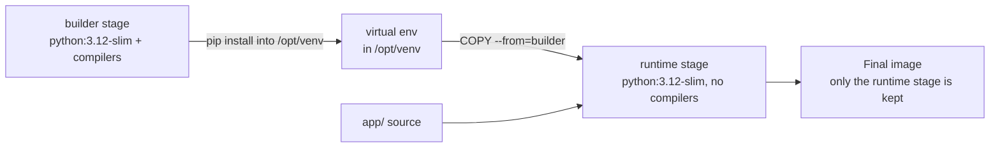

A **Dockerfile** is a plain-text recipe for building an image: start from this base, copy these files, run these commands, and when a container starts, run this program. Every instruction produces a layer or a piece of configuration, and the order and content of those instructions decide how big your image is, how fast it rebuilds, and how safe it is to run. In this lesson you will write the Dockerfile for the running example, a FastAPI service that serves a sentence-transformers embedding model, and improve it step by step into something you would deploy.

## The application

The service is a small [FastAPI](/learn/fastapi/fastapi-fundamentals) app:

```text
search-api/
├── app/
│   ├── __init__.py
│   └── main.py
├── requirements.txt
├── Dockerfile
└── .dockerignore
```

```python
# app/main.py
import os

from fastapi import FastAPI
from pydantic import BaseModel
from sentence_transformers import SentenceTransformer

MODEL_NAME = os.getenv("MODEL_NAME", "sentence-transformers/all-MiniLM-L6-v2")

app = FastAPI(title="Search API")
model = SentenceTransformer(MODEL_NAME)


class EmbedRequest(BaseModel):
    texts: list[str]


@app.get("/health")
def health():
    return {"status": "ok"}


@app.post("/embed")
def embed(req: EmbedRequest):
    vectors = model.encode(req.texts).tolist()
    return {"model": MODEL_NAME, "vectors": vectors}
```

`requirements.txt` pins exact versions of `fastapi`, `uvicorn`, `sentence-transformers` and their dependencies, ideally generated with `pip freeze` or a lock tool, as covered in [virtual environments](/learn/developer-tools/virtual-environments).

## A first Dockerfile

```dockerfile
FROM python:3.12-slim

WORKDIR /srv
COPY . .
RUN pip install -r requirements.txt

EXPOSE 8000
CMD ["uvicorn", "app.main:app", "--host", "0.0.0.0", "--port", "8000"]
```

Build it and run it:

```bash
docker build -t search-api:0.1 .
docker run --rm -p 8000:8000 search-api:0.1
```

The `.` at the end of `docker build` is the **build context**: the directory whose files are sent to the builder and become available to `COPY`. Note `--host 0.0.0.0`: Uvicorn's default of `127.0.0.1` would only accept connections from inside the container itself, a trap explained in [container networking](/learn/docker-and-containers/container-networking).

This Dockerfile works, but it has three problems: every code change reinstalls all dependencies, it copies everything in the folder (including `.git` and your virtual environment), and it runs as root. You will fix each.

## The core instructions

| Instruction | What it does | Creates a layer? |
| --- | --- | --- |
| `FROM image:tag` | Base image to start from. Must come first (after any `ARG`) | Uses the base's layers |
| `WORKDIR /path` | Sets the working directory for later instructions and the container; creates it if missing | Small |
| `COPY src dest` | Copies files from the build context into the image | Yes |
| `RUN command` | Runs a shell command at build time and saves the resulting filesystem changes | Yes |
| `ENV KEY=value` | Sets an environment variable for later build steps and for the running container | Config only |
| `ARG NAME=default` | A build-time variable, set with `--build-arg`. Not present at runtime | Config only |
| `EXPOSE 8000` | Documents the port the app listens on. Does **not** publish it | Config only |
| `USER name` | The user for later `RUN` steps and for the container's process | Config only |
| `CMD [...]` | Default command, easily overridden with arguments to `docker run` | Config only |
| `ENTRYPOINT [...]` | Fixed executable; `docker run` arguments are appended to it | Config only |

### CMD versus ENTRYPOINT

Both define what runs when the container starts. The difference is what happens to arguments you pass to `docker run`:

| Dockerfile | `docker run IMAGE` runs | `docker run IMAGE --port 9000` runs |
| --- | --- | --- |
| `CMD ["uvicorn", "app.main:app"]` | `uvicorn app.main:app` | `--port 9000` (replaces CMD, fails) |
| `ENTRYPOINT ["uvicorn", "app.main:app"]` | `uvicorn app.main:app` | `uvicorn app.main:app --port 9000` |
| `ENTRYPOINT ["uvicorn"]` with `CMD ["app.main:app"]` | `uvicorn app.main:app` | `uvicorn --port 9000` |

Use `CMD` for services, so that `docker run -it search-api:0.1 bash` gives you a shell for debugging. Use `ENTRYPOINT` when the image *is* a command-line tool, for example a batch embedding job where users pass input paths as arguments.

Always use the **exec form** (a JSON list) rather than the shell form (`CMD uvicorn app.main:app`). The shell form runs your program under `/bin/sh -c`, so the shell is PID 1 and does not forward SIGTERM. `docker stop` then waits out its timeout and kills your server without a graceful shutdown.

## Layer order and the build cache

Docker reuses a cached layer only if the instruction is unchanged and, for `COPY`, the copied files are unchanged. Once one step misses the cache, **every later step is rebuilt**. The first Dockerfile copies all code before installing packages, so editing one line of `main.py` invalidates the `pip install` layer. Step through two rebuilds after a one-line code change:

```trace
{
  "title": "rebuild after editing main.py, then after reordering",
  "code": [
    "FROM python:3.12-slim",
    "WORKDIR /srv",
    "COPY . .",
    "RUN pip install -r requirements.txt",
    "COPY requirements.txt .",
    "RUN pip install -r requirements.txt",
    "COPY . ."
  ],
  "steps": [
    { "line": 1, "vars": { "version": "bad order (lines 1-4)", "FROM": "cached" }, "note": "The base image is unchanged, so its layers are reused." },
    { "line": 2, "vars": { "version": "bad order (lines 1-4)", "FROM": "cached", "WORKDIR": "cached" }, "note": "Same instruction as last time: cache hit." },
    { "line": 3, "vars": { "version": "bad order (lines 1-4)", "FROM": "cached", "WORKDIR": "cached", "COPY . .": "MISS" }, "note": "main.py changed, so the checksum of the copied files changed. Cache miss." },
    { "line": 4, "vars": { "version": "bad order (lines 1-4)", "FROM": "cached", "WORKDIR": "cached", "COPY . .": "MISS", "pip install": "REBUILT" }, "out": ["bad order: every dependency reinstalled for a one-line code change"], "note": "Everything after a miss is rebuilt. Installing PyTorch and friends again takes minutes." },
    { "line": 5, "vars": { "version": "good order (lines 1, 2, 5-7)", "COPY requirements.txt": "cached" }, "note": "Now copy only requirements.txt first. It did not change, so this layer is a hit." },
    { "line": 6, "vars": { "version": "good order (lines 1, 2, 5-7)", "COPY requirements.txt": "cached", "pip install": "cached" }, "note": "The pip layer depends only on requirements.txt, so it is reused." },
    { "line": 7, "vars": { "version": "good order (lines 1, 2, 5-7)", "COPY requirements.txt": "cached", "pip install": "cached", "COPY . .": "MISS" }, "out": ["bad order: every dependency reinstalled for a one-line code change", "good order: only the code layer rebuilt, in seconds"], "note": "Only the final, cheap copy of the source code is rebuilt." }
  ]
}
```

The rule: **order instructions from least to most frequently changed**. System packages first, then Python dependencies, then your code. BuildKit, the default builder in current Docker, can also keep pip's download cache between builds with a cache mount, so even a changed `requirements.txt` does not re-download every wheel:

```dockerfile
RUN --mount=type=cache,target=/root/.cache/pip pip install -r requirements.txt
```

## .dockerignore

`COPY . .` copies the entire build context. Without a `.dockerignore` file that includes your `.venv` (hundreds of megabytes, and built for the wrong OS anyway), `.git`, notebooks, datasets, local model checkpoints, and your `.env` file full of API keys. A `.dockerignore` uses the same pattern style as `.gitignore`:

```text
.git
.venv
__pycache__/
*.pyc
.env
*.ipynb
data/
models/
.pytest_cache/
Dockerfile
compose.yaml
```

This makes builds faster (a smaller context to send), images smaller, and cache hits more frequent, because irrelevant file changes no longer invalidate `COPY . .`.

## A production Dockerfile

Here is the improved version, with a multi-stage build, a slim base and a non-root user:

```dockerfile
# syntax=docker/dockerfile:1

# ---- Stage 1: build dependencies ----
FROM python:3.12-slim AS builder
RUN apt-get update \
    && apt-get install -y --no-install-recommends build-essential \
    && rm -rf /var/lib/apt/lists/*
RUN python -m venv /opt/venv
ENV PATH="/opt/venv/bin:$PATH"
COPY requirements.txt .
RUN --mount=type=cache,target=/root/.cache/pip \
    pip install -r requirements.txt

# ---- Stage 2: runtime ----
FROM python:3.12-slim AS runtime
ENV PYTHONDONTWRITEBYTECODE=1 \
    PYTHONUNBUFFERED=1 \
    PATH="/opt/venv/bin:$PATH" \
    HF_HOME=/home/app/.cache/huggingface
RUN useradd --create-home --uid 1000 app
COPY --from=builder /opt/venv /opt/venv
WORKDIR /home/app/service
COPY --chown=app:app app/ ./app/
USER app
EXPOSE 8000
CMD ["uvicorn", "app.main:app", "--host", "0.0.0.0", "--port", "8000"]
```



What each choice buys you:

- **Multi-stage build.** Compilers and headers needed to build some wheels stay in the `builder` stage. Only the finished virtual environment is copied into the final image, which never contains `build-essential`.
- **Slim base.** `python:3.12-slim` is Debian with only the essentials. The full `python:3.12` image includes compilers and many libraries you do not need at runtime. Alpine-based images are smaller still, but they use musl instead of glibc, so many scientific wheels do not install from binaries and must compile, which is slow and fragile. For ML, prefer slim Debian or Ubuntu bases.
- **Non-root user.** By default containers run as root. If an attacker exploits your API, root inside the container makes escaping or damaging mounted files much easier. `USER app` costs nothing.
- **`PYTHONUNBUFFERED=1`** sends print and log output straight to `docker logs` instead of sitting in a buffer.

## Secrets do not belong in images

Anyone who can pull an image can read every layer, and `docker history` shows the build commands. These all leak secrets:

```dockerfile
ENV OPENAI_API_KEY=sk-...           # visible in image config
COPY .env .                         # file stored in a layer
ARG HF_TOKEN                        # value can appear in history
RUN rm .env                         # too late: the earlier layer still has it
```

Pass runtime secrets when the container starts (`docker run -e OPENAI_API_KEY`, an env file, or the platform's secret manager). If a build step genuinely needs a secret, such as downloading a gated model, use a BuildKit secret mount, which is available only during that one `RUN` and never written to a layer:

```dockerfile
RUN --mount=type=secret,id=hf_token \
    HF_TOKEN=$(cat /run/secrets/hf_token) python download_model.py
```

```bash
docker build --secret id=hf_token,src=./hf_token.txt -t search-api:0.2 .
```

> [!WARNING]
> Deleting a file in a later layer does not remove it from the image. The earlier layer still contains it, and anyone can extract it. If a secret was ever baked in, rotate it.

## Images for ML: CUDA bases and model weights

ML images are big for two reasons: GPU libraries and model weights.

**GPU base images.** A GPU build of PyTorch ships its own CUDA libraries, and NVIDIA publishes `nvidia/cuda` images in three flavours. Their sizes range from a few hundred megabytes to several gigabytes, so pick the smallest that works:

| `nvidia/cuda` flavour | Contains | Use for |
| --- | --- | --- |
| `base` | Minimal CUDA runtime | Apps that bring their own CUDA libraries |
| `runtime` | CUDA runtime plus math libraries such as cuBLAS | Running inference |
| `devel` | Everything plus the compiler `nvcc` and headers | Compiling CUDA extensions, typically in a builder stage |

A typical GPU serving image starts from a pinned tag such as `nvidia/cuda:12.1.1-runtime-ubuntu22.04` and installs Python and a matching PyTorch build. For CPU-only serving, install the CPU wheel of PyTorch from `https://download.pytorch.org/whl/cpu` to avoid pulling gigabytes of unused CUDA libraries.

**Model weights.** You can bake weights into the image at build time or download them when the container starts:

| | Bake into image | Download at runtime |
| --- | --- | --- |
| Start-up | Fast and works offline | Slow first start; needs network and credentials |
| Image size | Grows by the size of the weights | Stays small |
| Reproducibility | Image fully pins code and weights | Must pin a model revision explicitly |
| Changing the model | Rebuild and push | Change an environment variable |
| Best for | Small models, autoscaling services where cold start matters | Large models, frequent model swaps |

A common middle ground is runtime download into a [persistent volume](/learn/docker-and-containers/persistent-storage), so each machine downloads once and later starts are fast.

## Exercises

**1.** This Dockerfile reinstalls all packages whenever any file changes. Rewrite the relevant lines.

```dockerfile
FROM python:3.12-slim
WORKDIR /srv
COPY . .
RUN pip install -r requirements.txt
CMD ["python", "-m", "app.worker"]
```

<details>
<summary>Show solution</summary>

Copy and install the requirements before copying the rest of the code:

```dockerfile
FROM python:3.12-slim
WORKDIR /srv
COPY requirements.txt .
RUN pip install --no-cache-dir -r requirements.txt
COPY . .
CMD ["python", "-m", "app.worker"]
```

Add a `.dockerignore` as well, so changes to `.git` or notebooks do not invalidate the final `COPY`.

</details>

**2.** An image uses `CMD uvicorn app.main:app --host 0.0.0.0`. Each `docker stop` takes about 10 seconds and the app's shutdown handler never runs. Why, and what is the fix?

<details>
<summary>Show solution</summary>

That is the shell form, so `/bin/sh -c` is PID 1 and Uvicorn is its child. `docker stop` sends SIGTERM to the shell, which does not forward it, so Docker waits for its default timeout and then sends SIGKILL. Use the exec form: `CMD ["uvicorn", "app.main:app", "--host", "0.0.0.0"]`.

</details>

**3.** A teammate wants to put `ENV HF_TOKEN=hf_xxx` in the Dockerfile so the container can download a gated model at start-up. Suggest a safer approach.

<details>
<summary>Show solution</summary>

Remove the token from the Dockerfile and pass it at runtime, for example `docker run -e HF_TOKEN ...` reading from the host environment, an env file excluded from Git and from the build context, or the deployment platform's secret store. If the model must be downloaded during the build, use `RUN --mount=type=secret,...` with `docker build --secret`. Rotate the token if it was ever committed or pushed in an image.

</details>

```quiz
[
  {
    "q": "Why should `COPY requirements.txt .` and `RUN pip install` come before `COPY . .`?",
    "options": [
      "pip cannot see files copied later",
      "So code changes do not invalidate the cached dependency layer",
      "It makes the image run as non-root",
      "Docker requires requirements files to be copied first"
    ],
    "answer": 1,
    "why": "A cache miss rebuilds every later step. Putting rarely changed dependencies first keeps their layer cached when only code changes."
  },
  {
    "q": "What does `EXPOSE 8000` do?",
    "options": [
      "Publishes port 8000 on the host",
      "Opens port 8000 in the host firewall",
      "Documents that the app listens on 8000; publishing still needs `-p`",
      "Makes Uvicorn listen on port 8000"
    ],
    "answer": 2,
    "why": "`EXPOSE` is metadata. Only `-p` (or `ports:` in Compose) publishes a port on the host."
  },
  {
    "q": "What is the main benefit of a multi-stage build for a Python ML service?",
    "options": [
      "Build tools such as compilers stay out of the final image",
      "It enables GPU support",
      "It removes the need for a `.dockerignore`",
      "It runs each stage in a separate container at runtime"
    ],
    "answer": 0,
    "why": "Only the final stage becomes the image. Artefacts are copied across with `COPY --from`, leaving build-only tools behind."
  },
  {
    "q": "A Dockerfile has `COPY .env .` followed later by `RUN rm .env`. Is the secret safe?",
    "options": [
      "Yes, the file was deleted",
      "Yes, as long as the image is private",
      "No, the earlier layer still contains the file and can be extracted",
      "No, but only if the container runs as root"
    ],
    "answer": 2,
    "why": "Layers are immutable. A later deletion only hides the file; the layer that added it is still part of the image."
  }
]
```
