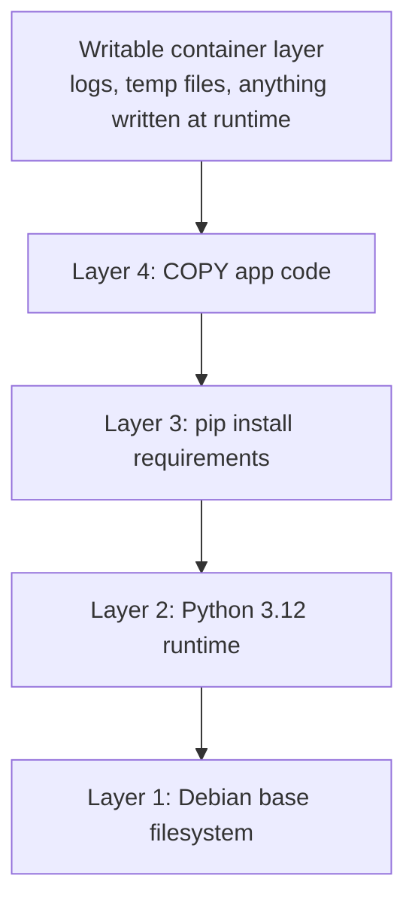
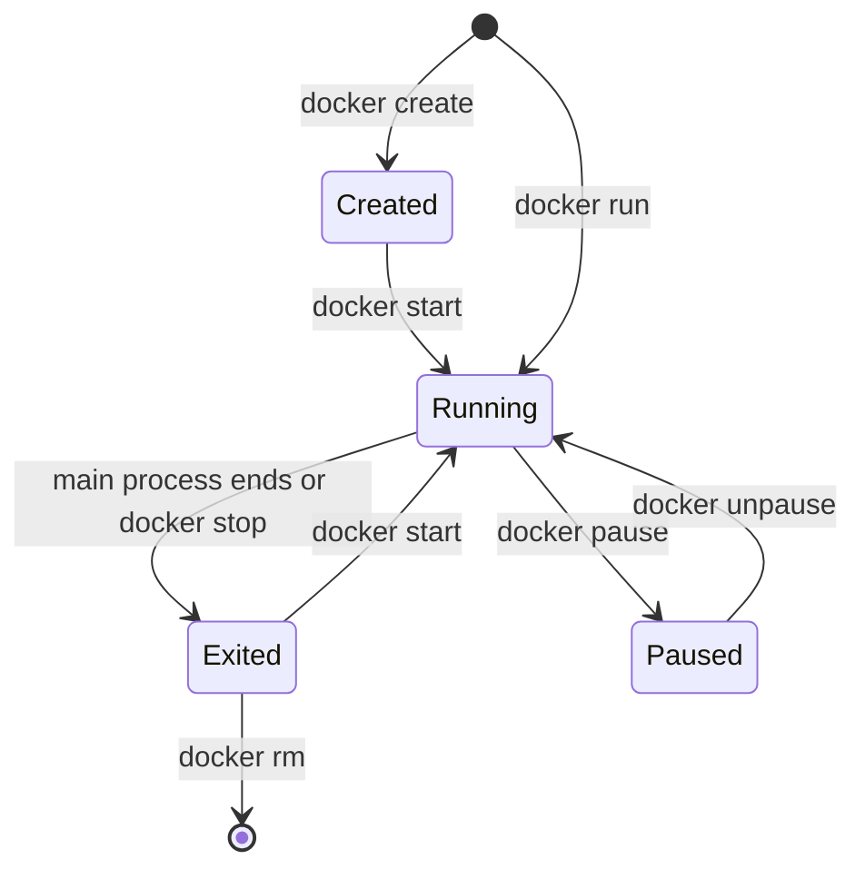

The two words you will use most with Docker are **image** and **container**, and mixing them up causes most beginner confusion. An image is a read-only package: a filesystem plus instructions for what to run. A container is a running (or stopped) instance of an image, with its own writable scratch space. The relationship is like a class and its objects in Python: one image, many containers. This lesson covers how images are built from layers, how they are named and stored in registries, and the commands that take a container through its life.

## Images: layers plus metadata

An image has two parts:

1. **An ordered stack of filesystem layers.** Each layer records the files added, changed or deleted relative to the layer below it.
2. **A configuration**: the default command, environment variables, working directory, exposed ports, user, and the target architecture.

When Docker starts a container, it stacks the image's read-only layers and adds one thin **writable layer** on top. Reads fall through the stack until they find the file; writes go into the writable layer, copying the file up first if it came from a lower layer (copy-on-write).



Two consequences follow, and both shape how you work:

- **Layers are shared.** If five images all start from `python:3.12-slim`, those base layers are stored and downloaded once. Ten containers from the same image share all the read-only layers and each only adds its own small writable layer.
- **The writable layer is temporary.** Remove the container and everything written there is gone. Model caches, uploaded files and database data must live in [volumes](/learn/docker-and-containers/persistent-storage).

> [!KEY]
> Image = read-only layers + config. Container = image + a writable layer + a running process. You never modify an image in place; you build a new one.

You can see an image's layers and what created each one:

```bash
docker pull python:3.12-slim
docker history python:3.12-slim
docker image inspect python:3.12-slim
```

`docker history` lists each layer with its size and the instruction that produced it. `docker image inspect` prints the full configuration as JSON, including `Cmd`, `Env` and `Architecture`.

### Layer caching

Because each layer is identified by its content and the instruction that built it, Docker can **reuse** a layer from a previous build if nothing it depends on has changed. This build cache is what makes the second `docker build` take seconds instead of minutes. The cache is invalidated from the first changed step downwards, which is why the order of instructions in a Dockerfile matters so much. The [Dockerfile](/learn/docker-and-containers/dockerfile) lesson steps through this in detail.

## Names, tags and digests

A full image reference has up to five parts: registry, namespace, repository, tag and digest.

```text
ghcr.io/acme-ai/search-api:1.4.2@sha256:9f86d0...
```

| Part | Meaning | Default if omitted |
| --- | --- | --- |
| Registry | Server that stores the image | `docker.io` (Docker Hub) |
| Namespace | User or organisation | `library` for official images |
| Repository | The image's name | Required |
| Tag | A human-readable label pointing at one image | `latest` |
| Digest | `sha256:` hash of the image manifest | None |

So `python:3.12-slim` is shorthand for `docker.io/library/python:3.12-slim`.

### Tags are movable, digests are not

A **tag** is a pointer, and pointers can move. The `python:3.12-slim` tag is updated whenever a new 3.12 patch release or Debian security fix is published, so pulling it next month gives you different bytes. A **digest** is a hash of the content itself, so `python@sha256:...` always refers to exactly the same image.

The special tag `latest` is just the default name used when no tag is given. It does not mean "newest"; it means "whatever someone last pushed with no tag". In production it is a trap: two servers that pulled `search-api:latest` a week apart may run different code, and rolling back is impossible because you do not know what the previous `latest` was.

| Reference | Reproducible? | Good for |
| --- | --- | --- |
| `search-api:latest` | No | Local experiments only |
| `python:3.12-slim` | Mostly: same minor version, patches change | Base images you rebuild regularly to pick up security fixes |
| `search-api:1.4.2` or `search-api:git-3f2c9a1` | Yes, if you never re-push the tag | Deployments, with immutable tags enforced in the registry |
| `search-api@sha256:...` | Exactly | Production deployment manifests, audits |

> [!WARNING]
> Never deploy `latest`. Tag every image you build with a version or the Git commit hash, and deploy that tag or its digest. Then "which code is running?" always has an answer, and rolling back means deploying the previous tag.

You can see local digests with `docker images --digests`, and a digest is printed when you push an image.

### Registries

A **registry** stores and serves images. Docker Hub is the default public registry; GitHub Container Registry (`ghcr.io`) and each cloud provider's registry (Amazon ECR, Google Artifact Registry, Azure Container Registry) are common for private images. The workflow is the same everywhere:

```bash
docker login ghcr.io
docker tag search-api:1.4.2 ghcr.io/acme-ai/search-api:1.4.2
docker push ghcr.io/acme-ai/search-api:1.4.2
# on another machine
docker pull ghcr.io/acme-ai/search-api:1.4.2
```

`docker tag` does not copy anything; it adds a second name pointing at the same image ID. Pushes and pulls only transfer layers the other side does not already have.

## The container lifecycle

A container moves through a small set of states.



`docker run` is `create` plus `start` in one step, and it is what you will use almost all the time. Here is a full lifecycle using an official Redis image, which you will need later in the running example:

```bash
docker run -d --name cache -p 6379:6379 redis:7.4
docker ps
docker logs cache
docker exec -it cache redis-cli ping
docker stop cache
docker ps -a
docker rm cache
```

The output of `docker ps` is a table like this (example output; your IDs and times will differ):

```output
CONTAINER ID   IMAGE       COMMAND                  CREATED         STATUS         PORTS                    NAMES
3f2c9a1b7d4e   redis:7.4   "docker-entrypoint.s…"   8 seconds ago   Up 7 seconds   0.0.0.0:6379->6379/tcp   cache
```

| Command | What it does |
| --- | --- |
| `docker run IMAGE [CMD]` | Create and start a new container. Pulls the image if missing |
| `docker ps` / `docker ps -a` | List running containers / all containers including stopped ones |
| `docker logs NAME` | Show everything the main process wrote to stdout and stderr. Add `-f` to follow, `--tail 50` for the last lines |
| `docker exec -it NAME CMD` | Run an extra command inside a running container, for example a shell |
| `docker stop NAME` | Send SIGTERM, wait (10 seconds by default), then SIGKILL |
| `docker start NAME` | Restart a stopped container, keeping its writable layer |
| `docker rm NAME` | Delete a stopped container and its writable layer. `-f` stops it first |
| `docker inspect NAME` | Full JSON details: IP address, mounts, environment, exit code |

The `docker run` flags you will use constantly:

| Flag | Meaning |
| --- | --- |
| `-d` | Detached: run in the background and print the container ID |
| `--name cache` | A friendly name instead of a random one |
| `--rm` | Remove the container automatically when it exits |
| `-it` | Interactive with a terminal, for shells and REPLs |
| `-p 6379:6379` | Publish a container port on the host (see [container networking](/learn/docker-and-containers/container-networking)) |
| `-e KEY=value` | Set an environment variable |
| `-v` / `--mount` | Attach storage (see [persistent storage](/learn/docker-and-containers/persistent-storage)) |
| `--restart unless-stopped` | Restart automatically if the process crashes or the host reboots |
| `--memory 4g --cpus 2` | cgroup limits on memory and CPU |

### Debugging a container that will not start

When a container exits immediately, the answer is almost always in its logs and exit code:

```bash
docker ps -a --filter name=search-api
docker logs search-api
docker inspect search-api --format '{{.State.ExitCode}}'
```

An exit code of `137` means the process was killed with SIGKILL, very often by the out-of-memory killer when a model is larger than the memory limit. Code `1` usually means a Python exception, which `docker logs` will show as a traceback. To poke around an image whose normal command crashes, override the command with a shell: `docker run --rm -it search-api:0.1 bash`.

## Housekeeping

Images and stopped containers accumulate quickly, and ML images are large. Check usage and clean up regularly:

```bash
docker system df          # space used by images, containers, volumes, build cache
docker image ls           # list images
docker container prune    # remove all stopped containers
docker image prune        # remove dangling (untagged) images
docker builder prune      # clear the build cache
```

`docker system prune` combines the first three prune commands. Be careful with `--volumes`: volumes hold data, and pruning them is not reversible.

## Exercises

**1.** Explain why two containers started from the same 3 GB image do not use 6 GB of disk.

<details>
<summary>Show solution</summary>

The image's layers are read-only and shared. Each container only adds its own thin writable layer on top, which holds whatever that container writes. The 3 GB is stored once, plus however much each container has written.

</details>

**2.** Start Redis with `docker run -d --name cache redis:7.4`, write a key with `docker exec cache redis-cli set greeting hello`, then `docker stop cache` and `docker start cache`. Is the key still there? What about after `docker rm -f cache` and a fresh `docker run`?

<details>
<summary>Show solution</summary>

After stop and start, the key is still there. Stopping does not delete the container's storage, and with its default settings Redis writes a snapshot to its data directory when it shuts down gracefully on SIGTERM, then reloads it on start. After `docker rm` the container and its writable layer are deleted, so a new container starts empty. Durable data needs a volume, covered in the persistent storage lesson.

</details>

**3.** Your deployment manifest says `image: search-api:latest`. List two concrete problems this can cause and the fix.

<details>
<summary>Show solution</summary>

Different servers can run different code depending on when they pulled the image, and you cannot roll back because the previous `latest` has been overwritten. Some platforms also skip pulling if a `latest` image is already cached, so updates silently do not deploy. Fix: tag images with a version or Git commit hash (`search-api:1.4.2`) and deploy that tag or its digest.

</details>

```quiz
[
  {
    "q": "What happens to files written inside a container when you run `docker rm` on it?",
    "options": [
      "They are saved into the image",
      "They are deleted with the container's writable layer",
      "They are moved to a volume automatically",
      "They are pushed to the registry"
    ],
    "answer": 1,
    "why": "Runtime writes go to the container's writable layer, which is deleted with the container. Only volumes and bind mounts survive."
  },
  {
    "q": "What does the tag `latest` guarantee?",
    "options": [
      "The most recently released stable version",
      "The image has passed security scanning",
      "Nothing beyond being the default tag name when none is given",
      "The image is identical on every machine"
    ],
    "answer": 2,
    "why": "`latest` is only the default tag. It points at whatever was last pushed without an explicit tag."
  },
  {
    "q": "A container exits immediately with code 137. What is the most likely cause for a model server?",
    "options": [
      "A syntax error in Python",
      "The image was not found",
      "The process was killed, often by the out-of-memory killer",
      "The port was already in use"
    ],
    "answer": 2,
    "why": "137 is 128 + 9, meaning SIGKILL. With large models this is very often an out-of-memory kill."
  },
  {
    "q": "Which reference always pulls exactly the same image bytes?",
    "options": ["`python:3.12`", "`python:3.12-slim`", "`python:latest`", "`python@sha256:<digest>`"],
    "answer": 3,
    "why": "A digest is a hash of the content. Tags are movable pointers that can be updated."
  }
]
```
