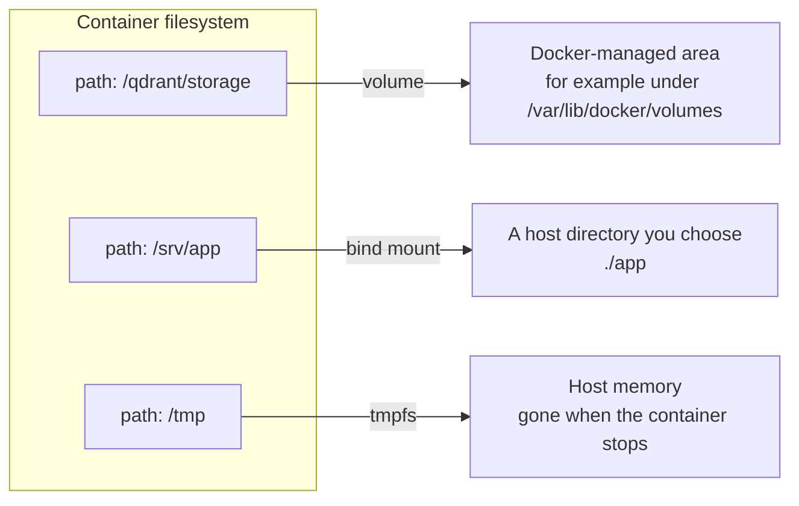
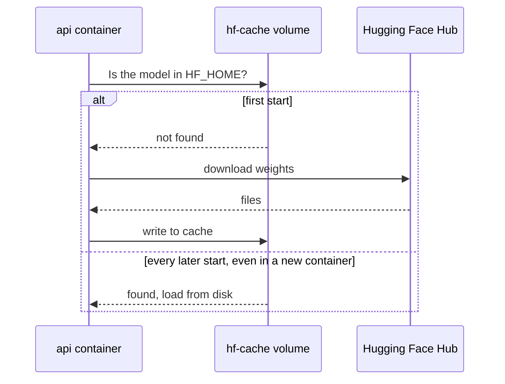

Containers are designed to be disposable. You stop one, remove it, start a fresh one from a new image, and nothing should be lost. But an AI stack is full of state that must survive: the vector index in Qdrant, Redis's data, and gigabytes of downloaded model weights you do not want to fetch again on every restart. Anything written to a container's writable layer disappears when the container is removed. This lesson covers the three ways Docker gives a container storage that lives outside that layer, **volumes**, **bind mounts** and **tmpfs mounts**, and how to use them for model caches and databases in the running example.

## Why the writable layer is not enough

As you saw in [images and containers](/learn/docker-and-containers/images-and-containers), each container gets a thin writable layer on top of its image. It has three problems as a home for data:

- It is deleted with the container, and redeploying a new image version always means a new container.
- It is tied to one container, so other containers cannot share it.
- Writes go through the copy-on-write storage driver, which is slower than a plain filesystem for write-heavy workloads such as databases.

The solution is to **mount** storage at a path inside the container. The app writes to `/qdrant/storage` as normal; the bytes actually land somewhere that outlives the container.



## Three kinds of mount

| | Volume | Bind mount | tmpfs mount |
| --- | --- | --- | --- |
| Where data lives | Storage managed by Docker | Any host path you specify | Host RAM |
| Survives container removal | Yes | Yes (it is a host folder) | No |
| Created by | `docker volume create`, or automatically on first use | Already exists on the host | Container start |
| Portable across hosts | Yes, the same name works anywhere | No, depends on host paths | Yes |
| Pre-populated from image | Yes, if the volume is empty | No, host content hides the image's | No |
| Typical use | Databases, model caches, anything the app owns | Source code in development, config files, input datasets | Scratch space, sensitive temporary files |

> [!KEY]
> Use **volumes** for data the containerised app owns, such as database files and model caches. Use **bind mounts** when you, on the host, own the files and want the container to see them, such as source code during development. Use **tmpfs** for fast scratch space that must never touch disk.

### Syntax

There are two syntaxes. The short `-v` form is compact; the long `--mount` form is explicit and easier to read in scripts:

```bash
# Named volume
docker run -d -v qdrant-data:/qdrant/storage qdrant/qdrant:v1.12.4
docker run -d --mount type=volume,src=qdrant-data,dst=/qdrant/storage qdrant/qdrant:v1.12.4

# Bind mount (read-only)
docker run --rm -v "$(pwd)/docs:/data/docs:ro" search-api:0.3 python -m app.seed
docker run --rm --mount type=bind,src="$(pwd)/docs",dst=/data/docs,readonly search-api:0.3 python -m app.seed

# tmpfs (Linux hosts)
docker run -d --tmpfs /tmp search-api:0.3
```

With `-v`, a value that starts with `/` or `.` is a host path (bind mount) and a plain name is a volume. One behavioural difference matters: if a bind-mount source path does not exist, `-v` silently creates an empty directory there (owned by root on Linux), while `--mount` fails with an error. The error is usually what you want, because a typo in a path otherwise results in an empty mount and a confusing app failure.

Manage volumes with:

```bash
docker volume ls
docker volume inspect qdrant-data
docker volume rm qdrant-data
docker volume prune        # remove volumes not used by any container
```

## Database data

Every database image documents the directory where it keeps data. Mount a named volume there:

| Image | Data directory |
| --- | --- |
| `qdrant/qdrant` | `/qdrant/storage` |
| `redis` | `/data` |
| `postgres` | `/var/lib/postgresql/data` |

In Compose, which you met in [Docker Compose](/learn/docker-and-containers/docker-compose), named volumes are declared at the top level and referenced by services:

```yaml
services:
  qdrant:
    image: qdrant/qdrant:v1.12.4
    volumes:
      - qdrant-data:/qdrant/storage
  redis:
    image: redis:7.4
    command: ["redis-server", "--appendonly", "yes"]
    volumes:
      - redis-data:/data

volumes:
  qdrant-data:
  redis-data:
```

Now `docker compose down` followed by `up` keeps every indexed vector. Two rules keep database volumes healthy:

- **Never point two running database containers at the same volume.** Databases assume exclusive access to their files and can corrupt data otherwise.
- **Prefer named volumes over bind mounts for databases on macOS and Windows.** Bind mounts there cross from the Docker Desktop VM to the host filesystem, which is much slower for the many small writes a database makes. Named volumes live inside the VM.

For managed production databases you will often skip containers for state entirely and use a cloud service, as described in [managed databases](/learn/cloud-computing/managed-databases). Containers plus volumes are ideal for development, testing and modest single-host deployments.

## Caching Hugging Face models in a volume

When the search API starts, `SentenceTransformer(MODEL_NAME)` downloads the model from the [Hugging Face Hub](/learn/hugging-face-ecosystem/model-hub) into the cache directory given by the `HF_HOME` environment variable (by default `~/.cache/huggingface`). Without a volume, that download is repeated every time a new container starts. For a small model it is a nuisance; for a model of many gigabytes it is minutes of start-up time and a lot of bandwidth.



The Dockerfile from the [Dockerfile](/learn/docker-and-containers/dockerfile) lesson sets `HF_HOME=/home/app/.cache/huggingface` and runs as the non-root user `app`. There is one trap here. If the mount point does not exist in the image, Docker creates it owned by root, and the `app` user then cannot write to the volume. Create the directory, owned by the right user, in the image:

```dockerfile
RUN useradd --create-home --uid 1000 app \
    && mkdir -p /home/app/.cache/huggingface \
    && chown -R app:app /home/app/.cache
```

When an **empty** named volume is mounted over a directory that exists in the image, Docker copies the directory's contents and ownership into the volume first, so the volume starts out owned by `app`. Then mount it in Compose:

```yaml
services:
  api:
    environment:
      HF_HOME: /home/app/.cache/huggingface
    volumes:
      - hf-cache:/home/app/.cache/huggingface

volumes:
  hf-cache:
```

You can warm the cache before the first real start with a one-off container that just loads the model:

```bash
docker compose run --rm api python -c "from sentence_transformers import SentenceTransformer; SentenceTransformer('sentence-transformers/all-MiniLM-L6-v2')"
```

> [!TIP]
> Pin the model version as well as the code. Pass a specific commit hash as `revision=` when loading the model, and once the cache is warm you can set `HF_HUB_OFFLINE=1` so the container never contacts the Hub at runtime. Start-up then cannot fail because of a network problem or an upstream model change.

## Bind mounts for development

Bind mounts shine when you want the container to see files you are editing on the host. The development override in the Compose lesson bind-mounts `./app` into the container and runs Uvicorn with `--reload`, so saving a file restarts the server inside the container without rebuilding the image. Read-only bind mounts (`:ro`) are a good way to give a job input data or a config file without letting it modify them.

On Linux, bind mounts expose host file ownership directly. Files created by a container running as root appear on your host owned by root, and a container running as UID 1000 can only write to host directories that UID 1000 may write to. Running the container as a user whose UID matches yours avoids most of these surprises.

## tmpfs mounts

A tmpfs mount is a filesystem in memory. It is fast, it counts against the container's memory limit, and its contents vanish when the container stops. Use it for scratch files, such as temporary uploads before processing, or for anything sensitive that must never be written to disk. It works on Linux hosts (including the Linux VM inside Docker Desktop); there is no Windows-container equivalent.

## Backing up a volume

Because volumes are managed by Docker, the portable way to back one up is to mount it into a throwaway container alongside a bind-mounted host folder and archive it:

```bash
docker compose stop qdrant
docker run --rm \
  -v search-api_qdrant-data:/data:ro \
  -v "$(pwd)/backups:/backup" \
  busybox tar czf /backup/qdrant-data.tar.gz -C /data .
docker compose start qdrant
```

Stopping the database first gives a consistent copy. Many databases also offer their own snapshot mechanism (Qdrant has a snapshots API, Postgres has `pg_dump`), which is safer for a live system.

> [!WARNING]
> `docker compose down -v`, `docker volume rm` and `docker volume prune` delete data permanently. There is no recycle bin. Treat them like `rm -rf` on a production database.

## Exercises

**1.** For each item, choose a volume, bind mount or tmpfs: (a) Postgres data for a local development database, (b) your FastAPI source code while developing, (c) a folder of PDFs a seeding job should read but never modify, (d) decrypted temporary files that must never hit disk.

<details>
<summary>Show solution</summary>

(a) Named volume: the database owns the data, and volumes are faster than bind mounts on Docker Desktop. (b) Bind mount, so edits on the host appear immediately in the container. (c) Read-only bind mount (`:ro` or `readonly`). (d) tmpfs mount, which lives in memory only.

</details>

**2.** After adding `- hf-cache:/home/app/.cache/huggingface` to the API service, start-up fails with `PermissionError` writing to the cache directory. The image runs as `USER app`. What happened and how do you fix it?

<details>
<summary>Show solution</summary>

The directory did not exist in the image, so Docker created the mount point owned by root, and the empty volume took on that ownership. The non-root `app` user cannot write there. Create the directory in the Dockerfile and `chown` it to `app` before the `USER` line, then remove the old volume (`docker volume rm` with its project-prefixed name) so a new one is initialised from the image with the correct ownership.

</details>

**3.** Write a `docker run` command that starts `redis:7.4` with append-only persistence and its data in a named volume called `redis-data`.

<details>
<summary>Show solution</summary>

```bash
docker run -d --name redis \
  -v redis-data:/data \
  redis:7.4 redis-server --appendonly yes
```

The official image stores data in `/data`; the arguments after the image name replace its default command.

</details>

```quiz
[
  {
    "q": "Which mount type is pre-populated with the image's files when it is empty and first mounted?",
    "options": ["Bind mount", "Named volume", "tmpfs mount", "None of them"],
    "answer": 1,
    "why": "An empty named volume is initialised with the contents of the image directory it is mounted over. A bind mount hides the image's directory with the host's contents."
  },
  {
    "q": "Why mount a volume at `HF_HOME` for a model-serving container?",
    "options": [
      "To make the model run faster on the GPU",
      "So downloaded model weights survive container replacement and are not re-downloaded on every start",
      "Because Hugging Face requires it",
      "To shrink the image"
    ],
    "answer": 1,
    "why": "The cache lives outside the writable layer, so new containers find the weights already on disk."
  },
  {
    "q": "What is the main risk of `docker run -v ./data:/data` when `./data` does not exist on the host?",
    "options": [
      "Docker refuses to start the container",
      "Docker silently creates an empty directory and mounts it",
      "The image's `/data` contents are copied to the host",
      "The container gets a tmpfs instead"
    ],
    "answer": 1,
    "why": "With `-v`, a missing bind source is created as an empty directory. `--mount` would fail with an error instead."
  },
  {
    "q": "Which command deletes the data in your Compose project's named volumes?",
    "options": ["`docker compose down`", "`docker compose stop`", "`docker compose down -v`", "`docker compose restart`"],
    "answer": 2,
    "why": "`-v` removes the named volumes. Plain `down` and `stop` keep them."
  }
]
```
