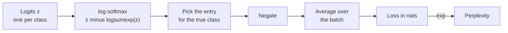

Cross-entropy is probably the most-used formula in modern AI. Every image classifier, every sentiment model and every large language model is trained by minimising it, and an LLM's headline quality metric, **perplexity**, is cross-entropy in disguise. You have already met it twice: as a [loss function](/learn/essential-mathematics-for-machine-learning/loss-functions) and as the negative log-likelihood of a categorical model in [maximum likelihood estimation](/learn/essential-mathematics-for-machine-learning/maximum-likelihood-estimation). This lesson gives it its information-theory meaning, which explains what the numbers you see during training actually measure, and covers the practical details: logits, numerical stability, the gradient, perplexity and label smoothing.

## Coding with the wrong distribution

In the [entropy](/learn/essential-mathematics-for-machine-learning/entropy) lesson you saw that $H(p)$ is the average number of bits needed to encode outcomes from $p$ using the best code for $p$, one that spends $-\log_2 p(x)$ bits on outcome $x$. Now suppose you do not know $p$. You build your code from a model's distribution $q$ instead, spending $-\log_2 q(x)$ bits on $x$, but the outcomes still arrive according to $p$. Your average cost is the **cross-entropy** of $q$ relative to $p$:

$$
H(p, q) = \mathbb{E}_{x \sim p}\big[-\log q(x)\big] = -\sum_{x} p(x)\log q(x)
$$

Here $p$ is the true (data) distribution and $q$ is the model's prediction. The expectation is over $p$, because that is where the data comes from; the log is of $q$, because that is the code you are using. The two arguments play different roles, so $H(p, q) \ne H(q, p)$ in general.

## Worked numbers

Take three outcomes with true probabilities $p = [0.5, 0.25, 0.25]$ and a model that believes $q = [0.25, 0.25, 0.5]$.

```python
import numpy as np

p = np.array([0.5, 0.25, 0.25])     # true distribution
q = np.array([0.25, 0.25, 0.5])     # model's distribution

H_p  = -np.sum(p * np.log2(p))
H_pq = -np.sum(p * np.log2(q))
KL   =  np.sum(p * np.log2(p / q))
print(f"H(p)    = {H_p:.4f} bits")
print(f"H(p, q) = {H_pq:.4f} bits")
print(f"KL(p||q) = {KL:.4f} bits   H(p) + KL = {H_p + KL:.4f}")
```

```output
H(p)    = 1.5000 bits
H(p, q) = 1.7500 bits
KL(p||q) = 0.2500 bits   H(p) + KL = 1.7500
```

By hand: $H(p, q) = -(0.5\log_2 0.25 + 0.25\log_2 0.25 + 0.25\log_2 0.5) = 0.5(2) + 0.25(2) + 0.25(1) = 1.75$ bits. The best possible code costs 1.5 bits; using the model's beliefs costs an extra 0.25 bits per symbol.

## The decomposition that explains training

That extra cost has a name: the [KL divergence](/learn/essential-mathematics-for-machine-learning/kl-divergence). In general,

$$
H(p, q) = H(p) + D_{\text{KL}}(p \,\|\, q)
$$

and $D_{\text{KL}}(p \,\|\, q) \ge 0$, with equality only when $q = p$. So cross-entropy is never smaller than the entropy, and it reaches that floor only when the model matches the truth.

This explains what training does. The data's entropy $H(p)$ is fixed: nothing the model does can change it. Minimising cross-entropy with respect to the model is therefore the same as minimising the KL divergence from the data distribution to the model. It also explains why your loss never reaches zero on a real task: if the data itself is ambiguous (the same input sometimes has different labels, or a sentence could continue many ways), $H(p) > 0$ is an irreducible floor.

> [!KEY]
> Cross-entropy = irreducible uncertainty in the data + how far the model is from the truth. Training can only shrink the second part. A plateau in the loss may mean the model has stopped improving, or that it has reached the data's own entropy.

## Cross-entropy as a classification loss

For a single labelled example, the "true distribution" is a **one-hot** vector: probability 1 on the correct class $y$, 0 elsewhere. Every term in the sum vanishes except one:

$$
H(\text{one-hot}_y, q) = -\log q(y)
$$

This is exactly minus the log of the probability assigned to the correct class, the categorical cross-entropy you derived as an NLL. A one-hot distribution has zero entropy, so in this case the cross-entropy equals the KL divergence.

In practice the model produces **logits** $z$, and $q = \text{softmax}(z)$, where $\text{softmax}(z)_k = e^{z_k} / \sum_j e^{z_j}$. Taking the log of the softmax gives

$$
\log q(k) = z_k - \log\sum_{j} e^{z_j}
$$

The second term is the **log-sum-exp** of the logits. Computing it this way, rather than exponentiating, dividing and then taking a log, is the numerically stable route.



```python
from scipy.special import logsumexp
from sklearn.metrics import log_loss

logits = np.array([[2.0, 0.5, -1.0],
                   [0.1, 1.5,  0.3],
                   [1.0, 1.0,  1.2],
                   [3.0, -2.0, 0.0]])
labels = np.array([0, 1, 2, 2])

# log-softmax computed stably: z - logsumexp(z)
log_probs = logits - logsumexp(logits, axis=1, keepdims=True)
nll = -log_probs[np.arange(len(labels)), labels]
print("per-example loss (nats):", np.round(nll, 4))
print(f"mean cross-entropy: {nll.mean():.4f} nats")
print(f"sklearn log_loss:   {log_loss(labels, np.exp(log_probs)):.4f} nats")

# gradient with respect to the logits: softmax - one-hot
probs = np.exp(log_probs)
grad = probs.copy()
grad[np.arange(len(labels)), labels] -= 1
print("gradient for example 0:", np.round(grad[0], 4))
```

```output
per-example loss (nats): [0.2413 0.4368 0.9698 3.055 ]
mean cross-entropy: 1.1757 nats
sklearn log_loss:   1.1757 nats
gradient for example 0: [-0.2144  0.1753  0.0391]
```

The fourth example dominates the mean: the model put most of its weight on class 0 when the answer was class 2.

### Why the gradient is so clean

Differentiate $-\log q(y) = -z_y + \log\sum_j e^{z_j}$ with respect to logit $z_k$. The second term gives $e^{z_k}/\sum_j e^{z_j} = q(k)$, and the first gives $-1$ when $k = y$. So

$$
\frac{\partial\, (-\log q(y))}{\partial z_k} = q(k) - \mathbb{1}[k = y]
$$

The gradient is "prediction minus target". For example 0 above, the true class gets $0.7856 - 1 = -0.2144$ (raise this logit) and the others get their predicted probability (lower these). The gradient is large when the model is confidently wrong and shrinks to zero as it becomes right, which is why softmax plus cross-entropy trains so reliably. You will see this formula again in [backpropagation](/learn/neural-network-fundamentals/backpropagation).

## Numerical stability

Logits can be large. Exponentiating them naively overflows:

```python
z = np.array([1000.0, 999.0, 998.0])          # large but perfectly valid logits

with np.errstate(over="ignore", invalid="ignore"):
    naive = np.log(np.exp(z) / np.exp(z).sum())
stable = z - logsumexp(z)
print("naive: ", naive)
print("stable:", np.round(stable, 4))
```

```output
naive:  [nan nan nan]
stable: [-0.4076 -1.4076 -2.4076]
```

`logsumexp` subtracts the maximum before exponentiating, using $\log\sum_j e^{z_j} = m + \log\sum_j e^{z_j - m}$ with $m = \max_j z_j$, so nothing overflows.

> [!WARNING]
> This is why framework loss functions take logits. In PyTorch, `nn.CrossEntropyLoss` expects raw logits and applies log-softmax internally, and `nn.BCEWithLogitsLoss` does the same for the sigmoid. Applying softmax yourself first, or using a separate sigmoid followed by `nn.BCELoss`, is less stable and, in the softmax case, simply wrong.

## Language models and perplexity

A language model predicts a distribution over its vocabulary at each position. Its training loss is the average cross-entropy over all $N$ token positions in the data:

$$
\text{CE} = -\frac{1}{N}\sum_{t=1}^{N}\log q(w_t \mid w_{1:t-1})
$$

where $w_t$ is the actual token at position $t$ and $w_{1:t-1}$ the tokens before it. **Perplexity** is its exponential:

$$
\text{PPL} = \exp(\text{CE}_{\text{nats}}) = 2^{\text{CE}_{\text{bits}}}
$$

Perplexity reads as an **effective branching factor**: a perplexity of 20 means the model is, on average, as uncertain as if it were choosing uniformly among 20 tokens. A model that guesses uniformly over a vocabulary of $V$ tokens has perplexity exactly $V$; a perfect model has perplexity 1.

```python
# probability a model gave to each actual next token in a short text
p_actual = np.array([0.40, 0.10, 0.65, 0.05, 0.30, 0.80, 0.22, 0.50])

nll = -np.log(p_actual)
ce_nats = nll.mean()
print(f"cross-entropy: {ce_nats:.4f} nats/token = {ce_nats / np.log(2):.4f} bits/token")
print(f"perplexity:    {np.exp(ce_nats):.4f}")
print(f"check 2**bits: {2 ** (ce_nats / np.log(2)):.4f}")
```

```output
cross-entropy: 1.2850 nats/token = 1.8538 bits/token
perplexity:    3.6146
check 2**bits: 3.6146
```

Perplexity is the geometric mean of $1/q(w_t)$, so a single token the model found nearly impossible can raise it sharply. It is also tied to the tokeniser: a model whose tokens are longer has fewer, harder predictions per sentence. Perplexities are only comparable between models that share a tokeniser and evaluation text.

## Label smoothing and soft targets

Nothing requires the target $p$ to be one-hot. **Label smoothing** replaces the one-hot target with, for example, $1 - \varepsilon$ on the true class and $\varepsilon/(K - 1)$ spread over the others. The loss then never rewards pushing the true probability all the way to 1, which discourages overconfidence and makes the model less fragile to mislabelled examples. **Knowledge distillation** goes further and uses a teacher model's whole predicted distribution as the target, which the [KL divergence](/learn/essential-mathematics-for-machine-learning/kl-divergence) lesson covers.

## Exercises

**1.** A classifier assigns probability 0.6 to the correct class. What is its cross-entropy loss in nats and in bits? What if it assigned 0.06?

<details>
<summary>Show solution</summary>

$-\ln 0.6 \approx 0.5108$ nats $= 0.7370$ bits. $-\ln 0.06 \approx 2.8134$ nats $= 4.0589$ bits. Dividing the probability by 10 adds $\ln 10 \approx 2.30$ nats (3.32 bits) of loss.

</details>

**2.** A language model reports a validation loss of 2.0 nats per token. What is its perplexity? What loss would a uniform model over a 50,000-token vocabulary have?

<details>
<summary>Show solution</summary>

$\text{PPL} = e^{2.0} \approx 7.39$. The uniform model has loss $\ln 50{,}000 \approx 10.82$ nats per token and perplexity 50,000. A freshly initialised LLM starts near this value, which is a useful sanity check on the first logged loss.

</details>

**3.** Using the gradient formula $q - \text{one-hot}$, what is the gradient with respect to the logits when $q = [0.1, 0.7, 0.2]$ and the true class is 2? Which logit is pushed up?

<details>
<summary>Show solution</summary>

$[0.1, 0.7, 0.2 - 1] = [0.1, 0.7, -0.8]$. Gradient descent moves opposite to the gradient, so logit 2 is increased and logits 0 and 1 are decreased, logit 1 most strongly.

</details>

```quiz
[
  {
    "q": "In H(p, q) = -Σ p(x) log q(x), which distribution is the expectation taken over?",
    "options": [
      "The model's distribution q",
      "The true distribution p",
      "The uniform distribution",
      "The average of p and q"
    ],
    "answer": 1,
    "why": "Outcomes arrive according to the true distribution p, but they are scored with the model's log-probabilities log q."
  },
  {
    "q": "Which identity relates cross-entropy, entropy and KL divergence?",
    "options": [
      "H(p, q) = H(p) - KL(p || q)",
      "H(p, q) = KL(p || q) - H(q)",
      "H(p, q) = H(p) + KL(p || q)",
      "H(p, q) = H(p) × KL(p || q)"
    ],
    "answer": 2,
    "why": "Cross-entropy is the entropy of the data plus the extra cost of using q instead of p, and that extra cost is the KL divergence."
  },
  {
    "q": "A language model has a cross-entropy of 3 bits per token. What is its perplexity?",
    "options": [
      "8",
      "3",
      "20.1",
      "9"
    ],
    "answer": 0,
    "why": "Perplexity is 2 raised to the cross-entropy in bits: 2^3 = 8."
  },
  {
    "q": "What is the gradient of softmax cross-entropy with respect to the logits?",
    "options": [
      "The logits minus the target",
      "The log-probabilities",
      "Minus the one-hot target",
      "The predicted probabilities minus the one-hot target"
    ],
    "answer": 3,
    "why": "∂(-log q(y))/∂z_k = q(k) - 1[k = y]: prediction minus target."
  }
]
```
