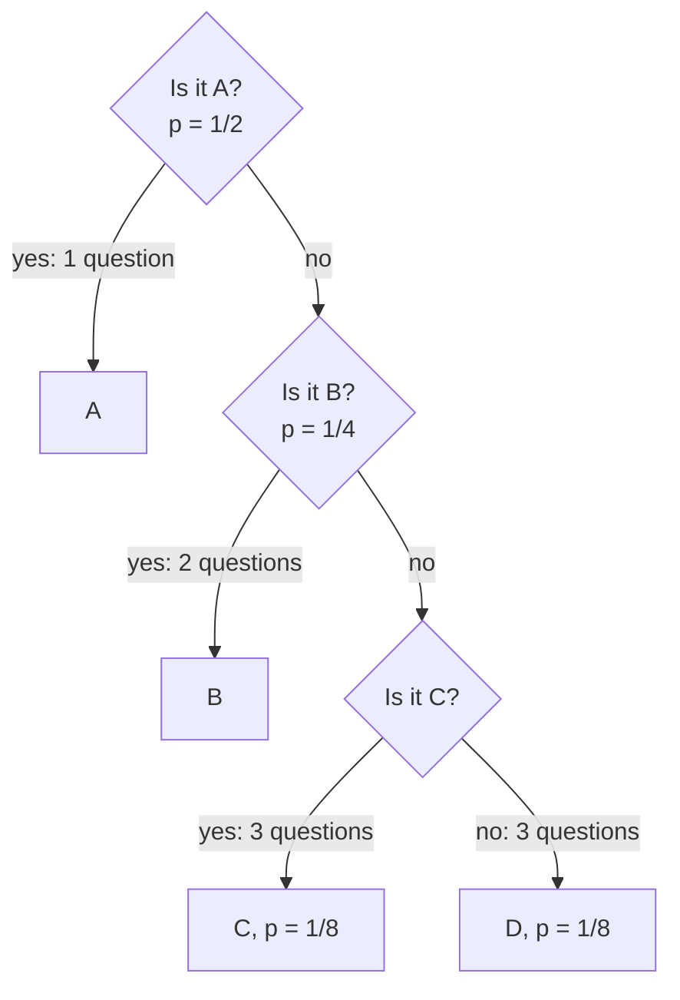

How uncertain is a prediction? A model that says "cat: 0.97" is far more certain than one that says "cat: 0.3, dog: 0.3, fox: 0.2, wolf: 0.2", and **entropy** puts a precise number on that difference. It comes from information theory, Claude Shannon's mathematics of communication, and it underpins the next two lessons: [cross-entropy](/learn/essential-mathematics-for-machine-learning/cross-entropy), the loss that trains almost every classifier and language model, and [KL divergence](/learn/essential-mathematics-for-machine-learning/kl-divergence), which compares two distributions. You will also meet entropy directly when decision trees choose splits, when you tune an LLM's sampling temperature, and when you measure how unsure a model is.

## Surprise: information in a single outcome

Start with one event. If something you were sure of happens, you learn nothing. If something very unlikely happens, you learn a lot. Shannon defined the **information content** (or **surprisal**) of an outcome with probability $p$ as

$$
I(x) = -\log p(x) = \log \frac{1}{p(x)}
$$

This is the only sensible choice that satisfies three requirements: a certain event ($p = 1$) carries zero information, rarer events carry more, and the information from two independent events adds up. Independence multiplies probabilities, and the logarithm turns that product into a sum.

| Outcome probability | Surprise in bits ($\log_2$) |
| --- | --- |
| 1 | 0 |
| 1/2 | 1 |
| 1/4 | 2 |
| 1/8 | 3 |
| 1/1024 | 10 |

A fair coin landing heads carries exactly one bit: it answers one yes-or-no question.

## Entropy: average surprise

The **entropy** of a discrete distribution $p$ over outcomes $x$ is the expected surprise:

$$
H(p) = \mathbb{E}_{x \sim p}\big[-\log p(x)\big] = -\sum_{x} p(x)\log p(x)
$$

By convention $0 \log 0 = 0$, because outcomes that never happen contribute nothing. Entropy measures how unpredictable a single draw from $p$ is, on average.

### Bits versus nats

The base of the logarithm only sets the unit:

| Log base | Unit | Where you see it |
| --- | --- | --- |
| 2 | bits | Information theory, compression, intuition |
| $e$ | nats | Machine learning code: `np.log`, PyTorch and TensorFlow losses all use natural logs |
| 10 | hartleys (bans) | Rare |

Converting is a single multiplication, since $\log_2 x = \ln x / \ln 2$:

$$
H_{\text{bits}} = \frac{H_{\text{nats}}}{\ln 2} \approx 1.4427\, H_{\text{nats}}
\qquad
1 \text{ bit} = \ln 2 \approx 0.6931 \text{ nats}
$$

> [!WARNING]
> When you compare a loss value with a figure from a paper or another tool, check the unit first. A cross-entropy of 0.69 in nats is 1.0 in bits. Training frameworks report nats unless they say otherwise.

## Worked numbers

```python
import numpy as np
from scipy.stats import entropy

def H(p, base=2):
    p = np.asarray(p, dtype=float)
    p = p[p > 0]                       # 0 * log 0 is taken as 0
    return -np.sum(p * np.log(p)) / np.log(base) + 0.0   # + 0.0 turns -0.0 into 0.0

cases = {
    "fair coin": [0.5, 0.5],
    "biased coin 0.9/0.1": [0.9, 0.1],
    "certain outcome": [1.0, 0.0],
    "fair die": [1/6] * 6,
    "loaded die": [0.5, 0.1, 0.1, 0.1, 0.1, 0.1],
}
for name, p in cases.items():
    print(f"{name:20s} H = {H(p):.4f} bits = {H(p, base=np.e):.4f} nats")

print("scipy check (fair die, bits):", round(entropy([1/6] * 6, base=2), 4))
```

```output
fair coin            H = 1.0000 bits = 0.6931 nats
biased coin 0.9/0.1  H = 0.4690 bits = 0.3251 nats
certain outcome      H = 0.0000 bits = 0.0000 nats
fair die             H = 2.5850 bits = 1.7918 nats
loaded die           H = 2.1610 bits = 1.4979 nats
scipy check (fair die, bits): 2.585
```

`scipy.stats.entropy(p, base=2)` computes the same thing and also normalises `p` if it does not sum to 1. Work through the biased coin by hand once:

$$
H = -\big(0.9\log_2 0.9 + 0.1\log_2 0.1\big) = -\big(0.9 \times (-0.152) + 0.1 \times (-3.322)\big) \approx 0.469 \text{ bits}
$$

Heads is so likely that it carries little surprise, and the rare tails, though very surprising, happens only a tenth of the time.

## Properties worth remembering

- **Never negative.** Every $-\log p(x) \ge 0$ when $p(x) \le 1$, so $H(p) \ge 0$, with equality only when one outcome is certain.
- **Maximised by the uniform distribution.** With $K$ outcomes, $H(p) \le \log K$, reached only when every outcome has probability $1/K$. A fair die has $\log_2 6 \approx 2.585$ bits; any loaded die has less.
- **Additive for independent variables.** Two independent fair coins together have 2 bits.
- **Depends only on the probabilities**, not on the labels or values of the outcomes. Relabelling the faces of a die does not change its entropy.

For two outcomes, $H(p) = -p\log_2 p - (1-p)\log_2(1-p)$ is the **binary entropy function**: 0 at $p = 0$ or $1$, rising to a peak of 1 bit at $p = 0.5$.

## Entropy as the cost of communication

Shannon's source coding theorem gives entropy a concrete meaning: it is the minimum average number of bits per symbol that any lossless code can achieve. Take four symbols with probabilities $\tfrac{1}{2}, \tfrac{1}{4}, \tfrac{1}{8}, \tfrac{1}{8}$. Their entropy is

$$
\tfrac{1}{2}(1) + \tfrac{1}{4}(2) + \tfrac{1}{8}(3) + \tfrac{1}{8}(3) = 1.75 \text{ bits}
$$

An optimal strategy for guessing the symbol with yes-or-no questions asks about the most likely outcome first:



The path lengths become the code words `0`, `10`, `110`, `111`, and the average number of questions is exactly 1.75, matching the entropy. Common symbols get short codes and rare ones long codes, with each length equal to the symbol's surprise. Every compression format exploits this.

> [!KEY]
> Entropy is the average number of bits needed to encode outcomes drawn from $p$ when you use the best code for $p$. Cross-entropy, in the next lesson, is the cost when you use a code designed for a *different* distribution.

## Entropy in machine learning

### Decision trees

A decision tree, which you will build in [decision trees](/learn/supervised-learning-algorithms/decision-trees), chooses splits that make the class labels in each branch less mixed. The **information gain** of a split is the parent's entropy minus the weighted average entropy of the children. A node with 8 positives and 8 negatives has 1 bit of entropy; a split into two branches of 8, each with a 6-to-2 mix, leaves $H(0.75, 0.25) \approx 0.811$ bits in each, a gain of about $0.189$ bits.

### Uncertainty and LLM sampling

The entropy of a classifier's output, or of a language model's next-token distribution, measures how unsure it is. Low entropy means the model has effectively chosen; high entropy means many options remain. Sampling **temperature** $T$ divides the logits before the softmax and directly controls this:

```python
def softmax(z):
    e = np.exp(z - z.max())
    return e / e.sum()

def entropy_bits(p):
    return -np.sum(p * np.log2(p))

logits = np.array([2.0, 1.0, 0.5, 0.0])
for T in [0.5, 1.0, 2.0]:
    p = softmax(logits / T)
    print(f"T={T}: probs={np.round(p, 3)}  entropy={entropy_bits(p):.3f} bits")
```

```output
T=0.5: probs=[0.831 0.112 0.041 0.015]  entropy=0.859 bits
T=1.0: probs=[0.579 0.213 0.129 0.078]  entropy=1.601 bits
T=2.0: probs=[0.409 0.248 0.193 0.15 ]  entropy=1.896 bits
```

Lower temperature sharpens the distribution and lowers entropy, giving more predictable text. Higher temperature flattens it towards the uniform maximum of $\log_2 4 = 2$ bits, giving more varied text.

### Entropy bonuses

In reinforcement learning, policy-gradient methods often add an **entropy bonus** to the objective so that the policy does not collapse onto one action too early and keeps exploring.

## Exercises

**1.** Compute the entropy in bits of a distribution over 8 equally likely outcomes, and of $[0.7, 0.1, 0.1, 0.1]$.

<details>
<summary>Show solution</summary>

Uniform over 8: $\log_2 8 = 3$ bits. For $[0.7, 0.1, 0.1, 0.1]$: $-(0.7\log_2 0.7 + 3 \times 0.1\log_2 0.1) = 0.3602 + 0.9966 \approx 1.357$ bits.

```python
print(H([1/8] * 8), round(H([0.7, 0.1, 0.1, 0.1]), 4))
```

```output
3.0 1.3568
```

</details>

**2.** A model reports a mean predictive entropy of 1.2 nats. What is that in bits?

<details>
<summary>Show solution</summary>

Divide by $\ln 2$: $1.2 / 0.6931 \approx 1.731$ bits.

</details>

**3.** Without computing, rank these by entropy: $[0.25, 0.25, 0.25, 0.25]$, $[1, 0, 0, 0]$, $[0.4, 0.4, 0.1, 0.1]$.

<details>
<summary>Show solution</summary>

$[1, 0, 0, 0]$ has 0 bits (certain), $[0.4, 0.4, 0.1, 0.1]$ is in between, and the uniform distribution has the maximum, 2 bits. (The middle one is about 1.722 bits.)

</details>

```quiz
[
  {
    "q": "What is the entropy of a fair coin flip, in bits and in nats?",
    "options": [
      "1 bit and 1 nat",
      "0.5 bits and 0.693 nats",
      "1 bit and about 0.693 nats",
      "2 bits and about 1.386 nats"
    ],
    "answer": 2,
    "why": "H = -2 × 0.5 log 0.5 = log 2, which is 1 in base 2 and ln 2 ≈ 0.693 in base e."
  },
  {
    "q": "For a distribution over K outcomes, which distribution has the highest entropy?",
    "options": [
      "The uniform distribution",
      "One with all mass on a single outcome",
      "One with mass split equally between two outcomes",
      "It depends on what the outcomes are labelled"
    ],
    "answer": 0,
    "why": "Entropy is maximised, at log K, when every outcome is equally likely. Labels do not matter."
  },
  {
    "q": "Lowering an LLM's sampling temperature from 1.0 to 0.5 does what to the entropy of its next-token distribution?",
    "options": [
      "Raises it",
      "Leaves it unchanged",
      "Makes it exactly zero",
      "Lowers it"
    ],
    "answer": 3,
    "why": "Dividing logits by a smaller T sharpens the softmax, concentrating probability on the top tokens and reducing entropy."
  },
  {
    "q": "In a decision tree, information gain is:",
    "options": [
      "The number of samples in the child nodes",
      "The parent's entropy minus the weighted average entropy of the children",
      "The entropy of the parent node",
      "The depth of the tree"
    ],
    "answer": 1,
    "why": "A good split makes the children purer, so their weighted entropy is lower than the parent's."
  }
]
```
