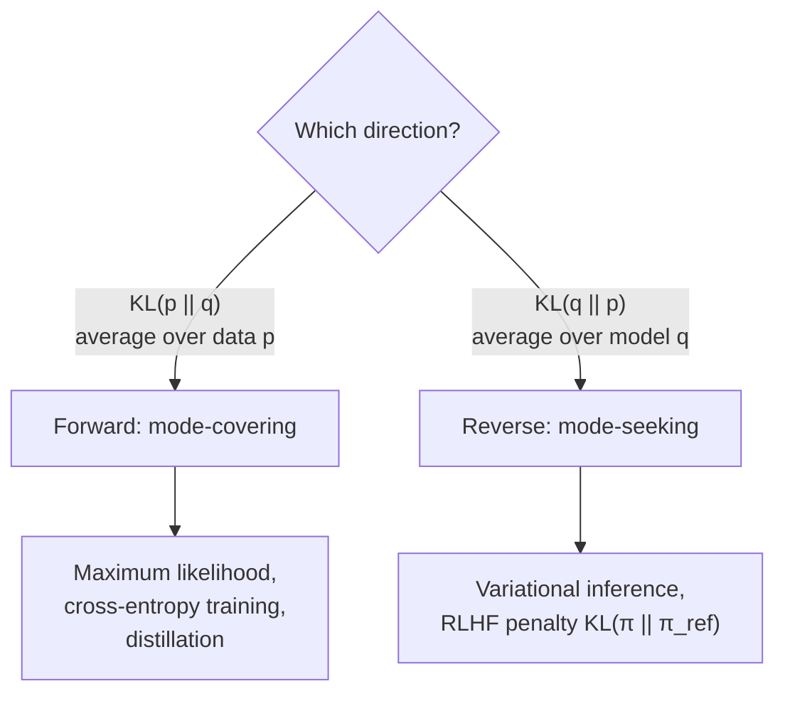

Many problems in AI come down to comparing two probability distributions. Is the model's predicted distribution close to the data? Is a small student model imitating a large teacher? Has a chat model, fine-tuned with human feedback, drifted too far from the model it started as? The standard tool for all three is the **Kullback-Leibler (KL) divergence**. You met it in the [cross-entropy](/learn/essential-mathematics-for-machine-learning/cross-entropy) lesson as the extra cost of using the wrong code. This lesson studies it directly: its definition and properties, why its direction matters so much, and where it appears in classification, knowledge distillation, variational autoencoders and the KL penalties of RLHF and DPO.

## Definition

For two discrete distributions $p$ and $q$ over the same outcomes, the KL divergence of $q$ from $p$ is

$$
D_{\text{KL}}(p \,\|\, q) = \sum_{x} p(x)\log\frac{p(x)}{q(x)} = \mathbb{E}_{x \sim p}\big[\log p(x) - \log q(x)\big]
$$

Read it as: draw outcomes from $p$, and average how much more log-probability $p$ gives them than $q$ does. Splitting the log of the ratio gives the link to the previous lessons:

$$
D_{\text{KL}}(p \,\|\, q) = \underbrace{-\sum_x p(x)\log q(x)}_{H(p,\,q)} - \underbrace{\Big(-\sum_x p(x)\log p(x)\Big)}_{H(p)}
$$

KL divergence is cross-entropy minus entropy: the number of extra bits (with $\log_2$) or nats (with $\ln$) you pay per outcome for encoding data from $p$ with a code built for $q$. For continuous distributions the sum becomes an integral over densities.

## Properties

| Property | Statement | Consequence |
| --- | --- | --- |
| Non-negative | $D_{\text{KL}}(p \,\|\, q) \ge 0$ (Gibbs' inequality) | Cross-entropy is never below entropy |
| Zero only at equality | $D_{\text{KL}}(p \,\|\, q) = 0$ exactly when $p = q$ | A perfect model has zero KL |
| Asymmetric | $D_{\text{KL}}(p \,\|\, q) \ne D_{\text{KL}}(q \,\|\, p)$ in general | Not a distance; the direction is a modelling choice |
| Unbounded | Infinite if $q(x) = 0$ anywhere $p(x) > 0$ | Models must never assign exactly zero probability |
| No triangle inequality | Not a metric | Call it a "divergence", not a "distance" |

```python
import numpy as np
from scipy.stats import entropy

def kl(p, q):
    p, q = np.asarray(p, float), np.asarray(q, float)
    mask = p > 0                                   # 0 * log(0 / q) = 0
    return np.sum(p[mask] * np.log(p[mask] / q[mask]))

p = [0.8, 0.15, 0.05]
q = [0.4, 0.4, 0.2]
print(f"KL(p||q) = {kl(p, q):.4f} nats   KL(q||p) = {kl(q, p):.4f} nats")
print(f"scipy entropy(p, q) = {entropy(p, q):.4f}")
```

```output
KL(p||q) = 0.3381 nats   KL(q||p) = 0.3923 nats
scipy entropy(p, q) = 0.3381
```

With two arguments, `scipy.stats.entropy(p, q)` returns $D_{\text{KL}}(p \,\|\, q)$ in nats. The two directions differ, and on less balanced examples they can differ by large factors.

## Forward versus reverse KL

When you fit a model $q$ to a target $p$, you must choose which way round to put them, and the choice changes the answer.

- **Forward KL**, $D_{\text{KL}}(p \,\|\, q)$, averages over $p$. It becomes huge wherever $p$ has mass and $q$ is small, so $q$ is forced to **cover** every region $p$ uses, even at the cost of putting mass in places $p$ does not. It is called **mean-seeking** or **mode-covering**.
- **Reverse KL**, $D_{\text{KL}}(q \,\|\, p)$, averages over $q$. It becomes huge wherever $q$ has mass and $p$ is small, so $q$ avoids regions $p$ rules out and is content to sit on **one mode**. It is called **mode-seeking**.

See it on a target with two peaks and a gap between them:

```python
p = np.array([0.49, 0.02, 0.49])           # two modes, a gap in the middle
candidates = {
    "cover both (flat)": np.array([0.34, 0.32, 0.34]),
    "pick one mode":     np.array([0.96, 0.02, 0.02]),
}
for name, q in candidates.items():
    print(f"{name:18s} forward KL(p||q) = {kl(p, q):.4f}   reverse KL(q||p) = {kl(q, p):.4f}")
```

```output
cover both (flat)  forward KL(p||q) = 0.3027   reverse KL(q||p) = 0.6387
pick one mode      forward KL(p||q) = 1.2378   reverse KL(q||p) = 0.5817
```

Forward KL prefers the flat model that covers both peaks (0.30 against 1.24). Reverse KL prefers the model that commits to one peak (0.58 against 0.64), because the flat model wastes probability on the gap that $p$ considers unlikely.



> [!KEY]
> Training with cross-entropy minimises forward KL from the data to the model, so models try to cover everything the data does. Penalties written as $D_{\text{KL}}(\pi \,\|\, \pi_{\text{ref}})$ in RLHF are reverse KL from the reference, and they only need samples from the model being trained.

## KL between two Gaussians

For continuous distributions, KL is an integral, but for two [normal distributions](/learn/probability-and-statistics/normal-distribution) $\mathcal{N}(\mu_1, \sigma_1^2)$ and $\mathcal{N}(\mu_2, \sigma_2^2)$ it has a closed form:

$$
D_{\text{KL}} = \log\frac{\sigma_2}{\sigma_1} + \frac{\sigma_1^2 + (\mu_1 - \mu_2)^2}{2\sigma_2^2} - \frac{1}{2}
$$

```python
from scipy.integrate import quad
from scipy.stats import norm

def kl_gauss(m1, s1, m2, s2):
    return np.log(s2 / s1) + (s1**2 + (m1 - m2)**2) / (2 * s2**2) - 0.5

m1, s1, m2, s2 = 0.0, 1.0, 1.0, 2.0
closed = kl_gauss(m1, s1, m2, s2)
integrand = lambda x: norm.pdf(x, m1, s1) * (norm.logpdf(x, m1, s1) - norm.logpdf(x, m2, s2))
numeric, _ = quad(integrand, -20, 20)
print(f"closed form: {closed:.4f} nats   numerical integral: {numeric:.4f} nats")
print(f"reverse direction: {kl_gauss(m2, s2, m1, s1):.4f} nats")
```

```output
closed form: 0.4431 nats   numerical integral: 0.4431 nats
reverse direction: 1.3069 nats
```

**Variational autoencoders** use this formula in their loss, summed over latent dimensions, to keep each encoded distribution close to a standard normal $\mathcal{N}(0, 1)$.

## Knowledge distillation

In **knowledge distillation**, a small student model is trained to match a large teacher's output distribution rather than only the hard labels. The teacher's probabilities on the wrong classes carry information (a picture of a husky looks more like a wolf than a teapot) that one-hot labels throw away. Both models' logits are divided by a temperature $T > 1$ to soften the distributions, and the student minimises

$$
\mathcal{L}_{\text{distill}} = T^2 \, D_{\text{KL}}\big(p_{\text{teacher}}^{(T)} \,\|\, p_{\text{student}}^{(T)}\big)
$$

usually mixed with the ordinary cross-entropy on true labels. The $T^2$ factor keeps gradient magnitudes comparable as $T$ changes, since softening shrinks the gradients by roughly $1/T^2$.

```python
def softmax(z, T=1.0):
    e = np.exp((z - z.max()) / T)
    return e / e.sum()

teacher = np.array([6.0, 3.0, 2.5, -1.0])      # logits for 4 classes
student = np.array([4.0, 0.5, 2.0, 0.0])

for T in [1.0, 4.0]:
    pt, ps = softmax(teacher, T), softmax(student, T)
    print(f"T={T}: teacher={np.round(pt, 3)} student={np.round(ps, 3)} "
          f"KL={kl(pt, ps):.4f}  T^2*KL={T**2 * kl(pt, ps):.4f}")
```

```output
T=1.0: teacher=[0.925 0.046 0.028 0.001] student=[0.845 0.026 0.114 0.015] KL=0.0696  T^2*KL=0.0696
T=4.0: teacher=[0.485 0.229 0.202 0.084] student=[0.418 0.174 0.254 0.154] KL=0.0373  T^2*KL=0.5974
```

At $T = 1$ the teacher's opinion about the wrong classes is squeezed into a few per cent. At $T = 4$ it is clearly visible that the teacher ranks class 1 above class 2 while the student has them the other way round, and the scaled loss is much larger, giving the student a strong signal to fix it. The [distillation](/learn/advanced-llm-engineering/distillation) lesson applies this to LLMs.

## The KL penalty in RLHF and DPO

When a language model is fine-tuned with reinforcement learning from human feedback, a reward model scores its responses. Maximising reward alone tends to go wrong: the policy finds odd outputs that exploit flaws in the reward model, and its language degrades. The standard fix is to penalise drift from a frozen **reference model** $\pi_{\text{ref}}$, usually the supervised fine-tuned starting point:

$$
\max_{\pi}\; \mathbb{E}_{x,\; y \sim \pi(\cdot \mid x)}\big[r(x, y)\big] \;-\; \beta\, D_{\text{KL}}\big(\pi(\cdot \mid x) \,\|\, \pi_{\text{ref}}(\cdot \mid x)\big)
$$

Here $x$ is a prompt, $y$ a sampled response, $r$ the reward and $\beta > 0$ sets how tightly the policy is held to the reference. Because the KL is averaged over the policy's own samples, it can be estimated from the log-probability ratio of the tokens it actually generated, with no need to sum over the vocabulary:

```python
rng = np.random.default_rng(42)
policy    = np.array([0.50, 0.30, 0.15, 0.05])   # fine-tuned model, one position
reference = np.array([0.25, 0.25, 0.25, 0.25])   # frozen starting model

exact = np.sum(policy * np.log(policy / reference))

tokens = rng.choice(4, size=5000, p=policy)       # sample from the policy
log_ratio = np.log(policy[tokens]) - np.log(reference[tokens])
print(f"exact KL:              {exact:.4f} nats")
print(f"sampled estimate:      {log_ratio.mean():.4f} nats")
print(f"first five log-ratios: {np.round(log_ratio[:5], 3)}")
```

```output
exact KL:              0.2442 nats
sampled estimate:      0.2525 nats
first five log-ratios: [ 0.182  0.693 -0.511  0.182  0.693]
```

Individual log-ratios can be negative, but their average estimates a non-negative KL. **Direct Preference Optimization (DPO)** starts from this same KL-regularised objective, solves for the optimal policy in closed form, and turns the problem into a simple classification-style loss on preference pairs, where $\beta$ plays the same role. See [RLHF fundamentals](/learn/advanced-llm-engineering/rlhf-fundamentals) and [DPO](/learn/advanced-llm-engineering/dpo) for the full methods.

> [!WARNING]
> Check argument order in library functions. PyTorch's `torch.nn.functional.kl_div(input, target)` expects `input` to be the model's **log**-probabilities and `target` the reference probabilities, and computes $D_{\text{KL}}(\text{target} \,\|\, \text{model})$. Use `reduction="batchmean"` to get the mathematically correct per-example average.

## Exercises

**1.** Compute $D_{\text{KL}}(p \,\|\, q)$ in bits for $p = [0.5, 0.5]$ and $q = [0.9, 0.1]$, and then the reverse.

<details>
<summary>Show solution</summary>

$D_{\text{KL}}(p \,\|\, q) = 0.5\log_2\frac{0.5}{0.9} + 0.5\log_2\frac{0.5}{0.1} \approx -0.424 + 1.161 = 0.737$ bits. Reverse: $0.9\log_2\frac{0.9}{0.5} + 0.1\log_2\frac{0.1}{0.5} \approx 0.763 - 0.232 = 0.531$ bits.

```python
p, q = np.array([0.5, 0.5]), np.array([0.9, 0.1])
print(round(kl(p, q) / np.log(2), 4), round(kl(q, p) / np.log(2), 4))
```

```output
0.737 0.531
```

</details>

**2.** A model assigns probability exactly 0 to a token that appears in the test data. What happens to the forward KL and the cross-entropy? How do practical models avoid this?

<details>
<summary>Show solution</summary>

Both become infinite, because the term $p(x)\log\frac{p(x)}{0}$ is unbounded. Softmax outputs are always strictly positive, which avoids exact zeros; label smoothing and clipping probabilities (as in the BCE code earlier in the module) add further protection.

</details>

**3.** In the RLHF objective, what would you expect to happen if $\beta$ were set to 0? And if it were very large?

<details>
<summary>Show solution</summary>

With $\beta = 0$ there is no penalty: the policy maximises reward alone and is prone to reward hacking and degenerate text. With a very large $\beta$ the KL term dominates, so the policy stays essentially equal to the reference and learns little from the reward.

</details>

```quiz
[
  {
    "q": "Which statement about KL divergence is true?",
    "options": [
      "It is symmetric: KL(p || q) = KL(q || p)",
      "It can be negative when q is a better model than p",
      "It equals cross-entropy minus entropy: H(p, q) - H(p)",
      "It satisfies the triangle inequality"
    ],
    "answer": 2,
    "why": "D_KL(p || q) = H(p, q) - H(p). It is non-negative, asymmetric and not a metric."
  },
  {
    "q": "Training a classifier by minimising cross-entropy on data is equivalent to minimising which quantity?",
    "options": [
      "Forward KL from the data distribution to the model, KL(p_data || q_model)",
      "Reverse KL, KL(q_model || p_data)",
      "The entropy of the model's predictions",
      "The entropy of the data"
    ],
    "answer": 0,
    "why": "H(p, q) = H(p) + KL(p || q), and H(p) is fixed by the data, so minimising cross-entropy minimises the forward KL."
  },
  {
    "q": "Why is a temperature T > 1 used in knowledge distillation?",
    "options": [
      "To make training faster",
      "To make the student more confident than the teacher",
      "To remove the need for true labels entirely",
      "To soften the teacher's distribution so information about the wrong classes becomes visible"
    ],
    "answer": 3,
    "why": "At T = 1 the teacher's wrong-class probabilities are tiny. Softening reveals their relative sizes, which is the knowledge the student learns from."
  },
  {
    "q": "What role does the KL penalty play in RLHF?",
    "options": [
      "It speeds up the reward model",
      "It keeps the fine-tuned policy close to a reference model to limit reward hacking and degradation",
      "It replaces the reward model",
      "It measures accuracy on preference data"
    ],
    "answer": 1,
    "why": "The term β·KL(π || π_ref) stops the policy drifting far from the reference while it maximises reward."
  }
]
```
