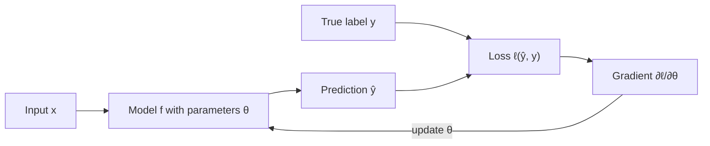
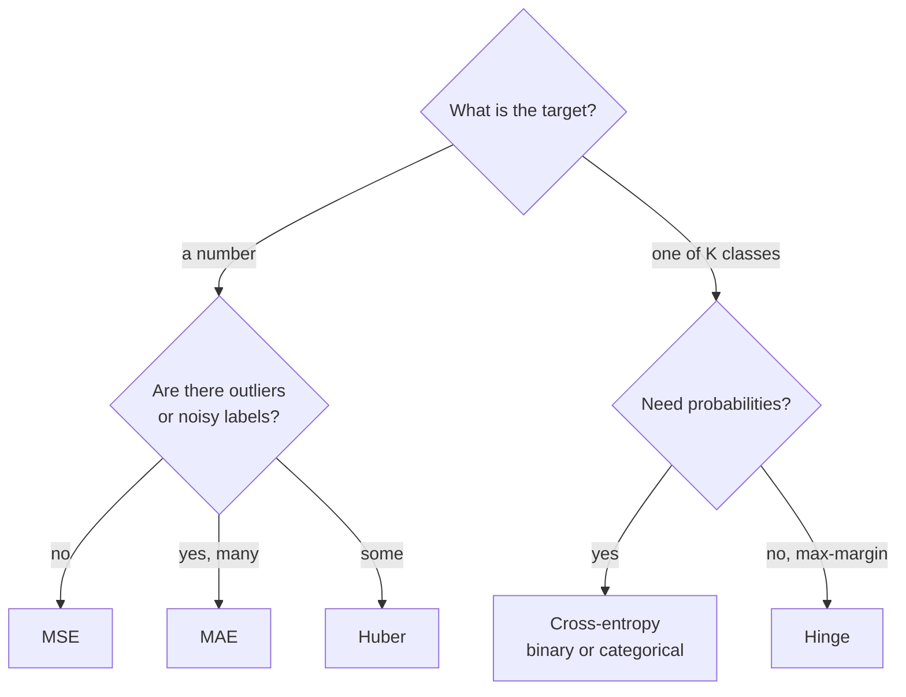

Training a model means making it less wrong, and "less wrong" has to be a number before a computer can work on it. A **loss function** turns the gap between a model's predictions and the true answers into a single number that gets smaller as the model gets better. Gradient descent, from [the calculus module](/learn/calculus/gradient-descent), then adjusts the parameters to push that number down. The choice of loss decides what "better" means: whether a few large errors matter more than many small ones, whether outliers are trusted, and whether the model is rewarded for honest probabilities. This module ties together the linear algebra, calculus and probability you have learned into the maths of training, and the loss is where it starts.

## Loss, cost and objective

The terms are used loosely, but the usual convention is:

| Term | Meaning |
| --- | --- |
| Loss | The error on one example, $\ell(\hat{y}, y)$, where $\hat{y}$ is the prediction and $y$ the true value |
| Cost (or empirical risk) | The average loss over a dataset or batch |
| Objective | Whatever the optimiser minimises: the cost plus any extras such as a regularisation penalty |

For a dataset of $n$ examples and model parameters $\theta$, the cost is

$$
J(\theta) = \frac{1}{n} \sum_{i=1}^{n} \ell\big(f_\theta(x_i),\, y_i\big)
$$

where $f_\theta(x_i)$ is the model's prediction for input $x_i$. Everything in training revolves around this one function.



A good loss has to do two jobs at once. It must measure what you actually care about, and it must be differentiable (or nearly so) so that its gradient gives a useful direction to move in. Accuracy fails the second test: it is flat almost everywhere and jumps when a prediction crosses a threshold, so its gradient is zero and tells the optimiser nothing. That is why classifiers are trained on cross-entropy and only *evaluated* on accuracy.

## Regression losses: MSE, MAE and Huber

For a residual $r_i = y_i - \hat{y}_i$:

$$
\text{MSE} = \frac{1}{n}\sum_{i=1}^{n} r_i^2
\qquad
\text{MAE} = \frac{1}{n}\sum_{i=1}^{n} |r_i|
$$

**Mean squared error** squares each residual, so an error of 10 costs 100 times as much as an error of 1. Its gradient, $-2r_i$ per example, is proportional to the error: large mistakes get large corrections, and the corrections shrink smoothly as the model approaches the answer. MSE predicts the **mean** of the target given the input.

**Mean absolute error** charges each unit of error equally. Its gradient is $\pm 1$ regardless of size, so a single wild label cannot dominate training. MAE predicts the **median**. Its drawbacks are a kink at zero, where the gradient is undefined, and the fact that the gradient does not shrink near the optimum, which can make the final steps jittery.

**Huber loss** combines the two. With a threshold $\delta > 0$:

$$
L_\delta(r) =
\begin{cases}
\tfrac{1}{2} r^2 & \text{if } |r| \le \delta \\
\delta\left(|r| - \tfrac{1}{2}\delta\right) & \text{otherwise}
\end{cases}
$$

It is quadratic for small errors (smooth near the optimum) and linear for large ones (robust to outliers). The two pieces meet with matching slope at $|r| = \delta$.

See the difference when one label is corrupted:

```python
import numpy as np

y_true = np.array([3.0, 5.0, 2.5, 7.0, 4.0])
y_pred = np.array([2.5, 5.0, 3.0, 8.0, 4.5])

def mse(y, p):
    return np.mean((y - p) ** 2)

def mae(y, p):
    return np.mean(np.abs(y - p))

def huber(y, p, delta=1.0):
    r = np.abs(y - p)
    quad = 0.5 * r ** 2
    lin = delta * (r - 0.5 * delta)
    return np.mean(np.where(r <= delta, quad, lin))

print(f"clean:   MSE={mse(y_true, y_pred):.3f}  MAE={mae(y_true, y_pred):.3f}  Huber={huber(y_true, y_pred):.3f}")

y_out = y_true.copy()
y_out[3] = 27.0          # one corrupted label
print(f"outlier: MSE={mse(y_out, y_pred):.3f}  MAE={mae(y_out, y_pred):.3f}  Huber={huber(y_out, y_pred):.3f}")
```

```output
clean:   MSE=0.350  MAE=0.500  Huber=0.175
outlier: MSE=72.350  MAE=4.100  Huber=3.775
```

One bad label multiplied the MSE by about 200 and the MAE by about 8. Under MSE, that single point now supplies almost all of the gradient, and the model will bend itself towards it.

> [!KEY]
> MSE trusts every label and punishes big errors hardest; MAE and Huber assume some labels may be wrong and refuse to let them dominate. Pick based on what you believe about your data, not on which number looks smaller. Losses on different scales cannot be compared with each other at all.

## Binary cross-entropy

For classification the model outputs a probability. In binary classification, $\hat{p} = \sigma(z)$ is the predicted probability that $y = 1$, where $z$ is the model's raw score (the **logit**) and $\sigma$ is the sigmoid. **Binary cross-entropy** (also called log loss) is

$$
\text{BCE} = -\frac{1}{n}\sum_{i=1}^{n} \Big[ y_i \log \hat{p}_i + (1 - y_i)\log(1 - \hat{p}_i) \Big]
$$

Only one term is active per example: $-\log \hat{p}$ when $y=1$ and $-\log(1-\hat{p})$ when $y=0$. So the loss is simply minus the log of the probability the model gave to the correct answer. Assigning 0.9 to the truth costs 0.105; assigning 0.01 costs 4.6. The penalty grows without limit as the model becomes confidently wrong.

```python
def binary_cross_entropy(y, p, eps=1e-12):
    p = np.clip(p, eps, 1 - eps)          # avoid log(0)
    return -np.mean(y * np.log(p) + (1 - y) * np.log(1 - p))

y = np.array([1, 0, 1, 1])
p = np.array([0.9, 0.2, 0.6, 0.99])
print(f"BCE, decent model:      {binary_cross_entropy(y, p):.4f}")
p_bad = np.array([0.9, 0.2, 0.6, 0.01])   # confidently wrong on the last one
print(f"BCE, one confident miss: {binary_cross_entropy(y, p_bad):.4f}")
```

```output
BCE, decent model:      0.2123
BCE, one confident miss: 1.3611
```

The two models differ on a single example, yet the loss is six times larger, because cross-entropy cares not only about whether the model was wrong but about *how* confident it was while being wrong. Why the logarithm, rather than squared error on probabilities? The [maximum likelihood](/learn/essential-mathematics-for-machine-learning/maximum-likelihood-estimation) and [cross-entropy](/learn/essential-mathematics-for-machine-learning/cross-entropy) lessons answer that properly. A practical reason: combined with a sigmoid, the gradient with respect to the logit is just $\hat{p} - y$, which never vanishes when the model is badly wrong.

## Categorical cross-entropy

With $K$ classes, the model produces $K$ logits, and the softmax turns them into probabilities $\hat{p}_{i,k}$. If $y_i$ is the index of the correct class:

$$
\text{CCE} = -\frac{1}{n}\sum_{i=1}^{n} \log \hat{p}_{i,\,y_i}
$$

Again: minus the log of the probability given to the right answer, averaged. Binary cross-entropy is the special case $K = 2$.

```python
def categorical_cross_entropy(y_idx, probs):
    return -np.mean(np.log(probs[np.arange(len(y_idx)), y_idx]))

probs = np.array([[0.7, 0.2, 0.1],
                  [0.1, 0.8, 0.1],
                  [0.3, 0.3, 0.4]])
labels = np.array([0, 1, 2])
print(f"CCE: {categorical_cross_entropy(labels, probs):.4f}")
```

```output
CCE: 0.4987
```

Language models use exactly this loss, with $K$ equal to the vocabulary size and one "example" per token position.

> [!WARNING]
> Frameworks usually expect **logits**, not probabilities, in their cross-entropy functions, and apply the softmax or sigmoid internally in a numerically stable way. Applying softmax yourself and then passing the result in is a common silent bug: training runs, but worse.

## Hinge loss

Support vector machines use the **hinge loss**. Labels are $y \in \{-1, +1\}$ and the model outputs a raw score $s$:

$$
\ell_{\text{hinge}}(s, y) = \max(0,\; 1 - y\,s)
$$

The product $y\,s$ is the **margin**: positive when the prediction has the right sign, large when it is confidently right. Hinge loss is zero once the margin exceeds 1, so correctly classified points far from the boundary contribute nothing. Only points that are wrong, or right by too little, push on the model.

```python
def hinge(y_pm, score):
    return np.mean(np.maximum(0, 1 - y_pm * score))

y_pm = np.array([1, -1, 1, -1])
score = np.array([2.5, -0.3, 0.4, 1.2])
print("per-example hinge:", np.maximum(0, 1 - y_pm * score))
print(f"mean hinge: {hinge(y_pm, score):.4f}")
```

```output
per-example hinge: [0.  0.7 0.6 2.2]
mean hinge: 0.8750
```

The first example (margin 2.5) costs nothing. The second and third are correct but inside the margin. The fourth is wrong. Unlike cross-entropy, hinge loss does not produce calibrated probabilities, which is why it is rare in deep learning but central to [support vector machines](/learn/supervised-learning-algorithms/support-vector-machines).

## Choosing a loss



| Loss | Task | Predicts | Outliers | Notes |
| --- | --- | --- | --- | --- |
| MSE | Regression | Conditional mean | Sensitive | Smooth; default for regression |
| MAE | Regression | Conditional median | Robust | Kink at 0; constant gradient |
| Huber | Regression | Between mean and median | Robust | Needs a choice of $\delta$ |
| Binary cross-entropy | Two classes, or independent labels | Probability | Punishes confident errors | Pass logits to the framework |
| Categorical cross-entropy | One of $K$ classes | Probability distribution | Punishes confident errors | Used for every LLM token |
| Hinge | Two classes | A score, not a probability | Moderate | SVMs; ignores easy points |

The loss is also where you encode business priorities. If a missed fraud case is ten times worse than a false alarm, weight those examples by ten in the loss. You will meet these losses again in [neural network loss functions](/learn/neural-network-fundamentals/loss-functions) and [PyTorch](/learn/pytorch/loss-functions).

## Exercises

**1.** Compute, by hand, the MSE, MAE and Huber loss ($\delta = 1$) for residuals $[0.5, -2, 3]$. Then check with the functions above.

<details>
<summary>Show solution</summary>

MSE $= (0.25 + 4 + 9)/3 = 4.4167$. MAE $= (0.5 + 2 + 3)/3 = 1.8333$. Huber: $0.5 \cdot 0.25 = 0.125$; $1\cdot(2 - 0.5) = 1.5$; $1\cdot(3 - 0.5) = 2.5$; mean $= 4.125/3 = 1.375$.

```python
y = np.array([0.0, 0.0, 0.0])
p = np.array([-0.5, 2.0, -3.0])     # residuals y - p = 0.5, -2, 3
print(mse(y, p), mae(y, p), huber(y, p))
```

```output
4.416666666666667 1.8333333333333333 1.375
```

</details>

**2.** A model predicts $\hat{p} = 0.5$ for every example in a balanced binary dataset. What is its binary cross-entropy in nats? Why is this a useful reference number?

<details>
<summary>Show solution</summary>

Every term is $-\log 0.5 = \log 2 \approx 0.6931$. It is the loss of a model that has learned nothing beyond the class balance. If your training loss is stuck near 0.693 on a balanced binary problem, the model is not learning at all.

</details>

**3.** For the hinge loss, which of these examples produce a non-zero gradient: $(y=+1, s=3)$, $(y=+1, s=0.5)$, $(y=-1, s=0.2)$?

<details>
<summary>Show solution</summary>

Margins are $3$, $0.5$ and $-0.2$. Only margins below 1 give non-zero loss and gradient, so the second and third examples do. The first is beyond the margin and is ignored.

</details>

```quiz
[
  {
    "q": "Why are classifiers trained on cross-entropy rather than directly on accuracy?",
    "options": [
      "Accuracy is too slow to compute",
      "Accuracy has zero gradient almost everywhere, so it gives the optimiser no direction",
      "Cross-entropy always produces a higher accuracy number",
      "Accuracy cannot be computed on batches"
    ],
    "answer": 1,
    "why": "Accuracy only changes when a prediction crosses a threshold, so small parameter changes do not change it. Cross-entropy is smooth and gives a useful gradient."
  },
  {
    "q": "A housing dataset contains a few prices that were entered with three extra zeros. Which loss is the safest default?",
    "options": [
      "MSE",
      "Hinge",
      "Huber",
      "Binary cross-entropy"
    ],
    "answer": 2,
    "why": "Huber behaves like MSE for ordinary errors but grows only linearly for huge ones, so the corrupted labels cannot dominate the gradient."
  },
  {
    "q": "Minimising MSE makes a model predict which statistic of the target given the input?",
    "options": [
      "The conditional mean",
      "The conditional median",
      "The conditional mode",
      "The maximum"
    ],
    "answer": 0,
    "why": "Squared error is minimised by the mean; absolute error is minimised by the median."
  },
  {
    "q": "With labels in {-1, +1}, an example has label +1 and score 0.4. What is its hinge loss?",
    "options": [
      "0",
      "0.4",
      "1.4",
      "0.6"
    ],
    "answer": 3,
    "why": "max(0, 1 - 1 × 0.4) = 0.6. The prediction is correct but inside the margin, so it still costs something."
  }
]
```
