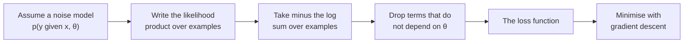

Where do loss functions come from? In the [loss functions](/learn/essential-mathematics-for-machine-learning/loss-functions) lesson, MSE and cross-entropy may have looked like sensible choices someone picked. They are much more than that. Both fall out of a single principle, **maximum likelihood estimation (MLE)**: choose the parameters that make the data you actually observed as probable as possible. Once you see this, a loss function stops being a magic formula and becomes a statement about how you believe the data was generated. That lets you derive the right loss for a new problem, understand what a trained model's outputs mean, and see why "minimise the negative log-likelihood" is the training objective of everything from logistic regression to large language models.

## Probability versus likelihood

In [probability distributions](/learn/probability-and-statistics/probability-distributions) you fixed the parameters and asked how probable different data would be. Likelihood turns this around: the data is fixed, because you have already observed it, and you ask how well different parameter values explain it.

For data $D = \{y_1, \dots, y_n\}$ drawn independently from a model with parameters $\theta$, the **likelihood** is

$$
L(\theta) = p(D \mid \theta) = \prod_{i=1}^{n} p(y_i \mid \theta)
$$

It is the same formula as the joint probability, read as a function of $\theta$. The **maximum likelihood estimate** is

$$
\hat{\theta}_{\text{MLE}} = \arg\max_{\theta}\; L(\theta)
$$

Likelihood is not a probability distribution over $\theta$: it need not sum or integrate to 1 across parameter values. It only ranks them.

## A worked example: a coin

You flip a coin 10 times and get 7 heads. Each flip is Bernoulli with unknown probability of heads $\theta$, so a sequence with $k$ heads in $n$ flips has likelihood $\theta^k(1-\theta)^{n-k}$. Evaluate a few candidates:

```python
import numpy as np

flips = np.array([1, 0, 1, 1, 0, 1, 1, 0, 1, 1])   # 7 heads in 10
for theta in [0.3, 0.5, 0.7, 0.9]:
    log_lik = np.sum(flips * np.log(theta) + (1 - flips) * np.log(1 - theta))
    print(f"theta={theta}: likelihood={np.exp(log_lik):.6f}  log-likelihood={log_lik:.4f}")
print("MLE (sample mean):", flips.mean())
```

```output
theta=0.3: likelihood=0.000075  log-likelihood=-9.4978
theta=0.5: likelihood=0.000977  log-likelihood=-6.9315
theta=0.7: likelihood=0.002224  log-likelihood=-6.1086
theta=0.9: likelihood=0.000478  log-likelihood=-7.6453
MLE (sample mean): 0.7
```

$\theta = 0.7$ explains the data best. You can prove it is the maximum with [derivatives](/learn/calculus/derivatives). The log-likelihood is $k \log\theta + (n-k)\log(1-\theta)$; setting its derivative to zero gives

$$
\frac{k}{\theta} - \frac{n-k}{1-\theta} = 0 \quad\Longrightarrow\quad \hat{\theta} = \frac{k}{n}
$$

The MLE is the observed fraction of heads, which matches intuition.

## Why we always take the log

Notice the raw likelihoods above are tiny. With a realistic dataset of a million examples, the product of a million numbers below 1 underflows to exactly `0.0` in floating point. Taking the logarithm fixes this and changes nothing about the answer:

- The log is strictly increasing, so the $\theta$ that maximises $L$ also maximises $\log L$.
- The log turns the product into a sum, $\log L(\theta) = \sum_i \log p(y_i \mid \theta)$, which is numerically stable and easy to differentiate term by term.
- Sums over examples are exactly what mini-batch [optimisers](/learn/essential-mathematics-for-machine-learning/optimization-algorithms) need: a batch gives an unbiased estimate of the average.

Optimisers minimise, so we flip the sign and average. This is the **negative log-likelihood (NLL)**:

$$
\text{NLL}(\theta) = -\frac{1}{n}\sum_{i=1}^{n} \log p(y_i \mid x_i, \theta)
$$

> [!KEY]
> Maximising likelihood, maximising log-likelihood and minimising average negative log-likelihood all give the same parameters. Almost every probabilistic model in machine learning is trained by minimising an NLL, and the loss you choose is simply the NLL of the noise model you assume.



## Minimising MSE is MLE under Gaussian noise

Assume a regression model $f_\theta(x)$ and that each target is the model's prediction plus Gaussian noise with a fixed variance $\sigma^2$:

$$
y_i = f_\theta(x_i) + \varepsilon_i, \qquad \varepsilon_i \sim \mathcal{N}(0, \sigma^2)
$$

Then each $y_i$ is [normally distributed](/learn/probability-and-statistics/normal-distribution) around the prediction:

$$
p(y_i \mid x_i, \theta) = \frac{1}{\sqrt{2\pi\sigma^2}} \exp\!\left(-\frac{(y_i - f_\theta(x_i))^2}{2\sigma^2}\right)
$$

Take minus the log and sum over the data:

$$
-\log L(\theta) = \frac{n}{2}\log(2\pi\sigma^2) + \frac{1}{2\sigma^2}\sum_{i=1}^{n}\big(y_i - f_\theta(x_i)\big)^2
$$

The first term does not depend on $\theta$, and $\frac{1}{2\sigma^2}$ is a positive constant. Neither changes where the minimum is. What remains to minimise is $\sum_i (y_i - f_\theta(x_i))^2$: the sum of squared errors, which is $n$ times the MSE. **Least squares is maximum likelihood under Gaussian noise.**

Check it numerically. Fit a line once by least squares and once by directly minimising the Gaussian NLL, with $\sigma$ learned as a third parameter:

```python
from scipy.optimize import minimize

rng = np.random.default_rng(0)
x = rng.uniform(0, 10, size=200)
y = 2.0 * x + 1.0 + rng.normal(0, 1.5, size=200)    # true w=2, b=1, sigma=1.5

# 1. Least squares: minimise MSE
w_ls, b_ls = np.polyfit(x, y, deg=1)

# 2. Maximum likelihood: minimise the Gaussian negative log-likelihood
def nll(params):
    w, b, log_sigma = params
    sigma = np.exp(log_sigma)                  # keeps sigma positive
    r = y - (w * x + b)
    return np.sum(0.5 * np.log(2 * np.pi * sigma**2) + r**2 / (2 * sigma**2))

res = minimize(nll, x0=[0.0, 0.0, 0.0])
w_ml, b_ml, log_s = res.x
print(f"least squares: w={w_ls:.4f}  b={b_ls:.4f}")
print(f"max likelihood: w={w_ml:.4f}  b={b_ml:.4f}  sigma={np.exp(log_s):.4f}")
rmse = np.sqrt(np.mean((y - (w_ls * x + b_ls))**2))
print(f"RMS residual of the least-squares fit: {rmse:.4f}")
```

```output
least squares: w=1.9620  b=1.0707
max likelihood: w=1.9620  b=1.0707  sigma=1.5313
RMS residual of the least-squares fit: 1.5313
```

The two methods agree to four decimal places. As a bonus, the MLE of $\sigma$ is the root-mean-square residual: the model estimates its own noise level. Swap the Gaussian for a Laplace distribution, $p(\varepsilon) \propto e^{-|\varepsilon|/b}$, and the same steps give MAE instead.

## Cross-entropy is MLE for a categorical model

Now classification with $K$ classes. The model outputs a probability vector $\hat{\mathbf{p}}_i = \text{softmax}(z_i)$, and assumes the label is drawn from a **categorical distribution** with those probabilities. Writing $\mathbb{1}[y_i = k]$ for 1 if the label is $k$ and 0 otherwise:

$$
p(y_i \mid x_i, \theta) = \prod_{k=1}^{K} \hat{p}_{i,k}^{\;\mathbb{1}[y_i = k]} = \hat{p}_{i,\,y_i}
$$

Every factor except the true class is raised to the power 0 and equals 1. Taking minus the log and averaging:

$$
\text{NLL}(\theta) = -\frac{1}{n}\sum_{i=1}^{n} \log \hat{p}_{i,\,y_i}
$$

This is exactly the categorical cross-entropy from the previous lesson. For two classes, a Bernoulli model with likelihood $\hat{p}^{\,y}(1-\hat{p})^{1-y}$ gives binary cross-entropy in the same way. So training a classifier with cross-entropy *is* maximum likelihood estimation, and an LLM trained on next-token cross-entropy is a maximum likelihood estimate of the distribution of text.

| Assumed distribution of $y$ given $x$ | Negative log-likelihood is | Typical task |
| --- | --- | --- |
| Gaussian, fixed variance | MSE (up to constants) | Regression |
| Laplace | MAE | Robust regression |
| Bernoulli | Binary cross-entropy | Binary classification |
| Categorical | Categorical cross-entropy | Multi-class, next-token prediction |
| Poisson | Poisson NLL | Counts, such as visits per day |

> [!TIP]
> Facing an unusual target, such as counts, durations or bounded values? Ask what distribution the target plausibly follows given the inputs, write its NLL, and use that as the loss. This recipe produces sensible losses where guessing does not.

## Limits of MLE

MLE is powerful but has well-known weaknesses.

- **It overfits small data.** Three heads in three flips gives $\hat{\theta} = 1$, which says tails is impossible. A model that assigns probability 0 to something that then happens has infinite NLL.
- **It ignores prior knowledge.** **Maximum a posteriori (MAP)** estimation, from [Bayes' theorem](/learn/probability-and-statistics/bayes-theorem), maximises $p(\theta \mid D) \propto p(D \mid \theta)\,p(\theta)$. Taking minus the log adds a penalty $-\log p(\theta)$ to the NLL. A Gaussian prior on the weights gives exactly an L2 penalty $\lambda\lVert\theta\rVert^2$, so weight decay is MAP estimation in disguise.
- **Variance estimates are biased.** The MLE of a variance divides by $n$, not $n-1$, so it slightly underestimates the spread for small samples, as you saw in [variance and standard deviation](/learn/probability-and-statistics/variance-and-standard-deviation).
- **It is only as good as the assumed model.** If the noise is heavy-tailed but you assume Gaussian, MLE faithfully gives you MSE and its sensitivity to outliers.

## Exercises

**1.** A die is rolled 20 times with face counts $[2, 3, 5, 1, 4, 5]$. What is the MLE of the probability of each face? (Hint: the categorical MLE generalises the coin result.)

<details>
<summary>Show solution</summary>

The MLE is each count divided by the total: $[0.10, 0.15, 0.25, 0.05, 0.20, 0.25]$. Maximising $\sum_k c_k \log p_k$ subject to $\sum_k p_k = 1$ (with a Lagrange multiplier) gives $p_k = c_k / n$.

</details>

**2.** In the Gaussian derivation, suppose each example has its own known noise level $\sigma_i$. What loss does MLE give now?

<details>
<summary>Show solution</summary>

The NLL becomes $\sum_i \frac{(y_i - f_\theta(x_i))^2}{2\sigma_i^2}$ plus terms independent of $\theta$. That is **weighted least squares**, with weight $1/\sigma_i^2$: noisy measurements count for less.

</details>

**3.** Why does a model trained with cross-entropy suffer a huge loss if it predicts probability 0.0001 for the correct class, and what does that say about the assumption of MLE?

<details>
<summary>Show solution</summary>

The loss for that example is $-\log 0.0001 \approx 9.21$ nats, many times larger than a typical well-predicted example. MLE treats every observation as genuinely drawn from the model, so declaring an observed outcome nearly impossible is heavily penalised. This makes MLE models sensitive to mislabelled data, which is one motivation for label smoothing.

</details>

```quiz
[
  {
    "q": "What is the likelihood function?",
    "options": [
      "The probability distribution over parameter values",
      "The probability of the observed data, viewed as a function of the parameters",
      "The probability that the model is correct",
      "The fraction of correct predictions"
    ],
    "answer": 1,
    "why": "Likelihood uses the same formula as the probability of the data but treats the data as fixed and the parameters as the variable. It need not integrate to 1 over parameters."
  },
  {
    "q": "Minimising mean squared error is equivalent to maximum likelihood under which assumption?",
    "options": [
      "The targets follow a Bernoulli distribution",
      "The noise follows a Laplace distribution",
      "The noise is Gaussian with constant variance",
      "The inputs are normally distributed"
    ],
    "answer": 2,
    "why": "With Gaussian noise of fixed variance, minus the log-likelihood is a constant plus a positive multiple of the sum of squared residuals."
  },
  {
    "q": "Why do we maximise the log-likelihood instead of the likelihood itself?",
    "options": [
      "It gives the same maximiser, turns products into sums and avoids numerical underflow",
      "It gives a different, better estimate",
      "The likelihood cannot be differentiated",
      "Logarithms make the model more accurate"
    ],
    "answer": 0,
    "why": "The log is monotonic, so the argmax is unchanged, and sums of logs are stable and convenient for gradients and mini-batches."
  },
  {
    "q": "Adding an L2 penalty on the weights to the negative log-likelihood corresponds to which estimate?",
    "options": [
      "The MLE with Laplace noise",
      "The unbiased estimate",
      "The method of moments",
      "The MAP estimate with a Gaussian prior on the weights"
    ],
    "answer": 3,
    "why": "MAP adds -log p(θ) to the NLL; for a zero-mean Gaussian prior that term is proportional to the squared norm of the weights."
  }
]
```
