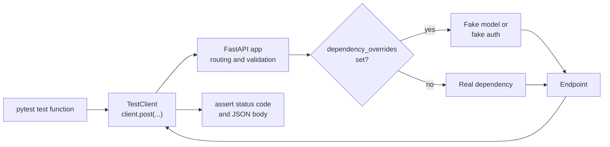

An API is a promise to its clients: this path, with this input, returns this shape and this status. Every change you make, a new model version, a tightened validation rule, a refactored dependency, risks breaking that promise in a way you will not notice until a client does. Automated API tests catch those breaks in seconds. FastAPI makes them unusually easy: `TestClient` exercises the full request pipeline in-process, and dependency overrides let you replace the model, the database and the authentication with fakes.

You have used `TestClient` throughout this module to show real responses. This lesson turns that into a proper **pytest** test suite for the finished sentiment API. General testing practice, such as fixtures, test structure and the difference between unit and integration tests, is covered in more depth in [pytest](/learn/software-engineering/pytest) and [integration testing](/learn/software-engineering/integration-testing).

## The application under test

Here is the sentiment API as it stands at the end of the module, in `sentiment_api/main.py`. It combines pieces from every lesson: a lifespan-loaded model, a model dependency, API-key authentication, validated request and response models, a background task and a streaming endpoint.

```python
import asyncio
import json
from contextlib import asynccontextmanager
from typing import Annotated, Literal

from fastapi import BackgroundTasks, Depends, FastAPI, HTTPException, Request
from fastapi.responses import StreamingResponse
from fastapi.security import APIKeyHeader
from pydantic import BaseModel, Field

POSITIVE = {"good", "great", "love", "excellent", "fast", "helpful"}
NEGATIVE = {"bad", "terrible", "hate", "slow", "broken", "useless"}


class LexiconModel:
    version = "lexicon-v1"

    def predict(self, text: str) -> tuple[str, float]:
        words = [w.strip(".,!?").lower() for w in text.split()]
        score = sum(w in POSITIVE for w in words) - sum(w in NEGATIVE for w in words)
        if score == 0:
            return "neutral", 0.5
        return ("positive" if score > 0 else "negative"), min(0.5 + 0.2 * abs(score), 0.99)


@asynccontextmanager
async def lifespan(app: FastAPI):
    app.state.model = LexiconModel()
    app.state.prediction_log = []
    yield


app = FastAPI(title="Sentiment API", lifespan=lifespan)
api_key_header = APIKeyHeader(name="X-API-Key", auto_error=False)
VALID_KEYS = {"sk-live-abc": "analytics-team"}


def get_model(request: Request) -> LexiconModel:
    return request.app.state.model


def get_client(key: Annotated[str | None, Depends(api_key_header)]) -> str:
    if key not in VALID_KEYS:
        raise HTTPException(401, detail="Invalid or missing API key")
    return VALID_KEYS[key]


class PredictRequest(BaseModel):
    text: str = Field(min_length=1, max_length=2000)


class PredictResponse(BaseModel):
    label: Literal["negative", "neutral", "positive"]
    confidence: float = Field(ge=0, le=1)
    model_version: str


@app.get("/health")
def health():
    return {"status": "ok"}


@app.post("/v1/predict")
def predict(
    req: PredictRequest,
    request: Request,
    background_tasks: BackgroundTasks,
    model: Annotated[LexiconModel, Depends(get_model)],
    client: Annotated[str, Depends(get_client)],
) -> PredictResponse:
    label, conf = model.predict(req.text)
    background_tasks.add_task(request.app.state.prediction_log.append, {"client": client, "label": label})
    return PredictResponse(label=label, confidence=round(conf, 2), model_version=model.version)


async def sse_tokens(text: str):
    for word in ["Mostly", " positive", "."]:
        await asyncio.sleep(0)
        yield f"data: {json.dumps({'token': word})}\n\n"
    yield "data: [DONE]\n\n"


@app.post("/v1/explain")
async def explain(req: PredictRequest, client: Annotated[str, Depends(get_client)]):
    return StreamingResponse(sse_tokens(req.text), media_type="text/event-stream")
```

The project layout:

```text
sentiment-api/
    sentiment_api/
        __init__.py
        main.py
    tests/
        __init__.py
        conftest.py      # shared fixtures
        test_api.py      # the tests
```

## How an API test works



Each test follows the **arrange, act, assert** pattern: set up any overrides or data, send one request, then check the status code and the parts of the body that matter. Because `TestClient` runs the real routing, validation, dependencies and serialisation, these are true end-to-end tests of your HTTP contract, only without a network.

## Fixtures in conftest.py

Fixtures in `tests/conftest.py` are available to every test file. Two are enough here: a plain client, and one with authentication overridden so that tests about predictions do not all need to carry an API key.

```python
import pytest
from fastapi.testclient import TestClient

from sentiment_api.main import app, get_client


@pytest.fixture
def client():
    with TestClient(app) as c:      # runs lifespan: the model is loaded
        yield c


@pytest.fixture
def authed_client(client):
    app.dependency_overrides[get_client] = lambda: "test-client"
    yield client
    app.dependency_overrides.clear()
```

Two details are essential. First, the `with TestClient(app)` block: without it, the lifespan function never runs, `app.state.model` does not exist, and every prediction test fails with an `AttributeError`. Second, `dependency_overrides.clear()` after the `yield`: overrides are stored on the app object, which is shared by every test, so an override left behind leaks into the next test and produces failures that depend on test order.

> [!WARNING]
> Always undo dependency overrides in fixture teardown, never at the end of the test body. If an assertion fails first, the clean-up line never runs and the override leaks into later tests.

## The tests

`tests/test_api.py` covers the success path, validation, authentication, an injected fake model, the background task, streaming and one async test:

```python
import httpx
import pytest

from sentiment_api.main import app, get_model


def test_health(client):
    r = client.get("/health")
    assert r.status_code == 200
    assert r.json() == {"status": "ok"}


@pytest.mark.parametrize(
    ("text", "expected"),
    [
        ("great and helpful", "positive"),
        ("slow and broken", "negative"),
        ("it arrived on tuesday", "neutral"),
    ],
)
def test_predict_labels(authed_client, text, expected):
    r = authed_client.post("/v1/predict", json={"text": text})
    assert r.status_code == 200
    body = r.json()
    assert body["label"] == expected
    assert 0 <= body["confidence"] <= 1


@pytest.mark.parametrize(
    ("payload", "bad_field"),
    [
        ({}, "text"),
        ({"text": ""}, "text"),
        ({"text": "x" * 2001}, "text"),
    ],
)
def test_predict_rejects_invalid_input(authed_client, payload, bad_field):
    r = authed_client.post("/v1/predict", json=payload)
    assert r.status_code == 422
    assert r.json()["detail"][0]["loc"] == ["body", bad_field]


def test_predict_requires_api_key(client):
    r = client.post("/v1/predict", json={"text": "great"})
    assert r.status_code == 401


def test_predict_accepts_real_api_key(client):
    r = client.post("/v1/predict", json={"text": "great"}, headers={"X-API-Key": "sk-live-abc"})
    assert r.status_code == 200


def test_predict_uses_injected_model(authed_client):
    class FakeModel:
        version = "fake-1"

        def predict(self, text):
            return "negative", 0.42

    app.dependency_overrides[get_model] = lambda: FakeModel()
    r = authed_client.post("/v1/predict", json={"text": "anything"})
    assert r.json() == {"label": "negative", "confidence": 0.42, "model_version": "fake-1"}


def test_prediction_is_logged_in_background(authed_client):
    authed_client.post("/v1/predict", json={"text": "love it"})
    assert app.state.prediction_log[-1] == {"client": "test-client", "label": "positive"}


def test_explain_streams_tokens(authed_client):
    with authed_client.stream("POST", "/v1/explain", json={"text": "fine"}) as r:
        assert r.headers["content-type"].startswith("text/event-stream")
        lines = [line for line in r.iter_lines() if line]
    assert lines[0] == 'data: {"token": "Mostly"}'
    assert lines[-1] == "data: [DONE]"


@pytest.mark.anyio
async def test_health_async():
    transport = httpx.ASGITransport(app=app)
    async with httpx.AsyncClient(transport=transport, base_url="http://test") as ac:
        r = await ac.get("/health")
    assert r.status_code == 200
```

Points worth noticing:

- **`parametrize`** turns one test function into several cases. Validation rules are perfect for it: each boundary (missing, empty, one character too long) becomes a row.
- **The fake model** in `test_predict_uses_injected_model` returns a fixed answer, so the test checks the API's wiring (does the endpoint use the injected model and report its version?) independently of the model's behaviour. Real model quality belongs in an evaluation suite, not in API tests.
- **Background tasks** have already run when `TestClient` returns, so their effects can be asserted straight away.
- **Async tests** use `httpx.AsyncClient` with `ASGITransport`. The `anyio` marker comes from the AnyIO pytest plugin, which is installed alongside FastAPI. Note that `ASGITransport` does not run lifespan events, which is why this test only touches `/health`.

## Running the suite

From the project root:

```bash
pytest -v
```

```output
============================= test session starts ==============================
collecting ... collected 13 items

tests/test_api.py::test_health PASSED                                    [  7%]
tests/test_api.py::test_predict_labels[great and helpful-positive] PASSED [ 15%]
tests/test_api.py::test_predict_labels[slow and broken-negative] PASSED  [ 23%]
tests/test_api.py::test_predict_labels[it arrived on tuesday-neutral] PASSED [ 30%]
tests/test_api.py::test_predict_rejects_invalid_input[payload0-text] PASSED [ 38%]
tests/test_api.py::test_predict_rejects_invalid_input[payload1-text] PASSED [ 46%]
tests/test_api.py::test_predict_rejects_invalid_input[payload2-text] PASSED [ 53%]
tests/test_api.py::test_predict_requires_api_key PASSED                  [ 61%]
tests/test_api.py::test_predict_accepts_real_api_key PASSED              [ 69%]
tests/test_api.py::test_predict_uses_injected_model PASSED               [ 76%]
tests/test_api.py::test_prediction_is_logged_in_background PASSED        [ 84%]
tests/test_api.py::test_explain_streams_tokens PASSED                    [ 92%]
tests/test_api.py::test_health_async[asyncio] PASSED                     [100%]

============================== 13 passed in 0.04s ==============================
```

(The real output also starts with a header naming your Python, pytest and plugin versions; it was removed here with `--no-header`.) Thirteen tests across the whole HTTP contract run in a fraction of a second, because there is no server, no network and no real model.

## What a regression looks like

Suppose someone raises `max_length` on `text` from 2000 to 5000 to "help a customer", forgetting that the limit protects inference cost. The suite catches it immediately (output abridged where the long payload is printed):

```output
......F......                                                            [100%]
=================================== FAILURES ===================================
______________ test_predict_rejects_invalid_input[payload2-text] _______________
...
>       assert r.status_code == 422
E       assert 200 == 422
E        +  where 200 = <Response [200 OK]>.status_code

tests/test_api.py:39: AssertionError
=========================== short test summary info ============================
FAILED tests/test_api.py::test_predict_rejects_invalid_input[payload2-text]
1 failed, 12 passed in 0.06s
```

The test ID names the exact case that broke, and the assertion shows that a 2001-character text was accepted. The change may still be the right decision, but now it has to be made deliberately, by updating the test.

> [!KEY]
> Test the contract, not the implementation: status codes, response fields, validation boundaries, authentication outcomes and error formats. These are what clients rely on, and they should only change on purpose.

## What to test in an AI API

| Area | Example checks |
| --- | --- |
| Happy path | Status 200 or 201, every response field present with the right type |
| Validation | Missing fields, empty strings, length and numeric limits, wrong types, unknown fields if forbidden |
| Authentication | No key, wrong key, expired token give 401; wrong role gives 403 |
| Errors | Unknown IDs give 404; model unavailable gives 503 with your error format |
| Wiring | Endpoints use injected dependencies; background effects happen |
| Streaming | Content type, first and last events, error events mid-stream |
| Contract | Optionally snapshot `app.openapi()` so any schema change shows up in review |

Run the suite on every commit; the [continuous integration](/learn/ci-cd/continuous-integration) module shows how to automate that.

## Exercises

**1.** Write a parametrised test that checks `/v1/predict` returns 401 with the body `{"detail": "Invalid or missing API key"}` for no header, an empty key and a wrong key. Use the plain `client` fixture.

<details>
<summary>Show solution</summary>

```python
@pytest.mark.parametrize("key", [None, "", "sk-live-wrong"])
def test_bad_keys_rejected(client, key):
    headers = {} if key is None else {"X-API-Key": key}
    r = client.post("/v1/predict", json={"text": "great"}, headers=headers)
    assert r.status_code == 401
    assert r.json() == {"detail": "Invalid or missing API key"}
```

All three cases pass against the app above.

</details>

**2.** Write a test proving that if the model returns an invalid label such as `"angry"`, the client receives 500 rather than the bad data. Which `TestClient` option do you need, and why?

<details>
<summary>Show solution</summary>

```python
from fastapi.testclient import TestClient


def test_invalid_model_output_is_500(authed_client):
    class BrokenModel:
        version = "broken"

        def predict(self, text):
            return "angry", 0.9

    app.dependency_overrides[get_model] = lambda: BrokenModel()
    with TestClient(app, raise_server_exceptions=False) as c:
        r = c.post("/v1/predict", json={"text": "x"})
    assert r.status_code == 500
```

By default `TestClient` re-raises server-side exceptions inside the test, which is helpful for debugging but means you never see the 500 response. `raise_server_exceptions=False` returns the response the client would actually get. Using `authed_client` as a fixture keeps authentication overridden and guarantees the overrides are cleared afterwards.

</details>

**3.** A test suite passes when each file is run alone but fails when the whole suite runs. The failing test gets `"model_version": "fake-1"`. What is the likely cause and the fix?

<details>
<summary>Show solution</summary>

An earlier test set `app.dependency_overrides[get_model]` and never cleared it, so the fake model leaked into later tests. Move override set-up into a fixture and clear `app.dependency_overrides` in its teardown (after `yield`), as `authed_client` does, so clean-up runs even when a test fails.

</details>

```quiz
[
  {
    "q": "Why should the `client` fixture use `with TestClient(app) as c:` for this app?",
    "options": [
      "It makes requests faster",
      "It runs the lifespan function, so the model is loaded into `app.state`",
      "It is required for POST requests",
      "It enables dependency overrides"
    ],
    "answer": 1,
    "why": "Lifespan startup and shutdown only run when `TestClient` is used as a context manager. Without it, `app.state.model` is never set."
  },
  {
    "q": "What is the main purpose of overriding `get_model` with a fake in API tests?",
    "options": [
      "To test the API's wiring and contract independently of the real model's behaviour and cost",
      "To measure the model's accuracy",
      "To speed up the real model",
      "To generate OpenAPI documentation"
    ],
    "answer": 0,
    "why": "A deterministic fake isolates what the API does with model output. Model quality is measured separately with evaluation datasets."
  },
  {
    "q": "Where should `app.dependency_overrides.clear()` go?",
    "options": [
      "At the top of each test",
      "In the application code",
      "In the fixture teardown, after `yield`",
      "Nowhere; overrides reset automatically between tests"
    ],
    "answer": 2,
    "why": "Overrides live on the shared app object and persist. Teardown after `yield` runs even when the test fails, preventing leaks."
  },
  {
    "q": "A test sends `{\"text\": \"x\" * 2001}` and expects 422, but gets 200. What does this most likely indicate?",
    "options": [
      "`TestClient` ignores validation",
      "The test should use `data=` instead of `json=`",
      "The model failed to load",
      "The `max_length` limit on `text` was raised or removed"
    ],
    "answer": 3,
    "why": "The boundary test exists to catch exactly this: a change to the validation contract."
  }
]
```
