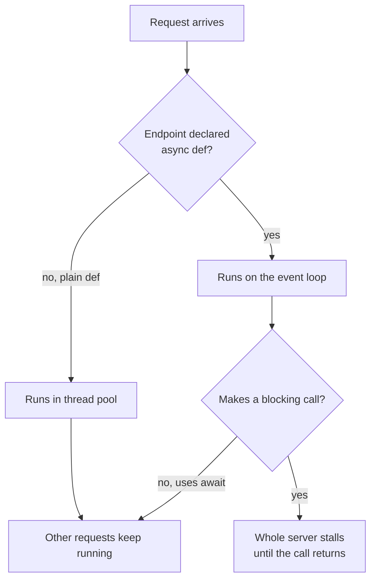

AI services spend most of their time waiting: for a hosted LLM to answer, for a vector database to search, for a GPU to finish a batch. FastAPI can serve many requests concurrently while that waiting happens, but only if you use `async def` and `def` correctly. Get it wrong and one slow call freezes every other request on the server. This lesson explains how FastAPI runs each kind of endpoint, the blocking-call trap that catches almost everyone, how to handle CPU-heavy inference, and how to stream LLM tokens to the client as they are generated.

You learned `async`/`await` and the event loop in [asynchronous programming](/learn/python-programming/asynchronous-programming); this lesson applies it to a server.

## How FastAPI runs def and async def

FastAPI accepts both kinds of path operation function and treats them differently:

| You write | FastAPI runs it | Safe to call inside |
| --- | --- | --- |
| `async def` | Directly on the **event loop**, the single thread that juggles all requests | Only non-blocking code and `await`-able calls |
| `def` | In a **thread pool**, so the event loop stays free | Blocking code: `time.sleep`, `requests`, most database drivers, model inference |

The event loop is fast precisely because it never waits: when a coroutine hits `await`, the loop switches to another request. A blocking call inside `async def` does not `await`; it simply holds the only thread, and **every** other request on that process stops until it returns.



## The blocking-call trap, measured

Here are three endpoints that each "wait" for half a second. Four requests are sent concurrently to each one with `httpx.AsyncClient`, which can talk to the app in-process through `ASGITransport`, and the total time is measured.

```python
import asyncio
import time

import httpx
from fastapi import FastAPI

app = FastAPI(title="Sentiment API")


@app.get("/async-blocking")
async def async_blocking():
    time.sleep(0.5)            # blocking call inside async def: the trap
    return {"ok": True}


@app.get("/async-nonblocking")
async def async_nonblocking():
    await asyncio.sleep(0.5)   # yields control to the event loop while waiting
    return {"ok": True}


@app.get("/sync")
def sync_endpoint():
    time.sleep(0.5)            # blocking, but FastAPI runs def in a thread pool
    return {"ok": True}


async def timed(path: str, n: int = 4) -> float:
    transport = httpx.ASGITransport(app=app)
    async with httpx.AsyncClient(transport=transport, base_url="http://test") as ac:
        start = time.perf_counter()
        await asyncio.gather(*[ac.get(path) for _ in range(n)])
        return time.perf_counter() - start


for path in ["/async-blocking", "/async-nonblocking", "/sync"]:
    print(f"{path:20s} 4 requests took {asyncio.run(timed(path)):.1f}s")
```

```output
/async-blocking      4 requests took 2.0s
/async-nonblocking   4 requests took 0.5s
/sync                4 requests took 0.6s
```

Your timings will differ by a tenth of a second or so, but the pattern will not. The blocking `async def` endpoint handled the requests one after another: four times half a second. The other two overlapped them. In a real service, the blocking version means one slow LLM call makes every user wait, including the ones calling `/health`, which can cause your load balancer to mark the server as dead.

> [!WARNING]
> Inside `async def`, never call `time.sleep`, `requests.get`, a synchronous database driver, a synchronous LLM SDK client, or `model.predict` on a large model. Either use the async version of the library (`await asyncio.sleep`, `httpx.AsyncClient`, async database drivers, the SDK's async client), or declare the endpoint with plain `def`.

## Calling external APIs asynchronously

Calling a hosted LLM or another service is I/O-bound: your server just waits for the network. That is where `async def` shines, especially when you can make several calls at once. The function below simulates a remote model call with `asyncio.sleep`; with a real service you would `await` an `httpx.AsyncClient` request or the provider SDK's async client instead.

```python
from pydantic import BaseModel


async def call_remote_model(name: str, text: str) -> dict:
    await asyncio.sleep(0.3)   # stands in for an HTTP call to a hosted model
    return {"model": name, "label": "positive" if "great" in text else "neutral"}


class PredictRequest(BaseModel):
    text: str


@app.post("/v1/predict/ensemble")
async def predict_ensemble(req: PredictRequest):
    results = await asyncio.gather(
        call_remote_model("model-a", req.text),
        call_remote_model("model-b", req.text),
        call_remote_model("model-c", req.text),
    )
    return {"votes": [r["label"] for r in results]}


async def one_call():
    transport = httpx.ASGITransport(app=app)
    async with httpx.AsyncClient(transport=transport, base_url="http://test") as ac:
        start = time.perf_counter()
        r = await ac.post("/v1/predict/ensemble", json={"text": "great product"})
        return r.json(), time.perf_counter() - start


body, seconds = asyncio.run(one_call())
print(body, f"in {seconds:.1f}s")
```

```output
{'votes': ['positive', 'positive', 'positive']} in 0.3s
```

Three 0.3-second calls finished in about 0.3 seconds, because `asyncio.gather` waited on them concurrently. In production, create one `httpx.AsyncClient` in `lifespan` and reuse it, rather than opening a new connection pool per request.

## CPU-bound inference

Running a model **inside** your server is different: the work is computation, not waiting. You have three options.

1. **Declare the endpoint with `def`.** FastAPI runs it in its thread pool. This is the simplest correct choice for local inference.
2. **Stay in `async def` and offload the call** with `await run_in_threadpool(model.predict, text)`. Useful when one endpoint mixes async I/O, such as fetching context, with a blocking model call.
3. **Move inference to separate worker processes or a dedicated model server** when the model is large or traffic is high.

```python
from fastapi.concurrency import run_in_threadpool


def slow_model_predict(text: str) -> str:
    time.sleep(0.5)            # stands in for a blocking model forward pass
    return "positive" if "great" in text else "neutral"


async def fetch_user_context(user_id: int) -> dict:
    await asyncio.sleep(0.05)  # async I/O, for example a database lookup
    return {"user_id": user_id, "language": "en"}


@app.post("/v1/predict/{user_id}")
async def predict_for_user(user_id: int, req: PredictRequest):
    context = await fetch_user_context(user_id)
    label = await run_in_threadpool(slow_model_predict, req.text)
    return {"label": label, **context}


async def burst():
    transport = httpx.ASGITransport(app=app)
    async with httpx.AsyncClient(transport=transport, base_url="http://test") as ac:
        start = time.perf_counter()
        rs = await asyncio.gather(*[ac.post(f"/v1/predict/{i}", json={"text": "great"}) for i in range(4)])
        return rs[0].json(), time.perf_counter() - start


body, seconds = asyncio.run(burst())
print(body, f"4 requests in {seconds:.1f}s")
```

```output
{'label': 'positive', 'user_id': 0, 'language': 'en'} 4 requests in 0.6s
```

There is a caveat the timing above hides. `time.sleep` releases Python's **Global Interpreter Lock (GIL)**, so the threads overlap perfectly. Real inference only overlaps in threads when the library releases the GIL during heavy computation, which NumPy and PyTorch do for their large numerical operations. Pure-Python computation, such as tokenising with a Python loop, does not run in parallel across threads at all. So threads keep the event loop responsive, but they do not give you more CPU.

To use more CPU cores, run several server processes with `uvicorn main:app --workers 4` (each process loads its own copy of the model, so watch memory), or move inference behind a queue to dedicated workers, as described in [background tasks](/learn/fastapi/background-tasks). Large GPU models usually live in a dedicated inference server, with FastAPI as the thin layer in front.

## Streaming LLM tokens with StreamingResponse

LLMs generate text token by token, and users perceive a response as much faster if words appear as they are produced instead of after the full answer. `StreamingResponse` sends whatever a generator yields, chunk by chunk, over a single HTTP response. Combined with the streaming APIs from [streaming responses](/learn/working-with-llms/streaming-responses), it lets you forward tokens to the browser as they arrive.

The common wire format is **Server-Sent Events (SSE)**: media type `text/event-stream`, each message written as `data: ...` followed by a blank line. The generator below fakes an LLM with a fixed reply.

```python
import json

from fastapi.responses import StreamingResponse
from fastapi.testclient import TestClient


async def fake_llm_tokens(prompt: str):
    for token in ["The", " review", " is", " mostly", " positive", "."]:
        await asyncio.sleep(0.05)   # a real LLM client would yield tokens as they arrive
        yield token


async def sse_events(prompt: str):
    async for token in fake_llm_tokens(prompt):
        yield f"data: {json.dumps({'token': token})}\n\n"
    yield "data: [DONE]\n\n"


@app.post("/v1/explain")
async def explain(req: PredictRequest):
    return StreamingResponse(sse_events(req.text), media_type="text/event-stream")


client = TestClient(app)
with client.stream("POST", "/v1/explain", json={"text": "great but slow"}) as r:
    print(r.status_code, r.headers["content-type"])
    for line in r.iter_lines():
        if line:
            print(line)
```

```output
200 text/event-stream; charset=utf-8
data: {"token": "The"}
data: {"token": " review"}
data: {"token": " is"}
data: {"token": " mostly"}
data: {"token": " positive"}
data: {"token": "."}
data: [DONE]
```

Step through how the generator produces the stream:

```trace
{
  "title": "streaming tokens with an async generator",
  "code": [
    "async def sse_events(prompt):",
    "    async for token in fake_llm_tokens(prompt):",
    "        yield f'data: {token}'",
    "    yield 'data: [DONE]'",
    "",
    "return StreamingResponse(sse_events(text))"
  ],
  "steps": [
    { "line": 6, "vars": {}, "note": "The endpoint returns immediately. Headers are sent; the body will be produced by iterating the generator." },
    { "line": 2, "vars": { "token": "(waiting)" }, "note": "StreamingResponse asks for the first chunk. The generator awaits the LLM; the event loop serves other requests meanwhile." },
    { "line": 3, "vars": { "token": "'The'" }, "out": ["data: {\"token\": \"The\"}"], "note": "The first token arrives and is yielded. It is sent to the client straight away." },
    { "line": 3, "vars": { "token": "' review'" }, "out": ["data: {\"token\": \"The\"}", "data: {\"token\": \" review\"}"], "note": "Each later token follows as soon as it exists. The client renders text progressively." },
    { "line": 4, "vars": { "token": "'.'" }, "out": ["data: {\"token\": \"The\"}", "data: {\"token\": \" review\"}", "...", "data: [DONE]"], "note": "After the last token a sentinel tells the client the stream is complete, then the response ends." }
  ]
}
```

A browser reads this with the `EventSource` API or `fetch` with a stream reader. Two things to remember: once streaming has started, the status code and headers are already sent, so errors mid-stream must be reported **inside** the stream (for example an `event: error` message); and if the client disconnects, stop generating, because you are paying for tokens nobody will read.

> [!KEY]
> Use `async def` when the endpoint awaits I/O and does nothing blocking. Use `def` for blocking work. Offload CPU-heavy inference to a thread pool, more processes or dedicated workers. Stream long LLM outputs.

## Exercises

**1.** Rewrite `async_blocking` so it keeps `async def` but no longer stalls the server, without changing the 0.5-second wait into `asyncio.sleep`. Measure it.

<details>
<summary>Show solution</summary>

Offload the blocking call to the thread pool:

```python
@app.get("/async-fixed")
async def async_fixed():
    await run_in_threadpool(time.sleep, 0.5)
    return {"ok": True}


print(f"{asyncio.run(timed('/async-fixed')):.1f}s")
```

```output
0.5s
```

</details>

**2.** For each endpoint, choose `def` or `async def`: (a) calls a hosted LLM with the provider's async client; (b) runs a scikit-learn `model.predict` on one row; (c) reads a file with `open()` and calls `requests.post` to a webhook.

<details>
<summary>Show solution</summary>

(a) `async def`, awaiting the async client. (b) `def`: scikit-learn calls are blocking, so let FastAPI run it in the thread pool (or use `run_in_threadpool` from an async endpoint). (c) `def`: both `open()` reads and `requests.post` block.

</details>

**3.** Modify `sse_events` so it streams the words of the request text back one per event, in upper case, and test it.

<details>
<summary>Show solution</summary>

```python
async def echo_events(text: str):
    for word in text.split():
        await asyncio.sleep(0)
        yield f"data: {word.upper()}\n\n"


@app.post("/v1/echo")
async def echo(req: PredictRequest):
    return StreamingResponse(echo_events(req.text), media_type="text/event-stream")


with client.stream("POST", "/v1/echo", json={"text": "fast and helpful"}) as r:
    print([line for line in r.iter_lines() if line])
```

```output
['data: FAST', 'data: AND', 'data: HELPFUL']
```

</details>

```quiz
[
  {
    "q": "An `async def` endpoint calls `requests.get(...)`, which takes 2 seconds. What happens to other requests on the same process?",
    "options": [
      "They run normally in other threads",
      "They are all blocked until the call returns",
      "FastAPI automatically moves the call to a thread",
      "They receive 503 responses"
    ],
    "answer": 1,
    "why": "`async def` endpoints run on the event loop thread. A blocking call holds that thread, so no other coroutine can run."
  },
  {
    "q": "How does FastAPI run an endpoint declared with plain `def`?",
    "options": [
      "In a separate process",
      "On the event loop, blocking it",
      "In a thread pool, keeping the event loop free",
      "Only once at startup"
    ],
    "answer": 2,
    "why": "FastAPI runs synchronous path operations in a thread pool so blocking calls do not stall the event loop."
  },
  {
    "q": "Why do threads not always speed up CPU-bound Python inference?",
    "options": [
      "Threads cannot call NumPy",
      "FastAPI limits the thread pool to one thread",
      "Threads always run slower than processes",
      "Pure-Python computation holds the GIL, so only one thread computes at a time"
    ],
    "answer": 3,
    "why": "Threads overlap only while the GIL is released, as in I/O or heavy NumPy and PyTorch operations. More CPU needs more processes or dedicated workers."
  },
  {
    "q": "An LLM error occurs halfway through a `StreamingResponse`. What is the right way to tell the client?",
    "options": [
      "Send an error message inside the stream, because headers and status were already sent",
      "Raise `HTTPException(500)`",
      "Change the status code to 500",
      "Return a JSONResponse instead"
    ],
    "answer": 0,
    "why": "The status line and headers go out before the first chunk, so they can no longer be changed. Report the error as a stream event."
  }
]
```
