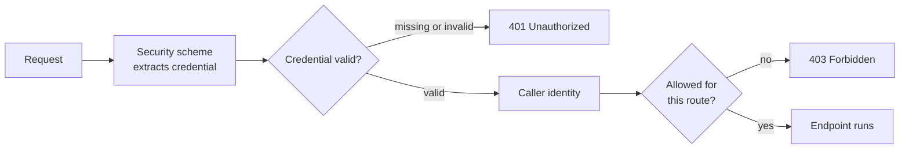
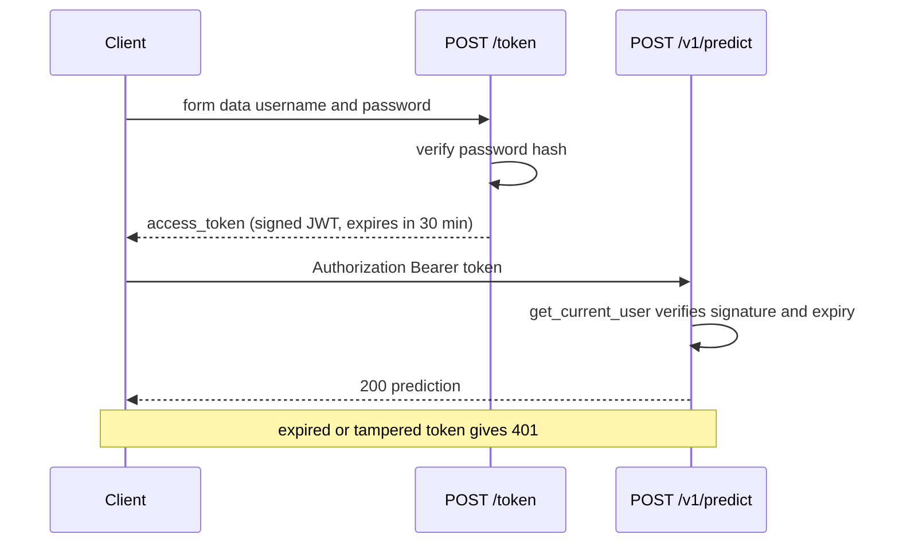

An open prediction endpoint on the internet will be found, and every call to it costs you compute. For an LLM-backed service, an unauthenticated endpoint can run up a large bill in a single night. Authentication answers "who is calling?", and it is the basis for everything that follows: rate limits per client, usage billing, per-user data and admin-only routes.

The concepts (API keys, sessions, tokens, OAuth2, the difference between 401 and 403) were covered in [authentication](/learn/backend-development/authentication) and [authorization](/learn/backend-development/authorization). This lesson implements the two schemes you will use most for AI APIs, **API keys** for machine-to-machine calls and **OAuth2 bearer tokens with JWTs** for users, as FastAPI dependencies.

## Authentication is a dependency

FastAPI has no special authentication system. You write a dependency that reads credentials from the request, checks them, and either returns the caller's identity or raises `HTTPException(401)`. Endpoints that need a caller simply depend on it. FastAPI's `fastapi.security` module provides ready-made classes that extract credentials and, as a bonus, register the scheme in the OpenAPI schema so `/docs` shows an **Authorize** button: you click it, enter a key or log in, and every "Try it out" request from then on carries the credentials.



## API keys in a header

API keys suit server-to-server clients: another team's service, a batch job, a partner. The client sends the key in a header such as `X-API-Key`. Two rules matter. Store only a **hash** of each key, so a leaked database does not leak working keys, and compare with `secrets.compare_digest`, which takes the same time whether the first or last character differs, so attackers cannot guess a key character by character from response times.

```python
import hashlib
import secrets
from typing import Annotated

from fastapi import Depends, FastAPI, HTTPException, status
from fastapi.security import APIKeyHeader
from fastapi.testclient import TestClient
from pydantic import BaseModel

POSITIVE = {"good", "great", "love", "excellent", "fast", "helpful"}
NEGATIVE = {"bad", "terrible", "hate", "slow", "broken", "useless"}


def classify(text: str) -> tuple[str, float]:
    words = [w.strip(".,!?").lower() for w in text.split()]
    score = sum(w in POSITIVE for w in words) - sum(w in NEGATIVE for w in words)
    if score == 0:
        return "neutral", 0.5
    return ("positive" if score > 0 else "negative"), min(0.5 + 0.2 * abs(score), 0.99)


def hash_key(key: str) -> str:
    return hashlib.sha256(key.encode()).hexdigest()


# In production these come from a database; the raw keys are shown to clients once.
API_KEY_HASHES = {hash_key("sk-demo-analytics-123"): "analytics-team"}

api_key_header = APIKeyHeader(name="X-API-Key", auto_error=False)


def get_client(key: Annotated[str | None, Depends(api_key_header)]) -> str:
    if key is None:
        raise HTTPException(status.HTTP_401_UNAUTHORIZED, detail="Missing API key")
    supplied = hash_key(key)
    for stored, client_name in API_KEY_HASHES.items():
        if secrets.compare_digest(supplied, stored):
            return client_name
    raise HTTPException(status.HTTP_401_UNAUTHORIZED, detail="Invalid API key")


class PredictRequest(BaseModel):
    text: str


app = FastAPI(title="Sentiment API")


@app.post("/v1/predict")
def predict(req: PredictRequest, client_name: Annotated[str, Depends(get_client)]):
    label, conf = classify(req.text)
    return {"label": label, "confidence": round(conf, 2), "client": client_name}


client = TestClient(app)
body = {"text": "fast and helpful"}
print(client.post("/v1/predict", json=body).json())
print(client.post("/v1/predict", json=body, headers={"X-API-Key": "guess"}).json())
print(client.post("/v1/predict", json=body, headers={"X-API-Key": "sk-demo-analytics-123"}).json())
```

```output
{'detail': 'Missing API key'}
{'detail': 'Invalid API key'}
{'label': 'positive', 'confidence': 0.9, 'client': 'analytics-team'}
```

`auto_error=False` makes the scheme return `None` for a missing header instead of raising its own error, so you control the message. A fast hash like SHA-256 is fine here because API keys are long random strings; it is **not** fine for passwords, as the next section explains.

> [!TIP]
> Generate keys with `secrets.token_urlsafe(32)` and give them a recognisable prefix such as `sk-`. The prefix makes leaked keys easy to spot with secret scanners in code repositories and logs.

## Storing passwords properly

Users choose short, guessable passwords, so a fast hash would let an attacker who steals your database test billions of guesses per second. Password hashing must be **deliberately slow** and **salted** (a random value per user, so identical passwords produce different hashes). The standard library's PBKDF2 does both:

```python
import os


def hash_password(password: str, iterations: int = 600_000) -> str:
    salt = os.urandom(16)
    digest = hashlib.pbkdf2_hmac("sha256", password.encode(), salt, iterations)
    return f"pbkdf2_sha256${iterations}${salt.hex()}${digest.hex()}"


def verify_password(password: str, stored: str) -> bool:
    _, iterations, salt_hex, digest_hex = stored.split("$")
    digest = hashlib.pbkdf2_hmac("sha256", password.encode(), bytes.fromhex(salt_hex), int(iterations))
    return secrets.compare_digest(digest.hex(), digest_hex)


stored = hash_password("correct horse battery staple")
print(stored.split("$")[0], stored.split("$")[1])
print(verify_password("correct horse battery staple", stored))
print(verify_password("password123", stored))
print(hash_password("same") == hash_password("same"))  # different salts
```

```output
pbkdf2_sha256 600000
True
False
False
```

The iteration count and salt are stored with the hash, so you can raise the count later and re-hash on next login. In production, prefer a memory-hard algorithm such as Argon2 or bcrypt through a maintained library (for example `argon2-cffi` or `pwdlib`); the structure of the code stays the same.

## OAuth2 password flow with JWT tokens

For users, the common pattern is: the client sends a username and password once to a `/token` endpoint, receives a signed **access token**, and sends it on later requests in the header `Authorization: Bearer <token>`. FastAPI's `OAuth2PasswordBearer` reads that header, and `OAuth2PasswordRequestForm` parses the login form (OAuth2 specifies form data, not JSON, which requires the `python-multipart` package).

The token is a **JWT** (JSON Web Token): a small JSON payload, such as the user's name and an expiry time, plus a signature made with a server secret. The server can verify it without a database lookup. This example uses the PyJWT library (`pip install pyjwt`).



```python
from datetime import datetime, timedelta, timezone

import jwt
from fastapi.security import OAuth2PasswordBearer, OAuth2PasswordRequestForm

SECRET_KEY = "demo-secret-change-me-and-load-from-env-0123456789abcdef"  # never hard-code in real apps
ALGORITHM = "HS256"

USERS = {
    "amina": {"password_hash": hash_password("s3cret-pass"), "role": "admin"},
    "tomas": {"password_hash": hash_password("tomas-pass"), "role": "user"},
}

oauth2_scheme = OAuth2PasswordBearer(tokenUrl="token")


def create_access_token(username: str, minutes: int = 30) -> str:
    expire = datetime.now(timezone.utc) + timedelta(minutes=minutes)
    return jwt.encode({"sub": username, "exp": expire}, SECRET_KEY, algorithm=ALGORITHM)


@app.post("/token")
def login(form: Annotated[OAuth2PasswordRequestForm, Depends()]):
    user = USERS.get(form.username)
    if user is None or not verify_password(form.password, user["password_hash"]):
        raise HTTPException(status.HTTP_401_UNAUTHORIZED, detail="Incorrect username or password")
    return {"access_token": create_access_token(form.username), "token_type": "bearer"}


def get_current_user(token: Annotated[str, Depends(oauth2_scheme)]) -> dict:
    unauthorized = HTTPException(
        status.HTTP_401_UNAUTHORIZED,
        detail="Invalid or expired token",
        headers={"WWW-Authenticate": "Bearer"},
    )
    try:
        payload = jwt.decode(token, SECRET_KEY, algorithms=[ALGORITHM])
    except jwt.InvalidTokenError:   # covers bad signature, malformed and expired tokens
        raise unauthorized
    user = USERS.get(payload.get("sub"))
    if user is None:
        raise unauthorized
    return {"username": payload["sub"], "role": user["role"]}


CurrentUser = Annotated[dict, Depends(get_current_user)]


@app.get("/v1/me")
def me(user: CurrentUser):
    return user


r = client.post("/token", data={"username": "tomas", "password": "wrong"})
print(r.status_code, r.json())

r = client.post("/token", data={"username": "tomas", "password": "tomas-pass"})
token = r.json()["access_token"]
print(r.json()["token_type"], token[:20] + "...")

print(client.get("/v1/me", headers={"Authorization": f"Bearer {token}"}).json())
print(client.get("/v1/me").status_code, client.get("/v1/me").json())

expired = create_access_token("tomas", minutes=-1)
r = client.get("/v1/me", headers={"Authorization": f"Bearer {expired}"})
print(r.status_code, r.json(), r.headers["www-authenticate"])
```

```output
401 {'detail': 'Incorrect username or password'}
bearer eyJhbGciOiJIUzI1NiIs...
{'username': 'tomas', 'role': 'user'}
401 {'detail': 'Not authenticated'}
401 {'detail': 'Invalid or expired token'} Bearer
```

Note `data=` rather than `json=` for the login call: that sends form data. Passing `algorithms=[ALGORITHM]` to `jwt.decode` explicitly is essential; it stops an attacker from choosing a weaker algorithm for a forged token.

> [!WARNING]
> A JWT is **signed, not encrypted**. Anyone holding the token can base64-decode the payload and read it, so never put secrets or personal data in it. Keep expiry short, load `SECRET_KEY` from an environment variable or secret manager, and only ever send tokens over HTTPS.

## Authorisation: roles on top of identity

Once you know who is calling, decide what they may do. A **dependency factory**, a function that returns a dependency, keeps role checks declarative. Note the status: **403** for a known user without permission, versus 401 for unknown callers.

```python
def require_role(role: str):
    def checker(user: CurrentUser) -> dict:
        if user["role"] != role:
            raise HTTPException(status.HTTP_403_FORBIDDEN, detail=f"Requires role {role!r}")
        return user
    return checker


@app.post("/admin/reload-model", dependencies=[Depends(require_role("admin"))])
def reload_model():
    return {"reloaded": True}


def token_for(username, password):
    return client.post("/token", data={"username": username, "password": password}).json()["access_token"]


for name, pw in [("tomas", "tomas-pass"), ("amina", "s3cret-pass")]:
    r = client.post("/admin/reload-model", headers={"Authorization": f"Bearer {token_for(name, pw)}"})
    print(name, r.status_code, r.json())
```

```output
tomas 403 {'detail': "Requires role 'admin'"}
amina 200 {'reloaded': True}
```

As in [dependency injection](/learn/fastapi/dependency-injection), you can attach `Depends(require_role("admin"))` to an entire `APIRouter` to protect every admin route at once.

| Scheme | FastAPI class | Best for | Revocation |
| --- | --- | --- | --- |
| API key header | `APIKeyHeader` | Services, scripts, partners | Delete the key row |
| Bearer JWT | `OAuth2PasswordBearer` + PyJWT | Users of a web or mobile app | Hard before expiry: keep expiry short or keep a deny-list |
| External identity provider | `OAuth2AuthorizationCodeBearer`, `OpenIdConnect` | Organisations with single sign-on | Handled by the provider |

## Exercises

**1.** Add a second client key `sk-demo-batch-456` for `"batch-jobs"` to `API_KEY_HASHES` and show that it is accepted by `/v1/predict` without changing `get_client`.

<details>
<summary>Show solution</summary>

```python
API_KEY_HASHES[hash_key("sk-demo-batch-456")] = "batch-jobs"
r = client.post("/v1/predict", json={"text": "slow"}, headers={"X-API-Key": "sk-demo-batch-456"})
print(r.json())
```

```output
{'label': 'negative', 'confidence': 0.7, 'client': 'batch-jobs'}
```

</details>

**2.** Decode the payload of `token` from the lesson **without** the secret key, using `jwt.decode(token, options={"verify_signature": False})`. What does this demonstrate?

<details>
<summary>Show solution</summary>

```python
print(sorted(jwt.decode(token, options={"verify_signature": False})))
```

```output
['exp', 'sub']
```

Anyone can read a JWT's contents. The signature only proves the token was issued by the server and not modified; it does not hide anything. That is why tokens must not contain secrets.

</details>

**3.** A teammate returns 403 when the `Authorization` header is missing and 401 when a logged-in user calls an admin route. What is wrong?

<details>
<summary>Show solution</summary>

They are swapped. **401 Unauthorized** means the caller is not authenticated (missing, invalid or expired credentials) and should come with a `WWW-Authenticate` header. **403 Forbidden** means the caller is known but lacks permission, as with a normal user on an admin route.

</details>

```quiz
[
  {
    "q": "Why compare API keys with `secrets.compare_digest` rather than `==`?",
    "options": [
      "It is faster for long strings",
      "It takes the same time regardless of where strings differ, preventing timing attacks",
      "It automatically hashes both values",
      "It ignores upper and lower case"
    ],
    "answer": 1,
    "why": "`==` can return as soon as a character differs, which leaks information through response timing. `compare_digest` runs in constant time."
  },
  {
    "q": "Which is true of a JWT signed with HS256?",
    "options": [
      "Its payload is encrypted and unreadable without the key",
      "It can be revoked instantly by the server without extra state",
      "Its payload is readable by anyone, but cannot be modified without invalidating the signature",
      "It must be sent as JSON in the request body"
    ],
    "answer": 2,
    "why": "JWTs are encoded and signed, not encrypted. The signature detects tampering; it does not provide secrecy."
  },
  {
    "q": "Why should passwords be hashed with PBKDF2, bcrypt or Argon2 rather than a single SHA-256?",
    "options": [
      "SHA-256 output is too short to store",
      "SHA-256 is not supported by Python's standard library",
      "Those algorithms make the hash reversible for password resets",
      "They are deliberately slow and salted, making large-scale guessing of stolen hashes impractical"
    ],
    "answer": 3,
    "why": "A fast hash lets attackers test enormous numbers of guesses. Slow, salted algorithms multiply the cost of every guess."
  },
  {
    "q": "A logged-in user without the admin role calls an admin-only endpoint. Which response is correct?",
    "options": ["403 Forbidden", "401 Unauthorized", "404 Not Found", "422 Unprocessable Content"],
    "answer": 0,
    "why": "The caller is authenticated but not authorised. 401 is for missing or invalid credentials."
  }
]
```
