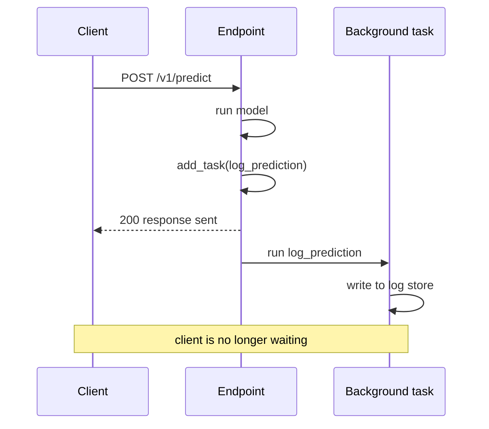
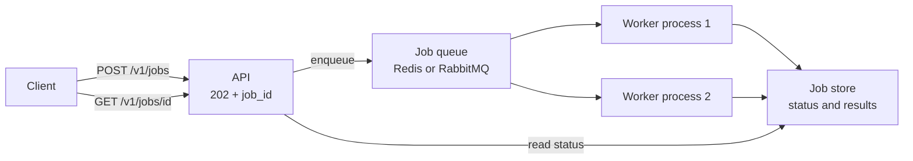

Some work triggered by a request does not need to finish before you answer. After returning a prediction you may want to log it for monitoring, write it to a feedback store, send a webhook or update usage counters. Making the client wait for all of that adds latency for no benefit. FastAPI's **background tasks** let you send the response first and do the follow-up work afterwards, in the same server process.

They are simple and convenient, and they also have hard limits. Knowing where those limits are, and when to reach for a real job queue instead, is the main lesson here. The general patterns for asynchronous work were introduced in [asynchronous APIs](/learn/backend-development/asynchronous-apis).

## Running work after the response

Declare a parameter of type `BackgroundTasks` and call `add_task(function, *args, **kwargs)`. FastAPI runs the function after the response has been sent.

```python
import time

from fastapi import BackgroundTasks, FastAPI
from fastapi.testclient import TestClient
from pydantic import BaseModel

POSITIVE = {"good", "great", "love", "excellent", "fast", "helpful"}
NEGATIVE = {"bad", "terrible", "hate", "slow", "broken", "useless"}


def classify(text: str) -> tuple[str, float]:
    words = [w.strip(".,!?").lower() for w in text.split()]
    score = sum(w in POSITIVE for w in words) - sum(w in NEGATIVE for w in words)
    if score == 0:
        return "neutral", 0.5
    return ("positive" if score > 0 else "negative"), min(0.5 + 0.2 * abs(score), 0.99)


PREDICTION_LOG: list[dict] = []
events: list[str] = []


def log_prediction(text: str, label: str, confidence: float) -> None:
    time.sleep(0.2)   # pretend this is a slow database write
    PREDICTION_LOG.append({"text": text, "label": label, "confidence": confidence})
    events.append("background: prediction logged")


class PredictRequest(BaseModel):
    text: str


app = FastAPI(title="Sentiment API")


@app.post("/v1/predict")
def predict(req: PredictRequest, background_tasks: BackgroundTasks):
    label, conf = classify(req.text)
    background_tasks.add_task(log_prediction, req.text, label, round(conf, 2))
    events.append("endpoint: returning response")
    return {"label": label, "confidence": round(conf, 2)}


client = TestClient(app)
print(client.post("/v1/predict", json={"text": "love the new UI"}).json())
print(events)
print(PREDICTION_LOG)
```

```output
{'label': 'positive', 'confidence': 0.7}
['endpoint: returning response', 'background: prediction logged']
[{'text': 'love the new UI', 'label': 'positive', 'confidence': 0.7}]
```

The endpoint returned first; the logging ran afterwards. With a real server, the client receives the response without waiting for the 0.2-second write. `TestClient` is different: it waits for background tasks to finish before giving you the response, which is convenient for tests because you can assert on their effects immediately.



Tasks run in the order they were added. Plain `def` task functions run in a thread pool so they do not block the server; `async def` tasks run on the event loop and must not make blocking calls (the [async endpoints](/learn/fastapi/async-endpoints) lesson explains why).

## Adding tasks from dependencies

`BackgroundTasks` can also be declared in a dependency, and FastAPI shares the same object with the endpoint. That lets cross-cutting work, such as usage metering, live in one place:

```python
from typing import Annotated

from fastapi import Depends, Header

USAGE: dict[str, int] = {}


def record_usage(client_id: str) -> None:
    USAGE[client_id] = USAGE.get(client_id, 0) + 1


def meter(background_tasks: BackgroundTasks, x_client_id: Annotated[str, Header()] = "anonymous"):
    background_tasks.add_task(record_usage, x_client_id)


@app.post("/v1/predict/metered", dependencies=[Depends(meter)])
def predict_metered(req: PredictRequest):
    return {"label": classify(req.text)[0]}


for _ in range(3):
    client.post("/v1/predict/metered", json={"text": "fine"}, headers={"X-Client-ID": "acme"})
client.post("/v1/predict/metered", json={"text": "fine"})
print(USAGE)
```

```output
{'acme': 3, 'anonymous': 1}
```

## When a background task fails

The response has already gone out by the time a task runs, so the client cannot be told about a failure. The exception is logged by the server and the work is simply lost.

```python
def flaky_webhook(url: str) -> None:
    raise ConnectionError(f"could not reach {url}")


@app.post("/v1/predict/notify")
def predict_notify(req: PredictRequest, background_tasks: BackgroundTasks):
    background_tasks.add_task(flaky_webhook, "https://hooks.example.com/sentiment")
    return {"label": classify(req.text)[0]}


safe_client = TestClient(app, raise_server_exceptions=False)
r = safe_client.post("/v1/predict/notify", json={"text": "great"})
print(r.status_code, r.json())
```

```output
200 {'label': 'positive'}
```

The client got a successful 200 even though the webhook failed. If the work matters, background tasks need their own error handling: catch exceptions, log them with context and, if necessary, record the failure somewhere you will see it.

> [!WARNING]
> Background tasks live in the memory of the server process. If the process restarts, is redeployed or crashes, any tasks that have not finished are lost silently. There are no retries, no persistence and no way to ask "is my task done?" from another process.

## The long-running job pattern

Some AI work is too slow for a request at all: summarising a 300-page PDF, transcribing an hour of audio, running a batch of 10,000 predictions. The usual design is to accept the job, return **202 Accepted** with a job ID at once, and let the client poll a status endpoint. Here is the shape of it, using a background task and an in-memory dictionary for illustration:

```python
import uuid

JOBS: dict[str, dict] = {}


class BatchRequest(BaseModel):
    texts: list[str]


def run_batch(job_id: str, texts: list[str]) -> None:
    JOBS[job_id]["status"] = "running"
    results = [classify(t)[0] for t in texts]
    JOBS[job_id].update(status="done", results=results)


@app.post("/v1/jobs", status_code=202)
def submit_job(req: BatchRequest, background_tasks: BackgroundTasks):
    job_id = uuid.uuid4().hex[:8]
    JOBS[job_id] = {"status": "queued", "results": None}
    background_tasks.add_task(run_batch, job_id, req.texts)
    return {"job_id": job_id, "status_url": f"/v1/jobs/{job_id}"}


@app.get("/v1/jobs/{job_id}")
def job_status(job_id: str):
    return JOBS[job_id]


r = client.post("/v1/jobs", json={"texts": ["great", "slow and broken", "ok"]})
print(r.status_code, sorted(r.json()))
job_id = r.json()["job_id"]
print(client.get(f"/v1/jobs/{job_id}").json())
```

```output
202 ['job_id', 'status_url']
{'status': 'done', 'results': ['positive', 'negative', 'neutral']}
```



Because `TestClient` waits for background tasks, the first poll already reports `done`; against a real server it would usually see `queued` or `running` for a while. The API shape (202, job ID, status URL) is right, but the in-memory implementation is not production-ready: `JOBS` disappears on restart, it is not shared between multiple server processes, and the batch competes for CPU with live requests. In production, the diagram above is what you build: the endpoint puts the job on a **queue** backed by Redis or RabbitMQ, separate **worker** processes (on other machines if needed, perhaps with GPUs) consume it, and status lives in a database. Libraries such as Celery, RQ, Dramatiq and arq implement the queue and worker side.

## Choosing between them

| Need | BackgroundTasks | Job queue with workers |
| --- | --- | --- |
| Small follow-up work (log, metric, email) | Good fit | Overkill |
| Survives restarts and deploys | No | Yes, jobs are persisted |
| Retries on failure | No (write your own) | Built in |
| Status visible to clients and other processes | No | Yes |
| Heavy CPU or GPU work | No: steals capacity from requests | Yes: scale workers separately |
| Extra infrastructure | None | Broker (Redis, RabbitMQ) and worker processes |

> [!KEY]
> Use background tasks for short, best-effort work where losing an occasional task is acceptable. If losing the task would be a bug, such as a paid batch job or a billing record, it belongs in a persistent queue.

## Exercises

**1.** Add a second background task to `predict` that appends `"background: metrics updated"` to `events` after the logging task. Clear `events`, call the endpoint, and check the order of all three entries.

<details>
<summary>Show solution</summary>

```python
def update_metrics() -> None:
    events.append("background: metrics updated")


@app.post("/v1/predict/v2")
def predict_v2(req: PredictRequest, background_tasks: BackgroundTasks):
    label, conf = classify(req.text)
    background_tasks.add_task(log_prediction, req.text, label, round(conf, 2))
    background_tasks.add_task(update_metrics)
    events.append("endpoint: returning response")
    return {"label": label}


events.clear()
client.post("/v1/predict/v2", json={"text": "useless"})
print(events)
```

```output
['endpoint: returning response', 'background: prediction logged', 'background: metrics updated']
```

Tasks run after the response, in the order they were added.

</details>

**2.** Rewrite `flaky_webhook` so a failure is caught and recorded in a `FAILED_WEBHOOKS` list instead of being lost in the server log.

<details>
<summary>Show solution</summary>

```python
FAILED_WEBHOOKS: list[dict] = []


def safe_webhook(url: str) -> None:
    try:
        flaky_webhook(url)
    except Exception as exc:
        FAILED_WEBHOOKS.append({"url": url, "error": str(exc)})


@app.post("/v1/predict/notify-safe")
def predict_notify_safe(req: PredictRequest, background_tasks: BackgroundTasks):
    background_tasks.add_task(safe_webhook, "https://hooks.example.com/sentiment")
    return {"label": classify(req.text)[0]}


client.post("/v1/predict/notify-safe", json={"text": "great"})
print(FAILED_WEBHOOKS)
```

```output
[{'url': 'https://hooks.example.com/sentiment', 'error': 'could not reach https://hooks.example.com/sentiment'}]
```

In production you would also log it and perhaps retry later from a scheduled job.

</details>

**3.** A product manager asks for an endpoint that fine-tunes a model on uploaded data, which takes about two hours on a GPU. Explain why `BackgroundTasks` is the wrong tool and sketch the design you would use.

<details>
<summary>Show solution</summary>

A two-hour GPU job inside the API process would tie up the server's resources, be lost on any restart or deploy, and give the client no reliable way to check progress. Use the job pattern with a real queue: `POST /v1/fine-tunes` validates the request, stores a job record and enqueues it, then returns 202 with a job ID; a separate GPU worker consumes the queue, updates status and stores the resulting model; `GET /v1/fine-tunes/{id}` reads status from the database.

</details>

```quiz
[
  {
    "q": "When does a task added with `background_tasks.add_task(...)` run?",
    "options": [
      "Immediately, in parallel with the endpoint",
      "After the response has been sent",
      "At server shutdown",
      "When the client polls for it"
    ],
    "answer": 1,
    "why": "FastAPI runs background tasks after sending the response, in the order they were added."
  },
  {
    "q": "A background task raises an exception. What does the client see?",
    "options": [
      "The normal response that was already sent",
      "A 500 error",
      "A 202 Accepted",
      "The connection is reset"
    ],
    "answer": 0,
    "why": "The response has already been delivered, so the failure only shows up in server logs unless you record it yourself."
  },
  {
    "q": "Which requirement is the strongest sign you need a job queue rather than `BackgroundTasks`?",
    "options": [
      "Logging each prediction",
      "Sending a short confirmation email",
      "The work must survive server restarts and be retried on failure",
      "Updating an in-memory counter"
    ],
    "answer": 2,
    "why": "Background tasks live in process memory with no persistence or retries. Queues persist jobs and retry them."
  },
  {
    "q": "For a long-running batch job, what should the submission endpoint return?",
    "options": [
      "200 with the full results after waiting",
      "204 with no body",
      "500 until the job finishes",
      "202 Accepted with a job ID and a status URL to poll"
    ],
    "answer": 3,
    "why": "202 signals the work was accepted but not done; the client uses the job ID to check status later."
  }
]
```
