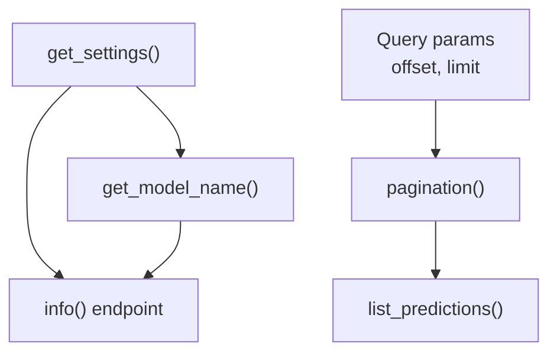
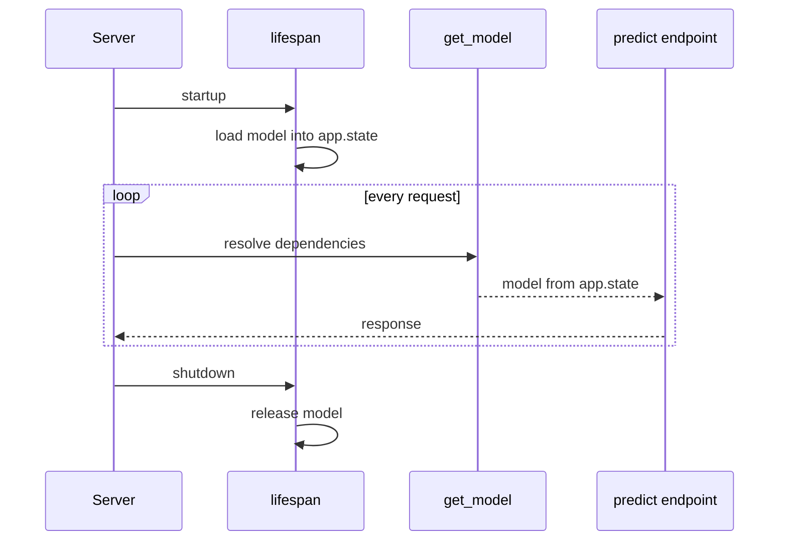

As the sentiment API grows, many endpoints need the same things: the loaded model, a database session, the current user, pagination settings, a rate-limit check. Copying that setup into every function is repetitive and error-prone, and it makes testing painful because the real model and database are hard-wired in. **Dependency injection** solves both problems. An endpoint declares what it needs, FastAPI provides it, and in tests you can swap in a fake.

This is the feature that holds larger FastAPI applications together. Authentication, database access and model loading in the following lessons are all built on it.

## The idea: declare what you need

A **dependency** is any callable (usually a function) whose parameters FastAPI can fill in the same way it fills an endpoint's: from the path, query, headers, body, or other dependencies. You request it with `Depends`:

```python
from typing import Annotated

from fastapi import Depends, FastAPI, Query
from fastapi.testclient import TestClient
from pydantic import BaseModel

app = FastAPI(title="Sentiment API")


class Pagination(BaseModel):
    offset: int
    limit: int


def pagination(
    offset: Annotated[int, Query(ge=0)] = 0,
    limit: Annotated[int, Query(ge=1, le=100)] = 20,
) -> Pagination:
    return Pagination(offset=offset, limit=limit)


PageDep = Annotated[Pagination, Depends(pagination)]


@app.get("/v1/predictions")
def list_predictions(page: PageDep):
    return {"endpoint": "predictions", **page.model_dump()}


@app.get("/v1/feedback")
def list_feedback(page: PageDep):
    return {"endpoint": "feedback", **page.model_dump()}


client = TestClient(app)
print(client.get("/v1/predictions?limit=5").json())
print(client.get("/v1/feedback?offset=40").json())
print(client.get("/v1/feedback?limit=1000").json()["detail"][0]["loc"])
```

```output
{'endpoint': 'predictions', 'offset': 0, 'limit': 5}
{'endpoint': 'feedback', 'offset': 40, 'limit': 20}
['query', 'limit']
```

Both endpoints get validated pagination without repeating the parameters, and the query parameters of `pagination` appear in `/docs` for each endpoint. Defining `PageDep` as an `Annotated` alias is the recommended pattern: write the dependency once, reuse the alias everywhere.

## Dependencies can depend on dependencies

Dependencies form a graph. FastAPI resolves it for each request, calling each dependency **at most once per request** even if several parts of the graph ask for it, and caching the result for that request.

```python
calls = []


def get_settings() -> dict:
    calls.append("settings")
    return {"default_model": "lexicon-v1", "max_batch": 32}


def get_model_name(settings: Annotated[dict, Depends(get_settings)]) -> str:
    calls.append("model_name")
    return settings["default_model"]


@app.get("/v1/info")
def info(
    model_name: Annotated[str, Depends(get_model_name)],
    settings: Annotated[dict, Depends(get_settings)],
):
    return {"model": model_name, "max_batch": settings["max_batch"]}


print(client.get("/v1/info").json())
print(calls)
```

```output
{'model': 'lexicon-v1', 'max_batch': 32}
['settings', 'model_name']
```

`get_settings` was needed twice, directly by the endpoint and through `get_model_name`, but ran once. (Pass `Depends(get_settings, use_cache=False)` if you really need a fresh call.)



## Yield dependencies: setup and teardown

Some resources must be cleaned up after the request: database sessions must be closed, transactions committed or rolled back, temporary files deleted. A dependency that uses `yield` instead of `return` handles this. Code before `yield` runs before the endpoint; the yielded value is injected; code after `yield` runs once the endpoint has finished.

The class below stands in for a database session, printing what happens so you can see the order:

```python
class FakeSession:
    def __init__(self):
        print("  session opened")
        self.rows = []

    def add(self, row):
        self.rows.append(row)

    def commit(self):
        print(f"  commit {len(self.rows)} row(s)")

    def rollback(self):
        print("  rollback")

    def close(self):
        print("  session closed")


def get_db():
    db = FakeSession()
    try:
        yield db
        db.commit()
    except Exception:
        db.rollback()
        raise
    finally:
        db.close()


DbDep = Annotated[FakeSession, Depends(get_db)]


class FeedbackIn(BaseModel):
    prediction_id: int
    correct_label: str


@app.post("/v1/feedback", status_code=201)
def create_feedback(fb: FeedbackIn, db: DbDep):
    print("  endpoint running")
    if fb.correct_label not in {"negative", "neutral", "positive"}:
        raise ValueError("bad label")
    db.add(fb.model_dump())
    return {"saved": True}


print("good request:")
r = client.post("/v1/feedback", json={"prediction_id": 1, "correct_label": "neutral"})
print(r.status_code, r.json())

print("failing request:")
safe = TestClient(app, raise_server_exceptions=False)
r = safe.post("/v1/feedback", json={"prediction_id": 1, "correct_label": "meh"})
print(r.status_code)
```

```output
good request:
  session opened
  endpoint running
  commit 1 row(s)
  session closed
201 {'saved': True}
failing request:
  session opened
  endpoint running
  rollback
  session closed
500
```

Step through the successful request to see the order of events:

```trace
{
  "title": "lifecycle of a yield dependency",
  "code": [
    "def get_db():",
    "    db = FakeSession()",
    "    try:",
    "        yield db",
    "        db.commit()",
    "    except Exception:",
    "        db.rollback()",
    "        raise",
    "    finally:",
    "        db.close()",
    "",
    "def create_feedback(fb, db):",
    "    db.add(fb.model_dump())",
    "    return {'saved': True}"
  ],
  "steps": [
    { "line": 2, "vars": {}, "out": ["  session opened"], "note": "A request arrives. Before calling the endpoint, FastAPI starts the dependency, which opens a session." },
    { "line": 4, "vars": { "db": "FakeSession" }, "out": ["  session opened"], "note": "The generator pauses at yield. The session object is what gets injected as the endpoint's db parameter." },
    { "line": 13, "vars": { "db": "FakeSession", "fb": "FeedbackIn(...)" }, "out": ["  session opened", "  endpoint running"], "note": "The endpoint runs with the injected session and adds a row." },
    { "line": 14, "vars": { "db": "FakeSession (1 row)" }, "out": ["  session opened", "  endpoint running"], "note": "The endpoint returns normally." },
    { "line": 5, "vars": { "db": "FakeSession (1 row)" }, "out": ["  session opened", "  endpoint running", "  commit 1 row(s)"], "note": "FastAPI resumes the generator after yield. No exception occurred, so the transaction is committed." },
    { "line": 10, "vars": { "db": "FakeSession (1 row)" }, "out": ["  session opened", "  endpoint running", "  commit 1 row(s)", "  session closed"], "note": "finally always runs, so the session is closed even when the endpoint fails. On the failing request, line 7 runs instead of line 5." }
  ]
}
```

With a real database the pattern is the same. Using SQLAlchemy (shown as code only, since it needs a running database server):

```python
from sqlalchemy import create_engine
from sqlalchemy.orm import Session, sessionmaker

engine = create_engine("postgresql+psycopg://user:pass@db/sentiment")
SessionLocal = sessionmaker(bind=engine)


def get_db():
    with SessionLocal() as session:   # closes the session on exit
        yield session
```

> [!WARNING]
> Code after `yield` is cleanup, not response logic. Do not try to change the response there, and do not swallow exceptions: re-raise them (as `get_db` does) so FastAPI can still produce the correct error response.

## Loading the model once with lifespan

Loading a model can take seconds and a lot of memory, so it must happen **once**, when the server starts, not inside a dependency that runs per request. FastAPI's `lifespan` parameter takes an async context manager: code before `yield` runs at startup, code after it at shutdown. Store the model on `app.state`, and expose it to endpoints through a small dependency.

```python
from contextlib import asynccontextmanager

from fastapi import Request

POSITIVE = {"good", "great", "love", "excellent", "fast", "helpful"}
NEGATIVE = {"bad", "terrible", "hate", "slow", "broken", "useless"}


class LexiconModel:
    """Stub for a real model; imagine an expensive load in __init__."""

    def __init__(self, version: str):
        self.version = version

    def predict(self, text: str) -> tuple[str, float]:
        words = [w.strip(".,!?").lower() for w in text.split()]
        score = sum(w in POSITIVE for w in words) - sum(w in NEGATIVE for w in words)
        if score == 0:
            return "neutral", 0.5
        return ("positive" if score > 0 else "negative"), min(0.5 + 0.2 * abs(score), 0.99)


@asynccontextmanager
async def lifespan(app: FastAPI):
    print("startup: loading model")
    app.state.model = LexiconModel("lexicon-v1")
    yield
    print("shutdown: releasing model")
    del app.state.model


def get_model(request: Request) -> LexiconModel:
    return request.app.state.model


ModelDep = Annotated[LexiconModel, Depends(get_model)]

service = FastAPI(title="Sentiment API", lifespan=lifespan)


class PredictRequest(BaseModel):
    text: str


@service.post("/v1/predict")
def predict(req: PredictRequest, model: ModelDep):
    label, conf = model.predict(req.text)
    return {"label": label, "confidence": round(conf, 2), "model_version": model.version}


with TestClient(service) as c:   # the with-block runs startup and shutdown
    print(c.post("/v1/predict", json={"text": "broken and useless"}).json())
    print(c.post("/v1/predict", json={"text": "great"}).json())
```

```output
startup: loading model
{'label': 'negative', 'confidence': 0.9, 'model_version': 'lexicon-v1'}
{'label': 'positive', 'confidence': 0.7, 'model_version': 'lexicon-v1'}
shutdown: releasing model
```

The model loaded once and served both requests. Note the `with TestClient(...)` block: lifespan events only run when the client is used as a context manager, which matters when you test.



> [!NOTE]
> You may see `@app.on_event("startup")` in older tutorials. It is deprecated in favour of `lifespan`, which keeps startup and shutdown code together and makes it easy to share state between them.

## Applying dependencies to a whole router

Some dependencies exist for their side effect, such as checking an API key or recording usage, and return nothing useful. Attach them with `dependencies=[...]` on a path operation, a router or the whole app, and they run for every matching request:

```python
from fastapi import APIRouter, Header, HTTPException


def require_tenant(x_tenant_id: Annotated[str | None, Header()] = None):
    if x_tenant_id is None:
        raise HTTPException(400, detail="X-Tenant-ID header required")


admin = APIRouter(prefix="/admin", tags=["admin"], dependencies=[Depends(require_tenant)])


@admin.get("/stats")
def stats():
    return {"predictions_today": 0}


app.include_router(admin)
print(client.get("/admin/stats").json())
print(client.get("/admin/stats", headers={"X-Tenant-ID": "acme"}).json())
```

```output
{'detail': 'X-Tenant-ID header required'}
{'predictions_today': 0}
```

The [authentication](/learn/fastapi/authentication) lesson uses exactly this to protect routes.

## Overriding dependencies

Because endpoints receive their dependencies instead of creating them, you can replace any dependency for the whole app through `app.dependency_overrides`, a dictionary mapping the original callable to a replacement. This is mainly for tests: swap the real model for a fake that always answers the same, or the real database for a temporary one.

```python
class AlwaysPositive:
    version = "fake"

    def predict(self, text):
        return "positive", 1.0


service.dependency_overrides[get_model] = lambda: AlwaysPositive()
with TestClient(service) as c:
    print(c.post("/v1/predict", json={"text": "terrible"}).json())
service.dependency_overrides.clear()
```

```output
startup: loading model
{'label': 'positive', 'confidence': 1.0, 'model_version': 'fake'}
shutdown: releasing model
```

The endpoint code is unchanged, yet it used the fake. [API testing](/learn/fastapi/api-testing) builds on this.

## Exercises

**1.** Write a dependency `get_language` that reads an `Accept-Language` header, takes the first two letters, lower-cases them and defaults to `"en"`. Use it in `GET /v1/lang` and test it with `"fr-FR,fr;q=0.9"`.

<details>
<summary>Show solution</summary>

```python
from fastapi import Header


def get_language(accept_language: Annotated[str | None, Header()] = None) -> str:
    if not accept_language:
        return "en"
    return accept_language[:2].lower()


@app.get("/v1/lang")
def lang(language: Annotated[str, Depends(get_language)]):
    return {"language": language}


print(client.get("/v1/lang", headers={"Accept-Language": "fr-FR,fr;q=0.9"}).json())
print(client.get("/v1/lang").json())
```

```output
{'language': 'fr'}
{'language': 'en'}
```

</details>

**2.** A colleague writes `def get_model(): return load_model_from_disk()` and uses it with `Depends` in the predict endpoint. Latency is terrible. Explain why and fix it.

<details>
<summary>Show solution</summary>

Dependencies run on every request, so the model is loaded from disk for every prediction. Load it once in a `lifespan` function, store it on `app.state`, and make the dependency just return `request.app.state.model`, as in this lesson.

</details>

**3.** In `get_db`, what would go wrong if the `except` block called `db.rollback()` but did not re-raise the exception?

<details>
<summary>Show solution</summary>

The exception would be swallowed inside the dependency. The transaction would be rolled back, but the error would be hidden from FastAPI's error handling and from your logs, so the failure becomes much harder to notice and debug. Re-raising lets the normal error response and logging happen.

</details>

```quiz
[
  {
    "q": "In one request, the endpoint and one of its dependencies both depend on `get_settings`. How many times does `get_settings` run?",
    "options": ["Twice", "Once per endpoint parameter", "Once", "It depends on the HTTP method"],
    "answer": 2,
    "why": "FastAPI caches each dependency's result within a request, unless you pass `use_cache=False`."
  },
  {
    "q": "In a dependency that uses `yield`, when does the code after `yield` run?",
    "options": [
      "After the endpoint has finished, as cleanup",
      "Before the endpoint is called",
      "Only if the endpoint raises an exception",
      "At server shutdown"
    ],
    "answer": 0,
    "why": "Code before `yield` is setup, the yielded value is injected, and code after `yield` (including `finally`) runs once the endpoint is done."
  },
  {
    "q": "Where should a large model be loaded in a FastAPI service?",
    "options": [
      "Inside the endpoint function",
      "In a dependency without caching",
      "In a background task started by the first request",
      "Once, in the `lifespan` function, stored on `app.state`"
    ],
    "answer": 3,
    "why": "`lifespan` runs once at startup, so every request reuses the same loaded model."
  },
  {
    "q": "What does `app.dependency_overrides[get_model] = fake_model` do?",
    "options": [
      "Deletes the `get_model` function",
      "Makes every endpoint that depends on `get_model` receive the result of `fake_model` instead",
      "Only changes the OpenAPI documentation",
      "Adds `fake_model` as a second model alongside the real one"
    ],
    "answer": 1,
    "why": "Overrides replace a dependency app-wide without changing endpoint code, which is ideal for tests."
  }
]
```
