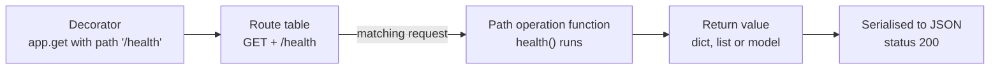
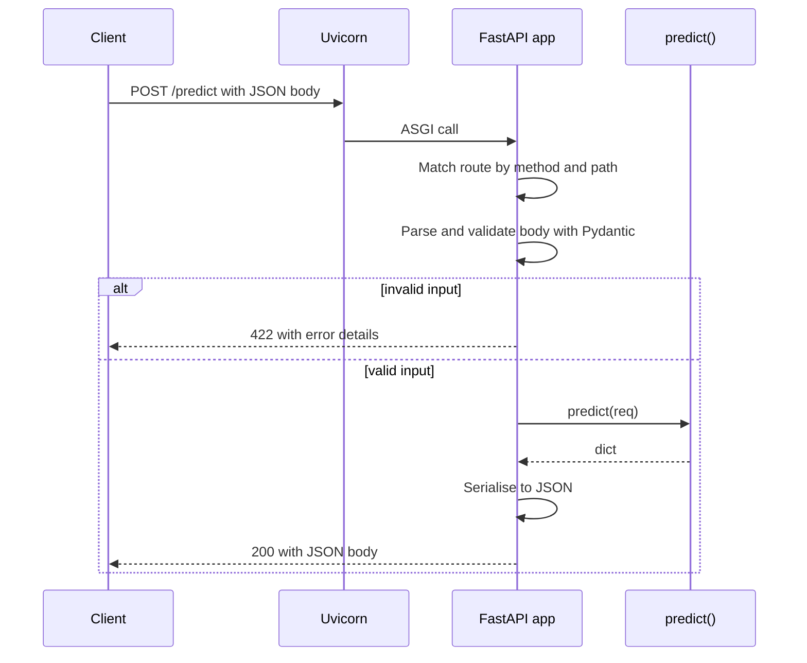

A trained model in a notebook helps nobody else. To be useful, it has to sit behind an interface that other programs can call: a web front end, a mobile app, another team's service, an agent. In Python, the framework most AI teams reach for to build that interface is **FastAPI**. You write ordinary Python functions with type hints, and FastAPI turns them into HTTP endpoints that validate their input, return JSON and document themselves.

[Module 34](/learn/backend-development/rest-apis) covered the concepts: HTTP methods, status codes, REST, JSON and request/response structure. This module is about doing all of that in FastAPI. Across the ten lessons you will grow one running example, a **sentiment prediction API**, from a single endpoint to a tested, authenticated, streaming service.

## What FastAPI is

FastAPI is a thin, opinionated layer on top of two other libraries:

| Piece | Role |
| --- | --- |
| **Starlette** | The web toolkit underneath: routing, requests, responses, middleware, WebSockets |
| **Pydantic** | Data validation and serialisation, driven by type hints |
| **ASGI server** (Uvicorn) | The program that listens on a network port and hands each HTTP request to your app |
| **FastAPI** | Glues them together: reads your function signatures, validates inputs, serialises outputs and generates an OpenAPI schema |

The key idea is that **type hints are the specification**. When you write `def predict(text: str, top_k: int = 1)`, FastAPI knows that `text` is required, `top_k` is an optional integer, how to convert the raw strings in a URL into those types, what error to return when conversion fails, and how to describe all of this in the API documentation. You state the contract once and get validation, conversion and documentation from it.

FastAPI is an **ASGI** application (Asynchronous Server Gateway Interface), which means it can handle many requests concurrently on one process using `async`/`await`, as described in [asynchronous APIs](/learn/backend-development/asynchronous-apis). It also runs plain `def` functions, as you will see in the lesson on [async endpoints](/learn/fastapi/async-endpoints).

## Installing and running your first app

Install FastAPI and an ASGI server into your virtual environment:

```bash
pip install fastapi uvicorn
```

Then create `main.py`:

```python
from fastapi import FastAPI

app = FastAPI(title="Sentiment API", version="0.1.0")


@app.get("/health")
def health():
    return {"status": "ok"}
```

Start the development server from the same folder:

```bash
uvicorn main:app --reload
```

```output
INFO:     Will watch for changes in these directories: ['/home/amina/sentiment-api']
INFO:     Uvicorn running on http://127.0.0.1:8000 (Press CTRL+C to quit)
INFO:     Started reloader process [41213] using WatchFiles
INFO:     Started server process [41215]
INFO:     Waiting for application startup.
INFO:     Application startup complete.
```

`main:app` means "import the module `main` and use the object called `app` inside it". `--reload` restarts the server whenever you save a file, which is what you want while developing and never what you want in production. Open `http://127.0.0.1:8000/health` in a browser and you see `{"status":"ok"}`.

> [!TIP]
> If you install `"fastapi[standard]"` instead, you also get the `fastapi` command-line tool, and `fastapi dev main.py` does the same job as `uvicorn main:app --reload` with friendlier output. Both run Uvicorn underneath.

## Anatomy of a path operation

FastAPI calls each endpoint a **path operation**: a combination of an HTTP method and a URL path, handled by a function.



There is a decorator for each method: `@app.get`, `@app.post`, `@app.put`, `@app.patch` and `@app.delete`. Whatever the function returns, FastAPI converts to JSON. Dictionaries, lists, strings, numbers, `None`, datetimes and Pydantic models all work.

## Calling your app without a server

You do not need a running server to try an endpoint. FastAPI ships a **`TestClient`** that sends requests directly into the application in the same Python process. It has the same interface as the `httpx` and `requests` libraries, so `client.get(...)` returns a response object with `.status_code`, `.json()` and `.headers`. Every example in this module uses it, so the outputs you see are real.

```python
from fastapi.testclient import TestClient

client = TestClient(app)

response = client.get("/health")
print(response.status_code)
print(response.json())
print(response.headers["content-type"])

print(client.get("/nope").status_code, client.get("/nope").json())
```

```output
200
{'status': 'ok'}
application/json
404 {'detail': 'Not Found'}
```

The second call shows that unknown paths get a `404` with a JSON body, without you writing any code for it.

## A first prediction endpoint

Now the running example. A real system would load a trained classifier; here a stub stands in for it, so you can focus on the API. It counts positive and negative words and is deterministic.

```python
POSITIVE = {"good", "great", "love", "excellent", "fast", "helpful"}
NEGATIVE = {"bad", "terrible", "hate", "slow", "broken", "useless"}


def classify(text: str) -> tuple[str, float]:
    """Stub model: returns (label, confidence)."""
    words = [w.strip(".,!?").lower() for w in text.split()]
    score = sum(w in POSITIVE for w in words) - sum(w in NEGATIVE for w in words)
    if score == 0:
        return "neutral", 0.5
    label = "positive" if score > 0 else "negative"
    return label, min(0.5 + 0.2 * abs(score), 0.99)


print(classify("Great service, really helpful"))
print(classify("The app is slow and broken"))
```

```output
('positive', 0.9)
('negative', 0.9)
```

To accept a JSON body, declare a Pydantic model and use it as a parameter type. FastAPI reads the request body, parses the JSON, validates it against the model and passes you a ready-made object.

```python
from pydantic import BaseModel


class PredictRequest(BaseModel):
    text: str


@app.post("/predict")
def predict(req: PredictRequest):
    label, confidence = classify(req.text)
    return {"label": label, "confidence": round(confidence, 2)}


r = client.post("/predict", json={"text": "I love this, it is excellent"})
print(r.status_code, r.json())

r = client.post("/predict", json={"message": "wrong field name"})
print(r.status_code, r.json())
```

```output
200 {'label': 'positive', 'confidence': 0.9}
422 {'detail': [{'type': 'missing', 'loc': ['body', 'text'], 'msg': 'Field required', 'input': {'message': 'wrong field name'}}]}
```

The second request is missing the `text` field, so FastAPI rejects it with **422 Unprocessable Content** before your function runs. The body tells the client exactly what is wrong: `loc` says where (`body` → `text`), `type` and `msg` say what. You wrote no validation code. The lessons on [Pydantic](/learn/fastapi/pydantic) and [request validation](/learn/fastapi/request-validation) go much further.

## What happens to a request



Routing, validation and serialisation happen in FastAPI. Your function only ever sees valid, typed data.

## Interactive documentation

Because FastAPI knows every path, parameter and model, it generates an **OpenAPI** schema (introduced in [API documentation](/learn/backend-development/api-documentation)) and serves three things automatically while the server runs:

| URL | What you get |
| --- | --- |
| `/docs` | **Swagger UI**: a page listing every endpoint grouped by tag. Expand one to see its parameters, request body schema and possible responses, click **Try it out**, fill in values and **Execute** to send a real request and see the response |
| `/redoc` | **ReDoc**: an alternative, read-only documentation layout |
| `/openapi.json` | The raw machine-readable schema, which tools use to generate client libraries |

You can inspect the same schema from Python:

```python
schema = app.openapi()
print(schema["info"])
for path, methods in schema["paths"].items():
    print(path, list(methods))
print(list(schema["components"]["schemas"]))
```

```output
{'title': 'Sentiment API', 'version': '0.1.0'}
/health ['get']
/predict ['post']
['HTTPValidationError', 'PredictRequest', 'ValidationError']
```

The `PredictRequest` model appears as a named schema, and `HTTPValidationError` documents the 422 response. Front-end developers on your team can open `/docs` and use the API without reading your code.

> [!KEY]
> The function signature is the contract. Types, defaults and Pydantic models drive validation, conversion, serialisation and documentation at once, so the docs cannot drift out of date with the code.

## Pitfalls for AI engineers

**Returning NumPy or tensor values.** Model libraries return types like `numpy.float32`, which FastAPI's JSON encoder does not understand. The request fails with a 500 error at serialisation time:

```python
import numpy as np


@app.get("/raw-score")
def raw_score():
    return {"score": np.float32(0.87)}


safe_client = TestClient(app, raise_server_exceptions=False)
print(safe_client.get("/raw-score").status_code)
```

```output
500
```

Convert with `float(x)`, `int(x)` or `array.tolist()` before returning, or declare a response model (see [response models](/learn/fastapi/response-models)).

Other common mistakes:

- **Wrong import string.** `uvicorn main:app` must match the file name and the variable name. If your file is `api.py` and the object is `application`, use `uvicorn api:application`.
- **Using `--reload` in production.** It watches the file system and restarts the process; production runs use several worker processes without reload.
- **Forgetting the method.** A `@app.post` endpoint returns **405 Method Not Allowed** when you open it in a browser, because browsers send `GET`.

## Exercises

**1.** Add a `GET /version` endpoint to the app that returns `{"name": "Sentiment API", "version": "0.1.0"}`, reading both values from `app.title` and `app.version`. Call it with `TestClient`.

<details>
<summary>Show solution</summary>

```python
@app.get("/version")
def version():
    return {"name": app.title, "version": app.version}


print(client.get("/version").json())
```

```output
{'name': 'Sentiment API', 'version': '0.1.0'}
```

</details>

**2.** Send `client.get("/predict")` and `client.post("/predict", json={"text": 42})`. Predict the status codes before running them, then explain each.

<details>
<summary>Show solution</summary>

```python
print(client.get("/predict").status_code)
print(client.post("/predict", json={"text": 42}).json()["detail"][0]["msg"])
```

```output
405
Input should be a valid string
```

The first is **405** because `/predict` exists but only for `POST`. The second is **422**: Pydantic does not silently turn the integer `42` into a string, because its default "lax" mode only converts between types where the meaning is unambiguous (such as `"3"` to `3` for an integer field).

</details>

**3.** A colleague's endpoint returns `{"probs": model.predict_proba(X)[0]}` and the server logs a `ValueError` on every request. Explain the cause and give a one-line fix.

<details>
<summary>Show solution</summary>

`predict_proba` returns a NumPy array, which FastAPI cannot encode as JSON. Convert it to a list of Python floats: `return {"probs": model.predict_proba(X)[0].tolist()}`.

</details>

```quiz
[
  {
    "q": "In `uvicorn main:app --reload`, what does `main:app` refer to?",
    "options": [
      "The URL path `/main/app`",
      "The object named `app` inside the module `main`",
      "A configuration section in `pyproject.toml`",
      "The function `main()` that starts the app"
    ],
    "answer": 1,
    "why": "Uvicorn imports the module before the colon and looks up the attribute after it to find the ASGI application."
  },
  {
    "q": "A client posts a JSON body that is missing a required field of the Pydantic model. What happens?",
    "options": [
      "The function runs with the field set to `None`",
      "FastAPI returns 500 Internal Server Error",
      "FastAPI returns 422 with details of the missing field, and the function never runs",
      "FastAPI returns 400 with an empty body"
    ],
    "answer": 2,
    "why": "Validation happens before the path operation function is called. Failures produce a 422 response whose `detail` lists each problem with its location."
  },
  {
    "q": "Where is the interactive Swagger UI documentation served by default?",
    "options": ["`/swagger`", "`/openapi`", "`/api`", "`/docs`"],
    "answer": 3,
    "why": "FastAPI serves Swagger UI at `/docs`, ReDoc at `/redoc` and the raw schema at `/openapi.json`."
  },
  {
    "q": "Why does `TestClient` let you exercise an app without starting Uvicorn?",
    "options": [
      "It calls the ASGI application directly inside the same Python process",
      "It starts a hidden server on a random port",
      "It reads responses from the OpenAPI schema",
      "It only works for GET requests, which need no server"
    ],
    "answer": 0,
    "why": "`TestClient` sends requests straight into the ASGI app in-process, so routing, validation and serialisation all run exactly as they would behind a server."
  }
]
```
