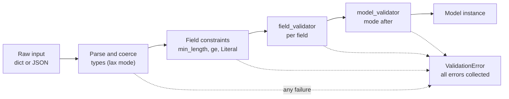

Every request your API receives is untrusted data: a JSON document that might be missing fields, contain strings where numbers belong, or carry a 2 MB "text" field meant to exhaust your model. **Pydantic** is the library FastAPI uses to turn that raw data into well-typed Python objects, or to reject it with a precise explanation. You declare what valid data looks like as a class, and Pydantic enforces it.

You met Pydantic briefly in [structured outputs](/learn/working-with-llms/structured-outputs), where it validated LLM responses. This lesson treats it properly, using **Pydantic v2**, because it is the vocabulary of every FastAPI request and response. Everything here runs without FastAPI; the next lessons plug these models into endpoints.

## Models are typed data contracts

A Pydantic model is a class that inherits from `BaseModel`, with fields declared as type-annotated class attributes.

```python
from pydantic import BaseModel, ValidationError


class PredictRequest(BaseModel):
    text: str
    top_k: int = 1
    language: str | None = None


req = PredictRequest(text="Great support team", top_k="2")
print(req)
print(type(req.top_k), req.language)
```

```output
text='Great support team' top_k=2 language=None
<class 'int'> None
```

Notice `top_k="2"` became the integer `2`. By default Pydantic runs in **lax mode**: it converts values when the conversion is unambiguous, such as the string `"2"` to the integer `2`, which is exactly what you want for data arriving as JSON or query strings. It refuses conversions that would lose or invent meaning:

```python
try:
    PredictRequest(text=123, top_k="two")
except ValidationError as e:
    print(e.error_count(), "errors")
    for err in e.errors():
        print(err["loc"], err["type"], "-", err["msg"])
```

```output
2 errors
('text',) string_type - Input should be a valid string
('top_k',) int_parsing - Input should be a valid integer, unable to parse string as an integer
```

Each error carries a location, a machine-readable `type` and a human-readable message. These are precisely the entries FastAPI puts in the `detail` list of a 422 response.

## Field constraints

`Field` attaches constraints and metadata to a field. For a text model API, length limits are a security control as much as a correctness one: they stop a single request from consuming your whole inference budget.

```python
from pydantic import Field


class PredictRequest(BaseModel):
    text: str = Field(min_length=1, max_length=2000, description="Text to classify")
    top_k: int = Field(default=1, ge=1, le=3)
    threshold: float = Field(default=0.5, gt=0.0, lt=1.0)
    tags: list[str] = Field(default_factory=list, max_length=5)


try:
    PredictRequest(text="", top_k=10, threshold=1.5, tags=["a"] * 6)
except ValidationError as e:
    for err in e.errors():
        print(err["loc"], "-", err["msg"])
```

```output
('text',) - String should have at least 1 character
('top_k',) - Input should be less than or equal to 3
('threshold',) - Input should be less than 1
('tags',) - List should have at most 5 items after validation, not 6
```

| Constraint | Applies to | Meaning |
| --- | --- | --- |
| `min_length`, `max_length` | strings, lists | Length bounds |
| `gt`, `ge`, `lt`, `le` | numbers | Greater than, greater or equal, less than, less or equal |
| `pattern` | strings | Must match a regular expression |
| `default` / `default_factory` | any | Value when omitted; use `default_factory=list` for mutable defaults |
| `description`, `examples` | any | Documentation only; shows up in `/docs` |

All Pydantic errors are collected and reported together, not one at a time, so a client can fix everything in one round trip.

## Nested models, lists and literals

Real payloads are structured. Models can contain other models and lists of them, and `Literal` restricts a field to fixed values.

```python
from typing import Literal


class LabelScore(BaseModel):
    label: Literal["negative", "neutral", "positive"]
    score: float = Field(ge=0, le=1)


class Prediction(BaseModel):
    text: str
    top: LabelScore
    alternatives: list[LabelScore] = []


raw = {
    "text": "slow but helpful",
    "top": {"label": "neutral", "score": 0.5},
    "alternatives": [{"label": "positive", "score": 0.3}, {"label": "angry", "score": 0.2}],
}
try:
    Prediction(**raw)
except ValidationError as e:
    print(e.errors()[0]["loc"], "-", e.errors()[0]["msg"])
```

```output
('alternatives', 1, 'label') - Input should be 'negative', 'neutral' or 'positive'
```

The location `('alternatives', 1, 'label')` points to the exact element: the second alternative's label. Deeply nested errors stay easy to find.

## Custom validation with validators

Constraints cover the common cases. For anything else, write a **validator**. `@field_validator` checks or transforms one field; `@model_validator(mode="after")` runs once all fields are valid and can check relationships between them.

```python
from pydantic import field_validator, model_validator


class BatchRequest(BaseModel):
    texts: list[str] = Field(min_length=1, max_length=32)
    model: str = "lexicon-v1"
    min_confidence: float = 0.0
    max_confidence: float = 1.0

    @field_validator("texts")
    @classmethod
    def strip_and_reject_blank(cls, texts: list[str]) -> list[str]:
        cleaned = [t.strip() for t in texts]
        if any(not t for t in cleaned):
            raise ValueError("texts must not contain blank strings")
        return cleaned

    @field_validator("model")
    @classmethod
    def known_model(cls, value: str) -> str:
        if value not in {"lexicon-v1", "lexicon-v2"}:
            raise ValueError(f"unknown model {value!r}")
        return value

    @model_validator(mode="after")
    def check_range(self):
        if self.min_confidence > self.max_confidence:
            raise ValueError("min_confidence must not exceed max_confidence")
        return self


print(BatchRequest(texts=["  great  ", "slow"]).texts)

for bad in [
    {"texts": ["ok", "   "]},
    {"texts": ["ok"], "model": "gpt-x"},
    {"texts": ["ok"], "min_confidence": 0.9, "max_confidence": 0.2},
]:
    try:
        BatchRequest(**bad)
    except ValidationError as e:
        err = e.errors()[0]
        print(err["loc"], "-", err["msg"])
```

```output
['great', 'slow']
('texts',) - Value error, texts must not contain blank strings
('model',) - Value error, unknown model 'gpt-x'
() - Value error, min_confidence must not exceed max_confidence
```

A validator signals failure by raising `ValueError` (or `AssertionError`); Pydantic wraps it into a normal validation error with the message prefixed by `Value error`. Whatever the validator **returns** becomes the field's value, which is how the first validator strips whitespace.



> [!NOTE]
> Field validators with the default `mode="after"` receive a value that already has the right type. If you need to see the raw input before conversion, for example to accept a comma-separated string for a list field, use `@field_validator("texts", mode="before")`.

## Model configuration

`model_config = ConfigDict(...)` changes behaviour for the whole model. Two settings matter for APIs: rejecting unknown fields, which catches client typos that would otherwise be silently ignored, and stripping whitespace from every string.

```python
from pydantic import ConfigDict


class StrictRequest(BaseModel):
    model_config = ConfigDict(extra="forbid", str_strip_whitespace=True)

    text: str
    top_k: int = 1


print(StrictRequest(text="  fine  ").text)
try:
    StrictRequest(text="fine", topk=3)  # typo: topk instead of top_k
except ValidationError as e:
    print(e.errors()[0]["loc"], "-", e.errors()[0]["msg"])
```

```output
fine
('topk',) - Extra inputs are not permitted
```

Without `extra="forbid"`, the misspelled `topk` would be dropped and the client would silently get `top_k=1`. Other useful options include `frozen=True` (instances are immutable and hashable) and `strict=True` (turn off lax conversion).

## Serialising: model_dump and friends

Going the other way, from a model back to plain data, is just as important: it is how responses are produced.

```python
p = Prediction(text="love it", top=LabelScore(label="positive", score=0.7))

print(p.model_dump())
print(p.model_dump(include={"top"}))
print(p.model_dump_json())

again = Prediction.model_validate_json('{"text": "x", "top": {"label": "neutral", "score": 0.5}}')
print(again.top.label)
print(list(Prediction.model_json_schema()["properties"]))
```

```output
{'text': 'love it', 'top': {'label': 'positive', 'score': 0.7}, 'alternatives': []}
{'top': {'label': 'positive', 'score': 0.7}}
{"text":"love it","top":{"label":"positive","score":0.7},"alternatives":[]}
neutral
['text', 'top', 'alternatives']
```

| Method | Direction | Use |
| --- | --- | --- |
| `Model(**data)` / `Model.model_validate(data)` | dict to model | Validate Python data |
| `Model.model_validate_json(s)` | JSON string to model | Parse and validate in one fast step |
| `m.model_dump()` | model to dict | Pass on to other code; `exclude`, `include`, `exclude_none` filter fields |
| `m.model_dump_json()` | model to JSON string | Logging, caching, queues |
| `Model.model_json_schema()` | class to JSON Schema | What FastAPI puts in the OpenAPI docs |

> [!WARNING]
> Many tutorials still show **Pydantic v1** names: `.dict()`, `.json()`, `parse_obj`, `@validator` and an inner `class Config`. In v2 these are `model_dump()`, `model_dump_json()`, `model_validate`, `@field_validator` and `model_config = ConfigDict(...)`. The old names are deprecated, so use the v2 ones in new code.

## Exercises

**1.** Write a `FeedbackRequest` model with `prediction_id` (positive integer), `correct_label` (one of the three sentiment labels) and an optional `comment` of at most 280 characters. Show that `{"prediction_id": 0, "correct_label": "happy"}` produces two errors.

<details>
<summary>Show solution</summary>

```python
class FeedbackRequest(BaseModel):
    prediction_id: int = Field(gt=0)
    correct_label: Literal["negative", "neutral", "positive"]
    comment: str | None = Field(default=None, max_length=280)


try:
    FeedbackRequest(prediction_id=0, correct_label="happy")
except ValidationError as e:
    print([err["loc"][0] for err in e.errors()])
```

```output
['prediction_id', 'correct_label']
```

</details>

**2.** Add a `field_validator` to a model with a `text: str` field that rejects text containing fewer than two words, with the message `"text must contain at least two words"`.

<details>
<summary>Show solution</summary>

```python
class TwoWords(BaseModel):
    text: str

    @field_validator("text")
    @classmethod
    def at_least_two_words(cls, v: str) -> str:
        if len(v.split()) < 2:
            raise ValueError("text must contain at least two words")
        return v


try:
    TwoWords(text="hello")
except ValidationError as e:
    print(e.errors()[0]["msg"])
```

```output
Value error, text must contain at least two words
```

</details>

**3.** A client sends `{"text": "ok", "top_k": 2, "debug": true}` to an endpoint whose model has only `text` and `top_k`. What happens by default, and what changes with `ConfigDict(extra="forbid")`? Which would you choose for a public API, and why?

<details>
<summary>Show solution</summary>

By default (`extra="ignore"`) the unknown `debug` field is silently dropped and validation succeeds. With `extra="forbid"` the request fails with an `extra_forbidden` error located at `('debug',)`. For a public API, `forbid` is usually better for request models because it surfaces client typos immediately; the trade-off is that adding fields becomes a coordinated change for clients that send extra data.

</details>

```quiz
[
  {
    "q": "In Pydantic v2's default lax mode, what happens to `PredictRequest(text=\"hi\", top_k=\"3\")` when `top_k: int`?",
    "options": [
      "A ValidationError, because `\"3\"` is a string",
      "`top_k` becomes the integer `3`",
      "`top_k` stays the string `\"3\"`",
      "`top_k` falls back to its default"
    ],
    "answer": 1,
    "why": "Lax mode converts unambiguous representations, so the numeric string becomes an integer. A string like `\"three\"` would be rejected."
  },
  {
    "q": "Which is the Pydantic v2 way to turn a model instance into a dictionary?",
    "options": ["`m.dict()`", "`dict(m.json())`", "`m.to_dict()`", "`m.model_dump()`"],
    "answer": 3,
    "why": "`model_dump()` replaced v1's `.dict()`, which is deprecated in v2."
  },
  {
    "q": "You need to check that `min_confidence <= max_confidence`. Which tool fits best?",
    "options": [
      "`Field(le=...)` on `min_confidence`",
      "A `@model_validator(mode=\"after\")`",
      "`ConfigDict(strict=True)`",
      "A `@field_validator` on `min_confidence` alone"
    ],
    "answer": 1,
    "why": "The check involves two fields, so it belongs in a model validator that runs after all fields are individually valid."
  },
  {
    "q": "What does `ConfigDict(extra=\"forbid\")` protect against?",
    "options": [
      "Unknown fields, such as misspelled names, being silently ignored",
      "Fields being modified after creation",
      "Strings longer than a set limit",
      "Requests arriving without authentication"
    ],
    "answer": 0,
    "why": "With `forbid`, any field not declared on the model raises an `extra_forbidden` error instead of being dropped."
  }
]
```
