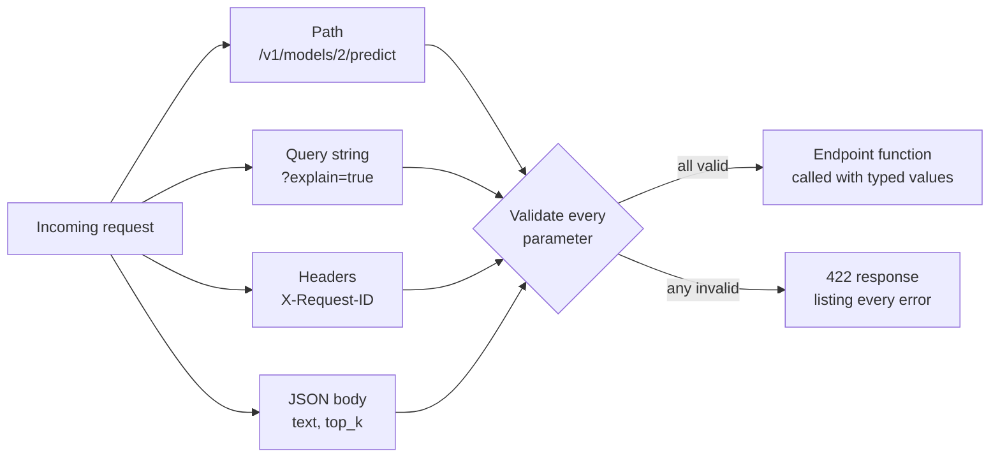

An HTTP request carries data in several places at once: the URL path, the query string, headers, cookies and the body. A prediction endpoint might read a model version from the path, a `limit` from the query string, a request ID from a header and the text to classify from a JSON body. FastAPI lets you declare where each value comes from and what makes it valid, all in the function signature, and rejects bad requests before your model ever sees them.

The [Pydantic](/learn/fastapi/pydantic) lesson showed how to validate a JSON body. This lesson covers the other sources, the modern `Annotated` style for declaring them, and how to control the 422 error response that clients receive.

## Where each value comes from

FastAPI provides one marker function per source. You attach it to a type using `typing.Annotated`, which reads as "this type, plus this extra information":

| Source | Marker | Example declaration |
| --- | --- | --- |
| Path segment | `Path` | `model_id: Annotated[int, Path(ge=1)]` |
| Query string | `Query` | `limit: Annotated[int, Query(le=100)] = 10` |
| Header | `Header` | `x_request_id: Annotated[str \| None, Header()] = None` |
| Cookie | `Cookie` | `session: Annotated[str \| None, Cookie()] = None` |
| JSON body | `Body` or a Pydantic model | `req: PredictRequest` |

Without a marker, FastAPI infers the source: names in the path are path parameters, Pydantic models are the body, and other simple types are query parameters. The markers let you add constraints, documentation, aliases and sources that cannot be inferred, such as headers.



> [!NOTE]
> Older code puts the marker in the default value: `limit: int = Query(10, le=100)`. It still works, but the `Annotated` form is now recommended, because the function keeps a normal Python default and the type information can be reused across functions.

## Path and query constraints

`Path` and `Query` accept the same numeric and string constraints as Pydantic's `Field`: `gt`, `ge`, `lt`, `le`, `min_length`, `max_length` and `pattern`, plus documentation such as `description`.

```python
from typing import Annotated

from fastapi import Body, FastAPI, Header, Path, Query
from fastapi.testclient import TestClient
from pydantic import BaseModel, Field

POSITIVE = {"good", "great", "love", "excellent", "fast", "helpful"}
NEGATIVE = {"bad", "terrible", "hate", "slow", "broken", "useless"}


def classify(text: str) -> tuple[str, float]:
    words = [w.strip(".,!?").lower() for w in text.split()]
    score = sum(w in POSITIVE for w in words) - sum(w in NEGATIVE for w in words)
    if score == 0:
        return "neutral", 0.5
    return ("positive" if score > 0 else "negative"), min(0.5 + 0.2 * abs(score), 0.99)


app = FastAPI(title="Sentiment API")


@app.get("/v1/predictions/search")
def search_predictions(
    q: Annotated[str, Query(min_length=2, max_length=50, description="Search term")],
    label: Annotated[str | None, Query(pattern="^(negative|neutral|positive)$")] = None,
    limit: Annotated[int, Query(ge=1, le=100)] = 10,
):
    return {"q": q, "label": label, "limit": limit}


client = TestClient(app)
print(client.get("/v1/predictions/search?q=slow&limit=5").json())

r = client.get("/v1/predictions/search?q=s&label=angry&limit=500")
print(r.status_code)
for err in r.json()["detail"]:
    print(err["loc"], "-", err["msg"])
```

```output
{'q': 'slow', 'label': None, 'limit': 5}
422
['query', 'q'] - String should have at least 2 characters
['query', 'label'] - String should match pattern '^(negative|neutral|positive)$'
['query', 'limit'] - Input should be less than or equal to 100
```

All three problems are reported in one response, each with its location, so the client can fix them together.

## Lists, aliases and headers

A query parameter declared as a list collects repeated keys: `?label=positive&label=neutral`. An `alias` lets the URL use a name that is not a valid Python identifier. Header parameters have their underscores converted to hyphens automatically, so `x_request_id` reads the `X-Request-ID` header (header names are case-insensitive).

```python
@app.get("/v1/predictions/export")
def export_predictions(
    labels: Annotated[list[str], Query(alias="label")] = [],
    model_version: Annotated[str, Query(alias="model-version")] = "lexicon-v1",
    x_request_id: Annotated[str | None, Header()] = None,
):
    return {"labels": labels, "model_version": model_version, "request_id": x_request_id}


r = client.get(
    "/v1/predictions/export?label=positive&label=neutral&model-version=lexicon-v2",
    headers={"X-Request-ID": "req-7f3a"},
)
print(r.json())
```

```output
{'labels': ['positive', 'neutral'], 'model_version': 'lexicon-v2', 'request_id': 'req-7f3a'}
```

Using `[]` as a default looks like the mutable-default trap from plain Python, but FastAPI copies defaults for each request, so it is safe here.

## Path parameters with Path

```python
@app.post("/v1/models/{model_version}/predict")
def predict_with_model(
    model_version: Annotated[int, Path(ge=1, le=2, description="Model version number")],
    text: Annotated[str, Body(embed=True, min_length=1, max_length=2000)],
    explain: bool = False,
):
    label, conf = classify(text)
    result = {"model_version": model_version, "label": label, "confidence": round(conf, 2)}
    if explain:
        result["explanation"] = "word-count lexicon"
    return result


print(client.post("/v1/models/2/predict?explain=true", json={"text": "great and fast"}).json())
r = client.post("/v1/models/7/predict", json={"text": "fine"})
print(r.status_code, r.json()["detail"][0]["loc"])
```

```output
{'model_version': 2, 'label': 'positive', 'confidence': 0.9, 'explanation': 'word-count lexicon'}
422 ['path', 'model_version']
```

This endpoint mixes three sources: `model_version` from the path, `explain` from the query string and `text` from the body.

## Body parameters: models, embed and multiple bodies

How FastAPI expects the body depends on how many body parameters you declare:

| Declaration | Expected JSON body |
| --- | --- |
| `req: PredictRequest` | `{"text": "...", "top_k": 1}` |
| `text: Annotated[str, Body(embed=True)]` | `{"text": "..."}` |
| `text: Annotated[str, Body()]` | `"..."` (a bare JSON string) |
| `req: PredictRequest, options: Options` | `{"req": {...}, "options": {...}}` |

With a single model, the body **is** the model. With two or more body parameters, FastAPI expects one key per parameter name. `Body(embed=True)` forces the keyed form even for a single parameter, which is why the endpoint above takes `{"text": "..."}`.

```python
class PredictRequest(BaseModel):
    text: str = Field(min_length=1, max_length=2000)
    top_k: int = Field(default=1, ge=1, le=3)


class Options(BaseModel):
    explain: bool = False
    language: str = "en"


@app.post("/v1/predict/advanced")
def predict_advanced(req: PredictRequest, options: Options):
    label, conf = classify(req.text)
    return {"label": label, "explain": options.explain, "language": options.language}


body = {"req": {"text": "love it"}, "options": {"explain": True}}
print(client.post("/v1/predict/advanced", json=body).json())
print(client.post("/v1/predict/advanced", json={"text": "love it"}).status_code)
```

```output
{'label': 'positive', 'explain': True, 'language': 'en'}
422
```

The second call fails because, with two body parameters, the top-level keys must be `req` and `options`.

## Grouping query parameters in a model

When an endpoint has many query parameters, you can collect them in a Pydantic model and mark it with `Query()`. The constraints live in one reusable class, and `extra="forbid"` rejects unknown query keys.

```python
from pydantic import ConfigDict


class ListFilters(BaseModel):
    model_config = ConfigDict(extra="forbid")

    label: str | None = None
    min_confidence: float = Field(default=0.0, ge=0, le=1)
    limit: int = Field(default=10, ge=1, le=100)


@app.get("/v1/predictions")
def list_predictions(filters: Annotated[ListFilters, Query()]):
    return filters.model_dump()


print(client.get("/v1/predictions?label=negative&limit=3").json())
r = client.get("/v1/predictions?limt=3")
print(r.status_code, r.json()["detail"][0]["msg"])
```

```output
{'label': 'negative', 'min_confidence': 0.0, 'limit': 3}
422 Extra inputs are not permitted
```

## Customising the 422 response

FastAPI's default error body includes an `input` field that echoes what the client sent. For a text API that can mean echoing back a large document, or personal data, in every error response and log line. You can replace the default by registering a handler for `RequestValidationError`:

```python
from fastapi import Request
from fastapi.exceptions import RequestValidationError
from fastapi.responses import JSONResponse

public_app = FastAPI(title="Sentiment API")


@public_app.exception_handler(RequestValidationError)
async def validation_handler(request: Request, exc: RequestValidationError):
    errors = [
        {"field": ".".join(str(part) for part in err["loc"]), "message": err["msg"]}
        for err in exc.errors()
    ]
    return JSONResponse(status_code=422, content={"error": "invalid_request", "errors": errors})


public_app.include_router(app.router)  # reuse every route defined so far
public_client = TestClient(public_app)

r = public_client.post("/v1/models/1/predict", json={"text": ""})
print(r.status_code, r.json())
```

```output
422 {'error': 'invalid_request', 'errors': [{'field': 'body.text', 'message': 'String should have at least 1 character'}]}
```

The status code stays 422, but the body now follows your own contract and never echoes the input. Register exception handlers where you create the app, before it serves its first request: the application assembles its error-handling stack on first use. Here a second app is created for that reason and reuses the existing routes through `include_router(app.router)`. A consistent error format across endpoints is one of the practices from [error handling](/learn/backend-development/error-handling); the next lesson adds handlers for your own exceptions too.

> [!WARNING]
> Validation limits are your first line of defence for an AI endpoint. Without `max_length` on text and `le` on batch sizes or `max_tokens`, one request can tie up a GPU for minutes. Set limits on every field that drives compute cost.

## Exercises

**1.** Write `GET /v1/models/{model_name}/labels` where `model_name` must match the pattern `^lexicon-v[0-9]+$` and an optional `lang` query parameter must be exactly two lowercase letters. Show one valid and one invalid call.

<details>
<summary>Show solution</summary>

```python
@public_app.get("/v1/models/{model_name}/labels")
def model_labels(
    model_name: Annotated[str, Path(pattern="^lexicon-v[0-9]+$")],
    lang: Annotated[str, Query(pattern="^[a-z]{2}$")] = "en",
):
    return {"model": model_name, "lang": lang}


print(public_client.get("/v1/models/lexicon-v2/labels?lang=fr").json())
print(public_client.get("/v1/models/bert/labels?lang=FR").json()["errors"])
```

```output
{'model': 'lexicon-v2', 'lang': 'fr'}
[{'field': 'path.model_name', 'message': "String should match pattern '^lexicon-v[0-9]+$'"}, {'field': 'query.lang', 'message': "String should match pattern '^[a-z]{2}$'"}]
```

The second response uses the custom error format, because the route lives on `public_app`, where the handler is registered.

</details>

**2.** An endpoint is declared as `def predict(text: str)`. A client posts `{"text": "hello"}` as JSON and gets a 422 saying a query parameter is missing. Explain and fix it in two different ways.

<details>
<summary>Show solution</summary>

A plain `str` parameter that is not in the path is treated as a **query** parameter, so FastAPI looks for `?text=...` and ignores the body. Fix one: declare `text: Annotated[str, Body(embed=True)]`. Fix two (usually better): define `class PredictRequest(BaseModel): text: str` and declare `req: PredictRequest`, which also gives you a named schema in the docs.

</details>

**3.** Why is it a good idea to remove the `input` field from validation errors in a public text-classification API? Name two concrete risks.

<details>
<summary>Show solution</summary>

The `input` field echoes what the client sent. Risks: (1) large payloads are reflected back and written into logs, wasting bandwidth and storage; (2) personal or confidential text ends up in error logs and monitoring tools that have wider access than the main data store. Echoing input can also help attackers probe how your validation behaves.

</details>

```quiz
[
  {
    "q": "How does FastAPI read the parameter `x_request_id: Annotated[str | None, Header()] = None`?",
    "options": [
      "From the query parameter `x_request_id`",
      "From the `X-Request-ID` HTTP header",
      "From a cookie named `x_request_id`",
      "From a body field called `x_request_id`"
    ],
    "answer": 1,
    "why": "Header parameters convert underscores to hyphens, and HTTP header names are case-insensitive."
  },
  {
    "q": "An endpoint declares two Pydantic body parameters, `req: PredictRequest` and `options: Options`. What body must the client send?",
    "options": [
      "The fields of both models merged at the top level",
      "Only the fields of `PredictRequest`",
      "A JSON object with keys `req` and `options`",
      "A JSON array of two objects"
    ],
    "answer": 2,
    "why": "With more than one body parameter, FastAPI expects each to be embedded under its parameter name."
  },
  {
    "q": "Which declaration makes `limit` an optional query parameter between 1 and 100 with default 10?",
    "options": [
      "`limit: Annotated[int, Query(ge=1, le=100)] = 10`",
      "`limit: Annotated[int, Path(ge=1, le=100)] = 10`",
      "`limit: int = Body(10, ge=1, le=100)`",
      "`limit: Annotated[int, Query(gt=1, lt=100)]`"
    ],
    "answer": 0,
    "why": "`Query` marks the source and holds the constraints, and the Python default makes it optional. The last option has no default, so it is required, and uses strict inequalities."
  },
  {
    "q": "Why register a handler for `RequestValidationError`?",
    "options": [
      "To make FastAPI skip validation for trusted clients",
      "To convert validation errors into 200 responses",
      "To validate response bodies",
      "To control the shape of 422 error bodies, for example removing echoed input"
    ],
    "answer": 3,
    "why": "The handler receives the validation errors and returns whatever response you build, so you can enforce a consistent error format."
  }
]
```
