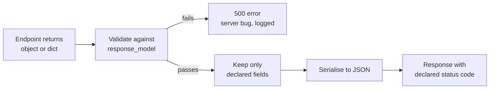
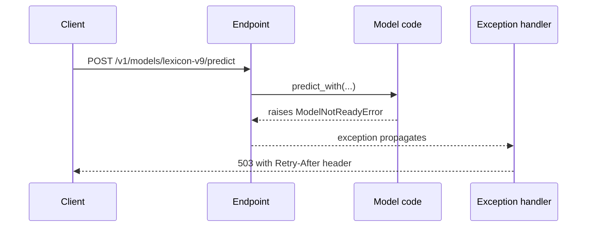

Validating what comes **in** is only half of an API contract. Clients also depend on what comes **out**: the field names, their types, the status code and the shape of errors. A model server that sometimes returns `confidence` as a string, leaks an internal `raw_logits` field, or answers a missing resource with status 200 and an error message breaks its clients in ways that are hard to debug.

FastAPI's **response models** apply the same Pydantic machinery to outputs. This lesson covers declaring response models, choosing status codes, raising HTTP errors properly and handling your own exceptions, continuing the sentiment API.

## Declaring a response model

There are two equivalent ways to declare what an endpoint returns: a **return type annotation**, or the `response_model` argument on the decorator. FastAPI then validates the returned value against that model, converts it, filters out anything not declared, and documents the schema in `/docs`.

```python
from typing import Literal

from fastapi import FastAPI, HTTPException, status
from fastapi.testclient import TestClient
from pydantic import BaseModel, Field

POSITIVE = {"good", "great", "love", "excellent", "fast", "helpful"}
NEGATIVE = {"bad", "terrible", "hate", "slow", "broken", "useless"}


def classify(text: str) -> tuple[str, float]:
    words = [w.strip(".,!?").lower() for w in text.split()]
    score = sum(w in POSITIVE for w in words) - sum(w in NEGATIVE for w in words)
    if score == 0:
        return "neutral", 0.5
    return ("positive" if score > 0 else "negative"), min(0.5 + 0.2 * abs(score), 0.99)


class PredictRequest(BaseModel):
    text: str = Field(min_length=1, max_length=2000)


class PredictResponse(BaseModel):
    label: Literal["negative", "neutral", "positive"]
    confidence: float = Field(ge=0, le=1)
    model_version: str


app = FastAPI(title="Sentiment API")


@app.post("/v1/predict")
def predict(req: PredictRequest) -> PredictResponse:
    label, conf = classify(req.text)
    return PredictResponse(label=label, confidence=round(conf, 2), model_version="lexicon-v1")


client = TestClient(app)
print(client.post("/v1/predict", json={"text": "terrible and slow"}).json())
```

```output
{'label': 'negative', 'confidence': 0.9, 'model_version': 'lexicon-v1'}
```

## Filtering out internal fields

The more important job of a response model is to act as a **filter**. Internal objects often carry data that must not leave the server: raw scores, debug information, user IDs, API keys. When `response_model` is set, only its declared fields are sent, even if you return a richer object.

```python
import numpy as np


class InternalPrediction(BaseModel):
    label: str
    confidence: float
    model_version: str
    raw_scores: list[float]   # internal: not for clients
    debug_tokens: list[str]   # internal


def run_model(text: str) -> InternalPrediction:
    label, conf = classify(text)
    return InternalPrediction(
        label=label,
        confidence=np.float32(conf),   # model libraries return NumPy types
        model_version="lexicon-v1",
        raw_scores=np.array([0.1, 0.2, 0.7]).tolist(),
        debug_tokens=text.lower().split(),
    )


@app.post("/v2/predict", response_model=PredictResponse)
def predict_v2(req: PredictRequest):
    return run_model(req.text)


print(client.post("/v2/predict", json={"text": "great"}).json())
```

```output
{'label': 'positive', 'confidence': 0.699999988079071, 'model_version': 'lexicon-v1'}
```

`raw_scores` and `debug_tokens` were removed, and the NumPy `float32` was converted to a plain float by Pydantic. The odd value `0.699999988...` is not a bug in FastAPI: 0.7 cannot be stored exactly in 32 bits, and the conversion to a 64-bit Python float exposes the error. Convert model outputs with `float(...)` and round them before building the response if clients will display them. Here the decorator argument is used rather than a return annotation, because the function returns an `InternalPrediction`, not a `PredictResponse`; the annotation would be misleading to type checkers.



> [!KEY]
> A response model is a security boundary as well as documentation. Treat "what the client may see" as a separate model from "what the code works with", and the filter makes leaks of internal fields much harder.

If the returned data does not match the response model, for example a `label` of `"angry"`, FastAPI raises an error and the client gets **500**: that is a bug in your server, not in the request.

A few decorator options fine-tune the output:

| Option | Effect |
| --- | --- |
| `response_model_exclude_none=True` | Drop fields whose value is `None` |
| `response_model_exclude_unset=True` | Drop fields that were never explicitly set |
| `response_model_include={...}` / `response_model_exclude={...}` | Quick per-endpoint field selection; separate models are usually clearer |

## Status codes

Every path operation has a default status code of 200. Set another with `status_code`, preferably using the named constants in `fastapi.status` so the intent is readable. Creating a resource should return **201 Created**; deleting one commonly returns **204 No Content** with an empty body.

```python
class FeedbackIn(BaseModel):
    prediction_id: int = Field(gt=0)
    correct_label: Literal["negative", "neutral", "positive"]


class FeedbackOut(FeedbackIn):
    id: int


FEEDBACK: dict[int, FeedbackOut] = {}


@app.post("/v1/feedback", status_code=status.HTTP_201_CREATED)
def create_feedback(fb: FeedbackIn) -> FeedbackOut:
    record = FeedbackOut(id=len(FEEDBACK) + 1, **fb.model_dump())
    FEEDBACK[record.id] = record
    return record


@app.delete("/v1/feedback/{feedback_id}", status_code=status.HTTP_204_NO_CONTENT)
def delete_feedback(feedback_id: int) -> None:
    FEEDBACK.pop(feedback_id, None)


r = client.post("/v1/feedback", json={"prediction_id": 12, "correct_label": "neutral"})
print(r.status_code, r.json())
r = client.delete("/v1/feedback/1")
print(r.status_code, repr(r.text))
```

```output
201 {'prediction_id': 12, 'correct_label': 'neutral', 'id': 1}
204 ''
```

## Raising HTTP errors

When a request is valid but cannot be served, such as asking for a prediction that does not exist, **raise** `HTTPException` with the right status code. Raising stops the function immediately, and FastAPI turns the exception into a JSON response with a `detail` field.

```python
PREDICTIONS = {
    1: PredictResponse(label="positive", confidence=0.9, model_version="lexicon-v1"),
}


@app.get("/v1/predictions/{prediction_id}")
def get_prediction(prediction_id: int) -> PredictResponse:
    if prediction_id not in PREDICTIONS:
        raise HTTPException(
            status_code=status.HTTP_404_NOT_FOUND,
            detail=f"Prediction {prediction_id} not found",
        )
    return PREDICTIONS[prediction_id]


print(client.get("/v1/predictions/1").json())
r = client.get("/v1/predictions/99")
print(r.status_code, r.json())
```

```output
{'label': 'positive', 'confidence': 0.9, 'model_version': 'lexicon-v1'}
404 {'detail': 'Prediction 99 not found'}
```

`detail` can be any JSON-serialisable value, including a dictionary with an error code, and `headers=` lets you add response headers such as `WWW-Authenticate` or `Retry-After`. The status codes themselves were covered in [error handling](/learn/backend-development/error-handling); the usual ones for a model API are:

| Status | When |
| --- | --- |
| 400 Bad Request | Valid shape but unusable content that validation cannot express |
| 401 / 403 | Missing credentials / authenticated but not allowed |
| 404 Not Found | The resource does not exist |
| 409 Conflict | The request clashes with current state, such as a duplicate |
| 413 Content Too Large | The input exceeds a size you can process |
| 422 Unprocessable Content | Validation failed (FastAPI sends this for you) |
| 429 Too Many Requests | Rate limit exceeded |
| 503 Service Unavailable | The model is not loaded or a dependency is down |

## Custom exceptions and handlers

Deep inside model code, you do not want to import FastAPI just to raise an `HTTPException`. Instead, define domain exceptions and map them to HTTP responses in one place with `@app.exception_handler`. Handlers must be registered when the app is created, before it serves requests.

```python
from fastapi import Request
from fastapi.responses import JSONResponse


class ModelNotReadyError(Exception):
    def __init__(self, model_name: str):
        self.model_name = model_name


api = FastAPI(title="Sentiment API")


@api.exception_handler(ModelNotReadyError)
async def model_not_ready_handler(request: Request, exc: ModelNotReadyError):
    return JSONResponse(
        status_code=503,
        content={"error": "model_not_ready", "model": exc.model_name},
        headers={"Retry-After": "30"},
    )


LOADED_MODELS = {"lexicon-v1"}


def predict_with(model_name: str, text: str) -> PredictResponse:
    if model_name not in LOADED_MODELS:
        raise ModelNotReadyError(model_name)   # plain Python, no HTTP knowledge
    label, conf = classify(text)
    return PredictResponse(label=label, confidence=round(conf, 2), model_version=model_name)


@api.post("/v1/models/{model_name}/predict")
def predict_named(model_name: str, req: PredictRequest) -> PredictResponse:
    return predict_with(model_name, req.text)


c = TestClient(api)
print(c.post("/v1/models/lexicon-v1/predict", json={"text": "helpful"}).json())
r = c.post("/v1/models/lexicon-v9/predict", json={"text": "helpful"})
print(r.status_code, r.headers["retry-after"], r.json())
```

```output
{'label': 'positive', 'confidence': 0.7, 'model_version': 'lexicon-v1'}
503 30 {'error': 'model_not_ready', 'model': 'lexicon-v9'}
```



## Documenting extra responses

`/docs` shows the success response and the 422 automatically, but not your 404s or 503s. The `responses` argument adds them to the OpenAPI schema so client developers know what to handle:

```python
class ErrorBody(BaseModel):
    detail: str


@app.get(
    "/v1/models/{name}",
    responses={404: {"model": ErrorBody, "description": "Unknown model"}},
)
def model_info(name: str):
    if name != "lexicon-v1":
        raise HTTPException(404, detail="Unknown model")
    return {"name": name}


print(sorted(app.openapi()["paths"]["/v1/models/{name}"]["get"]["responses"]))
```

```output
['200', '404', '422']
```

> [!TIP]
> Returning a `Response` object yourself, such as `JSONResponse(...)`, bypasses the response model entirely: no validation and no filtering. Do it only when you need full control over headers or content, and remember that the docs will no longer describe that output accurately.

## Exercises

**1.** Write `GET /v1/feedback/{feedback_id}` on `app` that returns a `FeedbackOut` or raises a 404 with `detail` set to `{"code": "feedback_not_found", "id": feedback_id}`. Show both outcomes after creating one feedback record.

<details>
<summary>Show solution</summary>

```python
@app.get("/v1/feedback/{feedback_id}")
def get_feedback(feedback_id: int) -> FeedbackOut:
    if feedback_id not in FEEDBACK:
        raise HTTPException(404, detail={"code": "feedback_not_found", "id": feedback_id})
    return FEEDBACK[feedback_id]


new = client.post("/v1/feedback", json={"prediction_id": 3, "correct_label": "positive"}).json()
print(client.get(f"/v1/feedback/{new['id']}").json())
print(client.get("/v1/feedback/500").json())
```

```output
{'prediction_id': 3, 'correct_label': 'positive', 'id': 1}
{'detail': {'code': 'feedback_not_found', 'id': 500}}
```

</details>

**2.** An endpoint has `response_model=PredictResponse` but the code returns a dictionary with `"label": "mixed"`. What does the client receive, and whose fault is it?

<details>
<summary>Show solution</summary>

The client receives **500 Internal Server Error**. The returned data fails validation against the response model (`label` must be one of three literals), which FastAPI treats as a server bug, not a client error. The fix belongs in the server: either the model code produced an invalid label, or the response model needs updating, which is a contract change clients should be told about.

</details>

**3.** Why is it better to raise a custom `ModelNotReadyError` in model-loading code than to raise `HTTPException(503)` there directly?

<details>
<summary>Show solution</summary>

It keeps the model code independent of the web framework: the same function can be used from a batch job, a CLI or a test without FastAPI. The mapping from domain error to HTTP status lives in one handler, so changing the response format (for example adding `Retry-After`) happens in one place rather than in every function that can fail.

</details>

```quiz
[
  {
    "q": "An endpoint with `response_model=PredictResponse` returns an object that also has a `raw_scores` field not declared in `PredictResponse`. What does the client receive?",
    "options": [
      "A 500 error, because the object has extra fields",
      "All fields including `raw_scores`",
      "Only the fields declared in `PredictResponse`",
      "An empty JSON object"
    ],
    "answer": 2,
    "why": "The response model filters output to its declared fields, which is how it prevents internal data from leaking."
  },
  {
    "q": "Which status code should a successful `POST /v1/feedback` that creates a record usually return?",
    "options": ["200", "201", "204", "202"],
    "answer": 1,
    "why": "201 Created signals that a new resource was created. 204 is for success with no body, and 202 for accepted-but-not-yet-processed work."
  },
  {
    "q": "What is the effect of `raise HTTPException(status_code=404, detail=\"Not found\")` inside an endpoint?",
    "options": [
      "The function stops and the client gets 404 with body `{\"detail\": \"Not found\"}`",
      "The server crashes and returns 500",
      "The error is logged but the client gets 200",
      "FastAPI retries the request once"
    ],
    "answer": 0,
    "why": "FastAPI catches `HTTPException` and converts it into a JSON response with the given status code and `detail`."
  },
  {
    "q": "Returning `JSONResponse(content=...)` directly from an endpoint that declares a response model means:",
    "options": [
      "The content is still validated and filtered",
      "FastAPI raises an error at startup",
      "The status code is forced to 200",
      "The response model is bypassed: no validation or filtering"
    ],
    "answer": 3,
    "why": "Response objects are sent as they are, so you take full responsibility for their content."
  }
]
```
