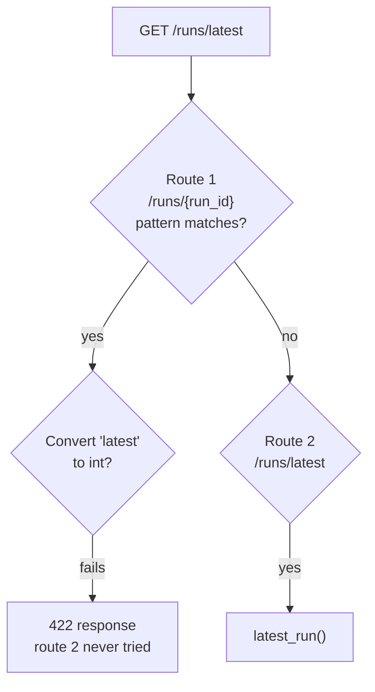
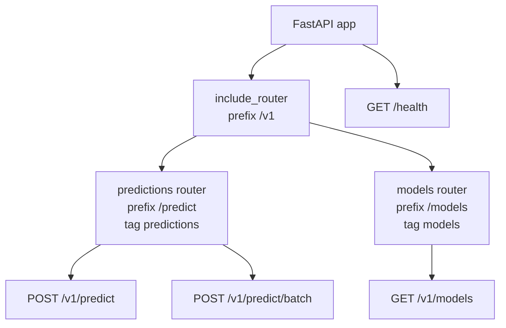

Routing decides which function handles which request. A one-endpoint demo needs none of it, but a real AI service quickly grows a dozen endpoints: predictions, batch predictions, model metadata, feedback collection, health checks, admin tools. This lesson shows how FastAPI maps URLs to functions, how it pulls values out of the path and the query string, and how to split an application into **routers** so it stays organised as it grows.

The REST conventions themselves (resources as nouns, methods as verbs) were covered in [REST APIs](/learn/backend-development/rest-apis). Here you put them into code, continuing the sentiment API from [FastAPI fundamentals](/learn/fastapi/fastapi-fundamentals).

## Path parameters

A segment in curly braces becomes a **path parameter**, passed to your function by name. The type hint tells FastAPI how to convert it.

```python
from fastapi import FastAPI
from fastapi.testclient import TestClient

app = FastAPI(title="Sentiment API")

MODELS = {
    "lexicon-v1": {"name": "lexicon-v1", "labels": ["negative", "neutral", "positive"]},
    "lexicon-v2": {"name": "lexicon-v2", "labels": ["negative", "positive"]},
}
PREDICTIONS = {1: {"id": 1, "text": "great tool", "label": "positive"}}


@app.get("/models/{model_name}")
def get_model(model_name: str):
    return MODELS.get(model_name, {"error": "unknown model"})


@app.get("/predictions/{prediction_id}")
def get_prediction(prediction_id: int):
    return PREDICTIONS.get(prediction_id, {"error": "not found"})


client = TestClient(app)
print(client.get("/models/lexicon-v2").json())
print(client.get("/predictions/1").json())
r = client.get("/predictions/abc")
print(r.status_code, r.json()["detail"][0]["msg"])
```

```output
{'name': 'lexicon-v2', 'labels': ['negative', 'positive']}
{'id': 1, 'text': 'great tool', 'label': 'positive'}
422 Input should be a valid integer, unable to parse string as an integer
```

`prediction_id: int` means `"1"` in the URL arrives as the integer `1`, and `"abc"` is rejected with a 422 before your code runs. (Returning an error dictionary with status 200 is bad practice; the lesson on [response models](/learn/fastapi/response-models) replaces it with proper 404 responses.)

## Query parameters

Any function parameter that is **not** in the path and is a simple type (`str`, `int`, `float`, `bool`) is read from the **query string**, the part after `?`. A default value makes it optional; no default makes it required.

```python
@app.get("/predictions")
def list_predictions(label: str | None = None, limit: int = 10, include_text: bool = True):
    return {"label": label, "limit": limit, "include_text": include_text}


print(client.get("/predictions").json())
print(client.get("/predictions?label=positive&limit=3&include_text=no").json())
```

```output
{'label': None, 'limit': 10, 'include_text': True}
{'label': 'positive', 'limit': 3, 'include_text': False}
```

Booleans accept `true`/`false`, `1`/`0`, `yes`/`no` and `on`/`off`, so `include_text=no` becomes `False`.

| Where the value lives | How FastAPI decides | Example |
| --- | --- | --- |
| Path | Name appears in `{...}` in the route | `/models/{model_name}` |
| Query string | Simple type, not in the path | `?limit=3` |
| Request body | Pydantic model type | `req: PredictRequest` |

## Restricting values with an Enum

When only a fixed set of values is valid, use an `Enum` that inherits from `str`. FastAPI validates the value and lists the choices in the docs as a drop-down.

```python
from enum import Enum


class ModelName(str, Enum):
    v1 = "lexicon-v1"
    v2 = "lexicon-v2"


@app.get("/labels/{model_name}")
def get_labels(model_name: ModelName):
    return {"model": model_name.value, "labels": MODELS[model_name.value]["labels"]}


print(client.get("/labels/lexicon-v1").json())
r = client.get("/labels/gpt-9")
print(r.status_code, r.json()["detail"][0]["msg"])
```

```output
{'model': 'lexicon-v1', 'labels': ['negative', 'neutral', 'positive']}
422 Input should be 'lexicon-v1' or 'lexicon-v2'
```

## Route order matters

FastAPI checks routes **in the order they were registered** and uses the first match. A fixed path such as `/models/latest` must therefore be declared **before** a parameterised path like `/models/{model_name}`, or the parameter swallows it.

```python
@app.get("/runs/{run_id}")
def get_run(run_id: int):
    return {"run_id": run_id}


@app.get("/runs/latest")  # registered too late: never reached
def latest_run():
    return {"run_id": 42}


r = client.get("/runs/latest")
print(r.status_code, r.json()["detail"][0]["loc"])
```

```output
422 ['path', 'run_id']
```

The request matched `/runs/{run_id}` first, then failed to turn `"latest"` into an integer. Swap the two declarations and both work.



> [!WARNING]
> Route order is a common source of baffling 422 errors. When a fixed path and a parameterised path share a prefix, register the fixed one first.

## Organising endpoints with APIRouter

Putting every endpoint on `app` in one file stops working after a few dozen routes. An **`APIRouter`** is a mini-application: you attach path operations to it, give it a URL **prefix** and documentation **tags**, and then include it in the main app. The usual project layout looks like this:

```text
sentiment_api/
    main.py              # creates app, includes routers
    routers/
        predictions.py   # router = APIRouter(prefix="/predict", tags=["predictions"])
        models.py        # router = APIRouter(prefix="/models", tags=["models"])
        health.py
```

Here are the routers in one block, so you can run them:

```python
from fastapi import APIRouter
from pydantic import BaseModel

POSITIVE = {"good", "great", "love", "excellent", "fast", "helpful"}
NEGATIVE = {"bad", "terrible", "hate", "slow", "broken", "useless"}


def classify(text: str) -> tuple[str, float]:
    words = [w.strip(".,!?").lower() for w in text.split()]
    score = sum(w in POSITIVE for w in words) - sum(w in NEGATIVE for w in words)
    if score == 0:
        return "neutral", 0.5
    return ("positive" if score > 0 else "negative"), min(0.5 + 0.2 * abs(score), 0.99)


class PredictRequest(BaseModel):
    text: str


class BatchRequest(BaseModel):
    texts: list[str]


# routers/predictions.py
predictions = APIRouter(prefix="/predict", tags=["predictions"])


@predictions.post("")
def predict(req: PredictRequest):
    label, conf = classify(req.text)
    return {"label": label, "confidence": round(conf, 2)}


@predictions.post("/batch")
def predict_batch(req: BatchRequest):
    return [{"text": t, "label": classify(t)[0]} for t in req.texts]


# routers/models.py
models = APIRouter(prefix="/models", tags=["models"])


@models.get("")
def list_models():
    return sorted(MODELS)


# main.py
api = FastAPI(title="Sentiment API")
api.include_router(predictions, prefix="/v1")
api.include_router(models, prefix="/v1")


@api.get("/health", tags=["health"])
def health():
    return {"status": "ok"}


for path, operations in api.openapi()["paths"].items():
    for method, op in operations.items():
        print(method.upper(), path, op["tags"])
```

```output
POST /v1/predict ['predictions']
POST /v1/predict/batch ['predictions']
GET /v1/models ['models']
GET /health ['health']
```

The prefixes stack: the router's own `/predict` sits under the `/v1` passed to `include_router`, giving `/v1/predict/batch`. Tags group endpoints into sections in `/docs`, so the Swagger page shows separate "predictions", "models" and "health" headings.

```python
c = TestClient(api)
print(c.post("/v1/predict", json={"text": "fast and helpful"}).json())
print(c.post("/v1/predict/batch", json={"texts": ["bad", "great", "ok"]}).json())
print(c.get("/v1/models").json())
```

```output
{'label': 'positive', 'confidence': 0.9}
[{'text': 'bad', 'label': 'negative'}, {'text': 'great', 'label': 'positive'}, {'text': 'ok', 'label': 'neutral'}]
['lexicon-v1', 'lexicon-v2']
```



> [!TIP]
> Putting a version prefix such as `/v1` in `include_router` lets you later mount a `/v2` router with a changed response format while existing clients keep calling `/v1`. Model APIs change shape often, so version them from day one.

Routers can also carry shared settings. `APIRouter(prefix="/admin", tags=["admin"], dependencies=[...])` applies a dependency, such as an authentication check, to every route on it. You will use that in [dependency injection](/learn/fastapi/dependency-injection) and [authentication](/learn/fastapi/authentication).

## Trailing slashes

`/v1/models` and `/v1/models/` are different paths. By default, if a request arrives with a trailing slash that no route has, FastAPI responds with a **307 redirect** to the version without it (and vice versa). `TestClient` follows redirects, so you only see the redirect if you ask:

```python
r = c.get("/v1/models/", follow_redirects=False)
print(r.status_code, r.headers["location"])
```

```output
307 http://testserver/v1/models
```

Browsers and `httpx` follow this automatically, but some HTTP clients do not, and a redirected `POST` costs an extra round trip. Pick one style and document the exact paths.

## Exercises

**1.** Add a `GET /v1/models/{model_name}` route to the `models` router that returns the model's details from `MODELS`, using the `ModelName` enum for validation. Include the router in a fresh app and call it for `lexicon-v1`.

<details>
<summary>Show solution</summary>

```python
@models.get("/{model_name}")
def model_detail(model_name: ModelName):
    return MODELS[model_name.value]


api2 = FastAPI()
api2.include_router(models, prefix="/v1")
print(TestClient(api2).get("/v1/models/lexicon-v1").json())
```

```output
{'name': 'lexicon-v1', 'labels': ['negative', 'neutral', 'positive']}
```

Keep the habit of defining every route on a router before including it in the app. In a real project this happens naturally, because each router module is fully imported before `main.py` calls `include_router`.

</details>

**2.** A colleague registers `@app.get("/users/{user_id}")` and then `@app.get("/users/me")`. Requests to `/users/me` return 422. Explain why and give two fixes.

<details>
<summary>Show solution</summary>

Routes are matched in registration order, so `/users/me` matches `/users/{user_id}` first and `"me"` fails integer conversion. Fix one: register `/users/me` before `/users/{user_id}`. Fix two: give the parameterised route a stricter type, or move the fixed route to a path that does not overlap, such as `/me`.

</details>

**3.** Write a `GET /v1/predict/search` endpoint on the `predictions` router that takes a required query parameter `q` and an optional `limit` defaulting to 5. What status does a request without `q` get?

<details>
<summary>Show solution</summary>

```python
@predictions.get("/search")
def search(q: str, limit: int = 5):
    return {"q": q, "limit": limit}


api3 = FastAPI()
api3.include_router(predictions, prefix="/v1")
c3 = TestClient(api3)
print(c3.get("/v1/predict/search?q=slow").json())
print(c3.get("/v1/predict/search").status_code)
```

```output
{'q': 'slow', 'limit': 5}
422
```

A parameter with no default is required, so omitting `q` produces a 422 with `loc` of `['query', 'q']`.

</details>

```quiz
[
  {
    "q": "Given `@app.get(\"/items/{item_id}\")` and `def read(item_id: int, verbose: bool = False)`, where does `verbose` come from?",
    "options": ["The path", "The query string", "The JSON body", "A header"],
    "answer": 1,
    "why": "Simple-typed parameters not named in the path are read from the query string, for example `?verbose=true`."
  },
  {
    "q": "A router is created with `APIRouter(prefix=\"/predict\")` and included with `app.include_router(router, prefix=\"/v1\")`. A route on it is declared as `@router.post(\"/batch\")`. What is its full path?",
    "options": ["`/batch`", "`/predict/batch`", "`/v1/batch`", "`/v1/predict/batch`"],
    "answer": 3,
    "why": "Prefixes stack: the include prefix, then the router prefix, then the route path."
  },
  {
    "q": "Why might `GET /runs/latest` return 422 even though a `/runs/latest` route exists?",
    "options": [
      "A `/runs/{run_id: int}` route was registered earlier and matched first",
      "FastAPI does not allow the word `latest` in paths",
      "The route needs a `tags` argument",
      "GET routes cannot have fixed segments"
    ],
    "answer": 0,
    "why": "Routes are matched in registration order. The parameterised route matches the path, then integer conversion of `latest` fails."
  },
  {
    "q": "What does the `tags` argument on a router mainly affect?",
    "options": [
      "Which HTTP methods are allowed",
      "The URL prefix",
      "How endpoints are grouped in the generated documentation",
      "Whether responses are cached"
    ],
    "answer": 2,
    "why": "Tags group path operations into sections in the OpenAPI schema and therefore in `/docs`."
  }
]
```
