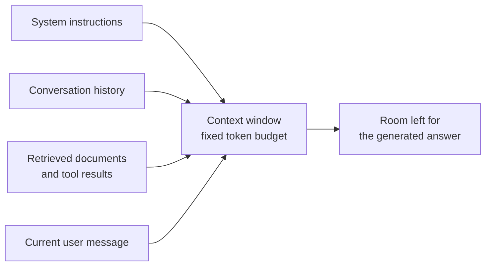
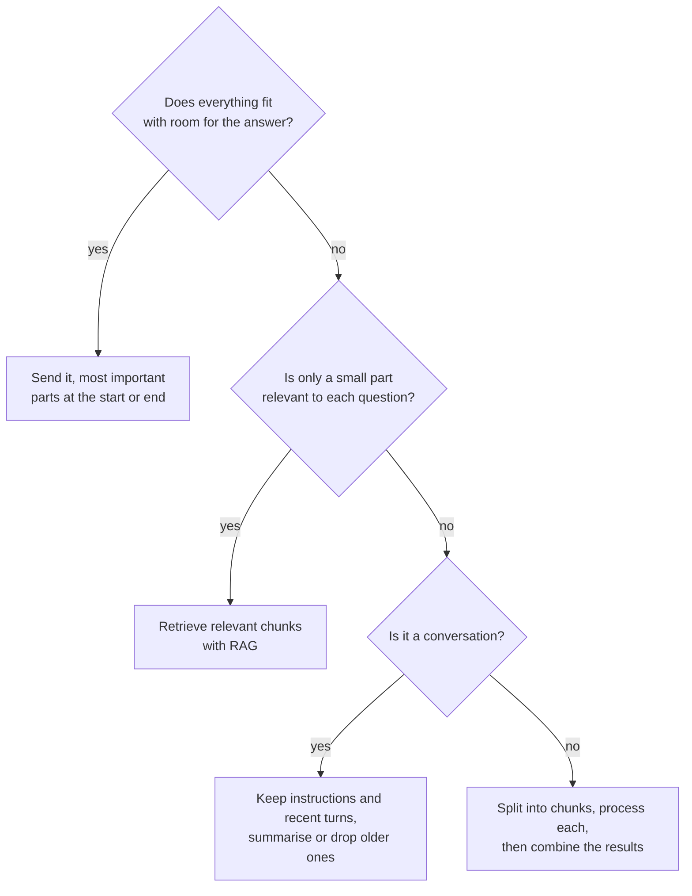

An LLM has no memory between calls. Everything it can use to produce an answer (the instructions, the conversation so far, any documents you paste in, and the answer it is writing) must fit inside a fixed budget of tokens called the **context window**. The size of that window decides whether you can hand a model a whole contract or only a page of it, how long a chat can run before it forgets the beginning, and how much each request costs in memory and time. This lesson explains where the limit comes from, why longer contexts are expensive, why a model may ignore information that is technically inside its window, and what to do when your data does not fit.

## What the context window contains

The context window is the maximum number of tokens the model can attend over in one forward pass. Input and output share it: if a model has a window of $W$ tokens and your prompt uses $P$ of them, the response can be at most $W - P$ tokens long (and APIs often impose a separate, smaller cap on output).



A chat application resends the whole history with every turn, because the model itself keeps nothing between calls. Each turn therefore uses more of the window than the last, and sooner or later something has to be dropped. Counting tokens, as shown in [Tokenization](/learn/generative-ai-fundamentals/tokenization), is how you track the budget.

## Why attention cost grows quadratically

In [self-attention](/learn/generative-ai-fundamentals/self-attention), every token computes a score against every token before it. For a sequence of $T$ tokens, each head in each layer builds a $T \times T$ score matrix:

$$
S = \frac{Q K^\top}{\sqrt{d_{\text{head}}}}, \qquad Q, K \in \mathbb{R}^{T \times d_{\text{head}}}, \quad S \in \mathbb{R}^{T \times T}
$$

Computing $S$ takes on the order of $T^2 d_{\text{head}}$ multiply-adds, so doubling the sequence length quadruples the attention work. The table shows the number of score entries for one head in one layer, and the memory that a single score matrix would need in 16-bit floats (2 bytes per entry) if it were stored in full.

```python
for T in [1_024, 4_096, 32_768, 131_072]:
    entries = T * T
    mib = entries * 2 / 2**20
    print(f"T={T:>7,}  entries={entries:>14,}  fp16 matrix={mib:>8,.0f} MiB  "
          f"relative cost={(T / 1024) ** 2:>6,.0f}x")
```

```output
T=  1,024  entries=     1,048,576  fp16 matrix=       2 MiB  relative cost=     1x
T=  4,096  entries=    16,777,216  fp16 matrix=      32 MiB  relative cost=    16x
T= 32,768  entries= 1,073,741,824  fp16 matrix=   2,048 MiB  relative cost= 1,024x
T=131,072  entries=17,179,869,184  fp16 matrix=  32,768 MiB  relative cost=16,384x
```

Going from 1,024 to 131,072 tokens multiplies the attention work by 16,384, while the text is only 128 times longer. Modern fused attention kernels, such as FlashAttention, compute attention in tiles and never store the full matrix, which keeps memory roughly linear in $T$. They do not change the arithmetic: the compute is still quadratic.

> [!NOTE]
> The feed-forward layers of a Transformer cost an amount proportional to $T$, not $T^2$. For short prompts they dominate the total compute, and attention only becomes the main cost once sequences grow long. That is why the quadratic term matters most for long-context work.

## The KV cache: memory that grows with every token

When a model generates text, it would be wasteful to recompute the keys and values of the whole prompt for every new token. Instead it stores them in a **KV cache** and only computes keys and values for the newest token at each step (the [inference](/learn/generative-ai-fundamentals/inference) lesson walks through this loop). The cache grows linearly with the number of tokens in context:

$$
\text{KV bytes} = 2 \times L \times T \times h_{kv} \times d_{\text{head}} \times b \times B
$$

where $L$ is the number of layers, $T$ the tokens in context, $h_{kv}$ the number of key/value heads, $d_{\text{head}}$ the dimension per head, $b$ the bytes per number (2 for 16-bit), $B$ the batch size, and the leading 2 counts both keys and values. Here is the arithmetic for an **illustrative** mid-sized configuration:

```python
def kv_cache_gib(layers, tokens, kv_heads, d_head, bytes_per=2, batch=1):
    return 2 * layers * tokens * kv_heads * d_head * bytes_per * batch / 2**30

per_token_kib = kv_cache_gib(32, 1, 8, 128) * 2**20
print(f"per token: {per_token_kib:.0f} KiB")
print(f"131,072 tokens, 8 KV heads:  {kv_cache_gib(32, 131_072, 8, 128):.0f} GiB")
print(f"131,072 tokens, 32 KV heads: {kv_cache_gib(32, 131_072, 32, 128):.0f} GiB")
```

```output
per token: 128 KiB
131,072 tokens, 8 KV heads:  16 GiB
131,072 tokens, 32 KV heads: 64 GiB
```

One long conversation can need more memory for its cache than many GPUs have, before counting the model weights. Using fewer key/value heads than query heads, as in grouped-query attention from [Multi-head attention](/learn/generative-ai-fundamentals/multi-head-attention), shrinks the cache by the same factor, which is one reason it has become common. Cache management at serving scale is covered in [KV caching](/learn/advanced-llm-engineering/kv-caching).

## Advertised length versus usable length

A model's context window is set by how it was built and trained, not just by a configuration value.

| Limit | What it means |
| --- | --- |
| Trained length | The sequence lengths the model actually saw during training. Behaviour beyond it is unreliable unless the model was adapted |
| Positional scheme | How positions are encoded affects how well a model handles lengths beyond those it was trained on; see [Positional encoding](/learn/generative-ai-fundamentals/positional-encoding) |
| Serving memory | The provider or your GPU must hold the KV cache for the whole context |
| Effective use | Whether the model can actually find and use information anywhere in the window |

Long-context models are usually pretrained at a shorter length and then extended with further training on long sequences. Being able to *accept* a long input is not the same as *using* all of it well.

## Lost in the middle

Researchers studying long-context question answering (Liu et al., 2023, "Lost in the Middle: How Language Models Use Long Contexts") placed the one relevant document at different positions among many distractors. Accuracy was typically highest when the relevant document was near the **start** or the **end** of the context and noticeably lower when it sat in the middle, a U-shaped curve. Newer models have improved, but the general lesson still holds: position inside a long prompt affects how reliably information is used, and more context can dilute the signal.

> [!TIP]
> Put the instructions and the most important material at the start or the end of a long prompt, and repeat the key question after a long document. Then test with your own data: place a known fact at several depths and check whether the model retrieves it each time.

## Strategies when the data does not fit



- **Truncation**: keep the system message and the most recent turns, drop the oldest. Cheap and predictable, but forgets.
- **Summarisation**: replace old turns with a model-written summary. Keeps the gist, loses detail, and costs an extra call.
- **Retrieval**: store documents outside the model and insert only the relevant chunks, the subject of [What is RAG?](/learn/rag-fundamentals/what-is-rag).
- **Map-reduce**: process chunks separately (for example, summarise each section) and combine the partial results.

Here is truncation that always keeps the first (system) message and as many recent messages as fit a token budget:

```python
import tiktoken

enc = tiktoken.get_encoding("cl100k_base")

def fit_history(messages, budget):
    system, rest = messages[0], messages[1:]
    used = len(enc.encode(system))
    kept = []
    for msg in reversed(rest):              # newest first
        n = len(enc.encode(msg))
        if used + n > budget:
            break
        kept.append(msg)
        used += n
    return [system] + kept[::-1], used

history = [
    "You are a helpful support assistant.",
    "User: My order has not arrived.",
    "Assistant: Sorry to hear that. What is the order number?",
    "User: It is 48213, placed last Monday.",
    "Assistant: Thanks. It shows as delayed at the depot.",
    "User: Can I get a refund instead?",
]
kept, used = fit_history(history, budget=40)
print(used, "tokens")
for m in kept:
    print(m)
```

```output
40 tokens
You are a helpful support assistant.
User: It is 48213, placed last Monday.
Assistant: Thanks. It shows as delayed at the depot.
User: Can I get a refund instead?
```

The two oldest turns were dropped, including the user's original complaint that the order had not arrived. Real systems often combine truncation with a short running summary so that facts from early turns survive.

## Exercises

**1.** By what factor does the attention compute grow when a prompt goes from 8,000 to 24,000 tokens? By what factor does the KV cache grow?

<details>
<summary>Show solution</summary>

The length triples. Attention compute scales with $T^2$, so it grows by $3^2 = 9$ times. The KV cache scales with $T$, so it grows by 3 times.

</details>

**2.** Use `kv_cache_gib` to find the cache size for a batch of 8 requests of 16,384 tokens each, with 40 layers, 8 KV heads, a head dimension of 128 and 16-bit values.

<details>
<summary>Show solution</summary>

```python
print(f"{kv_cache_gib(40, 16_384, 8, 128, batch=8):.1f} GiB")
```

```output
20.0 GiB
```

</details>

**3.** Change `fit_history` so that, when anything is dropped, it inserts the message `"(earlier conversation omitted)"` after the system message, counting its tokens against the budget.

<details>
<summary>Show solution</summary>

```python
def fit_history_marked(messages, budget):
    marker = "(earlier conversation omitted)"
    kept, used = fit_history(messages, budget - len(enc.encode(marker)))
    if len(kept) < len(messages):
        return [kept[0], marker] + kept[1:], used + len(enc.encode(marker))
    return fit_history(messages, budget)

kept, used = fit_history_marked(history, budget=40)
print(used, kept[:2])
```

```output
34 ['You are a helpful support assistant.', '(earlier conversation omitted)']
```

Reserving the marker's tokens up front guarantees the result never exceeds the budget.

</details>

```quiz
[
  {
    "q": "A model has a 16,000-token context window and your prompt uses 15,200 tokens. What is the longest possible response?",
    "options": [
      "16,000 tokens, because output has its own window",
      "800 tokens, because input and output share the window",
      "15,200 tokens",
      "Unlimited, because generation is streamed"
    ],
    "answer": 1,
    "why": "The prompt and the generated tokens share one budget, so at most 16,000 minus 15,200 tokens remain."
  },
  {
    "q": "How does the compute of standard self-attention scale with sequence length T?",
    "options": [
      "Linearly, proportional to T",
      "Logarithmically",
      "Quadratically, proportional to T squared",
      "It does not depend on T"
    ],
    "answer": 2,
    "why": "Every token scores against every other token, giving a T by T matrix per head per layer."
  },
  {
    "q": "Which change reduces KV cache memory without shortening the context?",
    "options": [
      "Using fewer key/value heads, as in grouped-query attention",
      "Raising the temperature",
      "Using more attention heads for queries",
      "Adding more layers"
    ],
    "answer": 0,
    "why": "The cache is proportional to the number of key/value heads. Sharing each KV head across several query heads shrinks it by that factor."
  },
  {
    "q": "What did the \"lost in the middle\" study find?",
    "options": [
      "Models ignore the first part of every prompt",
      "Longer contexts always improve accuracy",
      "Models only read the final 100 tokens",
      "Information was used most reliably near the start or end of a long context, less so in the middle"
    ],
    "answer": 3,
    "why": "Accuracy followed a U-shaped curve over the position of the relevant document."
  }
]
```
