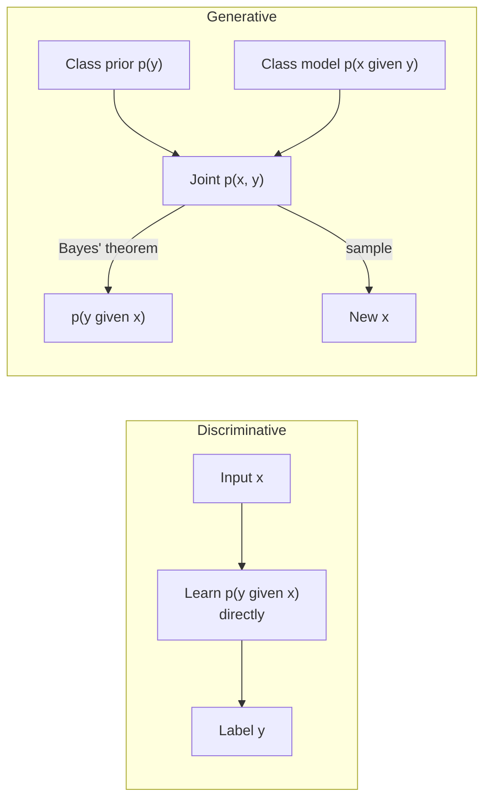
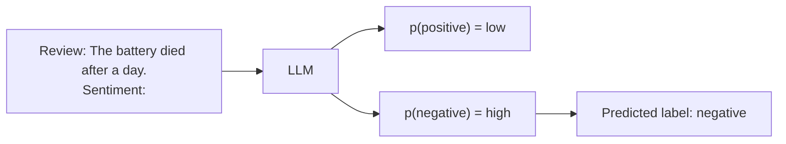

Every supervised model you have trained so far, from [logistic regression](/learn/supervised-learning-algorithms/logistic-regression) to a convolutional network, answers one question: given this input, which output is most likely? That is the **discriminative** approach. A **generative** model answers a different and harder question: what does the data itself look like? The difference decides what a model can do. A discriminative model can only label inputs you give it; a generative model can also produce new inputs, score how typical an input is, and fill in missing parts. Large language models are generative models, and understanding this distinction explains why they can write, translate and classify with one set of weights.

## Two ways to model the same problem

Suppose you have inputs $x$ (an email, an image, a vector of measurements) and labels $y$ (spam or not, cat or dog).

- A **discriminative** model learns the conditional distribution $p(y \mid x)$ directly, or just a decision boundary. It spends all its capacity on the question "which side of the boundary is this point on?"
- A **generative** model learns how the data is produced: the joint distribution $p(x, y)$, usually as a class prior $p(y)$ times a class-conditional distribution $p(x \mid y)$. Without labels it learns $p(x)$ alone.

A generative model can still classify, by using [Bayes' theorem](/learn/probability-and-statistics/bayes-theorem) to turn its model of the data into a posterior over labels:

$$
p(y \mid x) = \frac{p(x \mid y)\, p(y)}{p(x)}, \qquad p(x) = \sum_{y'} p(x \mid y')\, p(y')
$$

Here $p(y)$ is how common each class is, $p(x \mid y)$ is how likely the input is under each class, and $p(x)$ is the total probability of the input under the model.



The generative route does more work: to classify, it first models every detail of what each class looks like. That extra work is wasted if you only want labels, but it buys abilities a discriminative model does not have.

## The same data, two models

Here is a two-class dataset, modelled both ways. **Gaussian naive Bayes** is generative: it fits a [normal distribution](/learn/probability-and-statistics/normal-distribution) to each feature within each class. **Logistic regression** is discriminative: it fits a linear boundary directly.

```python
import numpy as np
from sklearn.naive_bayes import GaussianNB
from sklearn.linear_model import LogisticRegression
from sklearn.model_selection import train_test_split

rng = np.random.default_rng(42)
n = 300
X0 = rng.normal(loc=[0.0, 0.0], scale=[1.0, 0.6], size=(n, 2))   # class 0
X1 = rng.normal(loc=[2.5, 1.5], scale=[0.8, 1.0], size=(n, 2))   # class 1
X = np.vstack([X0, X1])
y = np.array([0] * n + [1] * n)

X_train, X_test, y_train, y_test = train_test_split(X, y, test_size=0.3, random_state=0)

gen = GaussianNB().fit(X_train, y_train)
disc = LogisticRegression().fit(X_train, y_train)

print(f"Gaussian naive Bayes accuracy: {gen.score(X_test, y_test):.3f}")
print(f"Logistic regression accuracy:  {disc.score(X_test, y_test):.3f}")
```

```output
Gaussian naive Bayes accuracy: 0.967
Logistic regression accuracy:  0.956
```

As classifiers they are about equally good. The difference is in what else they learned.

## What only the generative model can do

Gaussian naive Bayes stores a mean and a variance for every feature in every class (`theta_` and `var_` in scikit-learn). That is a complete recipe for producing data, so you can **sample** brand-new points for a chosen class:

```python
print("class means:\n", gen.theta_.round(2))

def sample_class(model, cls, k, rng):
    mean = model.theta_[cls]
    std = np.sqrt(model.var_[cls])
    return rng.normal(mean, std, size=(k, len(mean)))

new_points = sample_class(gen, cls=1, k=3, rng=np.random.default_rng(0))
print("three new class-1 points:\n", new_points.round(2))
print("classified as:", gen.predict(new_points))
```

```output
class means:
 [[-0.05 -0.05]
 [ 2.46  1.39]]
three new class-1 points:
 [[2.56 1.26]
 [2.97 1.5 ]
 [2.03 1.75]]
classified as: [1 1 1]
```

The model generated points it has never seen, and they look like class 1. Logistic regression has nothing to sample from: it knows where the boundary is, not what the data looks like on either side.

A generative model can also tell you how **typical** an input is. The total log-likelihood $\log p(x)$ is high for points like the training data and very low for points far from it, which makes it a natural tool for spotting out-of-distribution inputs:

```python
from scipy.special import logsumexp

def log_px(model, X):
    # log p(x) = log sum over classes of p(x | y) p(y)
    return logsumexp(model.predict_joint_log_proba(X), axis=1)

typical = np.array([[0.1, -0.2]])
strange = np.array([[12.0, -9.0]])
print(f"log p(typical) = {log_px(gen, typical)[0]:.1f}")
print(f"log p(strange) = {log_px(gen, strange)[0]:.1f}")
print("logistic regression on the strange point:", disc.predict_proba(strange).round(3))
```

```output
log p(typical) = -2.0
log p(strange) = -128.1
logistic regression on the strange point: [[0. 1.]]
```

Logistic regression assigns the absurd point to a class with near-total confidence, because it only measures which side of the boundary the point falls on. The generative model reports that the point is wildly unlikely under anything it has seen.

> [!KEY]
> A discriminative model answers "which label?"; a generative model answers "how likely is this data, and what else could it look like?" Sampling, likelihood scoring and filling in missing values all come from modelling $p(x)$.

## Trade-offs

| | Discriminative | Generative |
| --- | --- | --- |
| Models | $p(y \mid x)$ or a boundary | $p(x, y)$ or $p(x)$ |
| Can generate new data | No | Yes |
| Can score how typical an input is | No | Yes, via $p(x)$ |
| Assumptions about the data | Few | Must describe the whole data distribution |
| Typical classification accuracy with plenty of data | Usually higher | Lower if its assumptions are wrong |
| Works without labels | No | Yes, by modelling $p(x)$ |
| Classical examples | Logistic regression, SVMs, random forests | Naive Bayes, Gaussian mixture models, hidden Markov models |
| Deep learning examples | Image classifiers, BERT-style encoders | LLMs, diffusion models, VAEs, GANs |

Classical results show that a generative classifier can approach its best performance with fewer training examples, because its assumptions act as strong prior knowledge, while a discriminative classifier typically reaches a lower error once data is plentiful, because it is not penalised for wrong assumptions about $p(x)$. Naive Bayes, for example, assumes features are independent within a class; when they are strongly correlated, that assumption costs accuracy.

The decisive advantage of the generative approach in modern AI is the row "works without labels". The internet contains vast amounts of unlabelled text. A model of $p(x)$ can learn from all of it, and that is exactly what [pretraining](/learn/generative-ai-fundamentals/pretraining) does.

## Language models are generative models of text

An LLM models the probability of a token sequence with the autoregressive factorisation from [What is generative AI?](/learn/generative-ai-fundamentals/what-is-generative-ai):

$$
p(x_1, \ldots, x_T) = \prod_{t=1}^{T} p(x_t \mid x_{\lt t})
$$

where $x_{\lt t}$ means all tokens before position $t$. Given a prompt, the same model gives a **conditional** distribution over continuations, $p(\text{continuation} \mid \text{prompt})$. This one object supports many uses:

| Use | How the generative model is used |
| --- | --- |
| Writing, chat, code | Sample a continuation of the prompt |
| Classification | Ask in the prompt, then generate the label as text, or compare the probability of each label word |
| Scoring and ranking | Compare the log-probability the model assigns to different candidate texts |
| Translation and summarisation | Condition on the source text and generate the target |



This is why LLMs can replace many task-specific classifiers: a model of text is implicitly a model of every labelling task that can be written as text. A dedicated discriminative model, such as a fine-tuned [BERT](/learn/advanced-nlp/bert) encoder, is still often cheaper, faster and more accurate for a single high-volume classification task. Choosing between the two is an engineering decision, not a matter of fashion.

> [!NOTE]
> Strictly, a translation model learns $p(y \mid x)$, which is a conditional model. It is still called generative because the output $y$ is a whole sequence that must be generated piece by piece, not a single label picked from a short list. In modern usage, "generative" usually means "produces complex, structured output".

## Exercises

**1.** Use the fitted `gen` model to generate 1,000 points for class 0 and check that their mean and standard deviation match `gen.theta_[0]` and `np.sqrt(gen.var_[0])`.

<details>
<summary>Show solution</summary>

```python
samples = sample_class(gen, cls=0, k=1000, rng=np.random.default_rng(1))
print(samples.mean(axis=0).round(2), gen.theta_[0].round(2))
print(samples.std(axis=0).round(2), np.sqrt(gen.var_[0]).round(2))
```

```output
[-0.07 -0.05] [-0.05 -0.05]
[1.02 0.56] [1.02 0.55]
```

The sample statistics are close to the stored parameters, with small differences due to sampling noise. With more samples they would get closer.

</details>

**2.** Explain why `disc.predict_proba(strange)` is so confident even though the point is nothing like the training data. What does that imply for deploying a discriminative model on inputs that may drift over time?

<details>
<summary>Show solution</summary>

Logistic regression outputs $\sigma(w^\top x + b)$, which depends only on the signed distance from the linear boundary. The further a point is from the boundary, the closer the output gets to 0 or 1, regardless of whether any training data lived there. A discriminative model therefore gives no warning when inputs drift out of distribution. In production you need separate drift or out-of-distribution checks, which a density model of $p(x)$ can provide.

</details>

**3.** You must classify 50 million support tickets per day into 12 fixed categories, and you have 200,000 labelled examples. Would you start with an LLM prompted to classify, or a fine-tuned discriminative encoder? Justify your answer.

<details>
<summary>Show solution</summary>

A fine-tuned discriminative encoder is the natural starting point: the label set is fixed, labelled data is plentiful, and the volume makes per-request cost and latency dominant. A small encoder classifier is far cheaper to run than generating text with a large model. A prompted LLM is still useful to bootstrap labels, handle rare edge cases, or build a baseline quickly before the encoder is trained.

</details>

```quiz
[
  {
    "q": "Which distribution does a discriminative classifier model?",
    "options": [
      "p(x)",
      "p(x, y)",
      "p(y | x)",
      "p(x | y) only"
    ],
    "answer": 2,
    "why": "A discriminative model learns the conditional p(y | x), or simply a decision boundary, without modelling how x itself is distributed."
  },
  {
    "q": "How does a generative model such as naive Bayes classify an input?",
    "options": [
      "It combines p(x | y) and p(y) with Bayes' theorem to obtain p(y | x)",
      "It fits a linear boundary with gradient descent",
      "It samples random labels until one fits",
      "It cannot classify; it can only generate"
    ],
    "answer": 0,
    "why": "Bayes' theorem converts the class-conditional likelihood and the prior into a posterior over labels."
  },
  {
    "q": "Why could LLMs be pretrained on enormous amounts of internet text?",
    "options": [
      "Internet text comes with sentiment labels",
      "As generative models of p(x), they need no labels: the text is its own training signal",
      "Discriminative models cannot process text",
      "Bayes' theorem removes the need for training data"
    ],
    "answer": 1,
    "why": "Modelling p(x) requires only the data itself. Each next token is the target for the preceding context."
  },
  {
    "q": "A logistic regression model is given an input far outside its training data. What typically happens?",
    "options": [
      "It raises an error",
      "It outputs a probability near 0.5 to signal uncertainty",
      "It refuses to predict",
      "It can output a confident probability near 0 or 1"
    ],
    "answer": 3,
    "why": "Its output depends only on the distance from the boundary, so distant points get extreme probabilities even if no training data was ever there."
  }
]
```
