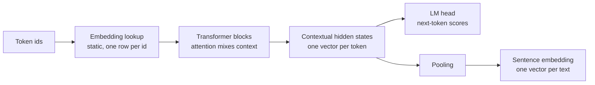

Once text has been turned into token ids, the model needs numbers it can compute with. An id such as `24748` carries no meaning on its own; it is just a row number. The first thing every LLM does is replace each id with a learned vector called an **embedding**. Embeddings appear again at the other end of the pipeline, too: a whole sentence or document can be summarised as a single vector, and those **sentence embeddings** power semantic search, clustering and retrieval-augmented generation. This lesson separates the two ideas, shows how each is computed, and explains when to use which.

You met static word embeddings such as word2vec in [Word embeddings](/learn/nlp-fundamentals/word-embeddings). Modern LLMs build on the same idea, but the vectors are learned end to end and then transformed by every layer of the network.

## The token embedding table

An LLM with a vocabulary of $V$ tokens and a model width of $d_{\text{model}}$ stores an **embedding matrix**

$$
E \in \mathbb{R}^{V \times d_{\text{model}}}
$$

where row $i$ is the vector for token id $i$. Embedding a sequence of $T$ token ids is nothing more than looking up $T$ rows, giving a $T \times d_{\text{model}}$ matrix that enters the first Transformer block.

Mathematically, the lookup is the same as multiplying a one-hot vector by $E$. Implementations use indexing because it is far cheaper than a matrix multiplication with a vector that is almost all zeros.

```python
import numpy as np

rng = np.random.default_rng(0)
V, d_model = 10, 4
E = rng.normal(size=(V, d_model)).round(2)

token_ids = np.array([3, 7, 3])
X = E[token_ids]               # lookup: shape (T, d_model)
print(X.shape)
print(X)

one_hot = np.eye(V)[token_ids]  # shape (T, V)
print(np.allclose(one_hot @ E, X))
```

```output
(3, 4)
[[-2.33 -0.22 -1.25 -0.73]
 [-0.46  0.22 -1.01 -0.21]
 [-2.33 -0.22 -1.25 -0.73]]
True
```

Two details matter here. First, the same token always gets the same row: token `3` appears twice and both rows are identical. At this stage the vector knows nothing about context. Second, $E$ is an ordinary weight matrix, trained by backpropagation along with everything else. Nobody designs these vectors; they settle into whatever arrangement helps the model predict the next token.

The table is not small. Its size is $V \times d_{\text{model}}$ parameters, so a vocabulary of 100,000 tokens with a width of 4,096 already gives about 410 million parameters in the embedding table alone (illustrative numbers). Many models reuse the same matrix, transposed, as the output layer that turns the final hidden state back into scores over the vocabulary. This is called **weight tying**; whether a given model does it is a design choice.

## From static to contextual

The vector for `" bank"` is identical in "river bank" and "bank account" when it leaves the embedding table. Every Transformer block then mixes in information from other tokens through [self-attention](/learn/generative-ai-fundamentals/self-attention), so the **hidden state** for `" bank"` at a later layer does depend on its neighbours. These hidden states are **contextual embeddings**.



A generative LLM uses the final hidden states for one purpose: the last position is projected through the output layer to predict the next token. An **embedding model** takes the same kind of hidden states and pools them into a single fixed-length vector that represents the whole input.

| | Token embedding | Contextual hidden state | Sentence embedding |
| --- | --- | --- | --- |
| Granularity | One vector per vocabulary entry | One vector per token position | One vector per text |
| Depends on context | No | Yes | Yes |
| Shape for one text | Rows of $E$ | $T \times d_{\text{model}}$ | $d$ (fixed) |
| Used for | Input to the first block | Internal computation, next-token prediction | Search, clustering, deduplication, RAG |

## Pooling hidden states into one vector

There are three common ways to turn $T$ token vectors into one:

- **Mean pooling**: average the vectors of the real tokens. Simple and widely used.
- **First-token pooling**: use the hidden state of a special first token, as BERT-style models do with `[CLS]`.
- **Last-token pooling**: use the hidden state of the final token. This suits decoder-only models, because with causal masking only the last position has seen the whole input.

Mean pooling must respect the **attention mask**. When texts of different lengths are batched together, short ones are padded, and padding positions must not be averaged in.

```python
# Hidden states for a batch of 2 texts, T=4 positions, width 3
H = np.array([
    [[1.0, 0.0, 2.0], [3.0, 2.0, 0.0], [2.0, 1.0, 1.0], [0.0, 0.0, 0.0]],
    [[0.0, 4.0, 1.0], [2.0, 2.0, 3.0], [9.0, 9.0, 9.0], [9.0, 9.0, 9.0]],
])
mask = np.array([[1, 1, 1, 0],
                 [1, 1, 0, 0]])          # 1 = real token, 0 = padding

m = mask[:, :, None]                     # shape (B, T, 1) for broadcasting
mean_pooled = (H * m).sum(axis=1) / m.sum(axis=1)
naive = H.mean(axis=1)

print(mean_pooled)
print(naive)
```

```output
[[2. 1. 1.]
 [1. 3. 2.]]
[[1.5  0.75 0.75]
 [5.   6.   5.5 ]]
```

The naive mean of the second text is pulled towards the padding values of 9. In a real model padding positions hold arbitrary numbers, so forgetting the mask silently corrupts your embeddings.

## Cosine similarity

Sentence embeddings are compared with **cosine similarity**, the cosine of the angle between two vectors:

$$
\cos(\mathbf{a}, \mathbf{b}) = \frac{\mathbf{a}^\top \mathbf{b}}{\lVert \mathbf{a} \rVert \, \lVert \mathbf{b} \rVert}
$$

It ranges from $-1$ (opposite directions) to $1$ (same direction) and ignores vector length. If you normalise every vector to unit length once, cosine similarity becomes a plain dot product, which is how vector databases compute it at scale.

```python
def normalise(X):
    return X / np.linalg.norm(X, axis=-1, keepdims=True)

docs = {
    "refund policy":     np.array([0.9, 0.1, 0.0, 0.2]),
    "returning an item": np.array([0.8, 0.3, 0.1, 0.1]),
    "GPU memory limits": np.array([0.0, 0.1, 0.9, 0.4]),
}
query = np.array([0.85, 0.2, 0.05, 0.15])   # "how do I get my money back?"

D = normalise(np.stack(list(docs.values())))
q = normalise(query)
scores = D @ q
for name, s in sorted(zip(docs, scores), key=lambda p: -p[1]):
    print(f"{s:.3f}  {name}")
```

```output
0.990  refund policy
0.989  returning an item
0.142  GPU memory limits
```

These four-dimensional vectors are hand-made for illustration. Real embedding models produce hundreds or thousands of dimensions, but the ranking logic is exactly this.

> [!KEY]
> Token embeddings are a lookup table inside the model, with no context. Sentence embeddings are the output of a model run over a whole text, pooled into one vector and designed to be compared with cosine similarity.

## Embedding models in practice

You could pool the hidden states of any generative LLM, but the result is usually a poor search vector, because nothing in next-token training asks for similar meanings to have similar pooled vectors. Dedicated embedding models are trained with a **contrastive** objective: pairs of related texts (a question and its answer, a title and its abstract) are pulled together and unrelated pairs are pushed apart.

With the `sentence-transformers` library, computing embeddings takes a few lines. This needs PyTorch and downloads a model, so no output is shown:

```text
pip install sentence-transformers
```

```python
from sentence_transformers import SentenceTransformer

model = SentenceTransformer("sentence-transformers/all-MiniLM-L6-v2")
vectors = model.encode(
    ["How do I get a refund?", "Our returns policy lasts 30 days."],
    normalize_embeddings=True,
)
print(vectors.shape)          # (2, embedding dimension)
print(vectors[0] @ vectors[1])  # cosine similarity
```

You will use embeddings like these to build retrieval systems in [Embedding generation](/learn/rag-fundamentals/embedding-generation).

> [!WARNING]
> Only compare embeddings produced by the **same model**. Two models produce vectors in unrelated spaces, even when the dimensions happen to match. If you change embedding model, you must re-embed your entire collection.

## Common pitfalls

| Pitfall | Effect | Fix |
| --- | --- | --- |
| Mean pooling without the mask | Padding leaks into the vector | Weight by the attention mask |
| Mixing models or model versions | Similarities become meaningless | Store the model name with every vector |
| Comparing unnormalised vectors with a dot product | Long vectors dominate the ranking | Normalise once, then use dot products |
| Embedding very long documents whole | Detail is averaged away, and input beyond the model's limit is truncated | Chunk documents before embedding |
| Using raw LLM hidden states for search | Weak retrieval quality | Use a model trained for embeddings |

## Exercises

**1.** Show that an embedding lookup is a matrix product: for `E` from the lesson, compute the embedding of token id `5` both as `E[5]` and as a one-hot vector times `E`.

<details>
<summary>Show solution</summary>

```python
v = np.zeros(V)
v[5] = 1.0
print(np.allclose(v @ E, E[5]))
```

```output
True
```

</details>

**2.** Implement last-token pooling for the batch `H` and `mask` from the lesson: for each text, pick the hidden state of its last real (non-padding) token.

<details>
<summary>Show solution</summary>

The index of the last real token is the number of real tokens minus one.

```python
last_idx = mask.sum(axis=1) - 1
last_pooled = H[np.arange(H.shape[0]), last_idx]
print(last_idx)
print(last_pooled)
```

```output
[2 1]
[[2. 1. 1.]
 [2. 2. 3.]]
```

</details>

**3.** A colleague stores embeddings from model A for a million documents, then embeds user queries with model B because it is faster. Search quality collapses. Explain why.

<details>
<summary>Show solution</summary>

Each model learns its own vector space. The coordinates from model B have no relationship to those from model A, so the cosine similarity between a B-query and an A-document is essentially noise. Either embed queries with model A or re-embed all documents with model B.

</details>

```quiz
[
  {
    "q": "What is the shape of the token embedding matrix of a model with vocabulary size V and width d_model?",
    "options": [
      "`d_model × d_model`",
      "`T × d_model`",
      "`V × d_model`",
      "`V × V`"
    ],
    "answer": 2,
    "why": "There is one learned row of length d_model for every token in the vocabulary."
  },
  {
    "q": "The token `\" bank\"` appears in two different sentences. Which vectors are guaranteed to be identical?",
    "options": [
      "Its rows from the embedding table",
      "Its hidden states at the last layer",
      "The sentence embeddings of the two sentences",
      "None of them"
    ],
    "answer": 0,
    "why": "The embedding table is a context-free lookup. Later layers mix in context, so hidden states and sentence embeddings differ."
  },
  {
    "q": "Why must mean pooling use the attention mask?",
    "options": [
      "To make the vector unit length",
      "So that padding positions do not contribute to the average",
      "Because the mask contains the token ids",
      "To apply causal masking"
    ],
    "answer": 1,
    "why": "Padded positions hold arbitrary values. Averaging them in distorts the embedding, especially for short texts in a batch."
  },
  {
    "q": "When are cosine similarity and the dot product equal?",
    "options": [
      "Always",
      "When the vectors have more than 100 dimensions",
      "When the vectors come from the same model",
      "When both vectors have unit length"
    ],
    "answer": 3,
    "why": "Cosine similarity divides the dot product by both lengths. If both lengths are 1, the division does nothing."
  }
]
```
