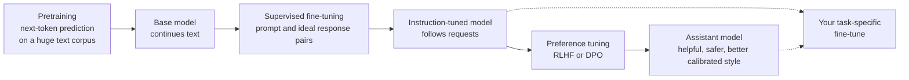
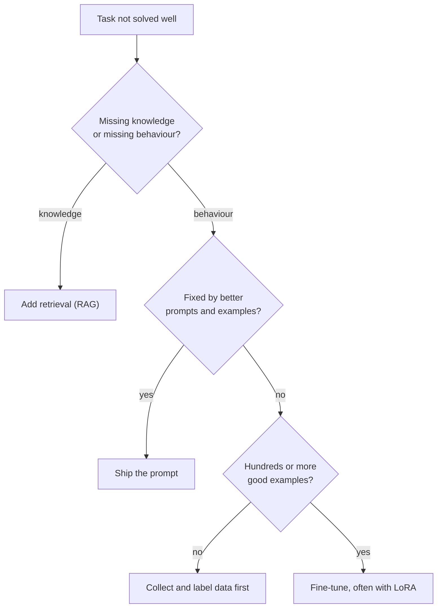

A model fresh from [pretraining](/learn/generative-ai-fundamentals/pretraining) is a remarkable text predictor but a poor assistant. Ask it "What is the capital of France?" and it may continue with "What is the capital of Germany? What is the capital of Spain?", because lists of quiz questions are a perfectly likely continuation of internet text. **Fine-tuning** is continued training on a smaller, targeted dataset that turns this base model into something that follows instructions, adopts a format, or specialises in a domain. As an AI engineer you will mostly use models others have fine-tuned, but you need to know what was done to them, and you will sometimes need to decide whether to fine-tune one yourself.

## From base model to assistant

Modern chat models are usually built in stages. Each stage starts from the weights of the previous one.



| Stage | Data | Teaches the model |
| --- | --- | --- |
| Pretraining | Very large amounts of general text | Language, facts, reasoning patterns |
| Supervised fine-tuning (SFT) | Thousands to hundreds of thousands of curated (prompt, response) examples | To answer rather than continue; the conversation format |
| Preference tuning | Pairs of responses with a human or AI judgement of which is better | Which of several plausible answers people prefer |
| Domain or task fine-tuning | Your own examples | A specific format, tone, label set or domain vocabulary |

The key insight is that fine-tuning mostly teaches **behaviour and format**, not new knowledge. The knowledge comes from pretraining; a few thousand examples cannot teach a model a whole new field, but they can teach it to respond in a consistent way.

## Supervised fine-tuning and instruction tuning

**Supervised fine-tuning** uses exactly the same objective as pretraining, next-token prediction with cross-entropy loss, but on carefully written examples of the behaviour you want. **Instruction tuning** is SFT where the examples span many different tasks phrased as instructions ("Summarise this...", "Translate...", "Write a function that..."). Training on a broad mix teaches the model to follow instructions in general, including ones it never saw.

A single training example is a conversation:

```json
{
  "messages": [
    {"role": "system", "content": "You are a concise assistant."},
    {"role": "user", "content": "Give one word for a baby cat."},
    {"role": "assistant", "content": "Kitten."}
  ]
}
```

### Chat templates

The model only sees a flat sequence of tokens, so the roles must be serialised with special marker tokens. This serialisation is the **chat template**. Here is an illustrative format; every model family defines its own:

```text
<|system|>You are a concise assistant.<|end|>
<|user|>Give one word for a baby cat.<|end|>
<|assistant|>Kitten.<|end|>
```

> [!WARNING]
> At inference time you must format prompts with exactly the template the model was fine-tuned with. A wrong or missing template is a common cause of a fine-tuned model "ignoring instructions" or rambling. Libraries such as Hugging Face `transformers` store the template with the tokenizer and apply it for you (see [Hugging Face tokenizers](/learn/hugging-face-ecosystem/tokenizers)).

## Loss masking: learn the answer, not the question

If you computed the loss over every token of the example, the model would also be trained to predict the user's messages. That wastes capacity and can teach it to generate user turns. Standard SFT therefore **masks** the prompt tokens: their loss is excluded, and only the assistant tokens contribute.

$$
\mathcal{L} = -\frac{1}{\sum_t m_t} \sum_{t} m_t \log P_\theta(x_t \mid x_1, \dots, x_{t-1})
$$

Here $x_t$ is the token at position $t$, $P_\theta$ is the model's predicted probability with parameters $\theta$, and $m_t$ is 1 for response tokens and 0 for prompt tokens.

```python
import numpy as np

tokens = ["<|user|>", "baby", "cat", "?", "<|end|>", "<|assistant|>", "Kitten", ".", "<|end|>"]
# Probability the model assigned to each actual token (illustrative values)
p_correct = np.array([0.90, 0.05, 0.20, 0.30, 0.95, 0.97, 0.40, 0.85, 0.90])
token_loss = -np.log(p_correct)

mask = np.array([0, 0, 0, 0, 0, 0, 1, 1, 1])   # 1 = assistant response tokens

full_loss = token_loss.mean()
masked_loss = (token_loss * mask).sum() / mask.sum()
print(f"loss over all tokens:      {full_loss:.3f}")
print(f"loss over response tokens: {masked_loss:.3f}")
```

```output
loss over all tokens:      0.798
loss over response tokens: 0.395
```

The unmasked loss is dominated by "baby" (probability 0.05), a word in the user's question that the model cannot be expected to predict. The masked loss reflects only how well the model produced the answer. In PyTorch-based training code this is usually implemented by setting the label of masked positions to `-100`, the default `ignore_index` of `torch.nn.CrossEntropyLoss`.

## Preference tuning: RLHF and DPO

SFT shows the model one good answer per prompt. But for many prompts there are many acceptable answers, and what makes one better (clearer, more honest, safer, better formatted) is easier to judge than to write. Preference tuning uses **comparisons**:

- **RLHF** (reinforcement learning from human feedback) trains a separate **reward model** to predict which of two responses people prefer, then optimises the language model with reinforcement learning to produce high-reward responses, with a penalty for drifting too far from the SFT model.
- **DPO** (direct preference optimisation) skips the separate reward model and the reinforcement learning loop, turning preference pairs directly into a classification-style loss on the language model.

Both are covered properly in [RLHF fundamentals](/learn/advanced-llm-engineering/rlhf-fundamentals) and [DPO](/learn/advanced-llm-engineering/dpo); production-scale SFT is in [Supervised fine-tuning](/learn/advanced-llm-engineering/supervised-fine-tuning-sft).

## Full fine-tuning versus parameter-efficient fine-tuning

**Full fine-tuning** updates every weight. With the Adam optimiser you hold the weights, their gradients and two optimiser states per weight in memory, several times the size of the model itself, and you store a full copy of the model for every fine-tune.

**Parameter-efficient fine-tuning (PEFT)** freezes the original weights and trains a small number of new ones. The most widely used method, **LoRA** (low-rank adaptation), represents the update to a weight matrix $W \in \mathbb{R}^{d \times k}$ as a product of two thin matrices:

$$
W' = W + \frac{\alpha}{r} B A, \qquad B \in \mathbb{R}^{d \times r},\; A \in \mathbb{R}^{r \times k}
$$

where $r$ is the rank (much smaller than $d$ and $k$) and $\alpha$ is a scaling hyperparameter. Only $A$ and $B$ are trained.

```python
d = k = 4096                     # an illustrative square projection matrix

full = d * k
for r in [4, 8, 16, 64]:
    lora = d * r + r * k
    print(f"rank {r:>2}: {lora:>9,} trainable vs {full:,} full  ({100 * lora / full:.2f}%)")
```

```output
rank  4:    32,768 trainable vs 16,777,216 full  (0.20%)
rank  8:    65,536 trainable vs 16,777,216 full  (0.39%)
rank 16:   131,072 trainable vs 16,777,216 full  (0.78%)
rank 64:   524,288 trainable vs 16,777,216 full  (3.12%)
```

Under 1% of the parameters of that matrix are trained at rank 8. Because the original weights stay frozen and shared, you can keep one base model and many small adapters, one per task or customer. LoRA, QLoRA and the `peft` library are taught in [PEFT](/learn/hugging-face-ecosystem/peft) and [LoRA](/learn/hugging-face-ecosystem/lora).

## Prompting, RAG or fine-tuning?

Fine-tuning is not the first tool to reach for. It needs data, evaluation and retraining whenever the base model changes.

| Need | Best first approach | Why |
| --- | --- | --- |
| The model lacks private or fresh facts | Retrieval-augmented generation ([what is RAG](/learn/rag-fundamentals/what-is-rag)) | Facts change; retrieval updates instantly and can cite sources |
| The model can do the task but inconsistently | Better prompts and examples ([few-shot prompting](/learn/prompt-engineering/few-shot-prompting)) | Cheap, fast to iterate |
| A strict output style, format or label set across many calls | Fine-tuning | Bakes the behaviour in and shortens prompts |
| A smaller, cheaper model must match a larger one on one narrow task | Fine-tuning (often on outputs from the larger model) | Specialisation can close the gap on narrow tasks |
| A whole new language or field | Continued pretraining, then fine-tuning | A small SFT set cannot supply broad knowledge |



> [!KEY]
> Use RAG to give a model knowledge and fine-tuning to give it behaviour. The two combine well: a fine-tuned model that is good at using retrieved context.

## Pitfalls

- **Catastrophic forgetting.** Narrow fine-tuning can degrade general abilities. Mix in some general data, use a low learning rate, train for few epochs, or use LoRA.
- **Garbage in, garbage out.** The model learns your examples' mistakes and tone exactly. A few hundred excellent examples often beat many thousands of noisy ones.
- **No evaluation set.** Hold out examples and compare base and fine-tuned models on them before deploying, as in [Model evaluation](/learn/working-with-llms/model-evaluation).
- **Template mismatch** between training and inference, as described above.

## Exercises

**1.** Change the mask in the loss-masking example to include the `<|assistant|>` marker token as well. Does the masked loss go up or down, and should that marker be trained?

<details>
<summary>Show solution</summary>

```python
mask2 = np.array([0, 0, 0, 0, 0, 1, 1, 1, 1])
print(f"{(token_loss * mask2).sum() / mask2.sum():.3f}")
```

```output
0.304
```

It goes down, because the marker was predicted with high probability (0.97) and now dilutes the average. The marker is part of the prompt the inference code supplies, so the model never needs to generate it; it is normally masked. The closing `<|end|>` after the response, by contrast, must be trained, or the model will not learn when to stop.

</details>

**2.** A model has 32 layers, and in each you apply LoRA with rank 16 to four square 4096 by 4096 projection matrices. How many trainable parameters is that?

<details>
<summary>Show solution</summary>

```python
per_matrix = 4096 * 16 + 16 * 4096
print(f"{32 * 4 * per_matrix:,}")
```

```output
16,777,216
```

About 16.8 million trainable parameters, tiny compared with the billions in the frozen base model.

</details>

**3.** A legal team wants a chatbot that answers questions about their 5,000 internal contracts, which change weekly. Should they fine-tune? Justify your answer.

<details>
<summary>Show solution</summary>

No, at least not first. The need is knowledge that changes weekly, which suits RAG: index the contracts, retrieve relevant clauses per question, and cite them. Fine-tuning would need retraining each week, cannot reliably memorise exact clause text, and gives no citations. Fine-tuning might later be added to enforce a house answer style.

</details>

```quiz
[
  {
    "q": "What does supervised fine-tuning mainly teach a pretrained base model?",
    "options": [
      "Large amounts of new factual knowledge",
      "Behaviour and format, such as answering instructions instead of continuing text",
      "A new tokenizer vocabulary",
      "How to retrieve documents"
    ],
    "answer": 1,
    "why": "Knowledge comes mostly from pretraining. SFT on a comparatively small dataset shapes how the model responds."
  },
  {
    "q": "Why are prompt tokens usually masked out of the SFT loss?",
    "options": [
      "So the model is trained only to produce the response, not to predict the user's messages",
      "Because prompt tokens are not tokenised",
      "To make the loss larger",
      "Because the chat template forbids it"
    ],
    "answer": 0,
    "why": "The model will be given the prompt at inference time; only the response needs to be learned."
  },
  {
    "q": "In LoRA with rank r applied to a d-by-k matrix, how many parameters are trained for that matrix?",
    "options": [
      "d times k",
      "r squared",
      "d times r plus r times k",
      "d plus k"
    ],
    "answer": 2,
    "why": "LoRA trains B (d by r) and A (r by k), so d*r + r*k parameters, while W stays frozen."
  },
  {
    "q": "A support bot needs to answer from a product catalogue that changes daily. What is the best first approach?",
    "options": [
      "Full fine-tuning every day",
      "DPO on catalogue data",
      "Raise the temperature",
      "Retrieval-augmented generation over the catalogue"
    ],
    "answer": 3,
    "why": "Frequently changing knowledge is best supplied at query time through retrieval, not baked into weights."
  }
]
```
