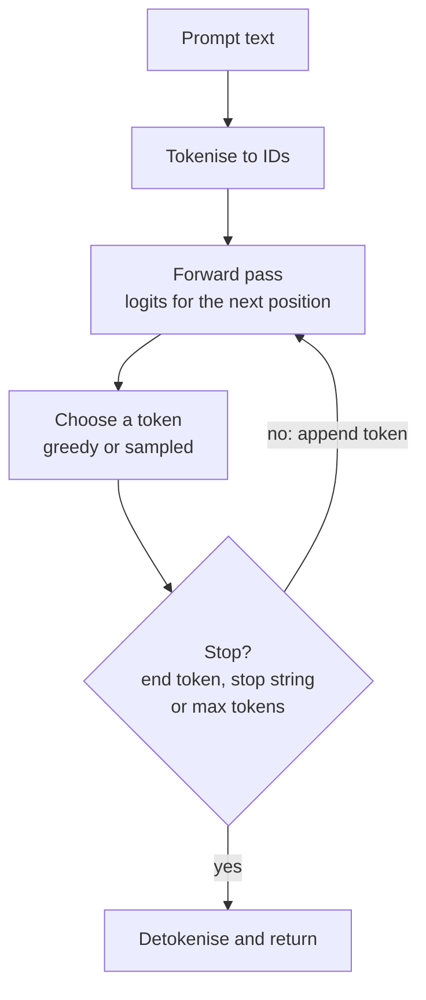
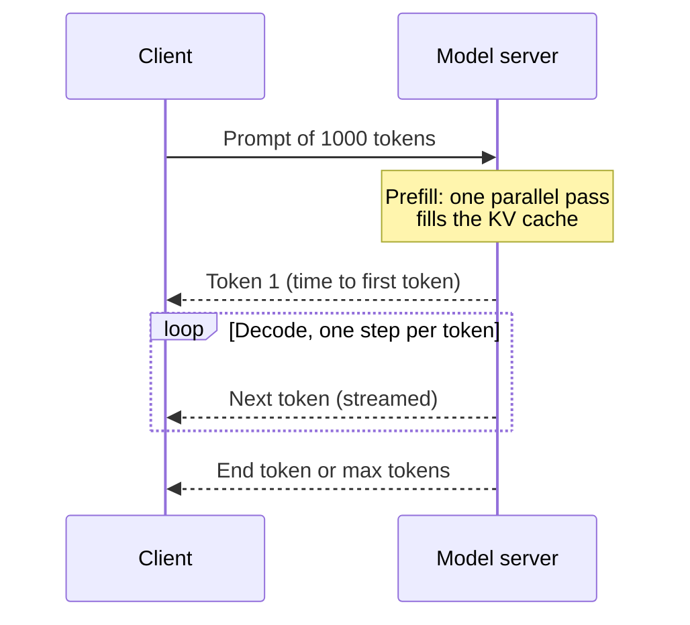

Training a language model happens once; **inference**, running the trained model to produce text, happens every time anyone uses it. For an AI engineer, inference is where cost, latency and user experience are decided. Why does a long prompt delay the first word? Why do output tokens cost more than input tokens on many price lists? Why does streaming feel faster even when the total time is the same? All of these follow from one fact: a decoder-only LLM generates text **one token at a time**, feeding each new token back in as input. This lesson walks through that loop, its two phases, the cache that makes it affordable, and the metrics you use to measure it.

## The autoregressive loop

A decoder-only model (see [LLM fundamentals](/learn/generative-ai-fundamentals/llm-fundamentals)) computes $P(x_{t+1} \mid x_1, \dots, x_t)$: a distribution over the next token given everything so far. To generate, you repeat:



How the token is chosen (greedy, [temperature](/learn/generative-ai-fundamentals/temperature), [top-k or top-p](/learn/generative-ai-fundamentals/top-k-and-top-p-sampling)) is a separate decision from the loop itself. The loop is inherently **sequential**: token 51 cannot be computed until token 50 exists, because token 50 is part of its input.

## A toy model you can run

A real LLM is too large to run here, but the loop is identical for any model that maps a context to next-token probabilities. This toy uses a bigram table: the next token depends only on the previous one.

```python
import numpy as np

vocab = ["<s>", "the", "cat", "dog", "sat", "ran", "on", "mat", ".", "</s>"]
idx = {w: i for i, w in enumerate(vocab)}

# P[i, j] = probability that token j follows token i (rows sum to 1)
P = np.zeros((len(vocab), len(vocab)))
def row(prev, nexts):
    for w, p in nexts.items():
        P[idx[prev], idx[w]] = p

row("<s>", {"the": 1.0})
row("the", {"cat": 0.5, "dog": 0.3, "mat": 0.2})
row("cat", {"sat": 0.7, "ran": 0.3})
row("dog", {"ran": 0.6, "sat": 0.4})
row("sat", {"on": 0.9, ".": 0.1})
row("ran", {"on": 0.5, ".": 0.5})
row("on",  {"the": 1.0})
row("mat", {".": 1.0})
row(".",   {"</s>": 1.0})
row("</s>", {"</s>": 1.0})
print(np.allclose(P.sum(axis=1), 1.0))
```

```output
True
```

The generation loop, with the three standard stopping criteria:

```python
def generate(prompt, max_new_tokens=20, greedy=True, seed=0, stop=("</s>",)):
    rng = np.random.default_rng(seed)
    ids = [idx[w] for w in prompt]
    for _ in range(max_new_tokens):              # stop 1: length limit
        probs = P[ids[-1]]                         # "forward pass"
        nxt = int(np.argmax(probs)) if greedy else int(rng.choice(len(vocab), p=probs))
        if vocab[nxt] in stop:                     # stop 2: end-of-sequence token
            break
        ids.append(nxt)
    return " ".join(vocab[i] for i in ids[1:])

print(generate(["<s>", "the"]))
print(generate(["<s>", "the"], max_new_tokens=4))
for s in range(3):
    print(generate(["<s>", "the"], greedy=False, seed=s))
```

```output
the cat sat on the cat sat on the cat sat on the cat sat on the cat sat on the
the cat sat on the
the dog sat on the mat .
the dog ran on the cat sat on the dog sat on the cat ran on the cat sat on the
the cat sat on the dog ran on the cat sat on the cat sat on the mat .
```

Notice the greedy output loops ("on the cat sat on the cat...") until the length limit cuts it off: the most likely path through this table never reaches the end token. Real models show the same failure under greedy decoding, which is one reason sampling is common for open-ended text. Two of the three sampled runs reach "." and then the end token, and stop naturally; the other wanders until the length limit, which is exactly why the limit exists. The third stopping criterion, **stop strings**, ends generation when the decoded text contains a sequence you specify, such as `"\n\n"` or `"</answer>"`.

> [!WARNING]
> Always set a maximum number of new tokens. Without one, a model stuck in a loop will generate until it hits the context limit, costing time and money on every such request.

## Prefill and decode

A real Transformer processes the context with attention, so its forward pass for position $t$ needs information from all earlier positions. Inference therefore has two distinct phases:

| Phase | Input | Work per forward pass | Bottleneck |
| --- | --- | --- | --- |
| **Prefill** | The whole prompt, all tokens at once | Many tokens processed in parallel as large matrix multiplications | Compute (GPU arithmetic) |
| **Decode** | One new token per step | One token, but all model weights must be read from memory | Memory bandwidth |

Prefill is parallel because every prompt token is already known; the causal mask (see [self-attention](/learn/generative-ai-fundamentals/self-attention)) lets the model compute all positions in one pass. Decode is sequential, and each step does little arithmetic relative to the amount of weight data it must move, so GPUs are underused during decode unless many requests are batched together.



## The KV cache

In attention, each position produces a query, a key and a value vector (covered in [self-attention](/learn/generative-ai-fundamentals/self-attention)). When generating token $t+1$, the keys and values of positions $1$ to $t$ are exactly the same as they were at the previous step, because of the causal mask: earlier positions never see later ones. So instead of recomputing them, the server stores them in a **KV cache** and computes keys and values only for the newest token.

Count how many token positions pass through the model to generate 200 tokens after a 1,000-token prompt:

```python
prompt_len, new_tokens = 1000, 200

# Without a cache: every step re-processes the whole sequence so far
no_cache = sum(prompt_len + t for t in range(new_tokens))
# With a cache: the prompt once (prefill), then one position per step
with_cache = prompt_len + (new_tokens - 1)

print(f"without cache: {no_cache:,} token-positions")
print(f"with cache:    {with_cache:,} token-positions")
print(f"ratio: {no_cache / with_cache:.0f}x")
```

```output
without cache: 219,900 token-positions
with cache:    1,199 token-positions
ratio: 183x
```

The cache is not free: it holds a key and a value vector for every layer, every attention head group and every token in the context, for every concurrent request. For long contexts and many users, KV cache memory, not model weights, often limits how many requests a GPU can serve. Grouped-query attention ([multi-head attention](/learn/generative-ai-fundamentals/multi-head-attention)) exists largely to shrink it. The details of cache layout and paging are in [KV caching](/learn/advanced-llm-engineering/kv-caching).

> [!KEY]
> Prefill cost grows with prompt length; decode cost grows with output length. Long prompts mostly delay the first token, and long outputs mostly stretch total time. This asymmetry is one reason many providers price input and output tokens differently.

## Measuring latency and throughput

| Metric | Definition | What users feel |
| --- | --- | --- |
| **Time to first token (TTFT)** | Request sent until first token arrives | Responsiveness; dominated by queueing plus prefill |
| **Inter-token latency (ITL)** | Average gap between consecutive tokens | Reading smoothness of a stream |
| **End-to-end latency** | Request sent until last token | Total wait for non-streamed responses |
| **Throughput** | Tokens generated per second, per request or across the whole server | Cost efficiency for the operator |

Given the arrival times of each token (in seconds after sending the request), you can compute all of them. These timestamps are illustrative:

```python
arrivals = np.array([0.42, 0.45, 0.48, 0.52, 0.55, 0.58, 0.62, 0.65, 0.68, 0.72])

ttft = arrivals[0]
itl = np.diff(arrivals).mean()
e2e = arrivals[-1]
decode_tps = (len(arrivals) - 1) / (arrivals[-1] - arrivals[0])

print(f"TTFT {ttft:.2f} s, ITL {itl*1000:.1f} ms, end-to-end {e2e:.2f} s")
print(f"decode speed {decode_tps:.1f} tokens/s")
```

```output
TTFT 0.42 s, ITL 33.3 ms, end-to-end 0.72 s
decode speed 30.0 tokens/s
```

Streaming (see [streaming responses](/learn/working-with-llms/streaming-responses)) does not reduce end-to-end latency, but it shows text after the TTFT instead of after the full response, which is why chat interfaces feel faster with it.

## Batching: latency against throughput

Because decode is memory-bound, a server that processes one request at a time leaves most of the GPU's arithmetic idle. Running many requests together lets one read of the weights serve every request in the batch, raising total throughput substantially. The cost is that each request may wait longer and each step does more work, so per-request latency rises.

| Goal | Lever |
| --- | --- |
| Lower TTFT | Shorter prompts, prompt caching where offered, less queueing |
| Lower ITL | Smaller or quantised model, smaller batches, faster hardware |
| Higher throughput per GPU | Larger batches, continuous batching, KV cache memory efficiency |
| Lower cost per request | Fewer output tokens, shorter prompts, a smaller model where quality allows |

Modern inference servers use **continuous batching**, admitting new requests into the running batch as soon as others finish rather than waiting for a whole batch to complete. That technique, along with speculative decoding and quantisation, is covered in [continuous batching](/learn/advanced-llm-engineering/continuous-batching) and [efficient inference](/learn/advanced-llm-engineering/efficient-inference).

## Exercises

**1.** Modify `generate` so that it also accepts a stop *string*: generation ends when the decoded text so far ends with that string. Test it with stop string `"sat on"`.

<details>
<summary>Show solution</summary>

```python
def generate_stop(prompt, stop_text, max_new_tokens=20):
    ids = [idx[w] for w in prompt]
    for _ in range(max_new_tokens):
        nxt = int(np.argmax(P[ids[-1]]))
        if vocab[nxt] == "</s>":
            break
        ids.append(nxt)
        text = " ".join(vocab[i] for i in ids[1:])
        if text.endswith(stop_text):
            return text[: -len(stop_text)].rstrip()
    return " ".join(vocab[i] for i in ids[1:])

print(generate_stop(["<s>", "the"], "sat on"))
```

```output
the cat
```

APIs usually strip the stop string from the returned text, as this version does. Real implementations must also handle a stop string that spans several tokens or splits a token, which is why they check the decoded text rather than token IDs.

</details>

**2.** For a 4,000-token prompt and 500 generated tokens, how many token-positions are processed with and without a KV cache?

<details>
<summary>Show solution</summary>

```python
p, n = 4000, 500
print(sum(p + t for t in range(n)), p + n - 1)
```

```output
2124750 4499
```

Without a cache the work grows roughly with prompt length times output length; with a cache it grows with their sum.

</details>

**3.** A user complains that a chatbot "takes ages to start answering" when they paste long documents, but then types quickly. Which phase and metric is affected, and name two remedies.

<details>
<summary>Show solution</summary>

This is a high time to first token caused by a long prefill (and possibly queueing). Remedies: send less text (retrieve only relevant passages rather than whole documents), use prompt caching if the provider supports it for repeated prefixes, or choose a smaller or faster model. Decode speed is fine, as the fast typing shows.

</details>

```quiz
[
  {
    "q": "Why is the decode phase of LLM inference sequential?",
    "options": [
      "Because GPUs cannot run matrix multiplications in parallel",
      "Because each new token is part of the input needed to compute the next one",
      "Because the KV cache must be cleared after every token",
      "Because tokenisation happens one character at a time"
    ],
    "answer": 1,
    "why": "Autoregressive generation conditions every token on all previous tokens, so token t+1 cannot be computed before token t exists."
  },
  {
    "q": "What does the KV cache store?",
    "options": [
      "The keys and values of previous positions, so they are not recomputed at each decode step",
      "The final generated text for reuse across users",
      "The model weights in compressed form",
      "The logits of every previously generated token"
    ],
    "answer": 0,
    "why": "Because of the causal mask, earlier keys and values do not change, so they can be cached and only the newest token's are computed."
  },
  {
    "q": "A prompt becomes much longer while the output length stays the same. Which metric rises most?",
    "options": [
      "Inter-token latency",
      "Number of output tokens",
      "Time to first token",
      "Vocabulary size"
    ],
    "answer": 2,
    "why": "The prompt is processed during prefill, which happens before the first token is produced."
  },
  {
    "q": "What is the main trade-off of batching many requests together on one GPU?",
    "options": [
      "Higher quality outputs but higher cost",
      "Lower memory use but more tokens per request",
      "Fewer stopping criteria but longer outputs",
      "Higher total throughput but potentially higher latency per request"
    ],
    "answer": 3,
    "why": "One read of the weights serves many requests, raising throughput, but each step does more work and requests may wait."
  }
]
```
