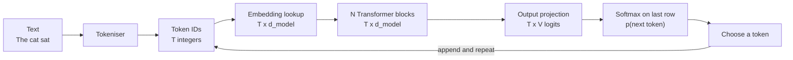
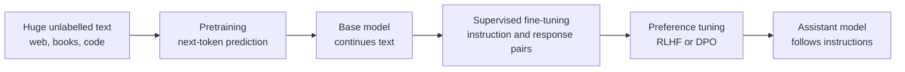

A **large language model** (LLM) is a neural network trained to predict the next token of text, made large enough and trained on enough data that this one skill turns into something far more general: answering questions, following instructions, writing code, translating and reasoning through problems step by step. Every chat assistant and coding assistant you will build on is an LLM at its core, wrapped in software.

This lesson gives you the whole picture in one place: what goes in, what comes out, where the parameters live, how a model is made, and which limitations follow directly from how it works. The lessons that follow zoom in on each part.

## What the three words mean

| Word | Meaning |
| --- | --- |
| **Large** | Many parameters (from hundreds of millions to hundreds of billions) trained on a very large text corpus with a very large compute budget |
| **Language** | Trained on text, and often code; many modern models also accept images or audio, but text is the core |
| **Model** | A probability model: given a sequence of tokens, it outputs a probability distribution over the next token |

Almost all current LLMs share one architecture: the **decoder-only Transformer**, which you met as [GPT](/learn/advanced-nlp/gpt-architecture) in the previous module. "Decoder-only" means there is no separate encoder: one stack of Transformer blocks reads the tokens so far and predicts the next one, with a causal mask that stops any position from seeing the future.

## From text to next token

An LLM never sees characters or words. It sees integer **token IDs**, and it returns a score for every token in its vocabulary.



Each stage has its own lesson: [tokenisation](/learn/generative-ai-fundamentals/tokenization), [embeddings](/learn/generative-ai-fundamentals/embeddings), the [Transformer block](/learn/generative-ai-fundamentals/transformer-architecture), and choosing a token with [temperature](/learn/generative-ai-fundamentals/temperature) and [top-k and top-p sampling](/learn/generative-ai-fundamentals/top-k-and-top-p-sampling). The table summarises the shapes, where $T$ is the number of tokens in the input, $d_{\text{model}}$ is the width of the vector that represents each token, and $V$ is the vocabulary size.

| Stage | Output shape | What it holds |
| --- | --- | --- |
| Token IDs | $T$ | One integer per token |
| Embeddings | $T \times d_{\text{model}}$ | One learned vector per token |
| Transformer blocks | $T \times d_{\text{model}}$ | Vectors refined with context from earlier tokens |
| Logits | $T \times V$ | A score for every possible next token, at every position |

The model produces a prediction at **every** position at once. During training all of them are used, since each position has a known next token. During generation only the last row matters, because that is the prediction for the token that does not exist yet.

Here is that flow with random weights in NumPy. The Transformer blocks are left out, so the model is useless, but the shapes are exactly those of a real LLM:

```python
import numpy as np

rng = np.random.default_rng(0)
V, d_model = 10, 4                       # tiny vocabulary and width
W_embed = rng.normal(size=(V, d_model))  # one row per token

token_ids = np.array([3, 7, 1])          # "The cat sat" after tokenisation
h = W_embed[token_ids]                   # (T, d_model)
# ... a real model applies N Transformer blocks to h here ...
logits = h @ W_embed.T                   # (T, V): reuse the embedding matrix as the output layer

def softmax(z):
    z = z - z.max(axis=-1, keepdims=True)
    e = np.exp(z)
    return e / e.sum(axis=-1, keepdims=True)

probs = softmax(logits[-1])              # distribution for the next token
print("h:", h.shape, " logits:", logits.shape)
print("p(next):", probs.round(3))
print("most likely next token id:", probs.argmax())
```

```output
h: (3, 4)  logits: (3, 10)
p(next): [0.047 0.423 0.009 0.007 0.114 0.021 0.002 0.006 0.051 0.321]
most likely next token id: 1
```

Reusing the embedding matrix as the output layer is called **weight tying**. Many models do it to save parameters; others keep a separate output matrix.

> [!KEY]
> An LLM is a function from a sequence of token IDs to a probability distribution over the next token. Everything it does, including conversation, is built from calling that function in a loop.

## Where the parameters live

For a standard GPT-style block with model width $d$, the attention layer has four $d \times d$ matrices (query, key, value and output projections) and the feed-forward layer expands to $4d$ and back, giving $2 \times 4d^2$. Ignoring the small bias and normalisation terms:

$$
\text{params} \approx \underbrace{V d}_{\text{token embeddings}} + L \times \underbrace{(4d^2 + 8d^2)}_{\text{attention + MLP}} = Vd + 12Ld^2
$$

where $L$ is the number of blocks. Including the biases, layer norms and learned position embeddings, you can check the formula against GPT-2 small, a published model with $V = 50257$, a 1,024-token context, $d = 768$ and $L = 12$:

```python
def gpt2_style_params(V, context, d, L):
    embeddings = V * d + context * d           # token + learned position embeddings
    per_block = (4 * d * d + 4 * d) \
              + (8 * d * d + 5 * d) \
              + 4 * d                           # attention, MLP, two layer norms
    final_norm = 2 * d
    return embeddings + L * per_block + final_norm   # output layer tied to embeddings

print(f"{gpt2_style_params(50257, 1024, 768, 12):,}")
```

```output
124,439,808
```

That is the well-known "124M" figure for GPT-2 small. Two things stand out. The embedding table is about a third of this small model, but in large models the $12Ld^2$ term dominates. And because the count grows with $d^2$, doubling the width roughly quadruples the parameters per block.

Parameters translate directly into memory. Just holding the weights takes parameters times bytes per parameter:

| Precision | Bytes per parameter | Weights of a 7-billion-parameter model |
| --- | --- | --- |
| 32-bit float | 4 | about 28 GB |
| 16-bit (fp16 or bf16) | 2 | about 14 GB |
| 8-bit integer | 1 | about 7 GB |
| 4-bit integer | 0.5 | about 3.5 GB |

These are weights only. Serving a model also needs memory for activations and the [KV cache](/learn/advanced-llm-engineering/kv-caching), and training needs several times more for gradients and optimiser state. Lower precision through [quantization](/learn/advanced-llm-engineering/model-quantization) is how large models fit on smaller hardware.

## How an LLM is made

An assistant model is the product of several training stages, each with a different kind of data.



[Pretraining](/learn/generative-ai-fundamentals/pretraining) uses by far the most compute and gives the model its knowledge and language ability. [Fine-tuning](/learn/generative-ai-fundamentals/fine-tuning) is much cheaper and shapes its behaviour. The difference is visible when you prompt each one:

| Prompt | Base model tends to | Assistant model tends to |
| --- | --- | --- |
| `What is the capital of France?` | Continue the pattern, perhaps with more quiz questions | Answer the question |
| `Write a haiku about rain.` | Continue as if inside a list of writing prompts | Write a haiku |
| Half a Python function | Complete the function | Complete it, often with an explanation |

A base model is not broken; it is doing exactly what it was trained to do, which is continue a document. Instruction tuning teaches it that the document is a conversation in which it plays the helpful assistant.

## In-context learning

A striking property of large models is **in-context learning**: they can pick up a new task from instructions or a handful of examples placed in the prompt, with no change to their weights.

```text
Translate to French.
sea otter => loutre de mer
cheese =>
```

A sufficiently capable model completes this with `fromage`. Nothing was trained; the examples in the context changed which continuation is most probable. Prompt engineering, covered in [few-shot prompting](/learn/prompt-engineering/few-shot-prompting), is the craft of exploiting this. Abilities such as in-context learning and multi-step reasoning get markedly more reliable as models and training data grow, which is one of the main reasons the field moved to such large models.

## Limitations that follow from the mechanism

Most surprising LLM behaviour makes sense once you remember that the model is predicting probable next tokens.

| Behaviour | Cause in the mechanism |
| --- | --- |
| Confident, fluent, false statements (**hallucination**) | Training rewards plausible continuations, not verified truth |
| No knowledge of recent events | Knowledge is frozen at the end of the training data |
| Forgets things from earlier in a long conversation | Only tokens inside the [context window](/learn/generative-ai-fundamentals/context-windows) are visible, and use of long contexts is imperfect |
| Struggles to count letters or reverse words | It sees tokens, not characters |
| Different answers to the same question | Tokens are sampled from a distribution |
| Every call has cost and latency | Each output token needs a full forward pass through the network |
| No memory between separate API calls | The model is stateless; applications resend the conversation each time |

> [!WARNING]
> An LLM has no built-in way to know when it does not know. A wrong answer and a right one come out of the same sampling process with the same fluency, so systems must add grounding, validation or human review where correctness matters.

> [!TIP]
> When a model behaves strangely, ask which stage of the pipeline is responsible: the tokens it saw, what was or was not in its context, what pretraining and fine-tuning taught it, or the sampling settings. That question turns most mysteries into engineering problems.

## Exercises

**1.** Use `gpt2_style_params` to estimate the parameters of a model with $V = 50257$, context 1,024, $d = 1600$ and $L = 48$. Then compute what fraction of the total is the token embedding table.

<details>
<summary>Show solution</summary>

```python
total = gpt2_style_params(50257, 1024, 1600, 48)
emb = 50257 * 1600
print(f"{total:,}  embedding share: {emb / total:.1%}")
```

```output
1,557,611,200  embedding share: 5.2%
```

This configuration matches the largest GPT-2 model, about 1.5 billion parameters. The embedding table is now only about 5% of the total, compared with about 31% for GPT-2 small, because the $12Ld^2$ term grows much faster.

</details>

**2.** In the NumPy flow above, the logits have shape `(3, 10)`. Explain what row 0 means and why it would be useful during training but ignored during generation.

<details>
<summary>Show solution</summary>

Row 0 is the model's distribution for the token that follows the first token, given only that first token. During training the true second token is known, so row 0 contributes a loss term; every row does, which is why one forward pass trains on $T$ predictions at once. During generation the earlier tokens already exist, so only the last row, the prediction for the next new token, is needed.

</details>

**3.** A user complains that a chatbot "forgot" an instruction they gave twenty messages ago. List two possible causes, using the limitations table.

<details>
<summary>Show solution</summary>

The conversation may have grown longer than the context window, so the application truncated the early messages and the model never saw the instruction. Or the instruction was still in the context but the model attended to it weakly, a known weakness for information buried in the middle of long contexts. Fixes include summarising older turns, restating key instructions in the system prompt, or keeping conversations shorter.

</details>

```quiz
[
  {
    "q": "What does an LLM output in a single forward pass over T input tokens?",
    "options": [
      "A single next token",
      "A T x V array of logits: a distribution over the vocabulary at every position",
      "A complete sentence",
      "One embedding vector for the whole input"
    ],
    "answer": 1,
    "why": "The model predicts the next token at every position simultaneously. Training uses all rows; generation uses only the last."
  },
  {
    "q": "Roughly how many bytes do the weights of a 7-billion-parameter model need in 16-bit precision?",
    "options": [
      "About 3.5 GB",
      "About 7 GB",
      "About 28 GB",
      "About 14 GB"
    ],
    "answer": 3,
    "why": "16-bit precision uses 2 bytes per parameter, and 7 billion times 2 bytes is about 14 GB, before activations and the KV cache."
  },
  {
    "q": "A base model answers the prompt `What is the capital of France?` with three more quiz questions. Why?",
    "options": [
      "It is continuing the document, which is what pretraining taught it; it has not been instruction-tuned",
      "Its temperature is too low",
      "Its context window is too small",
      "It does not know the answer"
    ],
    "answer": 0,
    "why": "Pretraining teaches document continuation. Following instructions comes from supervised fine-tuning and preference tuning."
  },
  {
    "q": "In-context learning means:",
    "options": [
      "The model's weights are updated during each conversation",
      "The model retrains itself overnight on user data",
      "The model performs a new task from instructions or examples in the prompt, without weight changes",
      "The model searches the internet for examples"
    ],
    "answer": 2,
    "why": "Examples in the context change which continuation is most probable. No gradient update takes place."
  }
]
```
