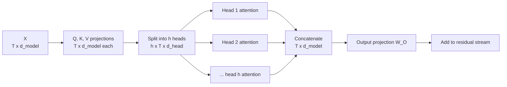
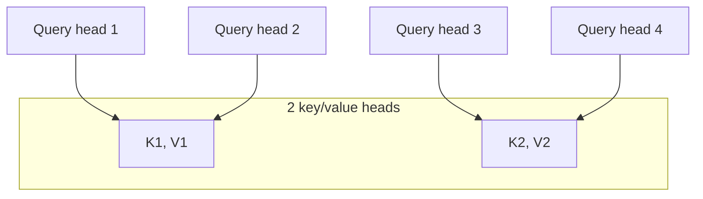

A single attention operation produces one set of weights per token: one opinion about which earlier tokens matter. But a token often needs several kinds of information at once. For the word "it" in a long sentence, one useful signal is which noun it refers to, another is the verb it attaches to, another is simply the previous token. **Multi-head attention** runs several smaller attention operations in parallel, each with its own projections, and combines their results. Every LLM uses it, and the way the heads are reshaped in code is something you will read in every model implementation. This lesson builds on [Self-attention](/learn/generative-ai-fundamentals/self-attention); the original motivation is also covered in [Transformer architecture](/learn/advanced-nlp/transformer-architecture).

## The idea: several attention patterns in parallel

Instead of one attention with dimension $d_{\text{model}}$, multi-head attention uses $h$ heads, each working in a smaller space of size $d_{\text{head}} = d_{\text{model}} / h$:

$$
\text{head}_i = \text{Attention}(X W_Q^{(i)},\; X W_K^{(i)},\; X W_V^{(i)})
$$

$$
\text{MHA}(X) = \text{Concat}(\text{head}_1, \dots, \text{head}_h)\, W_O
$$

Here $W_Q^{(i)}, W_K^{(i)}, W_V^{(i)}$ have shape $d_{\text{model}} \times d_{\text{head}}$, each head's output has shape $T \times d_{\text{head}}$, concatenation gives $T \times d_{\text{model}}$, and the **output projection** $W_O$ ($d_{\text{model}} \times d_{\text{model}}$) mixes the heads' results back together.



Because the heads are narrower, the total cost and parameter count are the same as one full-width attention. You get $h$ different attention patterns at no extra price. Interpretability research has found heads that specialise, for example heads that attend to the previous token, or heads that copy a token that appeared earlier after the same context. Do not expect every head to have a clean human-readable role, though; many are hard to interpret and some can be removed with little effect.

## Splitting heads: the reshape you will see everywhere

In practice nobody stores $h$ separate small matrices. The model computes full-width $Q$, $K$ and $V$ with one $d_{\text{model}} \times d_{\text{model}}$ matrix each, then **reshapes** so that the last dimension is split into $h$ chunks of size $d_{\text{head}}$. Head $i$ is simply columns $i \cdot d_{\text{head}}$ to $(i+1) \cdot d_{\text{head}} - 1$.

| Step | Operation | Shape |
| --- | --- | --- |
| Input | | $(B, T, d_{\text{model}})$ |
| Project | `X @ W_Q` | $(B, T, d_{\text{model}})$ |
| Split last axis | `reshape(B, T, h, d_head)` | $(B, T, h, d_{\text{head}})$ |
| Move heads forward | `transpose(0, 2, 1, 3)` | $(B, h, T, d_{\text{head}})$ |
| Scores | `Q @ K.transpose(0, 1, 3, 2)` | $(B, h, T, T)$ |
| Weighted values | `weights @ V` | $(B, h, T, d_{\text{head}})$ |
| Merge heads | `transpose(0, 2, 1, 3).reshape(B, T, d_model)` | $(B, T, d_{\text{model}})$ |
| Output projection | `@ W_O` | $(B, T, d_{\text{model}})$ |

The transpose puts the head axis next to the batch axis, so that the matrix multiplications broadcast over both $B$ and $h$ at once: every head of every sequence is computed in one call.

```python
import numpy as np

np.set_printoptions(precision=4, suppress=True)
rng = np.random.default_rng(42)

B, T, d_model, h = 2, 4, 8, 2
d_head = d_model // h

def softmax(z):
    z = z - z.max(axis=-1, keepdims=True)
    e = np.exp(z)
    return e / e.sum(axis=-1, keepdims=True)

def split_heads(x):                      # (B, T, d_model) -> (B, h, T, d_head)
    B, T, _ = x.shape
    return x.reshape(B, T, h, d_head).transpose(0, 2, 1, 3)

def merge_heads(x):                      # (B, h, T, d_head) -> (B, T, d_model)
    B, _, T, _ = x.shape
    return x.transpose(0, 2, 1, 3).reshape(B, T, h * d_head)

X = rng.normal(size=(B, T, d_model))
x_split = split_heads(X)
print(X.shape, "->", x_split.shape)
print(np.array_equal(x_split[0, 1, 2], X[0, 2, d_head:2 * d_head]))
print(np.array_equal(merge_heads(x_split), X))
```

```output
(2, 4, 8) -> (2, 2, 4, 4)
True
True
```

The second line confirms that head 1 at position 2 is exactly the second chunk of that position's vector. The third confirms that merging undoes splitting. If you get the transpose wrong, the shapes can still line up while values from different positions are silently mixed, so tests like these are worth writing.

## A full causal multi-head attention in NumPy

```python
W_Q, W_K, W_V, W_O = (rng.normal(size=(d_model, d_model)) / np.sqrt(d_model)
                      for _ in range(4))

def multi_head_attention(X):
    Q, K, V = split_heads(X @ W_Q), split_heads(X @ W_K), split_heads(X @ W_V)
    T = X.shape[1]
    scores = Q @ K.transpose(0, 1, 3, 2) / np.sqrt(d_head)      # (B, h, T, T)
    mask = np.triu(np.ones((T, T), dtype=bool), k=1)
    weights = softmax(np.where(mask, -np.inf, scores))
    return merge_heads(weights @ V) @ W_O, weights

out, weights = multi_head_attention(X)
print(out.shape, weights.shape)
print(weights[0, 0])
print(weights[0, 1])
```

```output
(2, 4, 8) (2, 2, 4, 4)
[[1.     0.     0.     0.    ]
 [0.5634 0.4366 0.     0.    ]
 [0.273  0.2713 0.4557 0.    ]
 [0.2093 0.3464 0.3127 0.1316]]
[[1.     0.     0.     0.    ]
 [0.2714 0.7286 0.     0.    ]
 [0.4428 0.2544 0.3028 0.    ]
 [0.2673 0.1961 0.3019 0.2347]]
```

The two heads of the same sequence produce different attention patterns from the same input, because they see different slices of $Q$ and $K$. Both respect the causal mask.

To be sure the vectorised version is right, compare it with a slow loop that runs each head separately on its own column slice and concatenates:

```python
def mha_loop(X):
    outs = []
    for b in range(B):
        heads = []
        for i in range(h):
            cols = slice(i * d_head, (i + 1) * d_head)
            q, k, v = (X[b] @ W[:, cols] for W in (W_Q, W_K, W_V))
            s = q @ k.T / np.sqrt(d_head)
            s = np.where(np.triu(np.ones((T, T), dtype=bool), k=1), -np.inf, s)
            heads.append(softmax(s) @ v)
        outs.append(np.concatenate(heads, axis=-1) @ W_O)
    return np.stack(outs)

print(np.allclose(mha_loop(X), out))
print("attention params:", 4 * d_model * d_model)
```

```output
True
attention params: 256
```

> [!KEY]
> Multi-head attention with $h$ heads has exactly the same $4 d_{\text{model}}^2$ parameters as single-head attention of width $d_{\text{model}}$. The heads come from reshaping, not from extra weights.

## The memory problem at inference time

During generation the model keeps a [KV cache](/learn/advanced-llm-engineering/kv-caching): the keys and values of every past token, in every layer, for every head. Its size per sequence is

$$
\text{KV bytes} = 2 \times n_{\text{layers}} \times n_{\text{kv heads}} \times d_{\text{head}} \times T \times \text{bytes per value}
$$

where the 2 counts keys and values. With standard multi-head attention, $n_{\text{kv heads}} = h$. For long contexts and many concurrent users, this cache, not the weights, often limits how many requests a server can handle at once.

```python
def kv_cache_gb(n_layers, n_kv_heads, d_head, T, bytes_per=2):
    return 2 * n_layers * n_kv_heads * d_head * T * bytes_per / 1e9

# an illustrative configuration: 32 layers, 32 query heads of size 128
for n_kv in [32, 8, 1]:
    print(f"n_kv_heads={n_kv:>2}: {kv_cache_gb(32, n_kv, 128, 32_768):.2f} GB per sequence")
```

```output
n_kv_heads=32: 17.18 GB per sequence
n_kv_heads= 8: 4.29 GB per sequence
n_kv_heads= 1: 0.54 GB per sequence
```

## Grouped-query and multi-query attention

The fix is to keep many **query** heads but share **key and value** heads between them.

| Variant | Query heads | Key/value heads | KV cache | Quality |
| --- | --- | --- | --- | --- |
| Multi-head (MHA) | $h$ | $h$ | Largest | Baseline |
| Grouped-query (GQA) | $h$ | $g$, with $1 < g < h$ | $g/h$ of MHA | Close to MHA in reported results |
| Multi-query (MQA) | $h$ | 1 | Smallest | Can degrade more |

In GQA, the $h$ query heads are divided into $g$ groups, and all query heads in a group attend using the same key and value head. Each query head still computes its own attention pattern, because its query differs; only the keys and values are shared.



In code, GQA is a small change: project keys and values to $g \cdot d_{\text{head}}$ columns instead of $d_{\text{model}}$, then repeat each KV head across its group before the attention maths.

```python
h, g = 4, 2                               # 4 query heads, 2 KV heads
d_head = d_model // h
W_Kg = rng.normal(size=(d_model, g * d_head)) / np.sqrt(d_model)

K_small = (X @ W_Kg).reshape(B, T, g, d_head).transpose(0, 2, 1, 3)
K_full = np.repeat(K_small, h // g, axis=1)   # each KV head serves h/g query heads
print(K_small.shape, "->", K_full.shape)
print(np.array_equal(K_full[:, 0], K_full[:, 1]), np.array_equal(K_full[:, 1], K_full[:, 2]))
```

```output
(2, 2, 4, 2) -> (2, 4, 4, 2)
True False
```

Only `K_small` (and the matching values) need to be cached; the repeat happens on the fly. Optimised kernels avoid even materialising the repeated copy.

> [!TIP]
> When you read a model's configuration file, look for separate settings for the number of attention heads and the number of key/value heads. If they differ, the model uses GQA (or MQA if the KV count is 1), and its KV cache is smaller by that ratio.

## Exercises

**1.** With $d_{\text{model}} = 4096$ and $h = 32$, what is $d_{\text{head}}$? What would the shape of `Q` be after `split_heads` for a batch of 3 sequences of 100 tokens?

<details>
<summary>Show solution</summary>

$d_{\text{head}} = 4096 / 32 = 128$. After splitting, `Q` has shape $(3, 32, 100, 128)$: batch, heads, positions, per-head dimension.

</details>

**2.** A colleague writes `merge_heads` as `x.reshape(B, T, d_model)` without the transpose. Show that this is wrong for the example `X` above.

<details>
<summary>Show solution</summary>

With $h = 2$ restored, the wrong version produces an array of the right shape but scrambles positions and heads together:

```python
h, d_head = 2, 4
x_split = split_heads(X)
wrong = x_split.reshape(B, T, d_model)
print(wrong.shape, np.array_equal(wrong, X))
```

```output
(2, 4, 8) False
```

The shape matches, so nothing crashes, but the values differ from `X`. The array must be transposed back to $(B, T, h, d_{\text{head}})$ before the final reshape.

</details>

**3.** Using `kv_cache_gb`, how many concurrent 32,768-token sequences fit in 40 GB of cache memory with 32 KV heads versus 8 KV heads (same illustrative configuration)?

<details>
<summary>Show solution</summary>

```python
for n_kv in [32, 8]:
    print(n_kv, int(40 // kv_cache_gb(32, n_kv, 128, 32_768)))
```

```output
32 2
8 9
```

Two sequences versus nine: each sequence's cache is four times smaller, so the same memory serves more than four times as many requests (the leftover space with 32 KV heads is not enough for a third).

</details>

```quiz
[
  {
    "q": "With d_model = 512 and 8 heads, what is d_head and how many parameters do the Q, K, V and output projections have together?",
    "options": [
      "64, and 4 x 512 x 512",
      "64, and 8 x 4 x 512 x 512",
      "512, and 4 x 512 x 512",
      "8, and 4 x 512 x 64"
    ],
    "answer": 0,
    "why": "d_head = 512 / 8 = 64. The heads are slices of full-width projections, so the parameter count stays 4 d_model^2."
  },
  {
    "q": "Why is the head axis transposed next to the batch axis, giving shape (B, h, T, d_head)?",
    "options": [
      "To reduce memory use",
      "So that matrix multiplication broadcasts over batch and heads together",
      "Because softmax only works on 4D arrays",
      "To apply the causal mask per head"
    ],
    "answer": 1,
    "why": "The last two axes (T, d_head) form the matrices to multiply; everything before them is broadcast, computing all heads of all sequences at once."
  },
  {
    "q": "In grouped-query attention with 32 query heads and 8 key/value heads, what is shared?",
    "options": [
      "Each group of 4 query heads shares one query projection",
      "All heads share one attention weight matrix",
      "Each group of 4 query heads uses the same key and value head",
      "The 8 KV heads share one output projection per layer"
    ],
    "answer": 2,
    "why": "Queries stay separate, so each head still has its own attention pattern; only K and V are shared within a group."
  },
  {
    "q": "What is the main practical benefit of grouped-query attention?",
    "options": [
      "It removes the need for a causal mask",
      "It makes training loss lower",
      "It increases the context window automatically",
      "It shrinks the KV cache, allowing longer contexts or more concurrent requests"
    ],
    "answer": 3,
    "why": "The KV cache scales with the number of KV heads, so fewer KV heads means proportionally less cache memory."
  }
]
```
