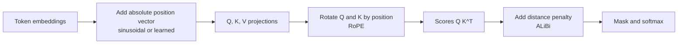

Self-attention compares every token with every other token, but nothing in that computation knows where a token sits. Without extra information, "dog bites man" and "man bites dog" would produce the same set of token vectors, merely reordered. **Positional encoding** is how a Transformer learns word order. The choice of scheme matters more than it first appears: it decides how well a model copes with sequences longer than it was trained on, which is one of the practical limits on context windows. The original sinusoidal scheme was introduced in [Transformer architecture](/learn/advanced-nlp/transformer-architecture); this lesson covers it alongside the methods modern LLMs actually use.

## Why attention needs position information

Attention without a mask is **permutation-equivariant**: shuffle the input tokens and the outputs are shuffled in exactly the same way, with no other change. The model literally cannot tell order apart.

```python
import numpy as np

np.set_printoptions(precision=4, suppress=True)
rng = np.random.default_rng(1)

def softmax(z):
    z = z - z.max(axis=-1, keepdims=True)
    e = np.exp(z)
    return e / e.sum(axis=-1, keepdims=True)

def attention(X, W_Q, W_K, W_V):
    Q, K, V = X @ W_Q, X @ W_K, X @ W_V
    return softmax(Q @ K.T / np.sqrt(Q.shape[1])) @ V

d = 4
W_Q, W_K, W_V = (rng.normal(size=(d, d)) for _ in range(3))
X = rng.normal(size=(3, d))            # "dog", "bites", "man"
perm = [2, 1, 0]                       # "man", "bites", "dog"

out = attention(X, W_Q, W_K, W_V)
out_perm = attention(X[perm], W_Q, W_K, W_V)
print(np.allclose(out[perm], out_perm))
```

```output
True
```

The output for "bites" is identical in both sentences. A causal mask breaks this symmetry partly (a token can tell how many tokens precede it), but models given explicit position information learn much better, so practically every LLM adds some.

There are two broad families:

- **Absolute** methods give each position $0, 1, 2, \dots$ its own vector, added to the token embedding.
- **Relative** methods make attention depend on the *distance* $i - j$ between a query at position $i$ and a key at position $j$.



The diagram shows where each method enters the computation. A given model uses one of them, not all three.

## Sinusoidal encoding

The original Transformer added a fixed vector to each token embedding. For position $\text{pos}$ and dimension pair $i = 0, 1, \dots, d/2 - 1$:

$$
PE_{(\text{pos},\, 2i)} = \sin\!\left(\frac{\text{pos}}{10000^{2i/d}}\right), \qquad
PE_{(\text{pos},\, 2i+1)} = \cos\!\left(\frac{\text{pos}}{10000^{2i/d}}\right)
$$

where $d = d_{\text{model}}$. Each pair of dimensions is a sine and cosine at one frequency. Early pairs oscillate quickly and distinguish neighbouring positions; later pairs oscillate slowly and distinguish distant ones, a little like the hands of a clock.

```python
def sinusoidal(T, d):
    pos = np.arange(T)[:, None]
    i = np.arange(0, d, 2)
    angles = pos / 10000 ** (i / d)
    pe = np.zeros((T, d))
    pe[:, 0::2] = np.sin(angles)
    pe[:, 1::2] = np.cos(angles)
    return pe

print(sinusoidal(4, 6))
```

```output
[[ 0.      1.      0.      1.      0.      1.    ]
 [ 0.8415  0.5403  0.0464  0.9989  0.0022  1.    ]
 [ 0.9093 -0.4161  0.0927  0.9957  0.0043  1.    ]
 [ 0.1411 -0.99    0.1388  0.9903  0.0065  1.    ]]
```

Row 0 alternates 0 and 1 because $\sin 0 = 0$ and $\cos 0 = 1$. Column 0 is $\sin(\text{pos})$: $\sin 1 = 0.8415$, $\sin 2 = 0.9093$, $\sin 3 = 0.1411$. The last pair barely moves over four positions; it changes noticeably only over thousands.

A useful property: for any fixed offset $k$, $PE_{\text{pos}+k}$ is a fixed rotation of $PE_{\text{pos}}$ within each sine-cosine pair, the same rotation for every $\text{pos}$. That made it plausible for the model to learn relative offsets from absolute vectors. In practice, models trained with sinusoidal encodings did not generalise well to sequences much longer than those seen in training.

## Learned absolute position embeddings

The simplest option is to learn a matrix of shape $T_{\max} \times d_{\text{model}}$, one trainable row per position, exactly like a token embedding table indexed by position. GPT-2 and BERT did this.

```python
T_max, d_model = 1024, 16
pos_table = rng.normal(0, 0.02, size=(T_max, d_model))    # learned during training
token_vectors = rng.normal(size=(10, d_model))           # 10 tokens of input
x = token_vectors + pos_table[:10]
print(x.shape)
```

```output
(10, 16)
```

It works well within the trained range, but there is simply no row for position 1024 or beyond. A model with a learned table has a hard maximum length, and the rows for rarely seen late positions are poorly trained.

## Rotary position embeddings (RoPE)

Most recent open LLM families use **rotary position embeddings**. Instead of adding anything to the token embedding, RoPE rotates the query and key vectors inside every attention layer, by an angle proportional to the token's position.

Split a $d_{\text{head}}$-dimensional query or key into pairs of numbers. Treat each pair as a point in 2D and rotate it by $\text{pos} \cdot \theta_i$, where $\theta_i = 10000^{-2i/d_{\text{head}}}$ uses the same family of frequencies as the sinusoidal scheme:

$$
\begin{pmatrix} x'_{2i} \\ x'_{2i+1} \end{pmatrix}
=
\begin{pmatrix} \cos(\text{pos}\,\theta_i) & -\sin(\text{pos}\,\theta_i) \\ \sin(\text{pos}\,\theta_i) & \cos(\text{pos}\,\theta_i) \end{pmatrix}
\begin{pmatrix} x_{2i} \\ x_{2i+1} \end{pmatrix}
$$

The key fact: rotating $q$ by angle $\alpha$ and $k$ by angle $\beta$ leaves their dot product depending only on $\alpha - \beta$. So the attention score between a query at position $m$ and a key at position $n$ depends on the content of the two tokens and on their **relative offset** $m - n$, never on the absolute positions.

```python
def rope(x, pos, base=10000):
    d = x.shape[-1]
    theta = base ** (-np.arange(0, d, 2) / d)
    angle = pos * theta
    cos, sin = np.cos(angle), np.sin(angle)
    x1, x2 = x[0::2], x[1::2]
    out = np.empty_like(x)
    out[0::2] = x1 * cos - x2 * sin
    out[1::2] = x1 * sin + x2 * cos
    return out

q = rng.normal(size=8)
k = rng.normal(size=8)

print(round(rope(q, 5) @ rope(k, 3), 6))       # offset 2
print(round(rope(q, 105) @ rope(k, 103), 6))   # offset 2, far along
print(round(rope(q, 7) @ rope(k, 3), 6))       # offset 4
print(np.isclose(np.linalg.norm(rope(q, 50)), np.linalg.norm(q)))
```

```output
-9.319323
-9.319323
-13.246385
True
```

Positions 5 and 3 give the same score as positions 105 and 103, because the offset is 2 in both cases. A different offset gives a different score. The last line shows that rotation never changes a vector's length, so RoPE alters only the angle between queries and keys.

> [!KEY]
> RoPE injects position by rotating queries and keys, so attention scores depend on how far apart two tokens are, not on where they sit. A pattern learned at positions 10 and 12 applies equally at positions 5,010 and 5,012.

### RoPE and longer contexts

Relative encoding helps with length, but it does not solve it for free. A model trained on sequences up to some length has never seen the largest rotation angles that longer sequences produce in the slow, low-frequency pairs, and quality often drops sharply beyond the trained length. What RoPE does provide is a clean handle for extension: because position enters only through the angles $\text{pos} \cdot \theta_i$, you can **rescale** them. Methods such as position interpolation (compressing positions so a longer sequence fits into the trained angle range) or raising the `base` adjust these angles, and a comparatively short fine-tuning run on long documents can then extend the usable context substantially. Many long-context models are built this way. Context limits more generally are covered in [Context windows](/learn/generative-ai-fundamentals/context-windows).

## ALiBi: a distance penalty on the scores

**ALiBi** (Attention with Linear Biases) adds no vectors at all. It adds a penalty to each attention score proportional to the distance between query and key:

$$
\text{score}_{ij} = \frac{q_i \cdot k_j}{\sqrt{d_{\text{head}}}} - m \cdot (i - j)
$$

where $m$ is a fixed slope that differs per head (some heads get steep slopes and focus locally; others get gentle slopes and look far back). It was designed with length extrapolation in mind, since a linear penalty is defined for any distance, and it has been used in some open models, though RoPE is far more common today.

```python
T, m = 5, 0.5
i = np.arange(T)[:, None]
j = np.arange(T)[None, :]
bias = -m * (i - j) + 0.0              # + 0.0 turns -0.0 into 0.0
bias = np.where(j > i, -np.inf, bias)      # combined with the causal mask
print(bias)
```

```output
[[ 0.  -inf -inf -inf -inf]
 [-0.5  0.  -inf -inf -inf]
 [-1.  -0.5  0.  -inf -inf]
 [-1.5 -1.  -0.5  0.  -inf]
 [-2.  -1.5 -1.  -0.5  0. ]]
```

## Comparing the schemes

| Scheme | Where it acts | Absolute or relative | Learned | Beyond trained length |
| --- | --- | --- | --- | --- |
| Sinusoidal | Added to input embeddings | Absolute | No | Defined, but generalises poorly |
| Learned table | Added to input embeddings | Absolute | Yes | Impossible: no rows exist |
| RoPE | Rotates Q and K in every layer | Relative in the scores | No | Degrades, but extendable by rescaling and fine-tuning |
| ALiBi | Bias added to attention scores | Relative | No (fixed slopes) | Designed to extrapolate |

> [!NOTE]
> Because RoPE and ALiBi act inside attention, the token embeddings entering the first layer carry no position information at all. If you inspect the input embeddings of such a model, you will not find a position table.

## Exercises

**1.** Using `sinusoidal`, compute the encodings for positions 0 to 99 with $d = 16$ and show that for every position the pair (dimension 0, dimension 1) lies on the unit circle.

<details>
<summary>Show solution</summary>

Each pair is $(\sin a, \cos a)$ for some angle, and $\sin^2 a + \cos^2 a = 1$:

```python
pe = sinusoidal(100, 16)
print(np.allclose(pe[:, 0]**2 + pe[:, 1]**2, 1))
```

```output
True
```

</details>

**2.** Verify the RoPE relative-position property for many random pairs: for random positions $m$ and $n$ and a random shift $s$, check that the score at $(m, n)$ equals the score at $(m + s, n + s)$.

<details>
<summary>Show solution</summary>

```python
ok = True
for _ in range(100):
    m, n, s = rng.integers(0, 1000, size=3)
    ok &= np.isclose(rope(q, m) @ rope(k, n), rope(q, m + s) @ rope(k, n + s))
print(ok)
```

```output
True
```

</details>

**3.** With ALiBi slope $m = 0.5$, two keys have identical content scores of 2.0 for a query at position 10. One key is at position 9, the other at position 2. What are their final scores, and what does that mean for attention?

<details>
<summary>Show solution</summary>

Position 9: $2.0 - 0.5 \times 1 = 1.5$. Position 2: $2.0 - 0.5 \times 8 = -2.0$. After softmax the nearer key gets $e^{3.5} \approx 33$ times more weight, so this head strongly prefers recent tokens unless the content score of a distant token is much higher.

</details>

```quiz
[
  {
    "q": "Why does a Transformer need positional information at all?",
    "options": [
      "Because the softmax needs positive inputs",
      "Because attention without a mask treats its input as an unordered set",
      "Because token embeddings are too small",
      "Because the feed-forward layer mixes positions"
    ],
    "answer": 1,
    "why": "Attention is permutation-equivariant: reordering the inputs just reorders the outputs, so order is invisible without position information."
  },
  {
    "q": "What is the main limitation of a learned absolute position table?",
    "options": [
      "It cannot represent position 0",
      "It makes attention quadratic",
      "It has no entries for positions beyond the trained maximum",
      "It must be recomputed for every input"
    ],
    "answer": 2,
    "why": "The table has one learned row per position up to T_max, so longer inputs simply have no position vector."
  },
  {
    "q": "With RoPE, the attention score between a query and a key depends on their positions only through what?",
    "options": [
      "The difference between the two positions",
      "The sum of the two positions",
      "The absolute position of the query",
      "Nothing: RoPE ignores positions in the score"
    ],
    "answer": 0,
    "why": "Rotations by angles a and b leave the dot product depending only on a - b, which is proportional to the offset."
  },
  {
    "q": "How does ALiBi encode position?",
    "options": [
      "By rotating queries and keys",
      "By adding sine and cosine vectors to the input",
      "By learning one vector per position",
      "By subtracting a per-head penalty proportional to query-key distance from the scores"
    ],
    "answer": 3,
    "why": "ALiBi adds -m (i - j) to each score, with a fixed slope m per head, so distant tokens are penalised linearly."
  }
]
```
