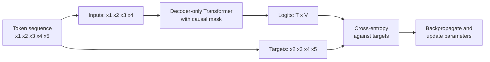
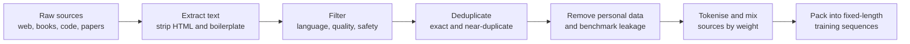

Pretraining is the long, expensive first stage that turns a randomly initialised Transformer into a model that knows grammar, facts, coding conventions and a surprising amount of reasoning. The recipe is almost embarrassingly simple: show the model enormous amounts of text and train it to predict the next token. Everything else (chat behaviour, instruction following, safety) is layered on afterwards by fine-tuning a pretrained model. As an AI engineer you will rarely pretrain a large model yourself, but you need to understand the objective, the data and the compute involved to reason about what a model can know, why it behaves as it does, and what fine-tuning can and cannot change.

## The next-token objective

Given a sequence of tokens $x_1, x_2, \dots, x_T$, a language model factorises the probability of the whole sequence into a chain of next-token predictions:

$$
p(x_1, \dots, x_T) = \prod_{t=1}^{T} p_\theta(x_t \mid x_{\lt t})
$$

where $\theta$ are the model's parameters and $x_{\lt t}$ means all tokens before position $t$. Training minimises the average **cross-entropy**, the negative log-probability the model assigns to each true next token:

$$
\mathcal{L}(\theta) = -\frac{1}{T} \sum_{t=1}^{T} \log p_\theta(x_t \mid x_{\lt t})
$$

This is the same cross-entropy loss you met in [Loss functions](/learn/neural-network-fundamentals/loss-functions), applied as a classification over the $V$ tokens of the vocabulary at every position. No human labels are needed: the text supplies its own targets, which is why this is called **self-supervised** learning.

Thanks to causal masking, one forward pass over a sequence of $T$ tokens produces predictions at every position at once. The targets are simply the inputs shifted one place to the left, so a single sequence of 4,096 tokens yields 4,096 training examples.



## Computing the loss by hand

Here is the loss for a toy model with a vocabulary of 5 tokens and a sequence of 4 positions. Each row of `logits` holds the model's raw scores for the next token at that position.

```python
import numpy as np

tokens = np.array([2, 0, 3, 3, 1])        # one training sequence
inputs, targets = tokens[:-1], tokens[1:]

logits = np.array([
    [ 2.0, 0.1, -1.0,  0.5, 0.0],
    [ 0.0, 0.2,  0.1,  1.5, 0.3],
    [-0.5, 0.0,  0.3,  2.5, 0.1],
    [ 0.2, 0.4,  0.0,  1.0, 0.1],
])

def log_softmax(z):
    z = z - z.max(axis=-1, keepdims=True)    # numerical stability
    return z - np.log(np.exp(z).sum(axis=-1, keepdims=True))

logp = log_softmax(logits)
per_token = -logp[np.arange(len(targets)), targets]

print("targets:       ", targets)
print("per-token loss:", per_token.round(3))
print("mean loss:     ", per_token.mean().round(3))
print("perplexity:    ", np.exp(per_token.mean()).round(3))
print("uniform guess: ", np.log(5).round(3))
```

```output
targets:        [0 3 3 1]
per-token loss: [0.443 0.715 0.288 1.62 ]
mean loss:      0.766
perplexity:     2.152
uniform guess:  1.609
```

In the first three positions the correct token has the highest score, so the loss is low. At the last position the model favours token 3 while the true next token is 1, which receives only about 20% of the probability, and the loss there is much higher. **Perplexity**, the exponential of the mean loss, reads as "how many tokens the model is effectively choosing between". A model that guesses uniformly over $V$ tokens has loss $\log V$ and perplexity $V$; training drives both down.

> [!KEY]
> Pretraining has a single objective: assign high probability to the actual next token. Knowledge of facts, syntax and even some reasoning emerges because they help with that prediction, not because they were taught directly.

## The data pipeline

What a model can know is bounded by what it read. Pretraining corpora are assembled from sources such as filtered web crawls, books, encyclopaedic text, scientific papers and source code, typically amounting to trillions of tokens for large models. Raw web text is mostly unusable, so most of the engineering effort goes into cleaning it.



| Step | Why it matters |
| --- | --- |
| Quality filtering | Spam, machine-generated junk and boilerplate waste compute and teach bad patterns |
| Deduplication | Repeated documents are memorised and over-weighted; removing them improves quality per token |
| Decontamination | Benchmark questions leaking into training data inflate evaluation scores |
| Mixture weights | The share of code, maths or each language shapes what the model is good at |
| Knowledge cut-off | The model knows nothing written after its data was collected |

Documents vary in length, but training batches need fixed-length sequences. The usual trick is **packing**: concatenate tokenised documents with an end-of-text token between them, then slice the stream into chunks of length $T + 1$, so each chunk gives $T$ inputs and $T$ targets.

```python
EOT = 0
docs = [[5, 8, 2], [7, 7, 3, 9, 4], [6, 1]]    # already tokenised
stream = [tok for d in docs for tok in d + [EOT]]
T = 4
chunks = [stream[i:i + T + 1] for i in range(0, len(stream) - T, T)]

print(stream)
for c in chunks:
    print("inputs", c[:-1], "targets", c[1:])
```

```output
[5, 8, 2, 0, 7, 7, 3, 9, 4, 0, 6, 1, 0]
inputs [5, 8, 2, 0] targets [8, 2, 0, 7]
inputs [7, 7, 3, 9] targets [7, 3, 9, 4]
inputs [4, 0, 6, 1] targets [0, 6, 1, 0]
```

Notice that some chunks cross a document boundary. The end-of-text token tells the model that what follows is unrelated, and many training setups also adjust the attention mask so tokens cannot attend across documents.

## Compute

A widely used rule of thumb estimates the training compute of a dense Transformer as

$$
C \approx 6 N D
$$

where $C$ is the number of floating-point operations, $N$ the number of parameters and $D$ the number of training tokens. The 6 comes from roughly 2 operations per parameter per token in the forward pass and 4 in the backward pass. It is an approximation that ignores attention's dependence on sequence length, but it is good enough for planning. With an **illustrative** model and budget:

```python
N = 7e9            # parameters
D = 2e12           # training tokens
C = 6 * N * D

throughput = 4e14  # illustrative sustained FLOP/s per accelerator
gpu_days = C / throughput / 86_400
print(f"compute: {C:.2e} FLOPs")
print(f"about {gpu_days:,.0f} accelerator-days, "
      f"or {gpu_days / 1024:.1f} days on 1,024 accelerators")
```

```output
compute: 8.40e+22 FLOPs
about 2,431 accelerator-days, or 2.4 days on 1,024 accelerators
```

Real runs also lose time to failed nodes, restarts from checkpoints, evaluation and the occasional loss spike that forces a rollback. This is why pretraining a large model is a project for organisations with large clusters, and why most engineers start from an existing pretrained model.

## Scaling laws

Empirical studies of language models found that pretraining loss falls smoothly and predictably as you increase parameters, data and compute, roughly following power laws: each tenfold increase buys a similar, diminishing improvement. This predictability lets teams run small experiments and extrapolate to choose the size of a large run before spending the compute.

Two qualitative findings are worth knowing:

- **Balance parameters and data.** For a fixed compute budget, a model that is too large for its data, or trained on too little data for its size, wastes compute. Hoffmann et al. (2022) concluded that parameters and training tokens should grow roughly in proportion, and their result is often summarised as about 20 tokens per parameter for compute-optimal training. Treat that figure as a rough guide from one study, not a law.
- **Inference cost changes the answer.** A compute-optimal model is not always the most useful. Many teams deliberately train smaller models on far more tokens than the compute-optimal amount, because a smaller model is cheaper to serve for its whole lifetime.

> [!WARNING]
> Lower pretraining loss does not translate one-for-one into better performance on a particular task. Scaling laws predict the loss, not whether the model will be good at your use case. Always evaluate on your own task.

## What a base model does

The output of pretraining is a **base model**. It is a powerful document continuer, not an assistant. Given a prompt, it produces whatever text would plausibly come next in a document from its training distribution. An illustrative exchange with a base model might look like this:

```text
Prompt:  What is the capital of France?
Output:  What is the capital of Germany? What is the capital of Italy?
         These are some of the questions in our geography quiz...
```

The model has treated the question as the start of a quiz page and continued it. It knows the answer, but nothing has taught it that a question is a request to be answered. That behaviour comes from [fine-tuning](/learn/generative-ai-fundamentals/fine-tuning), which uses far less data and compute than pretraining but changes how the model responds. Base models remain useful for completion-style tasks and as the starting point for your own fine-tuning.

## Exercises

**1.** A model assigns probabilities 0.5, 0.25 and 0.125 to the true next tokens at three positions. Compute the mean cross-entropy loss (natural log) and the perplexity.

<details>
<summary>Show solution</summary>

```python
p = np.array([0.5, 0.25, 0.125])
loss = -np.log(p).mean()
print(round(loss, 4), round(np.exp(loss), 4))
```

```output
1.3863 4.0
```

The losses are $\ln 2$, $2\ln 2$ and $3\ln 2$, with mean $2 \ln 2 \approx 1.386$, and the perplexity is $e^{2\ln 2} = 4$: on average the model was as uncertain as a uniform choice among 4 tokens.

</details>

**2.** Using $C \approx 6ND$, how many training tokens can you afford for a 1-billion-parameter model with a budget of $3 \times 10^{21}$ FLOPs? How does that compare with the "about 20 tokens per parameter" guideline?

<details>
<summary>Show solution</summary>

```python
C, N = 3e21, 1e9
D = C / (6 * N)
print(f"{D:.1e} tokens, {D / N:.0f} tokens per parameter")
```

```output
5.0e+11 tokens, 500 tokens per parameter
```

That is 500 tokens per parameter, far beyond the rough compute-optimal ratio. You would get lower loss for the same compute with a larger model, but the small model may still be the better choice if it must be cheap to serve.

</details>

**3.** Modify the packing code so that `T = 3`. How many training chunks are produced, and how many tokens of the stream are left unused at the end?

<details>
<summary>Show solution</summary>

```python
T = 3
chunks = [stream[i:i + T + 1] for i in range(0, len(stream) - T, T)]
used = len(chunks) * T + 1
print(len(chunks), "chunks;", len(stream) - used, "tokens unused")
```

```output
4 chunks; 0 tokens unused
```

Consecutive chunks overlap by one token, because the last target of one chunk is the first input of the next, so `len(chunks) * T + 1` stream tokens are covered.

</details>

```quiz
[
  {
    "q": "What are the training targets in next-token pretraining?",
    "options": [
      "Human-written labels for each document",
      "The input tokens shifted one position to the left",
      "A summary of each document",
      "Random tokens from the vocabulary"
    ],
    "answer": 1,
    "why": "Each position is trained to predict the token that follows it, so the text supplies its own labels."
  },
  {
    "q": "A model has a mean cross-entropy loss equal to the natural log of its vocabulary size V. What does that indicate?",
    "options": [
      "It is predicting perfectly",
      "It has overfitted",
      "It is no better than guessing uniformly over the vocabulary",
      "Its perplexity is 1"
    ],
    "answer": 2,
    "why": "A uniform distribution assigns 1/V to every token, giving loss log V and perplexity V."
  },
  {
    "q": "Roughly how much compute does the 6ND rule estimate for training a 2-billion-parameter model on 1 trillion tokens?",
    "options": [
      "1.2e22 FLOPs",
      "1.2e21 FLOPs",
      "2e12 FLOPs",
      "6e15 FLOPs"
    ],
    "answer": 0,
    "why": "6 × 2e9 × 1e12 = 1.2e22 floating-point operations."
  },
  {
    "q": "You ask a base model \"Translate to French: Good morning\" and it continues with a list of other phrases to translate. Why?",
    "options": [
      "The model does not know French",
      "The temperature was too low",
      "The context window was too short",
      "A base model continues documents and has not been fine-tuned to follow instructions"
    ],
    "answer": 3,
    "why": "Pretraining teaches continuation of text. Instruction following comes from later fine-tuning."
  }
]
```
