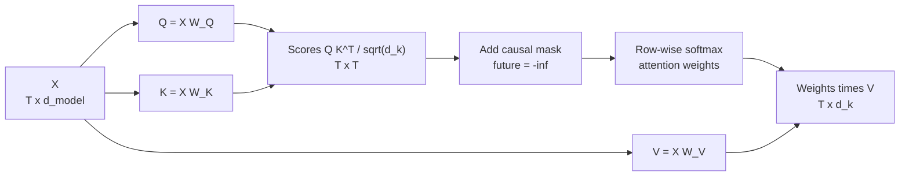

Self-attention is the one operation in an LLM that lets tokens talk to each other. When the model reads "The trophy did not fit in the suitcase because it was too big", self-attention is how the vector for "it" pulls in information from "trophy". Everything else in a Transformer block works on each position separately. You first met attention in [attention mechanisms](/learn/sequence-models/attention-mechanisms) and again in [Advanced NLP](/learn/advanced-nlp/attention-mechanisms); this lesson pins down the exact computation a decoder-only LLM performs, with the causal mask, and implements it in NumPy so you can check every number.

## The intuition: a soft lookup table

Think of a Python dictionary. You present a key, it returns one value. Attention is a *soft* version of this: each token issues a **query**, compares it with the **key** of every token it may look at, and receives a weighted average of their **values**, with more weight on keys that match the query better.

| Role | Question it answers | Produced by |
| --- | --- | --- |
| Query $q_i$ | What is token $i$ looking for? | $x_i W_Q$ |
| Key $k_j$ | What does token $j$ offer, for matching? | $x_j W_K$ |
| Value $v_j$ | What information does token $j$ pass on if chosen? | $x_j W_V$ |

The same token produces all three, through three different learned matrices. Separating keys from values matters: what makes a token *relevant* need not be the same as what it should *contribute*.

## The maths

Stack the $T$ token vectors of a sequence into a matrix $X$ of shape $T \times d_{\text{model}}$. Three learned matrices of shape $d_{\text{model}} \times d_k$ project it:

$$
Q = X W_Q, \qquad K = X W_K, \qquad V = X W_V
$$

so $Q$, $K$ and $V$ each have shape $T \times d_k$. Scaled dot-product attention is then

$$
\text{Attention}(Q, K, V) = \text{softmax}\!\left(\frac{Q K^\top}{\sqrt{d_k}} + M\right) V
$$

where:

- $Q K^\top$ is a $T \times T$ matrix of scores; entry $(i, j)$ is the dot product $q_i \cdot k_j$, large when query $i$ and key $j$ point the same way.
- $\sqrt{d_k}$ rescales the scores (explained below).
- $M$ is the causal mask: $M_{ij} = 0$ if $j \le i$ and $M_{ij} = -\infty$ if $j > i$.
- softmax is applied to each row, so row $i$ becomes a probability distribution over positions $1 \dots i$.
- Multiplying by $V$ gives each position a weighted average of value vectors, shape $T \times d_k$.



### Why divide by the square root of d_k

If the entries of $q$ and $k$ are independent with mean 0 and variance 1, their dot product is a sum of $d_k$ such products and has variance $d_k$. With $d_k = 128$, scores would typically be around $\pm 11$, and softmax of such large numbers is almost one-hot, so gradients through it nearly vanish. Dividing by $\sqrt{d_k}$ brings the variance back to about 1.

```python
import numpy as np

rng = np.random.default_rng(0)
d_k = 128
q = rng.normal(size=(10000, d_k))
k = rng.normal(size=(10000, d_k))
dots = (q * k).sum(axis=1)
print(round(dots.std(), 2), round((dots / np.sqrt(d_k)).std(), 2))
```

```output
11.33 1.0
```

## Implementing causal self-attention in NumPy

Here is the full computation for one sequence. The softmax subtracts each row's maximum before exponentiating, which does not change the result but prevents overflow; `exp(-inf)` is exactly 0, so masked positions get zero weight.

```python
np.set_printoptions(precision=3, suppress=True)

def softmax(z):
    z = z - z.max(axis=-1, keepdims=True)
    e = np.exp(z)
    return e / e.sum(axis=-1, keepdims=True)

def causal_attention(Q, K, V):
    T, d_k = Q.shape
    scores = Q @ K.T / np.sqrt(d_k)
    mask = np.triu(np.ones((T, T), dtype=bool), k=1)
    scores = np.where(mask, -np.inf, scores)
    weights = softmax(scores)
    return weights @ V, weights

def causal_self_attention(X, W_Q, W_K, W_V):
    return causal_attention(X @ W_Q, X @ W_K, X @ W_V)
```

`causal_attention` is the formula itself; `causal_self_attention` adds the three projections. The word *self* means queries, keys and values all come from the same sequence $X$.

To make the numbers easy to follow, use a tiny example where $d_{\text{model}} = d_k = 2$ and all three projections are the identity matrix, so $Q = K = V = X$. In a trained model they are learned.

```python
X = np.array([[1.0, 0.0],
              [0.0, 1.0],
              [1.0, 1.0]])           # 3 tokens, d_model = 2
I = np.eye(2)

out, weights = causal_self_attention(X, I, I, I)
print(weights)
print(out)
```

```output
[[1.    0.    0.   ]
 [0.33  0.67  0.   ]
 [0.248 0.248 0.503]]
[[1.    0.   ]
 [0.33  0.67 ]
 [0.752 0.752]]
```

Read the weights row by row. Token 0 can only see itself, so its weight is 1. Token 1 sees tokens 0 and 1 and prefers itself, because its query matches its own key better. Token 2's query $[1, 1]$ matches every key, matching its own key $[1, 1]$ most strongly. The upper triangle is exactly zero: no token attends to the future.

### Step through it

The trace below walks through the same computation with $V$ set to `[[1, 0], [0, 1], [2, 2]]`, so you can see how a large value vector on the last token shifts that token's output.

```trace
{
  "title": "causal attention on 3 tokens",
  "code": [
    "scores = Q @ K.T / np.sqrt(2)",
    "for i in range(T):",
    "    for j in range(i + 1, T):",
    "        scores[i, j] = -np.inf",
    "weights = softmax(scores)",
    "out = weights @ V",
    "print(out)"
  ],
  "steps": [
    { "line": 1, "vars": { "scores": "[[0.707, 0, 0.707], [0, 0.707, 0.707], [0.707, 0.707, 1.414]]" }, "note": "Every query is compared with every key. Entry (i, j) is q_i . k_j / sqrt(2). Token 2's query [1, 1] scores highest against its own key." },
    { "line": 4, "vars": { "i": "0", "j": "1", "scores row 0": "[0.707, -inf, 0.707]" }, "note": "Token 0 may not look at token 1, which comes after it." },
    { "line": 4, "vars": { "i": "0", "j": "2", "scores row 0": "[0.707, -inf, -inf]" }, "note": "Nor at token 2. Row 0 now only allows position 0." },
    { "line": 4, "vars": { "i": "1", "j": "2", "scores row 1": "[0, 0.707, -inf]" }, "note": "Token 1 loses access to token 2. Row 2 has no future positions, so it is untouched." },
    { "line": 5, "vars": { "weights": "[[1, 0, 0], [0.33, 0.67, 0], [0.248, 0.248, 0.503]]" }, "note": "Softmax per row. exp(-inf) = 0, so masked entries get zero weight, and each row sums to 1." },
    { "line": 6, "vars": { "out": "[[1, 0], [0.33, 0.67], [1.255, 1.255]]" }, "note": "Each output row is a weighted average of value rows. Token 2 puts half its weight on its own value [2, 2]." },
    { "line": 7, "vars": {}, "out": ["[[1.    0.   ]", " [0.33  0.67 ]", " [1.255 1.255]]"], "note": "In a real model these outputs are added back into the residual stream." }
  ]
}
```

Check the trace against the function by passing $Q$, $K$ and $V$ directly:

```python
V_demo = np.array([[1.0, 0.0], [0.0, 1.0], [2.0, 2.0]])
out, weights = causal_attention(X, X, V_demo)
print(weights)
print(out)
```

```output
[[1.    0.    0.   ]
 [0.33  0.67  0.   ]
 [0.248 0.248 0.503]]
[[1.    0.   ]
 [0.33  0.67 ]
 [1.255 1.255]]
```

The weights are the same as before, because they depend only on $Q$ and $K$. Changing $V$ changes *what* is mixed, not *how much* of each position is mixed.

## Batching and the shapes you will see in code

Real implementations process a batch of $B$ sequences at once. NumPy's `@` broadcasts over leading dimensions, so the same code works with $X$ of shape $(B, T, d_{\text{model}})$ if you transpose only the last two axes of $K$:

```python
B, T, d_model, d_k = 2, 5, 16, 8
X = rng.normal(size=(B, T, d_model))
W_Q, W_K, W_V = (rng.normal(size=(d_model, d_k)) / np.sqrt(d_model) for _ in range(3))

Q, K, V = X @ W_Q, X @ W_K, X @ W_V
scores = Q @ K.transpose(0, 2, 1) / np.sqrt(d_k)
mask = np.triu(np.ones((T, T), dtype=bool), k=1)
weights = softmax(np.where(mask, -np.inf, scores))
out = weights @ V
print(Q.shape, scores.shape, out.shape)
print(weights[0].sum(axis=-1))
print(np.allclose(np.triu(weights[0], k=1), 0))
```

```output
(2, 5, 8) (2, 5, 5) (2, 5, 8)
[1. 1. 1. 1. 1.]
True
```

The score matrix is $T \times T$ per sequence. That quadratic size is the root of the cost of long contexts, covered in [Context windows](/learn/generative-ai-fundamentals/context-windows).

> [!KEY]
> Attention has no learned parameters of its own beyond $W_Q$, $W_K$ and $W_V$. The weights are computed fresh from the data for every input, which is what lets the same layer route information differently in every sentence.

## Common mistakes

| Mistake | Symptom |
| --- | --- |
| Softmax over the wrong axis | Columns, not rows, sum to 1; outputs look plausible but are wrong |
| Forgetting the mask in a decoder | Training loss drops suspiciously fast, generation is garbage |
| Masking with 0 instead of $-\infty$ | Future tokens still get weight, because $e^0 = 1$ |
| Forgetting $\sqrt{d_k}$ | Near one-hot attention early in training, slow learning |
| `K.T` on a batched 3D array | Transposes the batch axis too; shapes error or silently mix sequences |

> [!WARNING]
> In half-precision code, a literal `-inf` can produce `nan` when an entire row is masked (for example, padding rows). Libraries often use a large negative finite number instead. If you see `nan` in attention weights, check for fully masked rows first.

## Exercises

**1.** Without running code, predict token 1's output if $V$ is changed to `[[4, 0], [0, 4], [9, 9]]`, keeping $Q = K = X$. Then check with `causal_attention`.

<details>
<summary>Show solution</summary>

Token 1's weights are `[0.33, 0.67, 0]` (more precisely $[0.330, 0.670, 0]$), and token 2's value is masked out, so the output is $0.330 \cdot [4, 0] + 0.670 \cdot [0, 4] \approx [1.32, 2.68]$. The 9s never reach token 1.

```python
X3 = np.array([[1.0, 0.0], [0.0, 1.0], [1.0, 1.0]])
out, _ = causal_attention(X3, X3, np.array([[4.0, 0.0], [0.0, 4.0], [9.0, 9.0]]))
print(out[1])
```

```output
[1.321 2.679]
```

</details>

**2.** Remove the causal mask from `causal_self_attention` and recompute the weights for the three-token example. Which row does not change, and why?

<details>
<summary>Show solution</summary>

```python
def full_attention_weights(X, W_Q, W_K):
    Q, K = X @ W_Q, X @ W_K
    return softmax(Q @ K.T / np.sqrt(Q.shape[1]))

print(full_attention_weights(X3, np.eye(2), np.eye(2)))
```

```output
[[0.401 0.198 0.401]
 [0.198 0.401 0.401]
 [0.248 0.248 0.503]]
```

The last row is unchanged: the final token already sees every position under the causal mask. The other rows now place weight on future tokens.

</details>

**3.** Using the batched code, check numerically that changing the last token of a sequence does not change the attention output at any earlier position.

<details>
<summary>Show solution</summary>

```python
def attend(X):
    Q, K, V = X @ W_Q, X @ W_K, X @ W_V
    s = Q @ K.transpose(0, 2, 1) / np.sqrt(d_k)
    return softmax(np.where(mask, -np.inf, s)) @ V

X2 = X.copy()
X2[:, -1, :] = rng.normal(size=(B, d_model))
a, b = attend(X), attend(X2)
print(np.allclose(a[:, :-1], b[:, :-1]), np.allclose(a[:, -1], b[:, -1]))
```

```output
True False
```

Earlier positions are unaffected, which is exactly the property that makes the KV cache possible.

</details>

```quiz
[
  {
    "q": "In scaled dot-product attention, what does entry (i, j) of `Q @ K.T` measure?",
    "options": [
      "How much value vector j contributes before softmax",
      "The similarity between query i and key j",
      "The distance between positions i and j",
      "The probability of token j following token i"
    ],
    "answer": 1,
    "why": "It is the dot product q_i . k_j, which is large when the query and key point in similar directions."
  },
  {
    "q": "Why are scores divided by the square root of d_k?",
    "options": [
      "To make the attention matrix symmetric",
      "To normalise the value vectors",
      "To keep score variance near 1 so softmax does not saturate",
      "To apply the causal mask"
    ],
    "answer": 2,
    "why": "A dot product of d_k unit-variance terms has variance d_k; scaling by sqrt(d_k) restores variance near 1."
  },
  {
    "q": "A causal mask sets future positions to which value before the softmax?",
    "options": [
      "Negative infinity (or a very large negative number)",
      "Zero",
      "One",
      "The row mean"
    ],
    "answer": 0,
    "why": "exp(-inf) = 0, so those positions get exactly zero weight. Setting them to 0 would still give weight e^0 = 1."
  },
  {
    "q": "For a sequence of T tokens, what is the shape of the attention weight matrix for one head?",
    "options": [
      "T x d_k",
      "d_k x d_k",
      "T x d_model",
      "T x T"
    ],
    "answer": 3,
    "why": "Every query position gets a weight for every key position, which is why attention cost grows quadratically with T."
  }
]
```
