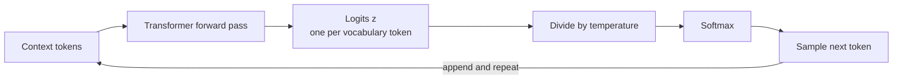

Every time a language model produces a token, it first produces a score for every token in its vocabulary and then has to choose one. **Temperature** is the single most important knob on that choice. Low temperature makes the model cautious and repetitive; high temperature makes it varied and, eventually, incoherent. Almost every LLM API exposes it, and choosing a sensible value for a task (extraction, code, brainstorming, fiction) is one of the first practical decisions you make as an AI engineer. This lesson shows exactly what the knob does to the numbers.

## From logits to probabilities

At each decoding step, the final layer of the model outputs a vector of **logits** $z \in \mathbb{R}^{V}$, one real number per vocabulary entry, where $V$ is the vocabulary size. Logits are unbounded scores, not probabilities. The [softmax](/learn/neural-network-fundamentals/activation-functions) turns them into a probability distribution:

$$
p_i = \frac{e^{z_i}}{\sum_{j=1}^{V} e^{z_j}}
$$

The model then **samples** the next token from $p$, appends it to the sequence, and repeats (the full loop is covered in [Inference](/learn/generative-ai-fundamentals/inference)).



## Softmax with temperature

Temperature $\tau > 0$ divides the logits before the softmax:

$$
p_i(\tau) = \frac{e^{z_i / \tau}}{\sum_{j=1}^{V} e^{z_j / \tau}}
$$

The ordering of tokens never changes, because dividing by a positive number preserves order. What changes is the **gap** between them:

| Temperature | Effect on logits | Resulting distribution |
| --- | --- | --- |
| $\tau < 1$ | Gaps between logits are stretched | Sharper: the top token takes more of the mass |
| $\tau = 1$ | Unchanged | The model's own distribution |
| $\tau > 1$ | Gaps are shrunk | Flatter: unlikely tokens gain mass |
| $\tau \to 0$ | Gaps become infinite | All mass on the top token (greedy decoding) |
| $\tau \to \infty$ | All logits approach 0 | Uniform over the whole vocabulary |

The name comes from statistical physics, where the Boltzmann distribution $p \propto e^{-E/kT}$ spreads probability over more states as a system gets hotter.

## Seeing it in NumPy

Take four candidate next tokens after the prompt "The cat sat on the" with made-up logits:

```python
import numpy as np

tokens = ["mat", "sofa", "floor", "moon"]
logits = np.array([2.0, 1.0, 0.5, -1.0])

def softmax_t(z, tau):
    s = z / tau
    s = s - s.max()          # subtract the max for numerical stability
    e = np.exp(s)
    return e / e.sum()

for tau in [0.5, 1.0, 2.0]:
    p = softmax_t(logits, tau)
    print(f"tau={tau}:", {t: round(float(x), 3) for t, x in zip(tokens, p)})
```

```output
tau=0.5: {'mat': 0.842, 'sofa': 0.114, 'floor': 0.042, 'moon': 0.002}
tau=1.0: {'mat': 0.609, 'sofa': 0.224, 'floor': 0.136, 'moon': 0.03}
tau=2.0: {'mat': 0.434, 'sofa': 0.263, 'floor': 0.205, 'moon': 0.097}
```

At $\tau = 0.5$ "mat" holds most of the probability; at $\tau = 2$ even "moon" gets roughly one chance in ten. Subtracting the maximum does not change the result (it cancels in the ratio) but prevents `np.exp` overflowing when logits are large, which matters when you divide by a small $\tau$.

### Step through one computation

```trace
{
  "title": "softmax at temperature 0.5",
  "code": [
    "z = np.array([2.0, 1.0, 0.0])",
    "s = z / 0.5",
    "s = s - s.max()",
    "e = np.exp(s)",
    "total = e.sum()",
    "p = e / total",
    "print(p.round(4))"
  ],
  "steps": [
    { "line": 1, "vars": { "z": "[2.0, 1.0, 0.0]" }, "note": "Three logits. At temperature 1 the probabilities would be about 0.665, 0.245, 0.090." },
    { "line": 2, "vars": { "z": "[2.0, 1.0, 0.0]", "s": "[4.0, 2.0, 0.0]" }, "note": "Dividing by 0.5 doubles every logit, so the gaps between them double too." },
    { "line": 3, "vars": { "s": "[0.0, -2.0, -4.0]" }, "note": "Shift so the largest is 0. This avoids overflow and does not change the final probabilities." },
    { "line": 4, "vars": { "s": "[0.0, -2.0, -4.0]", "e": "[1.0, 0.1353, 0.0183]" }, "note": "Exponentiate. Each step of 2 in the logits is a factor of about 7.4 in e." },
    { "line": 5, "vars": { "e": "[1.0, 0.1353, 0.0183]", "total": "1.1537" }, "note": "The normalising constant." },
    { "line": 6, "vars": { "total": "1.1537", "p": "[0.8668, 0.1173, 0.0159]" }, "note": "Divide to get probabilities that sum to 1." },
    { "line": 7, "vars": { "p": "[0.8668, 0.1173, 0.0159]" }, "out": ["[0.8668 0.1173 0.0159]"], "note": "The top token went from about 0.665 at temperature 1 to about 0.867 at temperature 0.5." }
  ]
}
```

## Measuring spread with entropy

A single number that captures "how spread out" a distribution is: the **entropy**, $H(p) = -\sum_i p_i \log_2 p_i$, measured in bits. Zero bits means one certain outcome; $\log_2 V$ bits means uniform.

```python
def entropy_bits(p):
    p = p[p > 0]
    return float(-(p * np.log2(p)).sum())

for tau in [0.1, 0.5, 1.0, 2.0, 10.0]:
    p = softmax_t(logits, tau)
    print(f"tau={tau:>4}: top p={p.max():.3f}  entropy={entropy_bits(p):.3f} bits")
print("uniform over 4:", np.log2(4))
```

```output
tau= 0.1: top p=1.000  entropy=0.001 bits
tau= 0.5: top p=0.842  entropy=0.776 bits
tau= 1.0: top p=0.609  entropy=1.463 bits
tau= 2.0: top p=0.434  entropy=1.825 bits
tau=10.0: top p=0.285  entropy=1.992 bits
uniform over 4: 2.0
```

Entropy rises smoothly with temperature from almost 0 towards the 2-bit ceiling for four options. In a real model with tens of thousands of tokens, a high temperature hands a meaningful share of probability to the long tail of nonsense tokens, which is why output degrades so quickly above about 1.5.

## Sampling at different temperatures

Probabilities only matter once you sample. Draw 1,000 tokens at each temperature with a fixed seed:

```python
rng = np.random.default_rng(0)

for tau in [0.2, 1.0, 2.0]:
    p = softmax_t(logits, tau)
    draws = rng.choice(len(tokens), size=1000, p=p)
    counts = np.bincount(draws, minlength=len(tokens))
    print(f"tau={tau}:", dict(zip(tokens, counts.tolist())))
```

```output
tau=0.2: {'mat': 993, 'sofa': 6, 'floor': 1, 'moon': 0}
tau=1.0: {'mat': 640, 'sofa': 191, 'floor': 137, 'moon': 32}
tau=2.0: {'mat': 443, 'sofa': 261, 'floor': 203, 'moon': 93}
```

At $\tau = 0.2$ the output is almost always "mat"; at $\tau = 2$ "moon" appears dozens of times. Over a long generation those occasional odd choices compound: once the model writes "moon", every later token is conditioned on it.

### Temperature zero

Dividing by zero is undefined, so APIs and libraries treat $\tau = 0$ as a special case meaning **greedy decoding**: always take `argmax(logits)`. In practice:

```python
def pick(z, tau, rng):
    if tau == 0:
        return int(np.argmax(z))
    return int(rng.choice(len(z), p=softmax_t(z, tau)))

print(tokens[pick(logits, 0, rng)])
```

```output
mat
```

> [!WARNING]
> Temperature 0 is not a guarantee of identical outputs from a hosted API. Floating-point non-determinism on GPUs, batching with other requests and ties between near-equal logits can all change the argmax occasionally. If you need reproducibility, log outputs rather than relying on regenerating them.

## Practical guidance

Temperature is a task setting, not a quality setting. Higher is not "more creative and therefore better"; it trades reliability for variety.

| Task | Typical range | Why |
| --- | --- | --- |
| Extraction, classification, structured output | 0 to 0.3 | You want the single most likely answer and consistent formatting |
| Code generation | 0 to 0.4 | Small deviations break syntax; low variance is valuable |
| Question answering, summarisation | 0.2 to 0.7 | Some fluency without drifting from the source |
| Brainstorming, creative writing | 0.7 to 1.2 | Variety is the goal; repetition is the failure mode |
| Generating many diverse candidates to filter later | 0.8 to 1.0+ | Diversity across samples matters more than any single sample |

These ranges are common starting points, not rules: providers scale and clip temperature differently (some accept 0 to 2, others 0 to 1), so check the documentation of the API you call and tune on your own evaluation set.

> [!KEY]
> Temperature changes how probability is shared between tokens; it never changes which token the model ranks first. A model that ranks a wrong answer first will give it at every low temperature.

Two further points:

- **Greedy decoding is not always best, even for accuracy.** Pure argmax tends to fall into repetition loops on long outputs ("the the the..."). A small temperature, or the truncation methods in [Top-k and top-p sampling](/learn/generative-ai-fundamentals/top-k-and-top-p-sampling), often avoids this.
- **Temperature interacts with truncation.** Libraries apply temperature to the logits and then cut the tail with top-k or top-p. Raising temperature with a tight top-p can have less effect than you expect, because the extra mass goes to tokens that are then cut. Change one knob at a time.

## Exercises

**1.** Using `softmax_t`, find (to two decimal places) the temperature at which "mat" has probability exactly 0.5 for the logits in this lesson. Use a simple search over a grid.

<details>
<summary>Show solution</summary>

```python
taus = np.arange(0.5, 3.0, 0.01)
best = min(taus, key=lambda t: abs(softmax_t(logits, t)[0] - 0.5))
print(round(best, 2), softmax_t(logits, best)[0].round(3))
```

```output
1.47 0.501
```

Probability of the top token falls monotonically as $\tau$ rises, so a grid (or bisection) finds the crossing point.

</details>

**2.** Show numerically that adding the same constant to every logit does not change the temperature-scaled distribution, but multiplying every logit by 2 is equivalent to halving the temperature.

<details>
<summary>Show solution</summary>

```python
print(np.allclose(softmax_t(logits + 5, 1.0), softmax_t(logits, 1.0)))
print(np.allclose(softmax_t(logits * 2, 1.0), softmax_t(logits, 0.5)))
```

```output
True
True
```

The constant cancels between numerator and denominator. Scaling logits by $c$ is the same as dividing by $\tau = 1/c$, which is why temperature is sometimes described as an inverse scale on the logits.

</details>

**3.** A colleague sets temperature to 1.8 to make a customer-support bot "friendlier". What would you expect, and what would you suggest instead?

<details>
<summary>Show solution</summary>

Expect more off-topic phrasing, occasional invented details and occasional garbled tokens, because the long tail of the vocabulary gains probability. Tone is better controlled with the prompt (instructions and examples of the desired style) while keeping temperature moderate, for example 0.3 to 0.7, and evaluating responses on real conversations.

</details>

```quiz
[
  {
    "q": "What does dividing the logits by a temperature below 1 do?",
    "options": [
      "Flattens the distribution towards uniform",
      "Changes which token is ranked first",
      "Sharpens the distribution so the top token gains probability",
      "Removes all tokens except the top k"
    ],
    "answer": 2,
    "why": "Dividing by tau < 1 stretches the gaps between logits, so after the softmax the largest logit takes more of the mass. The ranking is unchanged."
  },
  {
    "q": "Why do implementations subtract `z.max()` before calling `np.exp`?",
    "options": [
      "To prevent overflow; it does not change the resulting probabilities",
      "To apply the temperature",
      "To make the probabilities sum to 1",
      "To remove negative logits"
    ],
    "answer": 0,
    "why": "The constant cancels in the ratio, but it keeps the exponentials in a safe range, which matters especially at small temperatures."
  },
  {
    "q": "What do most libraries do when temperature is set to 0?",
    "options": [
      "Raise a division-by-zero error",
      "Sample uniformly from the vocabulary",
      "Use the model's unmodified distribution",
      "Use greedy decoding: pick the argmax token"
    ],
    "answer": 3,
    "why": "The limit of softmax(z / tau) as tau approaches 0 puts all mass on the largest logit, so temperature 0 is implemented as argmax."
  },
  {
    "q": "As temperature increases, the entropy of the next-token distribution...",
    "options": [
      "Decreases towards 0",
      "Increases towards log2 of the vocabulary size",
      "Stays the same because ranking is preserved",
      "Becomes negative"
    ],
    "answer": 1,
    "why": "Higher temperature flattens the distribution, and the uniform distribution has the maximum entropy, log2(V) bits."
  }
]
```
