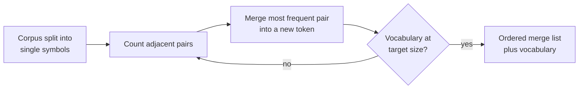

A large language model never sees letters or words. It sees a sequence of integers, each one an index into a fixed vocabulary of **tokens**. Every limit you meet when building with LLMs is counted in tokens: the context window, the maximum output length, the speed of generation and the bill from an API provider. Tokenisation also explains a surprising number of model quirks, from shaky arithmetic to higher costs for some languages. This lesson shows how modern LLM tokenisers work and how to measure and reason about tokens in your own code.

You met classical tokenisation (splitting on whitespace and punctuation, stemming, vocabularies of whole words) in [NLP Fundamentals](/learn/nlp-fundamentals/tokenization). Here the focus is the **subword** tokenisers that every modern LLM uses.

## Why subwords

There are three obvious ways to cut text into units, and each has a fatal flaw at LLM scale.

| Unit | Vocabulary size | Sequence length | Problem |
| --- | --- | --- | --- |
| Words | Huge (millions, and still incomplete) | Short | Unknown words, typos, new names and code all become an "unknown" token |
| Characters or bytes | Tiny (256 bytes) | Very long | Attention cost grows with sequence length, and the model must learn spelling from scratch |
| Subwords | Moderate (tens to hundreds of thousands) | Medium | Some oddities, covered below |

Subword tokenisers keep frequent strings such as `" the"` or `" learning"` as single tokens and break rare strings into smaller, reusable pieces. If the tokeniser works on **bytes** rather than characters, every possible input, including emoji, Chinese or binary junk, can be represented: in the worst case a string falls back to individual bytes. There is no unknown token.

## Byte-pair encoding

The most common algorithm is **byte-pair encoding (BPE)**. Training a BPE tokeniser is a simple greedy loop:

1. Start with a vocabulary of single symbols (bytes in real tokenisers, characters in this demo).
2. Count every adjacent pair of symbols across the training corpus.
3. Merge the most frequent pair into a new symbol and add it to the vocabulary.
4. Repeat until the vocabulary reaches the target size.



The output is an **ordered list of merges**. To tokenise new text, you split it into symbols and apply the merges in the order they were learned. Here is the whole training loop in plain Python on a tiny corpus of word counts. The `_` marks a leading space, mimicking how LLM tokenisers attach spaces to the start of words.

```python
from collections import Counter

corpus = {"_low": 5, "_lower": 2, "_newest": 6, "_widest": 3}
words = {tuple(w): c for w, c in corpus.items()}

def most_frequent_pair(words):
    pairs = Counter()
    for symbols, count in words.items():
        for a, b in zip(symbols, symbols[1:]):
            pairs[(a, b)] += count
    return pairs.most_common(1)[0]

def merge(words, pair):
    merged = {}
    for symbols, count in words.items():
        out, i = [], 0
        while i < len(symbols):
            if i < len(symbols) - 1 and (symbols[i], symbols[i + 1]) == pair:
                out.append(symbols[i] + symbols[i + 1])
                i += 2
            else:
                out.append(symbols[i])
                i += 1
        merged[tuple(out)] = count
    return merged

for step in range(6):
    pair, freq = most_frequent_pair(words)
    words = merge(words, pair)
    print(step + 1, pair, freq)

print(list(words))
```

```output
1 ('e', 's') 9
2 ('es', 't') 9
3 ('_', 'l') 7
4 ('_l', 'o') 7
5 ('_lo', 'w') 7
6 ('_', 'n') 6
[('_low',), ('_low', 'e', 'r'), ('_n', 'e', 'w', 'est'), ('_', 'w', 'i', 'd', 'est')]
```

After six merges, frequent fragments such as `est` and `_low` are single symbols, while the rarer word `_widest` is still split. Real tokenisers run the same loop over many gigabytes of text for tens or hundreds of thousands of merges. Production implementations also **pre-split** text with a regular expression first (roughly into words, numbers, punctuation and whitespace), so merges never cross those boundaries.

> [!NOTE]
> Other subword algorithms exist. **WordPiece** (used by BERT) chooses merges by a likelihood score rather than raw frequency, and **Unigram** (often used through the SentencePiece library) starts with a large vocabulary and prunes it. The behaviour you observe as a user is similar: frequent strings become single tokens, rare ones split.

## Tokenising with tiktoken

`tiktoken` is a fast BPE tokeniser library published by OpenAI, containing the encodings used by its models. It is a convenient way to see real LLM tokenisation, and the ideas carry over to every other model family. Install it with `pip install tiktoken`; the first call to `get_encoding` downloads the encoding file and caches it.

```python
import tiktoken

enc = tiktoken.get_encoding("cl100k_base")
ids = enc.encode("Tokenisation is surprisingly subtle.")

print(ids)
print([enc.decode([i]) for i in ids])
print(enc.decode(ids))
print(enc.n_vocab)
```

```output
[3404, 8082, 374, 29392, 27545, 13]
['Token', 'isation', ' is', ' surprisingly', ' subtle', '.']
Tokenisation is surprisingly subtle.
100277
```

Notice three things. The space belongs to the *start* of the next token (`' is'`, not `'is '`). A British spelling such as "Tokenisation" is split into `Token` and `isation`. And decoding the ids gives back the exact original string: BPE tokenisation is lossless.

Capitalisation and leading spaces produce *different* tokens, which is why `"Hello"` and `" hello"` are unrelated ids to the model until it learns otherwise:

```python
for text in ["Hello", " Hello", "hello", " hello", "HELLO"]:
    print(repr(text), enc.encode(text))
```

```output
'Hello' [9906]
' Hello' [22691]
'hello' [15339]
' hello' [24748]
'HELLO' [51812, 1623]
```

> [!TIP]
> Every model family has its own tokeniser, and token counts for the same text differ between them. Always count with the tokeniser that matches the model you will call. For open models you load the tokeniser through the Hugging Face libraries, covered in [Tokenizers](/learn/hugging-face-ecosystem/tokenizers).

## Token counts and cost

API providers charge per token, usually with separate rates for input and output tokens, and they limit requests by tokens. A rough rule of thumb for English prose is that one token is about four characters, or about three quarters of a word. Do not rely on it for anything that matters: measure.

```python
text = ("Large language models read and write tokens, not words. "
        "Counting tokens tells you what a request will cost and whether it fits.")
n_tokens = len(enc.encode(text))
print(len(text), "characters,", len(text.split()), "words,", n_tokens, "tokens")
print(round(len(text) / n_tokens, 2), "characters per token")
```

```output
127 characters, 22 words, 26 tokens
4.88 characters per token
```

Cost is then simple arithmetic. With an *illustrative* price of USD 2.00 per million input tokens and USD 8.00 per million output tokens (real prices vary widely and change often), a request with 3,000 input tokens and 500 output tokens costs:

$$
\text{cost} = \frac{3000 \times 2.00 + 500 \times 8.00}{10^6} = 0.01 \text{ USD}
$$

That looks tiny, but multiply by a million requests a day and prompt length becomes an engineering concern. Token budgeting is covered in depth in [Token usage and cost optimisation](/learn/working-with-llms/token-usage-and-cost-optimization).

## Multilingual quirks

Tokenisers are trained on a corpus that is usually dominated by English and code. Languages that are less represented get fewer merges, so the same meaning takes more tokens.

```python
sentences = {
    "English": "Machine learning is fun.",
    "French": "Le machine learning est amusant.",
    "Russian": "Машинное обучение — это интересно.",
    "Japanese": "機械学習は楽しい。",
}
for name in ["cl100k_base", "o200k_base"]:
    e = tiktoken.get_encoding(name)
    counts = {lang: len(e.encode(s)) for lang, s in sentences.items()}
    print(name, counts)
```

```output
cl100k_base {'English': 5, 'French': 8, 'Russian': 13, 'Japanese': 16}
o200k_base {'English': 5, 'French': 7, 'Russian': 9, 'Japanese': 8}
```

The larger vocabulary of `o200k_base` cuts the Russian and Japanese counts sharply. With `cl100k_base`, some Japanese characters are not even single tokens: they are split into raw UTF-8 bytes that only form a valid character when combined. More tokens for the same content means higher cost, slower generation and less effective context for users of those languages, which is one reason newer tokenisers have grown their vocabularies.

## Numbers, spelling and whitespace

Tokenisation shapes what a model finds easy.

```python
for text in ["2024", "The year 2024", "1234567", "3.14159"]:
    print(repr(text), [enc.decode([i]) for i in enc.encode(text)])
```

```output
'2024' ['202', '4']
'The year 2024' ['The', ' year', ' ', '202', '4']
'1234567' ['123', '456', '7']
'3.14159' ['3', '.', '141', '59']
```

This encoding chunks digits into groups of up to three, starting from the left. `1234567` becomes `123`, `456`, `7`, so the digit groups do not line up with place value (units, thousands, millions). A model doing long addition must work with groups that shift depending on the length of the number, which partly explains why LLMs can be unreliable at exact arithmetic. Other tokenisers split numbers into single digits for this reason.

| Quirk | Cause | Practical consequence |
| --- | --- | --- |
| Shaky arithmetic on long numbers | Digit groups do not align with place value | Use a calculator tool for exact maths |
| Trouble counting letters in a word | A word is one or two tokens, so its letters are not visible as separate units | Do not trust character-level answers without checking |
| Code with different indentation costs different amounts | Runs of spaces are tokenised in chunks | Minify or normalise whitespace in large prompts |
| A trailing space in a prompt changes the output | `" hello"` and `"hello"` are different tokens | Avoid ending prompts with a space |

## Special tokens

Vocabularies also contain **special tokens** that never appear in normal text: markers such as end-of-text, or the role markers that chat models use to separate system, user and assistant turns. The model learns that generating end-of-text means "stop". `tiktoken` refuses to encode special-token strings found in ordinary input unless you allow them explicitly, which protects you from a user smuggling a control token into your prompt.

```python
print(enc.encode("<|endoftext|>", allowed_special={"<|endoftext|>"}))
try:
    enc.encode("<|endoftext|>")
except ValueError as err:
    print("ValueError raised")
```

```output
[100257]
ValueError raised
```

## Exercises

**1.** Rerun the BPE demo from the original `corpus`, but keep merging until every word is a single token. How many merges does it take, and in what order do the words become whole?

<details>
<summary>Show solution</summary>

Replace the fixed `range(6)` loop with `while any(len(s) > 1 for s in words):`. It takes 15 merges. `_low` is whole after merge 5, `_newest` after merge 9, `_widest` after merge 13 and `_lower` last, after merge 15. Merges are chosen by pair frequency weighted by word count, so words with high counts (or that share pieces such as `est` and `_low` with other words) are completed first, and the rarest word, `_lower` with a count of 2, comes last.

</details>

**2.** Write a function `token_cost(prompt, completion_tokens, in_price, out_price)` that counts the prompt's tokens with `cl100k_base` and returns the cost in USD, where prices are per million tokens.

<details>
<summary>Show solution</summary>

```python
def token_cost(prompt, completion_tokens, in_price, out_price):
    n_in = len(enc.encode(prompt))
    return (n_in * in_price + completion_tokens * out_price) / 1_000_000

print(round(token_cost("Summarise this report. " * 100, 300, 2.0, 8.0), 6))
```

```output
0.003602
```

</details>

**3.** Using `tiktoken`, compare the token counts of the same short paragraph written in two languages you know. Explain the difference in terms of how BPE learns merges.

<details>
<summary>Show solution</summary>

Encode both versions with the same encoding and compare `len(enc.encode(text))`. The language that was more common in the tokeniser's training corpus usually needs fewer tokens, because BPE only creates merges for pairs that were frequent in that corpus. Rarer languages fall back to shorter pieces, down to single bytes in the worst case.

</details>

```quiz
[
  {
    "q": "Why can a byte-level BPE tokeniser represent any input string without an unknown token?",
    "options": [
      "Its vocabulary includes every word in every language",
      "Any string can fall back to individual bytes, and all 256 bytes are in the vocabulary",
      "It replaces unknown characters with the nearest known one",
      "It lowercases and normalises all input first"
    ],
    "answer": 1,
    "why": "The base vocabulary is the 256 byte values, and merges only add to it, so every input can be encoded, at worst one byte per token."
  },
  {
    "q": "What does training a BPE tokeniser produce?",
    "options": [
      "A neural network that predicts token boundaries",
      "A list of stop words",
      "An ordered list of merges and the resulting vocabulary",
      "A word frequency table"
    ],
    "answer": 2,
    "why": "BPE repeatedly merges the most frequent adjacent pair. The ordered merges are replayed to tokenise new text."
  },
  {
    "q": "The same sentence costs more tokens in Japanese than in English with a given tokeniser. What is the most likely reason?",
    "options": [
      "The tokeniser's training corpus contained less Japanese, so fewer Japanese merges were learned",
      "Japanese sentences always contain more information",
      "Tokenisers cannot handle non-Latin scripts",
      "Japanese text is always encoded as one token per byte"
    ],
    "answer": 0,
    "why": "Merges come from frequent pairs in the training corpus. Underrepresented languages get fewer merges and therefore split into more tokens."
  },
  {
    "q": "Why can digit grouping in a tokeniser make long addition harder for an LLM?",
    "options": [
      "Digits are removed during tokenisation",
      "Numbers are always a single token, hiding the digits",
      "Groups such as `123`, `456`, `7` do not line up with place value, so the alignment shifts with number length",
      "The model cannot see numbers at all"
    ],
    "answer": 2,
    "why": "Left-to-right chunking into groups of three means the units digit lands in a different group position depending on how long the number is."
  }
]
```
