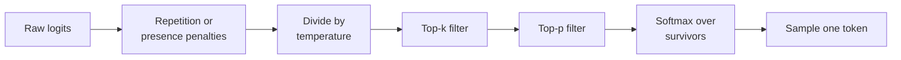

[Temperature](/learn/generative-ai-fundamentals/temperature) reshapes the whole next-token distribution, but it never removes anything: at any temperature above zero, every one of tens of thousands of tokens keeps some chance of being picked. Most of those tokens are nonsense in context, and over hundreds of sampling steps the model will eventually pick one. **Truncation sampling** fixes this by cutting off the unreliable tail before sampling. Top-k and top-p (nucleus) sampling are the two methods you will find in nearly every generation API and library, and knowing exactly what they do lets you set them deliberately instead of copying defaults.

## The problem with the tail

Consider a next-token distribution where a handful of tokens are sensible and many more each have a tiny probability. Individually the tail tokens are unlikely; together they can hold a surprising share of the mass.

```python
import numpy as np

tokens = ["mat", "sofa", "floor", "rug", "bed", "roof", "moon", "piano", "the", "xq"]
logits = np.array([3.0, 2.2, 2.0, 1.5, 1.0, 0.0, -0.5, -1.0, -1.5, -3.0])

def softmax(z):
    e = np.exp(z - z.max())
    return e / e.sum()

p = softmax(logits)
for t, x in zip(tokens, p):
    print(f"{t:>6}: {x:.3f}")
print("mass outside top 5:", round(float(p[5:].sum()), 3))
```

```output
   mat: 0.437
  sofa: 0.196
 floor: 0.161
   rug: 0.098
   bed: 0.059
  roof: 0.022
  moon: 0.013
 piano: 0.008
   the: 0.005
    xq: 0.001
mass outside top 5: 0.049
```

About one draw in twenty lands outside the five plausible endings. In a 500-token answer that compounds into several odd choices, each of which then conditions everything after it. A real vocabulary has a far longer tail than ten tokens, so the effect is stronger.

## Top-k sampling

**Top-k** keeps only the $k$ tokens with the highest logits, sets every other logit to $-\infty$, then applies the softmax and samples. The surviving probabilities are renormalised to sum to 1.

```python
def top_k_filter(z, k):
    z = z.copy()
    cutoff = np.sort(z)[-k]              # the k-th largest logit
    z[z < cutoff] = -np.inf
    return z

pk = softmax(top_k_filter(logits, 3))
print({t: round(float(x), 3) for t, x in zip(tokens, pk) if x > 0})
```

```output
{'mat': 0.55, 'sofa': 0.247, 'floor': 0.202}
```

Top-k is simple and cheap, but $k$ is fixed regardless of context. After "The capital of France is", only one token is reasonable, and $k = 40$ still lets 39 poor options in. After "My favourite food is", hundreds of tokens are reasonable, and $k = 40$ cuts many of them off. The right number of candidates depends on how confident the model is, which top-k ignores.

## Top-p (nucleus) sampling

**Top-p**, also called **nucleus sampling** (Holtzman et al., 2019, "The Curious Case of Neural Text Degeneration"), adapts to the shape of the distribution. Sort tokens by probability, then keep the smallest set whose cumulative probability reaches at least $p$:

$$
V^{(p)} = \text{smallest set } S \text{ of top-ranked tokens such that } \sum_{i \in S} p_i \ge p
$$

Here $p_i$ is the probability of token $i$ and $p$ (often 0.9 or 0.95) is the threshold. When the model is confident, the nucleus may contain one or two tokens; when it is uncertain, it grows to many.

```python
def top_p_filter(z, top_p):
    probs = softmax(z)
    order = np.argsort(-probs)                 # indices, most likely first
    cum = np.cumsum(probs[order])
    n_keep = int(np.searchsorted(cum, top_p) + 1)  # include the token that crosses top_p
    keep = order[:n_keep]
    out = np.full_like(z, -np.inf)
    out[keep] = z[keep]
    return out

for top_p in [0.5, 0.8, 0.95]:
    pp = softmax(top_p_filter(logits, top_p))
    kept = [t for t, x in zip(tokens, pp) if x > 0]
    print(f"top_p={top_p}: keeps {len(kept)} -> {kept}")
```

```output
top_p=0.5: keeps 2 -> ['mat', 'sofa']
top_p=0.8: keeps 4 -> ['mat', 'sofa', 'floor', 'rug']
top_p=0.95: keeps 5 -> ['mat', 'sofa', 'floor', 'rug', 'bed']
```

Now compare a confident distribution with the same threshold:

```python
confident = np.array([6.0, 2.0, 1.5, 1.0, 0.5, 0.0, -0.5, -1.0, -1.5, -3.0])
pp = softmax(top_p_filter(confident, 0.9))
print("confident, top_p=0.9 keeps:", [t for t, x in zip(tokens, pp) if x > 0])
```

```output
confident, top_p=0.9 keeps: ['mat']
```

The same threshold of 0.9 keeps five tokens for the original, uncertain distribution (the cumulative mass first passes 0.9 at "bed") and one for the confident one. That adaptivity is why top-p became a common default for open-ended generation.

> [!KEY]
> Top-k fixes the **number** of candidates. Top-p fixes the **probability mass** of candidates, so the number of candidates grows and shrinks with the model's uncertainty.

## Putting the pipeline together

In practice these steps run in sequence on the logits at every decoding step. A common order, used for example by the Hugging Face `transformers` generation code, is penalties first, then temperature, then truncation, then sampling:



Because top-p is computed from probabilities after temperature has been applied, temperature changes how many tokens survive the nucleus: higher temperature flattens the distribution, so more tokens are needed to reach the same mass. Implementations differ in details, so check the documentation of whichever API or library you use.

A full sampler with a fixed seed:

```python
def sample(z, rng, temperature=1.0, top_k=None, top_p=None):
    z = z / temperature
    if top_k is not None:
        z = top_k_filter(z, top_k)
    if top_p is not None:
        z = top_p_filter(z, top_p)
    return int(rng.choice(len(z), p=softmax(z)))

rng = np.random.default_rng(42)
settings = [dict(), dict(top_k=3), dict(top_p=0.8), dict(temperature=0.7, top_p=0.9)]
for s in settings:
    draws = [sample(logits, rng, **s) for _ in range(2000)]
    used = sorted({tokens[d] for d in draws})
    tail = np.mean([d >= 5 for d in draws])
    print(f"{str(s):<36} distinct={len(used):>2}  tail share={tail:.3f}")
```

```output
{}                                   distinct=10  tail share=0.052
{'top_k': 3}                         distinct= 3  tail share=0.000
{'top_p': 0.8}                       distinct= 4  tail share=0.000
{'temperature': 0.7, 'top_p': 0.9}   distinct= 4  tail share=0.000
```

Without truncation, all ten tokens appear and about 5% of draws come from the tail. Each truncation setting removes the tail entirely while keeping some variety among sensible tokens.

## Comparison

| Method | Keeps | Adapts to confidence | Typical values | Main weakness |
| --- | --- | --- | --- | --- |
| Greedy (temperature 0) | 1 token | No | n/a | Repetitive, no diversity |
| Pure sampling | All tokens | No | n/a | Tail tokens leak in |
| Top-k | The $k$ most likely | No | 20 to 100 | Too loose when confident, too tight when uncertain |
| Top-p | Smallest set with mass $\ge p$ | Yes | 0.9 to 0.95 | When the distribution is very flat, the nucleus can still be large |
| Min-p | Tokens with $p_i \ge p_{\min} \cdot \max_j p_j$ | Yes | 0.05 to 0.1 | Less universally available |

**Min-p** is a newer variant offered by several open-source inference libraries. It keeps every token whose probability is at least a fraction $p_{\min}$ of the top token's probability. If the top token has probability 0.6 and $p_{\min} = 0.1$, tokens below 0.06 are dropped; if the top token has only 0.1, the bar falls to 0.01. Like top-p it scales with confidence, but it is anchored to the top token rather than to cumulative mass.

> [!TIP]
> Many APIs recommend changing temperature **or** top-p, not both at once. Tune one, leave the other at its default, and judge the result on a fixed set of prompts.

## Repetition penalties

A separate family of controls fights loops ("I think that I think that I think..."). They modify logits of tokens that have already appeared:

- **Repetition penalty** (as in Hugging Face `transformers`): for each previously generated token, divide its logit by a factor $\theta > 1$ if the logit is positive, or multiply it by $\theta$ if negative, so it always becomes less likely.
- **Presence and frequency penalties** (as in several hosted APIs): subtract a fixed amount from the logit of any token that has appeared (presence), or an amount proportional to how often it has appeared (frequency).

Use them sparingly. Code, lists and structured output legitimately repeat tokens such as brackets, keywords and field names, and a strong penalty will corrupt them.

## Exercises

**1.** Write `min_p_filter(z, min_p)` and report which of the ten example tokens survive with `min_p=0.1`.

<details>
<summary>Show solution</summary>

```python
def min_p_filter(z, min_p):
    probs = softmax(z)
    out = z.copy()
    out[probs < min_p * probs.max()] = -np.inf
    return out

pm = softmax(min_p_filter(logits, 0.1))
print([t for t, x in zip(tokens, pm) if x > 0])
```

```output
['mat', 'sofa', 'floor', 'rug', 'bed']
```

"mat" has probability about 0.437, so the bar is about 0.044; "rug" (about 0.098) and "bed" (about 0.059) pass, while "roof" (about 0.022) does not.

</details>

**2.** For the example `logits`, how many tokens does `top_p=0.9` keep at temperature 0.5 and at temperature 1.5? Explain the difference.

<details>
<summary>Show solution</summary>

```python
for t in [0.5, 1.5]:
    kept = np.isfinite(top_p_filter(logits / t, 0.9)).sum()
    print(t, int(kept))
```

```output
0.5 3
1.5 6
```

Low temperature concentrates mass on the top few tokens, so fewer are needed to reach 90%. High temperature flattens the distribution, so the nucleus grows.

</details>

**3.** A `top_k_filter` that uses `z[z < cutoff]` can keep more than $k$ tokens. When, and does it matter?

<details>
<summary>Show solution</summary>

When several logits tie with the $k$-th largest value, all of them pass the `>=` comparison. With real-valued model logits exact ties are rare, and keeping a tied token is harmless. If you need exactly $k$, select indices with `np.argsort(-z)[:k]` instead.

</details>

```quiz
[
  {
    "q": "With `top_p=0.9`, which tokens are kept?",
    "options": [
      "The 90% of vocabulary tokens with the highest logits",
      "Every token with probability at least 0.9",
      "The smallest set of most likely tokens whose probabilities sum to at least 0.9",
      "The top 9 tokens"
    ],
    "answer": 2,
    "why": "Nucleus sampling sorts by probability and keeps tokens until the cumulative mass reaches the threshold."
  },
  {
    "q": "Why can top-p be preferable to top-k for open-ended text?",
    "options": [
      "It is cheaper to compute",
      "The number of candidates adapts to how confident the model is",
      "It always keeps more tokens than top-k",
      "It removes the need for a softmax"
    ],
    "answer": 1,
    "why": "A confident distribution yields a small nucleus and an uncertain one a large nucleus, whereas top-k always keeps exactly k."
  },
  {
    "q": "In a typical pipeline, what happens to the logits of tokens removed by top-k or top-p?",
    "options": [
      "They are set to minus infinity so the softmax gives them probability 0",
      "They are set to 0",
      "They are divided by the temperature",
      "They are moved to the end of the vocabulary"
    ],
    "answer": 0,
    "why": "exp(-inf) is 0, so removed tokens get zero probability and the survivors are renormalised."
  },
  {
    "q": "Why should repetition penalties be used carefully when generating JSON or code?",
    "options": [
      "They increase latency significantly",
      "They only work at temperature 0",
      "They change the tokenizer",
      "Valid output must repeat tokens such as brackets and keys, which the penalty makes less likely"
    ],
    "answer": 3,
    "why": "Penalties lower the logits of tokens that already appeared, including structural tokens that legitimately recur."
  }
]
```
