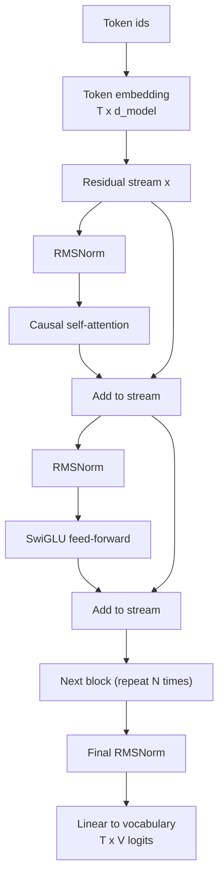
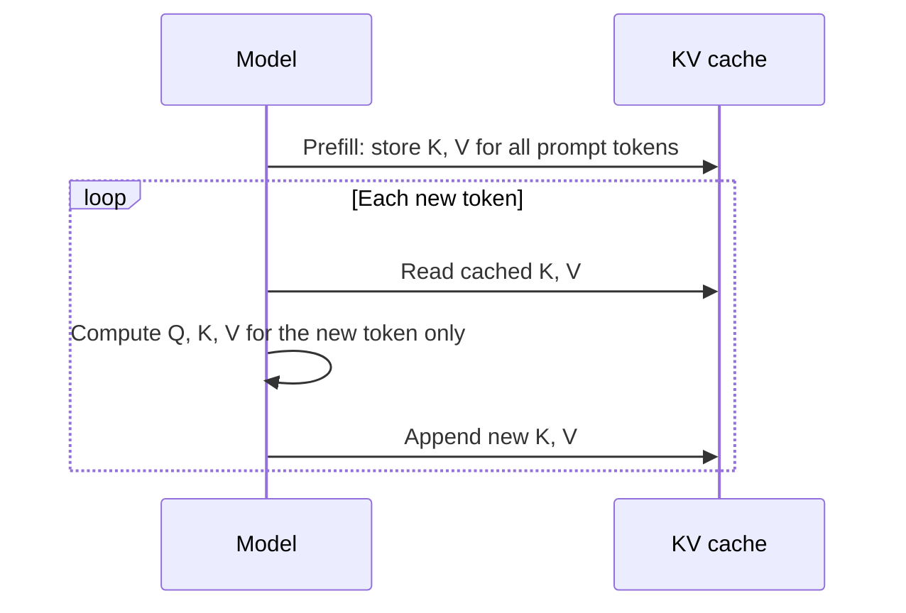

Almost every large language model you will use is a stack of the same building block repeated dozens of times. If you understand that one block, you understand where the parameters live, where the compute goes, why the model can only look backwards, and why serving it needs a cache. You met the original encoder-decoder Transformer in [Transformer architecture](/learn/advanced-nlp/transformer-architecture) and the decoder-only variant in [GPT architecture](/learn/advanced-nlp/gpt-architecture). This lesson looks at the block as it appears in modern decoder-only LLMs, which has changed in several small but important ways since the 2017 design.

## From the original Transformer to the modern LLM block

The 2017 Transformer had an encoder, a decoder and cross-attention between them, because it was built for translation. Generative language models dropped the encoder and the cross-attention and kept a single stack of decoder blocks that read text and predict the next token. Since then, a handful of refinements have become common across open model families:

| Component | Original Transformer (2017) | Typical modern decoder-only LLM |
| --- | --- | --- |
| Overall shape | Encoder + decoder | Decoder only |
| Normalisation placement | Post-norm (after each residual add) | Pre-norm (before each sub-layer) |
| Normalisation type | LayerNorm | RMSNorm (LayerNorm still used by some) |
| Feed-forward activation | ReLU | SwiGLU or GELU |
| Position information | Sinusoidal, added to inputs | Rotary embeddings (RoPE) inside attention |
| Attention | Full multi-head | Causal, often grouped-query attention |
| Biases in linear layers | Yes | Often removed |

None of these changes alters the core idea. They make very deep stacks train more stably and run more cheaply. Not every model uses every item; read the table as "common practice", not a rule.

## The residual stream

The most useful mental model for a decoder-only LLM is the **residual stream**. Each token position carries a vector of size $d_{\text{model}}$. Blocks never replace that vector; they read from it, compute something, and **add** their result back.



In equations, one pre-norm block is:

$$
\begin{aligned}
x' &= x + \text{Attn}(\text{Norm}(x)) \\
x'' &= x' + \text{FFN}(\text{Norm}(x'))
\end{aligned}
$$

where $x$ is the $T \times d_{\text{model}}$ matrix of token vectors ($T$ is the sequence length), Attn is causal multi-head self-attention, FFN is the feed-forward network and Norm is RMSNorm. Attention is the only place where positions exchange information; the FFN works on each position independently.

Because each block adds to the stream instead of overwriting it, the gradient has a direct path from the loss back to the embeddings. This is what makes stacks of many blocks trainable.

## Pre-norm and RMSNorm

In the original post-norm design, normalisation came *after* the residual addition: $x' = \text{Norm}(x + \text{Attn}(x))$. That puts a normalisation on the main path, and deep post-norm stacks needed careful learning-rate warm-up to train at all. **Pre-norm** moves the normalisation inside the branch, leaving the residual path as a clean sum. Training is more stable, which matters when you stack many blocks.

**RMSNorm** is a simplified LayerNorm. LayerNorm subtracts the mean and divides by the standard deviation; RMSNorm skips the mean subtraction and divides by the root mean square:

$$
\text{RMSNorm}(x) = \frac{x}{\sqrt{\frac{1}{d}\sum_{i=1}^{d} x_i^2 + \epsilon}} \odot g
$$

where $d = d_{\text{model}}$, $\epsilon$ is a small constant for numerical safety, $g$ is a learned per-dimension gain vector and $\odot$ is element-wise multiplication. It is slightly cheaper and works as well in practice.

```python
import numpy as np

def rms_norm(x, g, eps=1e-6):
    rms = np.sqrt(np.mean(x**2, axis=-1, keepdims=True) + eps)
    return x / rms * g

def layer_norm(x, eps=1e-6):
    mu = x.mean(axis=-1, keepdims=True)
    sd = x.std(axis=-1, keepdims=True)
    return (x - mu) / np.sqrt(sd**2 + eps)

x = np.array([[1.0, 2.0, 3.0, 4.0]])
g = np.ones(4)
print(np.round(rms_norm(x, g), 4))
print(np.round(layer_norm(x), 4))
print(np.round(np.sqrt(np.mean(rms_norm(x, g)**2)), 4))
```

```output
[[0.3651 0.7303 1.0954 1.4606]]
[[-1.3416 -0.4472  0.4472  1.3416]]
1.0
```

After RMSNorm the vector has a root mean square of 1, but its mean is not zero, unlike LayerNorm's output.

## The SwiGLU feed-forward network

The original FFN was two linear layers with a ReLU between them, expanding to $4 d_{\text{model}}$ and back. Many modern LLMs use a **gated** variant, SwiGLU:

$$
\text{FFN}(x) = \big(\text{SiLU}(x W_1) \odot (x W_3)\big) W_2, \qquad \text{SiLU}(z) = z \cdot \sigma(z)
$$

$W_1$ and $W_3$ both project from $d_{\text{model}}$ to a hidden size $d_{\text{ff}}$, $W_2$ projects back, and $\sigma$ is the sigmoid. One branch decides *how much* of the other branch to let through. Because there are three matrices instead of two, $d_{\text{ff}}$ is usually set to around $\frac{8}{3} d_{\text{model}}$ rather than $4 d_{\text{model}}$, which keeps the parameter count similar.

```python
rng = np.random.default_rng(0)
d_model, d_ff = 8, 16
W1 = rng.normal(0, 0.1, (d_model, d_ff))
W3 = rng.normal(0, 0.1, (d_model, d_ff))
W2 = rng.normal(0, 0.1, (d_ff, d_model))

def silu(z):
    return z / (1 + np.exp(-z))

def swiglu_ffn(x):
    return (silu(x @ W1) * (x @ W3)) @ W2

x = rng.normal(size=(5, d_model))      # 5 positions
print(swiglu_ffn(x).shape)
print("FFN params:", W1.size + W2.size + W3.size)
```

```output
(5, 8)
FFN params: 384
```

The output has the same shape as the input, as every sub-layer must, so it can be added back to the residual stream.

> [!KEY]
> Roughly two thirds of a typical LLM's parameters sit in the feed-forward layers, not in attention. Attention moves information between positions; the FFN does the per-position "thinking" and is where much factual knowledge appears to be stored.

## Causal masking

A decoder-only model is trained to predict token $t+1$ from tokens $1 \dots t$. If position $t$ could attend to later positions, it would see the answer. A **causal mask** blocks this: before the softmax, every attention score from position $i$ to a position $j > i$ is set to $-\infty$, so its weight becomes exactly zero.

```python
T = 4
mask = np.triu(np.ones((T, T), dtype=bool), k=1)   # True above the diagonal
print(mask.astype(int))
```

```output
[[0 1 1 1]
 [0 0 1 1]
 [0 0 0 1]
 [0 0 0 0]]
```

Row $i$ shows which positions token $i$ is *not* allowed to see. The mask lets the model train on every position of a sequence in parallel: one forward pass over $T$ tokens produces $T$ next-token predictions, each using only its own past. You will implement it fully in [Self-attention](/learn/generative-ai-fundamentals/self-attention).

## Counting parameters in a block

Ignoring the small norm gains, a block with full multi-head attention has four $d_{\text{model}} \times d_{\text{model}}$ attention matrices ($W_Q, W_K, W_V, W_O$) and three FFN matrices:

$$
\text{params per block} \approx 4 d_{\text{model}}^2 + 3 \, d_{\text{model}} \, d_{\text{ff}}
$$

```python
def block_params(d_model, d_ff):
    return 4 * d_model**2 + 3 * d_model * d_ff

for d_model in [1024, 4096]:
    d_ff = int(8 * d_model / 3)
    print(d_model, d_ff, f"{block_params(d_model, d_ff):,}")
```

```output
1024 2730 12,580,864
4096 10922 201,318,400
```

Multiply by the number of blocks and add the embedding matrix ($V \times d_{\text{model}}$ for vocabulary size $V$) and you have a good estimate of total model size. These dimensions are illustrative, not those of any specific model.

## Preview: why inference needs a KV cache

During generation the model produces one token at a time. With causal masking, the keys and values of earlier tokens never change when a new token is appended, because earlier positions cannot see later ones. So instead of recomputing them for the whole prefix at every step, inference engines store each layer's keys and values in a **KV cache** and compute attention only for the newest token.



The cache trades memory for compute, and its size grows with sequence length, number of layers and number of key/value heads. That last factor is why [grouped-query attention](/learn/generative-ai-fundamentals/multi-head-attention) exists. You will see the full prefill and decode loop in [Inference](/learn/generative-ai-fundamentals/inference), and cache engineering in [KV caching](/learn/advanced-llm-engineering/kv-caching).

> [!NOTE]
> The KV cache only works because of causal masking. An encoder such as BERT, where every token sees every other token, would need to recompute everything whenever the input changed.

## Exercises

**1.** Rewrite the post-norm block $x' = \text{Norm}(x + \text{Attn}(x))$ as a pre-norm block, and explain in one sentence why the pre-norm version gives gradients a cleaner path.

<details>
<summary>Show solution</summary>

Pre-norm: $x' = x + \text{Attn}(\text{Norm}(x))$. The residual path is now an identity plus additions, so the gradient of the loss reaches earlier blocks through a sum with no normalisation in the way, which keeps very deep stacks stable.

</details>

**2.** Using `block_params`, estimate the parameters of a 32-block model with $d_{\text{model}} = 4096$, $d_{\text{ff}} = 10922$ and a vocabulary of 32,000 tokens whose input embedding and output projection are separate matrices.

<details>
<summary>Show solution</summary>

```python
blocks = 32 * block_params(4096, 10922)
embeddings = 2 * 32000 * 4096
print(f"{blocks + embeddings:,}")
```

```output
6,704,332,800
```

About 6.7 billion parameters, almost all of them in the blocks.

</details>

**3.** Modify the causal mask so that each token can see only itself and the two previous tokens (a sliding window of size 3). Print it for `T = 5`.

<details>
<summary>Show solution</summary>

A position $j$ is blocked if it is in the future ($j > i$) or too far back ($j < i - 2$):

```python
T = 5
i = np.arange(T)[:, None]
j = np.arange(T)[None, :]
window_mask = (j > i) | (j < i - 2)
print(window_mask.astype(int))
```

```output
[[0 1 1 1 1]
 [0 0 1 1 1]
 [0 0 0 1 1]
 [1 0 0 0 1]
 [1 1 0 0 0]]
```

Sliding-window attention like this is one way some models reduce the cost of long contexts.

</details>

```quiz
[
  {
    "q": "In a pre-norm Transformer block, where is the normalisation applied?",
    "options": [
      "After the residual addition, on the main path",
      "Inside each sub-layer branch, before attention or the FFN",
      "Only once, at the very start of the model",
      "Only on the output logits"
    ],
    "answer": 1,
    "why": "Pre-norm computes x + Attn(Norm(x)), so the residual path stays a clean sum, which stabilises deep stacks."
  },
  {
    "q": "How does RMSNorm differ from LayerNorm?",
    "options": [
      "It normalises across the batch instead of the features",
      "It has no learned parameters",
      "It skips subtracting the mean and divides by the root mean square",
      "It is applied only to attention scores"
    ],
    "answer": 2,
    "why": "RMSNorm rescales by sqrt(mean(x^2) + eps) and a learned gain, without centring."
  },
  {
    "q": "Why is a causal mask required when training a decoder-only LLM?",
    "options": [
      "So each position predicts the next token without seeing future tokens",
      "To reduce the number of parameters",
      "To make attention weights sum to more than one",
      "To remove padding tokens from the vocabulary"
    ],
    "answer": 0,
    "why": "Without the mask, position t could attend to token t+1, which is the very token it is trained to predict."
  },
  {
    "q": "Which statement about the KV cache is correct?",
    "options": [
      "It stores the output logits so they can be reused",
      "It is only needed during training",
      "It works because past keys and values do not change when a new token is appended",
      "It removes the need for attention at decode time"
    ],
    "answer": 2,
    "why": "With causal masking earlier positions never see later ones, so their keys and values can be computed once and reused."
  }
]
```
