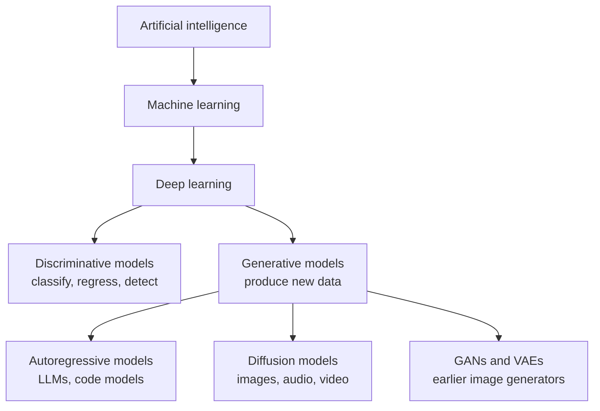
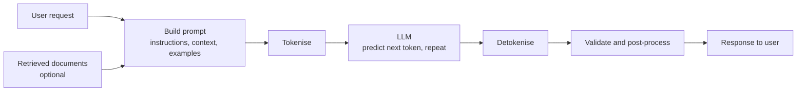

Most of the models you have built so far answer a question about an input: is this email spam, what digit is in this image, what will this house sell for. **Generative AI** turns that around. A generative model produces new content, such as a paragraph of text, a block of code, an image or a clip of audio, that looks as if it came from the same source as its training data. Chat assistants, coding assistants, image generators and speech synthesisers are all generative models underneath.

As an AI engineer you will spend much of your time building on top of these models rather than training them from scratch. To do that well you need a clear mental model of what they are, how they produce output, and where their behaviour comes from. This module builds that model from the ground up, with a focus on the large language models (LLMs) that power most generative AI applications today.

## From predicting labels to generating data

A model trained for classification learns a mapping from inputs to labels. A generative model learns something richer: the **distribution** of the data itself. Once you have a model of that distribution, you can do something a classifier cannot: **sample** from it to produce new examples.

| | Predictive (discriminative) model | Generative model |
| --- | --- | --- |
| Learns | How to map an input to an output, $p(y \mid x)$ | What the data looks like, $p(x)$ or $p(x, y)$ |
| Typical output | A label, a number, a probability | A new example: text, image, audio, code |
| Example | Spam filter, price regressor | Chat assistant, image generator |
| Main question | "Which class is this?" | "What would a plausible example look like?" |

Here $x$ is a data point (a sentence, an image) and $y$ a label. The next lesson, [discriminative vs generative models](/learn/generative-ai-fundamentals/discriminative-vs-generative-models), makes this distinction precise.

## Where generative AI sits

Generative AI is not a separate field. It is a set of goals and techniques inside deep learning, which you met in [AI vs ML vs deep learning](/learn/machine-learning-fundamentals/ai-vs-ml-vs-deep-learning).



What changed in recent years is scale. Training very large Transformer models on enormous amounts of text produced **foundation models**: general-purpose models that can be adapted to many tasks, often just by describing the task in plain language. Before this, you trained a separate model for each task. Now a single pretrained model can summarise, translate, classify, extract and write code.

## The main families of generative model

Each family solves the same problem, "learn the data distribution and sample from it", in a different way.

| Family | How it generates | Strong at | Notes |
| --- | --- | --- | --- |
| Autoregressive | One piece at a time, each conditioned on everything before it | Text, code, any sequence | The approach behind LLMs and the focus of this module |
| Diffusion | Starts from random noise and removes it step by step | Images, audio, video | Dominant approach for image generation |
| GAN (generative adversarial network) | A generator tries to fool a discriminator that spots fakes | Sharp images | Powerful but notoriously hard to train |
| VAE (variational autoencoder) | Encodes data into a compact latent space and decodes samples from it | Smooth latent spaces | Often used as a component inside diffusion systems |

An **autoregressive** model factorises the probability of a whole sequence into a chain of next-step predictions:

$$
p(x_1, x_2, \ldots, x_T) = \prod_{t=1}^{T} p(x_t \mid x_1, \ldots, x_{t-1})
$$

where $x_t$ is the item (for an LLM, the **token**) at position $t$ and $T$ is the length of the sequence. This is just the chain rule of probability from [conditional probability](/learn/probability-and-statistics/conditional-probability), and it is exact, not an approximation. The modelling problem reduces to one question asked over and over: given what came before, what comes next?

## A generative model in twenty lines

To see the idea without any deep learning, here is the simplest possible autoregressive text model: a character **bigram** model. It counts which character follows which in a small corpus, turns the counts into probabilities, and then samples new text one character at a time.

```python
import numpy as np

corpus = "the cat sat on the mat. the dog sat on the log. the cat saw the dog."
chars = sorted(set(corpus))
idx = {c: i for i, c in enumerate(chars)}

# Count how often each character follows each other character
counts = np.zeros((len(chars), len(chars)))
for a, b in zip(corpus, corpus[1:]):
    counts[idx[a], idx[b]] += 1

# Each row becomes a probability distribution over the next character
probs = counts / counts.sum(axis=1, keepdims=True)

print("vocabulary:", "".join(chars))
print("p(next | 't'):", {c: round(float(p), 2) for c, p in zip(chars, probs[idx["t"]]) if p > 0})
```

```output
vocabulary:  .acdeghlmnostw
p(next | 't'): {' ': 0.36, '.': 0.09, 'h': 0.55}
```

The model has learned that after `t` the most likely next character is `h`. Now generate by repeatedly sampling the next character from the row for the current one:

```python
rng = np.random.default_rng(seed=0)

def generate(start, length):
    out = start
    for _ in range(length):
        row = probs[idx[out[-1]]]
        out += chars[rng.choice(len(chars), p=row)]
    return out

for _ in range(3):
    print(generate("t", 40))
```

```output
the caw the cathe sat cathe the og. lon m
the maw sathe cat. dog cathe mathe og. th
the t. the the the the the on the cathe c
```

The output is gibberish with a familiar texture: it reuses fragments like `the`, `cat` and `sat` because they are common in the training data. Every element of an LLM is already present in miniature:

- **Training** estimates $p(\text{next} \mid \text{context})$ from data.
- **Generation** is a loop: predict a distribution, sample one item, append it, repeat.
- **Randomness** comes from sampling, so the same prompt can produce different outputs.

An LLM replaces the lookup table with a Transformer network that conditions on thousands of previous tokens instead of one, and that has learned from a large fraction of the public text ever written. The loop stays the same.

> [!KEY]
> Generative models do not retrieve stored answers. They produce output by repeatedly sampling from learned probability distributions. That one fact explains both their flexibility and their failure modes, such as confidently stated falsehoods.

## What generative AI can and cannot do

Generative models are general and fluent, which makes them easy to over-trust. Learn their typical failure modes early.

| Strength | Matching weakness |
| --- | --- |
| Fluent, well-formed output in many styles and languages | Fluency is not accuracy: plausible but false statements, often called **hallucinations** |
| Broad knowledge absorbed during training | Knowledge stops at a training cutoff and is not reliably attributable to a source |
| Adapts to new tasks from an instruction or a few examples | Behaviour can change with small wording changes in the prompt |
| Can produce many varied outputs | Output is not deterministic by default, which complicates testing |
| One model serves many tasks | Large models are expensive to run, and every request has a cost and latency |

Most of the engineering in later modules exists to manage these weaknesses: [retrieval-augmented generation](/learn/rag-fundamentals/what-is-rag) grounds answers in your own documents, [structured outputs](/learn/working-with-llms/structured-outputs) constrain the format, and [prompt testing and evaluation](/learn/prompt-engineering/prompt-testing-and-evaluation) measures quality systematically.

> [!WARNING]
> Never treat generated text as verified fact in a system where errors matter, such as medical, legal or financial advice. Design the application so that output is checked, grounded in trusted sources, or reviewed by a person.

## How a generative AI application fits together

In practice you rarely interact with the raw model. A typical application wraps it in a pipeline:



The rest of this module opens up the box in the middle: how text becomes [tokens](/learn/generative-ai-fundamentals/tokenization), how the [Transformer](/learn/generative-ai-fundamentals/transformer-architecture) turns tokens into predictions, how models are [pretrained](/learn/generative-ai-fundamentals/pretraining) and [fine-tuned](/learn/generative-ai-fundamentals/fine-tuning), and how settings such as [temperature](/learn/generative-ai-fundamentals/temperature) control generation.

> [!TIP]
> Keep the twenty-line bigram model in mind as you read the later lessons. Whenever an idea feels abstract, ask what it corresponds to in that toy: the table of counts, the sampling step, or the loop.

## Exercises

**1.** Change the bigram model so that `generate` always picks the **most likely** next character instead of sampling. Generate 30 characters starting from `"t"`. What goes wrong?

<details>
<summary>Show solution</summary>

```python
def generate_greedy(start, length):
    out = start
    for _ in range(length):
        out += chars[int(np.argmax(probs[idx[out[-1]]]))]
    return out

print(generate_greedy("t", 30))
```

```output
the the the the the the the the
```

Always choosing the single most likely character gets stuck in a loop: `t` leads to `h`, `h` to `e`, `e` to a space, and a space back to `t`. Real LLMs show a milder version of this, repeating phrases when decoded greedily. Sampling is one reason generated text stays varied. The [temperature](/learn/generative-ai-fundamentals/temperature) lesson explores this trade-off.

</details>

**2.** For each product below, say which family of generative model it most likely uses and why: (a) a tool that writes SQL from a question, (b) a tool that produces a photo-realistic image from a text description, (c) an autocomplete feature in a code editor.

<details>
<summary>Show solution</summary>

(a) and (c) produce sequences of tokens, so they are autoregressive language models; code is just text with a strict grammar. (b) produces an image, which is most commonly done with a diffusion model, usually conditioned on a text embedding produced by a language-model component.

</details>

**3.** A colleague says "the model looked up the answer in its training data". Explain in two sentences why this is misleading, using the bigram model as an example.

<details>
<summary>Show solution</summary>

The bigram model never stores whole sentences; it stores statistics about which character follows which, and it generates new strings such as `the maw sathe cat` that never appeared in the corpus. An LLM is far more capable but works the same way: it generates text from learned probabilities, which is why it can produce answers that sound right but are not in any source.

</details>

```quiz
[
  {
    "q": "What does a generative model learn that a typical classifier does not?",
    "options": [
      "A decision boundary between classes",
      "The distribution of the data, so that it can sample new examples",
      "A lookup table of correct answers",
      "How to minimise mean squared error"
    ],
    "answer": 1,
    "why": "A generative model learns p(x) or p(x, y). Sampling from that distribution produces new examples, which a classifier that only models p(y | x) cannot do."
  },
  {
    "q": "The factorisation p(x1, ..., xT) = product of p(xt | x1, ..., xt-1) is:",
    "options": [
      "An approximation that only holds for short sequences",
      "Specific to Transformer models",
      "The exact chain rule of probability, used by autoregressive models",
      "Only valid when tokens are independent"
    ],
    "answer": 2,
    "why": "The chain rule holds for any joint distribution. Autoregressive models use it to turn sequence generation into repeated next-token prediction."
  },
  {
    "q": "Which family of generative model is most commonly used for text-to-image generation?",
    "options": [
      "Diffusion models",
      "Bigram models",
      "Decision trees",
      "Autoencoders without a latent space"
    ],
    "answer": 0,
    "why": "Diffusion models, which generate by progressively removing noise, are the dominant approach for images."
  },
  {
    "q": "Why can the same prompt produce different outputs from an LLM?",
    "options": [
      "The model's weights change after every request",
      "The model randomly forgets part of its training data",
      "Generation samples each token from a probability distribution",
      "Tokenisation is random"
    ],
    "answer": 2,
    "why": "Each step samples from the predicted distribution. Unless you decode greedily, different random draws lead to different continuations."
  }
]
```
