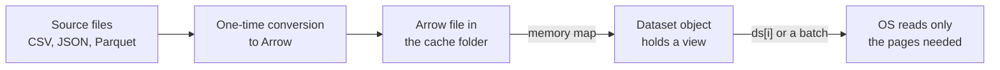

Models are only as good as the data you feed them, and LLM-era datasets are large: millions of documents, tens or hundreds of gigabytes. The `datasets` library gives you one interface for loading data from the Hub or from local files, transforming it in parallel with automatic caching, and streaming it when it is too large for your disk. It does this by storing data in Apache Arrow files that are memory-mapped rather than loaded into RAM, which is why a dataset far larger than your memory opens in a second. If you know pandas from [Series and DataFrames](/learn/pandas/series-and-dataframes), many ideas will feel familiar; the differences are in scale and in how transformations are cached.

## Loading data

`load_dataset` handles both Hub datasets and local files, and returns a `DatasetDict` whose keys are splits.

```python
from datasets import load_dataset, Dataset

imdb = load_dataset("stanfordnlp/imdb")                 # a dataset repo on the Hub
print(imdb)                                              # DatasetDict with train, test, unsupervised

local = load_dataset("csv", data_files={"train": "train.csv", "test": "test.csv"})
logs = load_dataset("json", data_files="logs/*.jsonl", split="train")  # one split only

small = Dataset.from_dict({"text": ["good", "bad"], "label": [1, 0]})
```

| Source | Call |
| --- | --- |
| Hub dataset | `load_dataset("owner/name")`, optionally with a configuration name and `revision=` |
| CSV, JSON or JSON Lines, Parquet, plain text | `load_dataset("csv" \| "json" \| "parquet" \| "text", data_files=...)` |
| In-memory Python data | `Dataset.from_dict`, `Dataset.from_list`, `Dataset.from_pandas` |
| A single split | add `split="train"`, or a slice such as `split="train[:10%]"` |

A `Dataset` behaves like a table with typed columns. `ds.features` shows the schema; a `ClassLabel` feature stores integers but knows their names, so `ds.features["label"].int2str(1)` returns the label name. Indexing gives different shapes, and the difference matters later:

| Expression | Returns |
| --- | --- |
| `ds[0]` | One row as a dictionary: `{"text": "...", "label": 1}` |
| `ds[:3]` | A dictionary of lists: `{"text": [...3 items], "label": [...]}` |
| `ds["text"]` | The whole column as a list (loads it, so be careful with huge datasets) |

## Arrow and memory mapping

When a dataset is loaded, it is converted once to Arrow's columnar binary format and written to the cache. After that, the file is **memory-mapped**: the operating system maps the file into the process's address space and reads pages from disk only when they are touched. Your process holds a view, not a copy.



NumPy can memory-map files too, which makes the idea easy to see. This writes a 40 MB array to disk, then opens it without reading it:

```python
import numpy as np, os, tempfile

path = os.path.join(tempfile.mkdtemp(), "big.dat")
data = np.lib.format.open_memmap(path, mode="w+", dtype=np.float32, shape=(10_000_000,))
data[:] = np.arange(10_000_000, dtype=np.float32)
data.flush()
del data

view = np.load(path, mmap_mode="r")          # no data read yet
print(type(view).__name__, view.shape)
print(f"file size: {os.path.getsize(path) / 1e6:.0f} MB")
print(view[-5:].astype(np.int64))           # only these pages are read from disk
```

```output
memmap (10000000,)
file size: 40 MB
[9999995 9999996 9999997 9999998 9999999]
```

Arrow adds a columnar layout and zero-copy conversion to NumPy, pandas and PyTorch, but the memory behaviour is the same: dataset size is limited by disk, not RAM.

## Transforming with `map`

`map` applies a function to every row and writes the result to a new cached Arrow file. With `batched=True`, the function receives a **batch as a dictionary of lists** (by default 1,000 rows) and must return a dictionary of lists. Batching is much faster, and fast tokenizers are built to process lists in one call.

```python
from transformers import AutoTokenizer

tok = AutoTokenizer.from_pretrained("distilbert/distilbert-base-uncased")

def tokenize(batch):
    return tok(batch["text"], truncation=True, max_length=256)

tokenized = imdb.map(tokenize, batched=True, num_proc=4, remove_columns=["text"])
```

A batched function may return a different number of rows than it received, as long as every returned column has the same length. That is how you split long documents into fixed-size chunks. Here is the contract in plain Python, with the batch format `map` would pass in:

```python
def chunk(batch, size=4):
    out = {"doc_id": [], "piece": []}
    for doc_id, words in zip(batch["doc_id"], batch["words"]):
        for start in range(0, len(words), size):
            out["doc_id"].append(doc_id)
            out["piece"].append(words[start:start + size])
    return out

batch = {"doc_id": [0, 1], "words": [list("abcdefghij"), list("xyz")]}
result = chunk(batch)
print(len(batch["doc_id"]), "rows in ->", len(result["doc_id"]), "rows out")
for d, p in zip(result["doc_id"], result["piece"]):
    print(d, "".join(p))
```

```output
2 rows in -> 4 rows out
0 abcd
0 efgh
0 ij
1 xyz
```

In `datasets` you would call `ds.map(chunk, batched=True, remove_columns=ds.column_names)`. Removing the old columns is required here, because the input had two rows and the output has four, so the old columns cannot be kept alongside the new ones.

> [!KEY]
> `map` results are cached by a **fingerprint** computed from the previous dataset state and a hash of your function and its arguments. Run the same `map` again and it loads from the cache instantly. Change the function and it recomputes. If a function cannot be hashed deterministically (it closes over an unpicklable object, for example), `datasets` warns you and caching becomes unreliable; pass `load_from_cache_file=False` to force recomputation when in doubt.

## Filtering, splitting and reshaping

| Method | What it does |
| --- | --- |
| `filter(fn)` | Keep rows where `fn` returns True; supports `batched=True` and `num_proc` |
| `select(range(1000))` | Keep rows by index (quick subsets for debugging) |
| `shuffle(seed=42)` | Shuffle rows reproducibly |
| `train_test_split(test_size=0.1, seed=42)` | Return a `DatasetDict` with train and test |
| `sort("length")` | Sort by a column |
| `rename_column`, `remove_columns`, `cast_column` | Change the schema |
| `with_format("torch", columns=[...])` | Return PyTorch tensors when indexed |
| `to_pandas()` | Convert to a DataFrame (only for data that fits in memory) |

```python
short = imdb["train"].filter(lambda ex: len(ex["text"]) < 2000)
splits = short.train_test_split(test_size=0.1, seed=42)
train_ds = splits["train"].with_format("torch")
```

`shuffle` and `select` do not rewrite the data; they add an **indices mapping** on top of the Arrow file. Reads through that mapping are scattered, so iteration can slow down noticeably on large datasets. Calling `flatten_indices()` writes a contiguous copy once.

## Streaming datasets that do not fit on disk

With `streaming=True`, nothing is downloaded up front. You get an `IterableDataset` that fetches and decodes records lazily as you iterate.

```python
stream = load_dataset("HuggingFaceFW/fineweb", split="train", streaming=True)

for example in stream.take(3):
    print(example["text"][:80])

shuffled = stream.shuffle(buffer_size=10_000, seed=42)
tokenized_stream = shuffled.map(tokenize, batched=True)   # applied lazily during iteration
```

| | `Dataset` | `IterableDataset` (streaming) |
| --- | --- | --- |
| Storage | Full Arrow copy on local disk | Nothing stored, read on demand |
| Random access `ds[i]`, `len(ds)` | Yes | No |
| `map`, `filter` | Eager, cached | Lazy, recomputed each pass |
| Shuffle | Exact, over all rows | Approximate, within a buffer |
| Best for | Data that fits on disk, repeated epochs | Exploring or training on very large corpora |

> [!WARNING]
> Streaming shuffle only mixes examples within `buffer_size`. If a source file is sorted (by date, by topic), a small buffer leaves batches far from random. Use a large buffer, and shuffle the order of the underlying files where possible.

## From dataset to training batches

After tokenisation, a dataset plugs straight into PyTorch. The `Trainer` does this for you; in your own loop you combine a `DataLoader` from [Dataset and DataLoader](/learn/pytorch/dataset-and-dataloader) with a padding collator:

```python
from torch.utils.data import DataLoader
from transformers import DataCollatorWithPadding

collator = DataCollatorWithPadding(tokenizer=tok)
loader = DataLoader(tokenized["train"], batch_size=16, shuffle=True, collate_fn=collator)
batch = next(iter(loader))     # dict of tensors padded to this batch's longest example
```

## Exercises

**1.** A batched `map` function receives `{"text": ["a b", "c"]}`. Write it so that it returns one row per word, with a `word` column, and say which `map` argument you must pass.

<details>
<summary>Show solution</summary>

```python
def explode(batch):
    return {"word": [w for t in batch["text"] for w in t.split()]}

print(explode({"text": ["a b", "c"]}))
```

```output
{'word': ['a', 'b', 'c']}
```

Call `ds.map(explode, batched=True, remove_columns=ds.column_names)`, because three output rows cannot sit beside the two input rows of the old `text` column.

</details>

**2.** You need the first 500 examples of a 2 TB web corpus to inspect its fields. Write the code, and explain why `load_dataset(..., split="train[:500]")` is a poor choice.

<details>
<summary>Show solution</summary>

```python
stream = load_dataset("HuggingFaceFW/fineweb", split="train", streaming=True)
sample = list(stream.take(500))
```

A slice in `split` still downloads and converts the whole split before slicing. Streaming reads only enough data to yield 500 examples.

</details>

**3.** You shuffle a 40 GB dataset and then iterate over it for several epochs, and each epoch is much slower than before shuffling. Why, and what is the fix?

<details>
<summary>Show solution</summary>

`shuffle` adds an indices mapping, so each read jumps to a random place in the Arrow file instead of reading sequentially. Call `ds = ds.shuffle(seed=42).flatten_indices()` once to write a contiguous shuffled copy, or shuffle per epoch with a sampler in the `DataLoader` instead.

</details>

```quiz
[
  {
    "q": "Why can `datasets` open a dataset larger than your RAM almost instantly?",
    "options": [
      "It compresses the data in memory",
      "It memory-maps an Arrow file, so pages are read from disk only when accessed",
      "It loads only the first split",
      "It keeps the data on the Hub and fetches rows over HTTP"
    ],
    "answer": 1,
    "why": "The Arrow cache file is memory-mapped. The process holds a view and the OS reads only the pages that are touched."
  },
  {
    "q": "With `batched=True`, what does your `map` function receive?",
    "options": [
      "A single row as a dictionary",
      "A pandas DataFrame",
      "A dictionary whose values are lists, one entry per row in the batch",
      "A list of dictionaries"
    ],
    "answer": 2,
    "why": "A batch is a dictionary of lists (columns), and the function must return a dictionary of lists of equal length."
  },
  {
    "q": "Which operation is NOT available on a streaming `IterableDataset`?",
    "options": ["`map`", "`take`", "`shuffle` with a buffer", "`len(ds)`"],
    "answer": 3,
    "why": "A stream has no known length and no random access; it can only be iterated."
  },
  {
    "q": "You re-run a notebook cell containing an unchanged `ds.map(tokenize, batched=True)`. What usually happens?",
    "options": [
      "It recomputes everything",
      "It loads the result from the cache using the fingerprint",
      "It raises an error because the column already exists",
      "It appends a second copy of the columns"
    ],
    "answer": 1,
    "why": "The fingerprint of the input dataset plus the hashed function is unchanged, so the cached Arrow file is reused."
  }
]
```
