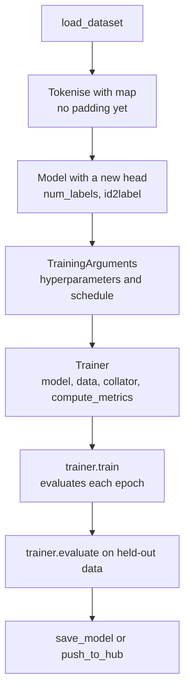

Fine-tuning takes a model that already understands language from pretraining and trains it a little further on your labelled data, so it learns your task: routing support tickets, flagging toxic comments, tagging contract clauses. For classification, a fine-tuned encoder with a hundred million parameters is often more accurate, far cheaper and far faster than prompting a large LLM. The concepts (transfer learning, freezing, learning rates) were introduced in [Transfer learning](/learn/pytorch/transfer-learning) and [Fine-tuning](/learn/generative-ai-fundamentals/fine-tuning). This lesson is the practical Hugging Face workflow: the `Trainer` API, data collators, evaluation and `compute_metrics`.

## The workflow



The `Trainer` owns the training loop you wrote by hand in [Training loops](/learn/pytorch/training-loops): batching, moving tensors to the device, forward and backward passes, optimiser and learning-rate schedule, gradient accumulation, mixed precision, periodic evaluation, checkpointing and logging. You supply the pieces.

## Step 1: data and tokenisation

```python
from datasets import load_dataset
from transformers import AutoTokenizer

raw = load_dataset("stanfordnlp/imdb")
splits = raw["train"].train_test_split(test_size=0.1, seed=42)   # carve out validation
train_raw, val_raw, test_raw = splits["train"], splits["test"], raw["test"]

checkpoint = "distilbert/distilbert-base-uncased"
tokenizer = AutoTokenizer.from_pretrained(checkpoint)

def tokenize(batch):
    return tokenizer(batch["text"], truncation=True, max_length=256)

train_ds = train_raw.map(tokenize, batched=True, remove_columns=["text"])
val_ds = val_raw.map(tokenize, batched=True, remove_columns=["text"])
test_ds = test_raw.map(tokenize, batched=True, remove_columns=["text"])
```

Notice there is no `padding` here. Padding happens per batch, in the collator.

> [!WARNING]
> Choose hyperparameters and the best checkpoint using a **validation** split carved from the training data. Evaluate on the test split once, at the end. Evaluating on the test set every epoch and keeping the best one quietly turns it into a validation set and inflates your reported score.

## Step 2: the model and its labels

```python
from transformers import AutoModelForSequenceClassification

id2label = {0: "negative", 1: "positive"}
label2id = {v: k for k, v in id2label.items()}

model = AutoModelForSequenceClassification.from_pretrained(
    checkpoint, num_labels=2, id2label=id2label, label2id=label2id
)
```

`num_labels` sizes the new classifier head. Passing `id2label` stores the names in the saved config, so anyone who loads your model, including a pipeline, gets readable labels instead of `LABEL_0`.

## Step 3: the data collator

A **data collator** turns a list of examples into one batch of tensors. `DataCollatorWithPadding` pads `input_ids` and `attention_mask` to the longest example in the batch, and renames a `label` column to `labels`, the keyword the model uses to compute its loss.

```python
from transformers import DataCollatorWithPadding

collator = DataCollatorWithPadding(tokenizer=tokenizer)
```

| Collator | Use it for |
| --- | --- |
| `DataCollatorWithPadding` | Sequence classification and regression |
| `DataCollatorForTokenClassification` | NER and tagging; pads `labels` with `-100` |
| `DataCollatorForLanguageModeling(tokenizer, mlm=False)` | Causal LM training; copies inputs to labels |
| `DataCollatorForLanguageModeling(tokenizer, mlm=True)` | Masked LM training; masks random tokens |
| `DataCollatorForSeq2Seq` | Encoder-decoder models such as T5 |

When a model is given `labels`, its forward pass returns `loss` as well as `logits`. That is what the `Trainer` backpropagates.

## Step 4: `compute_metrics`

The `Trainer` reports only the loss unless you pass a `compute_metrics` function. It receives an `EvalPrediction`, which unpacks into the logits and labels for the whole evaluation set as NumPy arrays, and returns a dictionary of metric names to numbers. You can write and test it without a model:

```python
import numpy as np
from sklearn.metrics import accuracy_score, f1_score

def compute_metrics(eval_pred):
    logits, labels = eval_pred
    preds = np.argmax(logits, axis=-1)
    return {
        "accuracy": accuracy_score(labels, preds),
        "f1": f1_score(labels, preds, average="macro"),
    }

# Test it on fake predictions before handing it to the Trainer
rng = np.random.default_rng(0)
fake_logits = rng.normal(size=(8, 2))
fake_labels = np.array([0, 1, 1, 0, 1, 0, 0, 1])
print(compute_metrics((fake_logits, fake_labels)))
```

```output
{'accuracy': 0.5, 'f1': 0.5}
```

Testing it like this catches shape and key mistakes in seconds instead of after the first full epoch. Metric choice is covered in [F1 score](/learn/model-evaluation/f1-score); macro F1 is a sensible default when classes are imbalanced.

## Step 5: `TrainingArguments` and `Trainer`

```python
from transformers import TrainingArguments, Trainer

args = TrainingArguments(
    output_dir="imdb-distilbert",
    learning_rate=2e-5,
    per_device_train_batch_size=16,
    per_device_eval_batch_size=64,
    gradient_accumulation_steps=2,
    num_train_epochs=3,
    weight_decay=0.01,
    warmup_ratio=0.06,
    eval_strategy="epoch",          # older releases call this evaluation_strategy
    save_strategy="epoch",
    load_best_model_at_end=True,
    metric_for_best_model="f1",
    bf16=True,                       # if your GPU supports bfloat16; else fp16=True
    logging_steps=50,
    seed=42,
)

trainer = Trainer(
    model=model,
    args=args,
    train_dataset=train_ds,
    eval_dataset=val_ds,
    data_collator=collator,
    compute_metrics=compute_metrics,
)

trainer.train()
print(trainer.evaluate(test_ds))     # once, at the end
trainer.save_model("imdb-distilbert/final")
tokenizer.save_pretrained("imdb-distilbert/final")
```

| Argument | What it controls |
| --- | --- |
| `learning_rate` | Peak learning rate. Small (around 1e-5 to 5e-5) for full fine-tuning of pretrained encoders |
| `per_device_train_batch_size` | Examples per device per step |
| `gradient_accumulation_steps` | Steps whose gradients are summed before one optimiser update |
| `num_train_epochs` | Passes over the training data; 2 to 4 is typical for classification |
| `weight_decay` | AdamW decoupled weight decay |
| `warmup_ratio` | Fraction of steps spent ramping the learning rate up from zero |
| `eval_strategy`, `save_strategy` | When to evaluate and checkpoint: `"no"`, `"steps"` or `"epoch"` |
| `load_best_model_at_end`, `metric_for_best_model` | Restore the checkpoint with the best validation metric |
| `bf16`, `fp16` | Mixed-precision training |
| `report_to` | Logging integrations such as `"wandb"` or `"none"` |

The number of optimiser updates follows from these settings. It is worth computing before you start, because schedules, warmup and logging are all measured in steps:

```python
import math

n_train, per_device, n_devices, accum, epochs = 22_500, 16, 1, 2, 3
effective_batch = per_device * n_devices * accum
steps_per_epoch = math.ceil(n_train / effective_batch)
print("effective batch size:", effective_batch)
print("optimiser steps per epoch:", steps_per_epoch)
print("total steps:", steps_per_epoch * epochs, "| warmup steps:", math.ceil(0.06 * steps_per_epoch * epochs))
```

```output
effective batch size: 32
optimiser steps per epoch: 704
total steps: 2112 | warmup steps: 127
```

The `Trainer` computes these internally (its exact rounding can differ by a step); the point is to know the order of magnitude, so that `logging_steps=50` is sensible and `eval_steps=5000` would never fire.

## Pitfalls

| Symptom | Likely cause |
| --- | --- |
| Loss falls, then accuracy collapses to one class | Learning rate too high for full fine-tuning; drop it to 2e-5 and use warmup |
| `ValueError` about missing `labels` or no loss returned | Label column not named `label` or `labels`, or removed by `remove_columns` |
| A custom column disappears before reaching your collator | `remove_unused_columns=True` (the default) drops columns the model's `forward` does not accept |
| Validation score great, production poor | Leakage between splits, or production text differs from training text |
| Out of memory | Lower the batch size and raise `gradient_accumulation_steps`, shorten `max_length`, enable mixed precision, or use PEFT |

> [!TIP]
> Before a long run, train on 200 examples for a few epochs with `trainer.train()` on `train_ds.select(range(200))`. The loss should fall close to zero. If it does not, you have a bug in the data or labels, not a capacity problem.

### Fine-tuning generative models

The same `Trainer` trains causal LMs: use `AutoModelForCausalLM` and `DataCollatorForLanguageModeling(tokenizer, mlm=False)`. Instruction tuning adds chat formatting and loss masking so the model learns only the assistant's replies; the `trl` library's `SFTTrainer` packages this. For LLMs, updating every weight is usually too expensive, which is where [PEFT](/learn/hugging-face-ecosystem/peft) comes in. Supervised fine-tuning of LLMs in depth is in [Supervised fine-tuning (SFT)](/learn/advanced-llm-engineering/supervised-fine-tuning-sft).

## Exercises

**1.** Extend `compute_metrics` to also return macro precision and recall, and run it on the same fake predictions.

<details>
<summary>Show solution</summary>

```python
from sklearn.metrics import precision_score, recall_score

def compute_metrics(eval_pred):
    logits, labels = eval_pred
    preds = np.argmax(logits, axis=-1)
    return {
        "accuracy": accuracy_score(labels, preds),
        "f1": f1_score(labels, preds, average="macro"),
        "precision": precision_score(labels, preds, average="macro", zero_division=0),
        "recall": recall_score(labels, preds, average="macro", zero_division=0),
    }

print(compute_metrics((fake_logits, fake_labels)))
```

```output
{'accuracy': 0.5, 'f1': 0.5, 'precision': 0.5, 'recall': 0.5}
```

</details>

**2.** Your GPU fits a per-device batch of 8, but the recipe you are following used a batch size of 64 on one device. Which `TrainingArguments` reproduce its effective batch size?

<details>
<summary>Show solution</summary>

`per_device_train_batch_size=8, gradient_accumulation_steps=8`. Gradients from eight batches of 8 are accumulated before each optimiser step, giving an effective batch of 64 and the same number of optimiser steps per epoch. Training takes longer in wall-clock time but follows the same schedule.

</details>

**3.** You fine-tune a ticket classifier and push it to the Hub. A colleague's pipeline returns labels `LABEL_0` to `LABEL_4`. What did you forget, and how do you fix it without retraining?

<details>
<summary>Show solution</summary>

You did not set `id2label` and `label2id` when creating the model, so the config has generic names. Load the model, set `model.config.id2label = {0: "billing", ...}` and the matching `label2id`, then save or push again. The weights are unchanged; only `config.json` changes.

</details>

```quiz
[
  {
    "q": "What does `DataCollatorWithPadding` do?",
    "options": [
      "Tokenises raw text",
      "Pads each batch to its longest example and builds tensors",
      "Pads every example to the model's maximum length during `map`",
      "Computes evaluation metrics"
    ],
    "answer": 1,
    "why": "It pads per batch at collation time, which is cheaper than padding everything to a fixed length, and it renames `label` to `labels`."
  },
  {
    "q": "What does `compute_metrics` receive?",
    "options": [
      "One batch of tensors at a time",
      "The model and the dataset",
      "Logits and labels for the whole evaluation set, as NumPy arrays",
      "Only the loss"
    ],
    "answer": 2,
    "why": "The Trainer gathers predictions over the evaluation set and passes an `EvalPrediction` that unpacks to (logits, labels)."
  },
  {
    "q": "With `per_device_train_batch_size=4`, `gradient_accumulation_steps=8` and 2 GPUs, what is the effective batch size?",
    "options": ["8", "16", "32", "64"],
    "answer": 3,
    "why": "4 examples x 2 devices x 8 accumulation steps = 64 examples per optimiser update."
  },
  {
    "q": "Why pass `id2label` when creating a classification model?",
    "options": [
      "It is required for training to run",
      "It stores human-readable label names in the saved config",
      "It sets class weights",
      "It changes the loss function"
    ],
    "answer": 1,
    "why": "The names are saved in `config.json`, so pipelines and other users see real labels instead of `LABEL_0`."
  }
]
```
