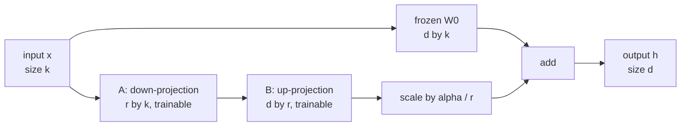

LoRA (low-rank adaptation) is the most widely used PEFT method, and it rests on one observation: when you fine-tune a large pretrained model, the *change* in each weight matrix tends to have much lower effective rank than the matrix itself. So instead of learning a full update, LoRA learns two thin matrices whose product is the update. The previous lesson showed the `peft` workflow; this one explains the mathematics precisely, verifies the parameter arithmetic for a real architecture, and gives you the knowledge to choose rank, alpha and target modules deliberately instead of copying them from a blog post.

## The update as a product of two thin matrices

Take one weight matrix in a pretrained model, $W_0 \in \mathbb{R}^{d \times k}$, which maps an input $x \in \mathbb{R}^{k}$ to an output in $\mathbb{R}^{d}$. Fine-tuning learns an update $\Delta W$ so the adapted weight is $W_0 + \Delta W$. LoRA constrains that update to rank at most $r$ by writing it as

$$
\Delta W = \frac{\alpha}{r} B A, \qquad B \in \mathbb{R}^{d \times r}, \quad A \in \mathbb{R}^{r \times k}, \quad r \ll \min(d, k)
$$

where $r$ is the **rank**, $\alpha$ (`lora_alpha`) is a constant scaling factor, and only $A$ and $B$ are trained while $W_0$ stays frozen. The forward pass becomes

$$
h = W_0 x + \frac{\alpha}{r} B (A x)
$$

Computing $A x$ first is cheap: it projects $x$ down to $r$ numbers, and $B$ projects them back up to $d$.



**Initialisation matters.** $A$ starts with small random values and $B$ starts at zero, so $BA = 0$ and the adapted model is exactly the pretrained model at step zero. Training starts from the base model's behaviour rather than from a random perturbation of it. Because $B$ is zero, its gradient at the start is driven by $A x$, so both matrices begin learning immediately.

A product of a $d \times r$ and an $r \times k$ matrix can never have rank above $r$, whatever values you put in it:

```python
import numpy as np

rng = np.random.default_rng(0)
B = rng.normal(size=(6, 2))
A = rng.normal(size=(2, 5))
delta = B @ A
print(delta.shape, "rank:", np.linalg.matrix_rank(delta))
```

```output
(6, 5) rank: 2
```

## Step through a LoRA forward pass

Here is the whole computation with tiny numbers: $d = k = 2$, $r = 1$, $\alpha = 2$. Watch the merged weight give the same output as the two-path forward pass.

```trace
{
  "title": "LoRA forward pass and merge, d = k = 2, r = 1",
  "code": [
    "W0 = [[1, 0], [0, 1]]",
    "A = [[1, 1]]",
    "B = [[0.5], [0]]",
    "scale = alpha / r",
    "x = [1, 2]",
    "base = W0 @ x",
    "low = A @ x",
    "update = scale * (B @ low)",
    "h = base + update",
    "W_merged = W0 + scale * (B @ A)",
    "print(h, W_merged @ x)"
  ],
  "steps": [
    { "line": 1, "vars": { "W0": "[[1, 0], [0, 1]]" }, "note": "The frozen pretrained weight. Identity, to keep the arithmetic easy." },
    { "line": 3, "vars": { "W0": "[[1, 0], [0, 1]]", "A": "[[1, 1]]", "B": "[[0.5], [0]]" }, "note": "A is 1 by 2 (r by k), B is 2 by 1 (d by r). In real training B would start at zero; these are values after some training." },
    { "line": 4, "vars": { "W0": "[[1, 0], [0, 1]]", "A": "[[1, 1]]", "B": "[[0.5], [0]]", "scale": "2.0" }, "note": "alpha = 2 and r = 1, so the update is scaled by 2." },
    { "line": 6, "vars": { "x": "[1, 2]", "base": "[1, 2]", "scale": "2.0" }, "note": "The frozen path: W0 x." },
    { "line": 7, "vars": { "x": "[1, 2]", "base": "[1, 2]", "low": "[3]", "scale": "2.0" }, "note": "A squeezes the 2-dimensional input to r = 1 number: 1 + 2 = 3." },
    { "line": 8, "vars": { "x": "[1, 2]", "base": "[1, 2]", "low": "[3]", "update": "[3.0, 0.0]" }, "note": "B expands it back to size 2: [1.5, 0], then scaled by 2." },
    { "line": 9, "vars": { "base": "[1, 2]", "update": "[3.0, 0.0]", "h": "[4.0, 2.0]" }, "note": "The adapted output is the sum of the two paths." },
    { "line": 10, "vars": { "h": "[4.0, 2.0]", "W_merged": "[[2, 1], [0, 1]]" }, "note": "Merging folds the update into one matrix: scale * B A = [[1, 1], [0, 0]]." },
    { "line": 11, "vars": { "h": "[4.0, 2.0]", "W_merged": "[[2, 1], [0, 1]]" }, "out": ["[4. 2.] [4. 2.]"], "note": "Identical outputs. After merging there is a single matrix multiply, so inference costs exactly what the base model costs." }
  ]
}
```

## Parameter arithmetic

A full update to a $d \times k$ matrix has $dk$ parameters. The LoRA update has

$$
\underbrace{d r}_{B} + \underbrace{r k}_{A} = r (d + k)
$$

For a square $4096 \times 4096$ projection at $r = 8$, that is $8 \times 8192 = 65{,}536$ instead of $16{,}777{,}216$, about 0.4%.

To see whole-model numbers, take an architecture with the published shape of Llama 2 7B: hidden size 4096, feed-forward size 11008, 32 layers, a 32,000-token vocabulary, no biases, and separate input embedding and output head. Each layer has four $4096 \times 4096$ attention projections ($W_q, W_k, W_v, W_o$) and three feed-forward projections (gate and up: $11008 \times 4096$; down: $4096 \times 11008$).

```python
hidden, inter, layers, vocab = 4096, 11008, 32, 32000
attn = 4 * hidden * hidden                 # q, k, v, o
mlp = 3 * hidden * inter                   # gate, up, down
norms = 2 * hidden                         # two RMSNorm weight vectors per layer
total = layers * (attn + mlp + norms) + 2 * vocab * hidden + hidden
print(f"total parameters: {total:,}")

def lora_params(shapes, r):
    return sum(r * (d_out + d_in) for d_out, d_in in shapes)

qv = [(hidden, hidden)] * 2
all_linear = [(hidden, hidden)] * 4 + [(inter, hidden)] * 2 + [(hidden, inter)]
for name, shapes in [("q,v", qv), ("all linear", all_linear)]:
    for r in (8, 16, 64):
        n = layers * lora_params(shapes, r)
        print(f"{name:<10} r={r:<3} {n:>12,} trainable  ({100 * n / total:.3f}% of total)")
```

```output
total parameters: 6,738,415,616
q,v        r=8      4,194,304 trainable  (0.062% of total)
q,v        r=16     8,388,608 trainable  (0.124% of total)
q,v        r=64    33,554,432 trainable  (0.498% of total)
all linear r=8     19,988,480 trainable  (0.297% of total)
all linear r=16    39,976,960 trainable  (0.593% of total)
all linear r=64   159,907,840 trainable  (2.373% of total)
```

Even the largest configuration trains under 3% of the model. These are exactly the numbers `print_trainable_parameters` would report for such a model with a causal LM head, since that head is frozen.

## The role of alpha

Why scale by $\alpha / r$ instead of letting $B$ and $A$ learn any scale they need? Because it decouples the size of the update from the rank. With this scaling, if you double $r$ you do not have to retune the learning rate to keep the update magnitude similar. In practice people fix $\alpha$ relative to $r$ (common choices are $\alpha = r$ or $\alpha = 2r$) and tune the learning rate.

> [!NOTE]
> The scale $\alpha / r$ shrinks the update as rank grows, which some work found makes high ranks learn too slowly. **Rank-stabilised LoRA** uses $\alpha / \sqrt{r}$ instead; in `peft` it is `LoraConfig(use_rslora=True)`. If you raise the rank and see no improvement, this is one thing to try.

## Which modules to target

| Target set | `target_modules` (Llama-style names) | Trade-off |
| --- | --- | --- |
| Query and value only | `["q_proj", "v_proj"]` | Fewest parameters; the setting used in the original LoRA paper |
| All attention projections | `["q_proj", "k_proj", "v_proj", "o_proj"]` | Moderate |
| All linear layers | `"all-linear"`, or list the attention and MLP projections | Most parameters; the QLoRA work found this was needed to match full fine-tuning quality |
| Plus embeddings or head | add via `modules_to_save` | Needed when you add new tokens; much larger adapter |

A useful rule: spreading a fixed parameter budget across more modules at lower rank usually beats concentrating it in a few modules at high rank. Feed-forward layers hold most of a transformer's parameters and much of its stored knowledge, so including them helps most on tasks that need new domain knowledge, while attention-only adapters often suffice for changing format or style.

```python
from peft import LoraConfig

config = LoraConfig(
    r=16,
    lora_alpha=32,
    lora_dropout=0.05,
    target_modules="all-linear",
    bias="none",
    task_type="CAUSAL_LM",
)
```

| Hyperparameter | Typical range | Effect |
| --- | --- | --- |
| `r` | 4 to 64 | Capacity of the update; higher is not always better |
| `lora_alpha` | $r$ to $2r$ | Scale of the update relative to rank |
| `lora_dropout` | 0 to 0.1 | Dropout on the LoRA path input; helps with small datasets |
| Learning rate | about 1e-4 to 3e-4 | Higher than full fine-tuning because far fewer, freshly initialised parameters are learning |

## Merging, exactly

Because the update is linear, merging is exact: $W = W_0 + \frac{\alpha}{r} B A$. You can confirm that the merged layer reproduces the adapted layer to floating-point precision:

```python
import torch

torch.manual_seed(0)
d, k, r, alpha = 64, 32, 4, 8
W0 = torch.randn(d, k)
A = torch.randn(r, k) * 0.1
B = torch.randn(d, r) * 0.1          # pretend training has moved B away from zero
x = torch.randn(5, k)

two_path = x @ W0.T + (alpha / r) * (x @ A.T @ B.T)
W_merged = W0 + (alpha / r) * (B @ A)
merged = x @ W_merged.T
print("max difference:", (two_path - merged).abs().max().item() < 1e-5)
```

```output
max difference: True
```

LoRA is not the end of the story: variants such as DoRA (`use_dora=True`), which separates the magnitude and direction of each weight's update, and the engineering of large-scale LoRA training are covered in [LoRA and QLoRA](/learn/advanced-llm-engineering/lora-and-qlora).

## Exercises

**1.** A model has 24 layers, hidden size 2048 and feed-forward size 5632, with the same seven linear projections per layer as above. How many LoRA parameters does `r=16` on all linear layers add?

<details>
<summary>Show solution</summary>

```python
h, f, L, r = 2048, 5632, 24, 16
shapes = [(h, h)] * 4 + [(f, h)] * 2 + [(h, f)]
print(f"{L * sum(r * (a + b) for a, b in shapes):,}")
```

```output
15,138,816
```

</details>

**2.** You switch from `r=8, lora_alpha=16` to `r=32` and want the same $\alpha / r$ scale. What `lora_alpha` do you use? With rsLoRA instead, what alpha keeps the same scale as `r=8, lora_alpha=16` under rsLoRA?

<details>
<summary>Show solution</summary>

Standard scaling: $16 / 8 = 2$, so `lora_alpha=64` at `r=32`. With rsLoRA the scale is $\alpha / \sqrt{r}$: $16 / \sqrt{8} \approx 5.66$, so at `r=32` you need $\alpha = 5.66 \times \sqrt{32} = 32$.

</details>

**3.** Why does LoRA initialise $B$ to zero rather than both matrices randomly?

<details>
<summary>Show solution</summary>

With $B = 0$ the product $BA$ is zero, so the adapted model starts identical to the pretrained model, and training moves smoothly away from a known-good point. Random $A$ and $B$ would add a random perturbation to every targeted layer at step zero, damaging the pretrained behaviour before learning begins. $A$ is random (not zero) so that the gradient for $B$ is non-zero from the first step.

</details>

```quiz
[
  {
    "q": "In LoRA, which matrices are trained?",
    "options": [
      "Only the frozen weight W0",
      "Only A and B, the low-rank factors of the update",
      "W0, A and B together",
      "Only the scaling factor alpha"
    ],
    "answer": 1,
    "why": "W0 stays frozen; the update is parameterised as (alpha/r) B A and only A and B receive gradients."
  },
  {
    "q": "How many trainable parameters does LoRA with rank 8 add to a 4096 x 11008 matrix?",
    "options": ["65,536", "120,832", "45,088,768", "88,064"],
    "answer": 1,
    "why": "r (d + k) = 8 x (4096 + 11008) = 8 x 15,104 = 120,832."
  },
  {
    "q": "Why is a merged LoRA model no slower at inference than the base model?",
    "options": [
      "Merging removes some layers",
      "The update is linear, so W0 + (alpha/r) B A is a single matrix of the original shape",
      "Merging quantises the weights",
      "LoRA layers run on the CPU"
    ],
    "answer": 1,
    "why": "Adding the low-rank product into W0 yields one matrix of the same size, so the forward pass is unchanged."
  },
  {
    "q": "At step zero of LoRA training, what is the adapted model's output compared with the base model's?",
    "options": [
      "Identical, because B starts at zero",
      "Slightly noisier, because A is random",
      "Undefined until the first update",
      "Scaled by alpha / r"
    ],
    "answer": 0,
    "why": "B = 0 makes the update BA zero, so the model behaves exactly like the pretrained one at initialisation."
  }
]
```
