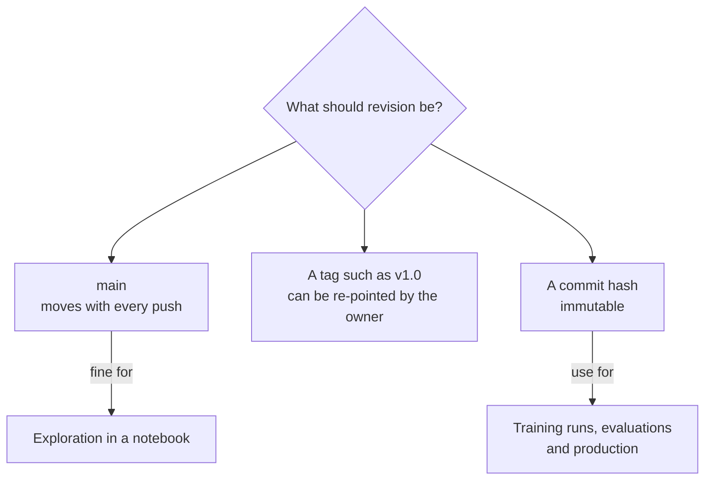

The Hugging Face Hub hosts hundreds of thousands of models, datasets and demo apps (Spaces), all as version-controlled repositories. For an AI engineer it plays the role that PyPI plays for Python packages: the place you pull dependencies from, and the place you publish your own. Like any dependency source, it needs discipline. You should know what you are downloading, under which licence, at which exact version, and whether loading it can run someone else's code on your machine. This lesson covers reading model cards, licences, pinning revisions, downloading with `huggingface_hub`, private repositories and tokens, and why the weights format matters for security.

## Repositories, not files

Every model on the Hub is a Git repository identified by `owner/name`, such as `Qwen/Qwen2.5-0.5B-Instruct`. Large weight files are stored with large-file storage, but you get normal version control: commits, branches and tags. A typical model repository contains:

| File | Purpose |
| --- | --- |
| `README.md` | The model card: description, usage, limitations, licence, with YAML metadata at the top |
| `config.json` | Architecture configuration read by `transformers` |
| `model.safetensors` or `model-00001-of-00004.safetensors` plus an index | Weights, sharded when large |
| `tokenizer.json`, `tokenizer_config.json` | Tokenizer and chat template |
| `generation_config.json` | Default decoding settings |

The same structure applies to dataset repositories (`load_dataset` reads from them) and Spaces (small hosted apps, often Gradio or Streamlit, which you will meet in [Gradio](/learn/application-development/gradio)).

## Reading a model card

A model card is the documentation for a checkpoint. Read it before you build on a model, not after something goes wrong.

| Check | Why it matters |
| --- | --- |
| Intended use and out-of-scope use | A model tuned for English summarisation may be poor or unsafe elsewhere |
| Training data | Tells you about language coverage, domain and possible contamination of benchmarks |
| Evaluation | Which benchmarks, under what settings; compare like with like |
| Limitations and bias | Known failure modes you will otherwise rediscover in production |
| Base model and fine-tuning method | Whether it is a base model or instruction-tuned, and which chat template it expects |
| Licence | Whether you may use it for your purpose at all |

Cards vary enormously in quality. A missing card, or one that says nothing about training data, is itself information: treat the model as higher risk.

## Licences and gated models

The licence is in the card metadata and shown on the repo page. Broadly you will see four families:

| Family | Examples | Typical implication |
| --- | --- | --- |
| Permissive open-source | Apache-2.0, MIT | Commercial use allowed with attribution and notice |
| Responsible-AI licences | OpenRAIL variants | Use allowed, with restrictions on specified harmful uses that pass on to derivatives |
| Custom model licences | Licences written by a model's publisher | Read in full: may restrict commercial scale, require attribution in product names, or restrict using outputs to train other models |
| Non-commercial | CC-BY-NC | Research and personal use only |

Some repos are **gated**: you must accept terms on the website, while logged in, before downloads with your token succeed. Fine-tuning does not escape a licence. A LoRA adapter or merged model built on a base model is a derivative and usually inherits its terms. When in doubt for a commercial product, ask someone qualified to read the licence.

## Revisions: pinning what you load

`from_pretrained("owner/name")` loads whatever is on the `main` branch today. If the owner pushes new weights or a changed tokenizer tomorrow, your next deployment silently changes behaviour. Pin a **revision**: a branch, a tag, or best of all a full commit hash, which can never move.



```python
from transformers import AutoModelForCausalLM

model = AutoModelForCausalLM.from_pretrained(
    "Qwen/Qwen2.5-0.5B-Instruct",
    revision="<commit-hash-from-the-files-tab>",
)
```

Record the commit hash with every experiment, alongside your code version, as discussed in [Reproducible experiments](/learn/mlops/reproducible-experiments).

## Downloading with `huggingface_hub`

`transformers` and `datasets` call the `huggingface_hub` library under the hood. Use it directly when you want files without loading a model: to pre-fetch weights into a container image, mirror a model inside a private network, or grab one file.

```python
from huggingface_hub import hf_hub_download, snapshot_download, HfApi

# One file
config_path = hf_hub_download(
    repo_id="Qwen/Qwen2.5-0.5B-Instruct", filename="config.json", revision="main"
)

# A whole repo, filtered to what you need
local_dir = snapshot_download(
    repo_id="Qwen/Qwen2.5-0.5B-Instruct",
    revision="main",
    allow_patterns=["*.json", "*.safetensors"],   # skip other formats and extras
)

# Metadata without downloading weights
api = HfApi()
print(api.list_repo_files("Qwen/Qwen2.5-0.5B-Instruct"))
```

Both functions return local paths inside the cache. The cache stores each file once as a content-addressed blob and exposes per-commit snapshot folders, so two revisions that share files do not duplicate them. Useful environment variables:

| Variable | Effect |
| --- | --- |
| `HF_HOME` | Root folder for the cache and saved token |
| `HF_TOKEN` | Access token, read automatically by all the libraries |
| `HF_HUB_OFFLINE=1` | Never touch the network; use only cached files (good for air-gapped servers and reproducible jobs) |

> [!TIP]
> In Docker images, run `snapshot_download` during the build and set `HF_HUB_OFFLINE=1` at runtime. Containers then start without network access to the Hub and cannot pick up a changed file. See [Dockerfile](/learn/docker-and-containers/dockerfile).

## Private repositories and tokens

Access tokens are created in your account settings. Give each one the least privilege it needs: **read** tokens for servers that only download, **write** tokens only where you upload, and fine-grained tokens scoped to specific repositories for automation.

```bash
hf auth login            # interactive; older releases use: huggingface-cli login
export HF_TOKEN=hf_...   # or set it in the environment, as CI systems do
```

Uploading your own work, privately by default:

```python
from huggingface_hub import create_repo, upload_folder

create_repo("my-org/ticket-classifier", private=True, exist_ok=True)
upload_folder(repo_id="my-org/ticket-classifier", folder_path="outputs/final")

# or, from transformers objects directly
model.push_to_hub("my-org/ticket-classifier", private=True)
tokenizer.push_to_hub("my-org/ticket-classifier", private=True)
```

> [!WARNING]
> Never paste a token into code or a notebook you might share or commit. Read it from the environment or a secrets manager, and revoke it immediately if it leaks. A write token can overwrite every model in your organisation.

## Safetensors versus pickle

Older checkpoints were saved as `pytorch_model.bin`, which is a Python **pickle**. Unpickling can execute arbitrary code, because a pickled object may name any callable to run during loading. This harmless example shows the mechanism; a malicious file would call something like `os.system` instead of `print`:

```python
import pickle

class Payload:
    def __reduce__(self):
        # pickle will call print(...) while LOADING the file
        return (print, ("code ran during unpickling",))

blob = pickle.dumps(Payload())
obj = pickle.loads(blob)
print("loaded object:", obj)
```

```output
code ran during unpickling
loaded object: None
```

**Safetensors** removes the problem by design. A file is an 8-byte header length, a JSON header describing each tensor (dtype, shape, byte offsets), and then raw bytes. There is nothing to execute. The format is simple enough to write by hand:

```python
import json, struct, numpy as np

tensors = {"weight": np.arange(6, dtype=np.float32).reshape(2, 3)}
header, offset, payload = {}, 0, b""
for name, arr in tensors.items():
    raw = arr.tobytes()
    header[name] = {"dtype": "F32", "shape": list(arr.shape),
                    "data_offsets": [offset, offset + len(raw)]}
    payload += raw
    offset += len(raw)

header_bytes = json.dumps(header).encode()
file_bytes = struct.pack("<Q", len(header_bytes)) + header_bytes + payload

n = struct.unpack("<Q", file_bytes[:8])[0]                 # reading it back
meta = json.loads(file_bytes[8:8 + n])
start, end = meta["weight"]["data_offsets"]
w = np.frombuffer(file_bytes[8 + n + start: 8 + n + end], dtype=np.float32)
print(meta)
print(w.reshape(meta["weight"]["shape"]))
```

```output
{'weight': {'dtype': 'F32', 'shape': [2, 3], 'data_offsets': [0, 24]}}
[[0. 1. 2.]
 [3. 4. 5.]]
```

Because offsets are known from the header, a loader can memory-map the file and read individual tensors directly, which also makes safetensors fast to load.

| | Pickle (`.bin`, `.pt`, `.pth`) | Safetensors |
| --- | --- | --- |
| Can run code on load | Yes | No |
| Lazy or partial loading | No | Yes, via memory mapping |
| Stores | Arbitrary Python objects | Tensors and string metadata only |
| Safe default | Only with `torch.load(..., weights_only=True)` | Always |

`transformers` prefers safetensors when a repo has both. Two remaining risks are separate from the weights format: pickled files in other places (old checkpoints, some dataset scripts), and `trust_remote_code=True`, which deliberately runs Python files from the repo. Only enable it for repositories you have read, pinned to a commit hash so the code cannot change after your review. Model supply-chain security is covered further in [Model security](/learn/ai-security-and-responsible-ai/model-security).

## Exercises

**1.** Your production service loads `from_pretrained("acme/support-bot")`. Last night its answers changed though you deployed nothing. Give the likely cause and the fix.

<details>
<summary>Show solution</summary>

The service loads the `main` branch at start-up, and the owner pushed a new commit (weights, tokenizer, chat template or generation config). Pin `revision` to a full commit hash, ideally pre-download that snapshot into the image, and set `HF_HUB_OFFLINE=1` so the running service never fetches new files.

</details>

**2.** Using the hand-written safetensors code above, add a second tensor `"bias"` of shape `(3,)` holding `[0.5, 0.5, 0.5]`, then read it back by its offsets.

<details>
<summary>Show solution</summary>

```python
tensors = {"weight": np.arange(6, dtype=np.float32).reshape(2, 3),
           "bias": np.full(3, 0.5, dtype=np.float32)}
header, offset, payload = {}, 0, b""
for name, arr in tensors.items():
    raw = arr.tobytes()
    header[name] = {"dtype": "F32", "shape": list(arr.shape),
                    "data_offsets": [offset, offset + len(raw)]}
    payload += raw
    offset += len(raw)
hb = json.dumps(header).encode()
fb = struct.pack("<Q", len(hb)) + hb + payload

n = struct.unpack("<Q", fb[:8])[0]
meta = json.loads(fb[8:8 + n])
s, e = meta["bias"]["data_offsets"]
print(meta["bias"]["data_offsets"], np.frombuffer(fb[8 + n + s: 8 + n + e], dtype=np.float32))
```

```output
[24, 36] [0.5 0.5 0.5]
```

The bias starts at byte 24 because the six float32 weights take 24 bytes.

</details>

**3.** A teammate wants to download only the GGUF files from a repo that also contains several gigabytes of safetensors shards. Write the call.

<details>
<summary>Show solution</summary>

```python
from huggingface_hub import snapshot_download

path = snapshot_download(repo_id="owner/model-GGUF", allow_patterns=["*.gguf"])
```

For a single file, `hf_hub_download(repo_id=..., filename="...gguf")` is simpler.

</details>

```quiz
[
  {
    "q": "Which `revision` value guarantees you load exactly the same files every time?",
    "options": ["`main`", "A tag such as `v1.0`", "A full commit hash", "Leaving it unset"],
    "answer": 2,
    "why": "Branches move with each push and tags can be re-pointed. A commit hash identifies one immutable state of the repo."
  },
  {
    "q": "Why is loading an untrusted `pytorch_model.bin` with plain `pickle` dangerous?",
    "options": [
      "It may be too large for memory",
      "Unpickling can call arbitrary functions named in the file",
      "It may use the wrong dtype",
      "It cannot be loaded on a GPU"
    ],
    "answer": 1,
    "why": "Pickle reconstructs objects by calling callables recorded in the file, so a crafted file can run any code during loading."
  },
  {
    "q": "A server only needs to download a private model. What token should it use?",
    "options": [
      "Your personal write token",
      "A read-only token, ideally scoped to that repository",
      "No token; private repos are readable by anyone with the link",
      "The organisation admin token"
    ],
    "answer": 1,
    "why": "Least privilege: a read-only, narrowly scoped token limits the damage if it leaks."
  },
  {
    "q": "You fine-tune a LoRA adapter on a model released under a non-commercial licence. What can you assume about the adapter?",
    "options": [
      "It is yours to license freely",
      "It is automatically Apache-2.0",
      "It is a derivative and is usually bound by the base model's terms",
      "Licences do not apply to adapters"
    ],
    "answer": 2,
    "why": "An adapter is useless without the base model and is a derivative of it, so the base licence normally governs its use."
  }
]
```
