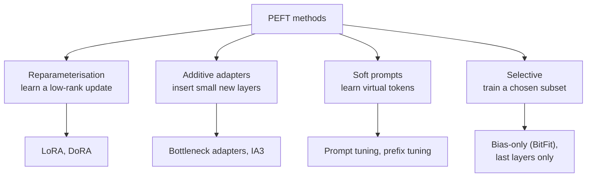
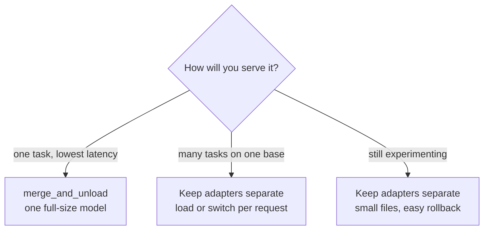

Full fine-tuning updates every weight in a model. For a classifier with a hundred million parameters that is fine. For a seven-billion-parameter LLM it means storing gradients and optimiser state for seven billion numbers, which needs far more GPU memory than the model itself, and it produces a full-size copy of the model for every task you train. **Parameter-efficient fine-tuning (PEFT)** freezes the pretrained weights and trains a small number of new or selected parameters instead, often well under one percent. Quality on a specific task is frequently close to full fine-tuning, memory falls dramatically, and the result is a small adapter file rather than a new model. The Hugging Face `peft` library implements the main methods behind one interface that plugs straight into `transformers` and the `Trainer`.

## Why full fine-tuning is expensive

During training with the Adam optimiser and mixed precision, each trainable parameter carries much more than its own value. A common accounting is 16 bytes per parameter: a 16-bit weight (2 bytes), a 16-bit gradient (2), a 32-bit master copy of the weight (4), and Adam's two 32-bit moment estimates (8). Activations come on top and grow with batch size and sequence length.

```python
params = 7e9                                  # a 7-billion-parameter model
full_ft = params * (2 + 2 + 4 + 8)            # weights, grads, master weights, Adam m and v
frozen_16bit = params * 2                     # frozen weights only, in bf16
lora_params = 20e6                            # a typical adapter size, for illustration
lora_ft = frozen_16bit + lora_params * 16

print(f"full fine-tuning: {full_ft / 1e9:.0f} GB before activations")
print(f"LoRA:             {lora_ft / 1e9:.1f} GB before activations")
```

```output
full fine-tuning: 112 GB before activations
LoRA:             14.3 GB before activations
```

The frozen weights still need memory, but nothing else does except the small adapter. That difference is what moves fine-tuning from a multi-GPU cluster to a single GPU, and [QLoRA](/learn/hugging-face-ecosystem/qlora) shrinks the frozen part further by storing it in 4 bits.

## The main families of PEFT methods



| Method | What is trained | Inference cost | Notes |
| --- | --- | --- | --- |
| LoRA | Low-rank matrices added to chosen weight matrices | None once merged | The default choice; see [LoRA](/learn/hugging-face-ecosystem/lora) |
| Bottleneck adapters | Small MLPs inserted after sublayers | Extra layers on every forward pass | The original PEFT approach |
| IA3 | Learned vectors that rescale keys, values and feed-forward activations | Negligible | Extremely few parameters |
| Prompt tuning | Embeddings for a few virtual tokens prepended to the input | Slightly longer sequences | Works best with large models |
| Prefix tuning | Virtual key and value vectors at every layer | Slightly longer attention | More expressive than prompt tuning |
| Selective (BitFit and similar) | Existing biases, or the top layers | None | Simple, usually weaker |

LoRA dominates in practice because it adds no inference latency once merged, works across architectures, and has well-understood hyperparameters. The rest of this lesson uses it to show the `peft` workflow.

## What PEFT does to a model, in plain PyTorch

Before using the library, it helps to see the mechanism. This runnable sketch freezes a small model, wraps two kinds of linear layer with a trainable low-rank update, keeps the new classifier head trainable, and counts parameters the way `peft` reports them.

```python
import torch
from torch import nn

torch.manual_seed(0)

class Block(nn.Module):
    def __init__(self, d=256, ff=1024):
        super().__init__()
        self.q_proj = nn.Linear(d, d)
        self.v_proj = nn.Linear(d, d)
        self.up = nn.Linear(d, ff)
        self.down = nn.Linear(ff, d)
    def forward(self, x):
        h = x + self.v_proj(x) * torch.sigmoid(self.q_proj(x))
        return h + self.down(torch.relu(self.up(h)))

class TinyModel(nn.Module):
    def __init__(self, n_layers=4, d=256, n_classes=3):
        super().__init__()
        self.blocks = nn.ModuleList(Block(d) for _ in range(n_layers))
        self.classifier = nn.Linear(d, n_classes)
    def forward(self, x):
        for b in self.blocks:
            x = b(x)
        return self.classifier(x)

class LoRALinear(nn.Module):
    def __init__(self, base: nn.Linear, r=8, alpha=16):
        super().__init__()
        self.base = base                                              # frozen
        self.A = nn.Parameter(torch.randn(r, base.in_features) * 0.01)
        self.B = nn.Parameter(torch.zeros(base.out_features, r))     # zero: no change at start
        self.scale = alpha / r
    def forward(self, x):
        return self.base(x) + (x @ self.A.T @ self.B.T) * self.scale

def apply_lora(model, targets, r=8, alpha=16):
    for p in model.parameters():
        p.requires_grad = False                     # freeze everything
    for module in model.modules():
        for name, child in list(module.named_children()):
            if name in targets and isinstance(child, nn.Linear):
                setattr(module, name, LoRALinear(child, r, alpha))
    return model

def print_trainable_parameters(model):
    trainable = sum(p.numel() for p in model.parameters() if p.requires_grad)
    total = sum(p.numel() for p in model.parameters())
    print(f"trainable params: {trainable:,} || all params: {total:,} "
          f"|| trainable%: {100 * trainable / total:.4f}")

model = apply_lora(TinyModel(), targets={"q_proj", "v_proj"})
for p in model.classifier.parameters():
    p.requires_grad = True                          # the new head must train too
print_trainable_parameters(model)
print(model(torch.randn(2, 256)).shape)
```

```output
trainable params: 33,539 || all params: 2,662,147 || trainable%: 1.2598
torch.Size([2, 3])
```

Check the count by hand: each wrapped 256 by 256 layer adds $8 \times 256 + 256 \times 8 = 4{,}096$ parameters, two per block over four blocks gives 32,768, and the classifier adds $256 \times 3 + 3 = 771$. Real models are far larger relative to the adapter, so the trainable percentage is usually well below this.

## The `peft` library workflow

The library does the same three things: freeze the base, inject adapter modules by name, and leave chosen modules trainable.

```python
from transformers import AutoModelForSequenceClassification
from peft import LoraConfig, TaskType, get_peft_model

base = AutoModelForSequenceClassification.from_pretrained(
    "FacebookAI/roberta-base", num_labels=3
)

config = LoraConfig(
    task_type=TaskType.SEQ_CLS,        # keeps the classification head trainable
    r=8,
    lora_alpha=16,
    lora_dropout=0.1,
    target_modules=["query", "value"], # module names inside RoBERTa's attention
)
model = get_peft_model(base, config)
model.print_trainable_parameters()     # prints counts in the format shown above
```

`target_modules` refers to submodule names, which differ between architectures: RoBERTa calls its projections `query` and `value`, while Llama-style models use `q_proj`, `k_proj`, `v_proj`, `o_proj`, `gate_proj`, `up_proj` and `down_proj`. Print the model, or list `[n for n, _ in base.named_modules()]`, to find them. For newly created heads in other task types, add them with `modules_to_save=["classifier"]` so they are trained and saved alongside the adapter.

The returned `PeftModel` is still a PyTorch module with the same forward signature, so the `Trainer` code from [Fine-tuning models](/learn/hugging-face-ecosystem/fine-tuning-models) works unchanged. Only one thing usually changes: LoRA tolerates and often needs a higher learning rate than full fine-tuning, commonly around 1e-4 to 3e-4 rather than 2e-5.

> [!KEY]
> PEFT does not change how you train, only what is trainable. The model, data, collator and `Trainer` are the same; `get_peft_model` decides which parameters receive gradients.

## Saving, loading and switching adapters

`model.save_pretrained("tickets-lora")` on a `PeftModel` writes only the adapter: `adapter_config.json` (which records the base model and the LoRA settings) and `adapter_model.safetensors`. For a 7B base model an adapter is typically tens to a few hundred megabytes, depending on rank and targeted modules, against roughly 14 GB for the base weights in 16-bit.

```python
from peft import PeftModel

base = AutoModelForSequenceClassification.from_pretrained("FacebookAI/roberta-base", num_labels=3)
model = PeftModel.from_pretrained(base, "tickets-lora")          # attach a saved adapter

model.load_adapter("reviews-lora", adapter_name="reviews")       # a second adapter
model.set_adapter("reviews")                                     # switch between them
```

One base model in memory with many small adapters lets a single deployment serve many tasks or customers.

## Merging adapters

For deployment you can fold the adapter into the base weights, producing an ordinary `transformers` model with no adapter overhead:

```python
merged = model.merge_and_unload()
merged.save_pretrained("tickets-merged")       # a normal, full-size checkpoint
```



| | Separate adapter | Merged model |
| --- | --- | --- |
| Storage per task | Megabytes | Full model size |
| Extra inference compute | Small extra matrix multiplies | None |
| Swap tasks at runtime | Yes | No |
| Loadable without `peft` | No | Yes |

> [!WARNING]
> Merge into a base model in 16-bit or 32-bit precision. If you trained on a 4-bit quantised base (QLoRA), reload the base in bf16 before merging; merging into quantised weights loses precision or is not supported.

## Exercises

**1.** Using `apply_lora` from this lesson, also target `up` and `down`, and print the new trainable count. Explain the difference.

<details>
<summary>Show solution</summary>

```python
model2 = apply_lora(TinyModel(), targets={"q_proj", "v_proj", "up", "down"})
for p in model2.classifier.parameters():
    p.requires_grad = True
print_trainable_parameters(model2)
```

```output
trainable params: 115,459 || all params: 2,744,067 || trainable%: 4.2076
```

`up` is 256 to 1024 and `down` is 1024 to 256, so each adds $8 \times (256 + 1024) = 10{,}240$ parameters. Over four blocks that is 81,920 more than before.

</details>

**2.** Verify with the formula from this lesson how much memory full fine-tuning of a 1.5-billion-parameter model needs before activations, and compare with its frozen bf16 weights.

<details>
<summary>Show solution</summary>

```python
p = 1.5e9
print(f"full: {p * 16 / 1e9:.0f} GB, frozen bf16 weights: {p * 2 / 1e9:.0f} GB")
```

```output
full: 24 GB, frozen bf16 weights: 3 GB
```

</details>

**3.** You must serve twelve customer-specific fine-tunes of the same 8B model on one GPU. Merge, or keep adapters separate? Why?

<details>
<summary>Show solution</summary>

Keep them separate. Twelve merged models would each be full size and could not share a GPU. One base model plus twelve small adapters fits, and the server attaches the right adapter per request. Merging suits a single task where the last bit of latency matters.

</details>

```quiz
[
  {
    "q": "What does `get_peft_model` do?",
    "options": [
      "Downloads a smaller version of the model",
      "Freezes the base model and injects trainable adapter modules according to the config",
      "Quantises the model to 4 bits",
      "Prunes unimportant weights"
    ],
    "answer": 1,
    "why": "It wraps the base model, freezes its parameters and adds the adapter parameters, which are the only ones that receive gradients (plus any `modules_to_save`)."
  },
  {
    "q": "What does `save_pretrained` write for a `PeftModel`?",
    "options": [
      "The full merged model",
      "Only the adapter weights and adapter config",
      "The optimiser state",
      "The base model and the adapter in one file"
    ],
    "answer": 1,
    "why": "Only the small adapter is saved; its config records which base model it applies to."
  },
  {
    "q": "Roughly how many bytes per trainable parameter does mixed-precision Adam training use, before activations?",
    "options": ["2", "4", "8", "16"],
    "answer": 3,
    "why": "16-bit weight and gradient (4 bytes), a 32-bit master weight (4) and two 32-bit Adam moments (8)."
  },
  {
    "q": "When is `merge_and_unload` the better choice?",
    "options": [
      "When serving many tasks from one base model",
      "When you want to keep training several adapters",
      "When deploying a single task and you want no adapter overhead or `peft` dependency",
      "When the base model is stored in 4 bits"
    ],
    "answer": 2,
    "why": "Merging gives a plain model with no extra compute, at the cost of a full-size checkpoint per task."
  }
]
```
