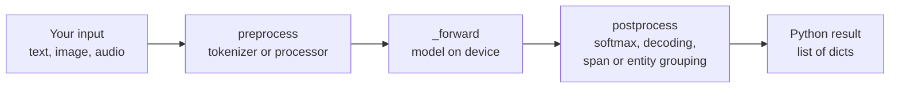
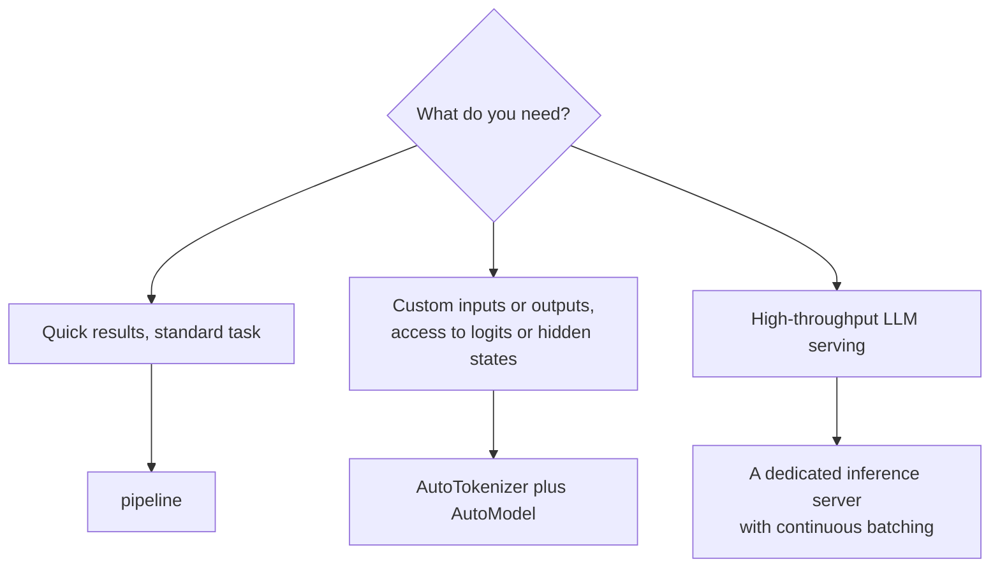

A `pipeline` is the shortest path from a task name to a working model: one line to build, one call to run. Behind that line it chains a tokenizer (or image or audio processor), a model, and task-specific post-processing that turns raw logits into labels, spans or text. Pipelines are ideal for prototypes, evaluation scripts, batch jobs and for learning what a model can do. They are also a good thing to take apart, because each one encodes the correct pre- and post-processing for its task, the part that people most often get subtly wrong when they write it themselves.

## What a pipeline does

Every pipeline runs the same three steps. Only the details change by task.



```python
from transformers import pipeline

classifier = pipeline(
    "text-classification",
    model="distilbert/distilbert-base-uncased-finetuned-sst-2-english",
)
print(classifier(["Setup took two minutes.", "Support never replied."]))
```

The result is a list with one dictionary per input. Its shape looks like this (scores here are illustrative; run it to see the real values):

```text
[{'label': 'POSITIVE', 'score': 0.99...}, {'label': 'NEGATIVE', 'score': 0.99...}]
```

> [!WARNING]
> If you omit `model=`, the pipeline picks a default checkpoint for the task and prints a warning. Defaults can change between library releases, so code that relies on one is not reproducible. Always pass `model=`, and for anything that matters, `revision=` as well.

## The common tasks

| Task string | Input | Output per input |
| --- | --- | --- |
| `"text-classification"` (alias `"sentiment-analysis"`) | Text | `label`, `score`; pass `top_k=None` for every label |
| `"token-classification"` (alias `"ner"`) | Text | List of entities with `entity_group`, `score`, `word`, `start`, `end` |
| `"question-answering"` | `question` and `context` | `answer`, `score`, `start`, `end` |
| `"zero-shot-classification"` | Text plus `candidate_labels` | `labels` and `scores`, sorted |
| `"summarization"` | Text | `summary_text` |
| `"translation"` | Text | `translation_text` |
| `"text-generation"` | Prompt or list of chat messages | `generated_text` |
| `"fill-mask"` | Text containing the mask token | Top candidates with `token_str` and `score` |
| `"feature-extraction"` | Text | Hidden states (nested lists), the raw material for embeddings |
| `"image-classification"` | Image path, URL or PIL image | `label`, `score` |
| `"automatic-speech-recognition"` | Audio file or array | `text` |

## Task examples

### Named entities with aggregation

Token classifiers label subword tokens. The `aggregation_strategy` argument merges them back into whole entities with character offsets.

```python
ner = pipeline(
    "token-classification",
    model="dslim/bert-base-NER",
    aggregation_strategy="simple",
)
ner("Ada Lovelace worked with Charles Babbage in London.")
```

To see what aggregation does, here it is in plain Python on example token predictions. Labels use the BIO scheme from [Named entity recognition](/learn/nlp-fundamentals/named-entity-recognition): `B-` begins an entity, `I-` continues it, `O` is outside any entity.

```python
text = "Ada Lovelace met Charles Babbage in London."
# (token, label, start, end) as a token classifier would produce
tokens = [
    ("Ada", "B-PER", 0, 3), ("Love", "I-PER", 4, 8), ("##lace", "I-PER", 8, 12),
    ("met", "O", 13, 16), ("Charles", "B-PER", 17, 24), ("Ba", "I-PER", 25, 27),
    ("##bbage", "I-PER", 27, 32), ("in", "O", 33, 35), ("London", "B-LOC", 36, 42),
]

entities, current = [], None
for tok, label, start, end in tokens:
    if label.startswith("B-") or (label.startswith("I-") and current is None):
        if current:
            entities.append(current)
        current = {"group": label[2:], "start": start, "end": end}
    elif label.startswith("I-") and current["group"] == label[2:]:
        current["end"] = end                    # extend the open entity
    else:
        if current:
            entities.append(current)
        current = None
if current:
    entities.append(current)

for e in entities:
    print(e["group"], repr(text[e["start"]:e["end"]]))
```

```output
PER 'Ada Lovelace'
PER 'Charles Babbage'
LOC 'London'
```

The real pipeline also averages scores across the merged tokens and offers other strategies (`"first"`, `"average"`, `"max"`) for words whose subwords disagree. Note that the entity text comes from the original string via offsets, as described in [Tokenizers](/learn/hugging-face-ecosystem/tokenizers).

### Zero-shot classification

Zero-shot classification labels text with categories chosen at call time, with no training. It uses a model trained for natural language inference (NLI): for each candidate label it asks whether the text **entails** a hypothesis such as "This example is about billing."

```python
zs = pipeline("zero-shot-classification", model="facebook/bart-large-mnli")
zs(
    "I was charged twice for my subscription this month.",
    candidate_labels=["billing", "technical problem", "feature request"],
    hypothesis_template="This example is about {}.",
)
```

Post-processing takes the entailment logit for each label and applies a softmax across labels. With example logits:

```python
import numpy as np

labels = ["billing", "technical problem", "feature request"]
entail_logits = np.array([3.2, -0.4, -1.9])      # one NLI pass per label
scores = np.exp(entail_logits) / np.exp(entail_logits).sum()
for i in np.argsort(-scores):
    print(f"{labels[i]:<18} {scores[i]:.3f}")
```

```output
billing            0.968
technical problem  0.026
feature request    0.006
```

Each candidate label costs a full forward pass, so ten labels make it ten times slower than one classification. Pass `multi_label=True` when several labels can be true at once; scores are then computed independently per label (entailment against contradiction) and need not sum to 1.

### Text generation with chat messages

The text-generation pipeline accepts a list of chat messages and applies the model's chat template for you.

```python
chat = pipeline("text-generation", model="Qwen/Qwen2.5-0.5B-Instruct", torch_dtype="auto")
messages = [
    {"role": "system", "content": "Answer in one sentence."},
    {"role": "user", "content": "What is a tokenizer?"},
]
result = chat(messages, max_new_tokens=60, do_sample=False)
print(result[0]["generated_text"][-1]["content"])   # the new assistant message
```

With chat input, `generated_text` holds the conversation including the new assistant turn, so the last message is the reply. Generation keyword arguments (`max_new_tokens`, `temperature` and the others from [Transformers](/learn/hugging-face-ecosystem/transformers)) are passed straight through to `generate`.

## Devices, batching and datasets

| Argument | Effect |
| --- | --- |
| `device=0` or `device="cuda"` | Run on the first GPU (default is CPU unless `device_map` is used) |
| `device_map="auto"` | Spread a large model over available devices |
| `torch_dtype=torch.float16` | Lower-precision weights for speed and memory |
| `batch_size=16` | Group inputs into batches for the forward pass |

Passing a list processes every item. For a large dataset, pass a generator or a `KeyDataset` so the pipeline can stream inputs and overlap preprocessing with GPU work:

```python
from datasets import load_dataset
from transformers.pipelines.pt_utils import KeyDataset

reviews = load_dataset("stanfordnlp/imdb", split="test[:1000]")
clf = pipeline("text-classification",
               model="distilbert/distilbert-base-uncased-finetuned-sst-2-english",
               device=0, batch_size=32, truncation=True)
predictions = [out["label"] for out in clf(KeyDataset(reviews, "text"))]
```

> [!TIP]
> Batching is not automatically faster. On a CPU, or with inputs of very different lengths, padding can cost more than batching saves. Measure with your real data and try a few batch sizes, starting with 8 to 32 on a GPU.

Pass `truncation=True` for long inputs: without it, a text longer than the model's maximum (512 tokens for many encoders) raises an error.

## When to move beyond pipelines



Pipelines are convenient but opinionated. Drop to the Auto classes when you need logits, attention, or hidden states, a non-standard pre-processing step, or tight control over memory. For serving an LLM to many concurrent users, a dedicated inference engine with continuous batching and a paged KV cache is far more efficient; see [vLLM](/learn/advanced-llm-engineering/vllm).

## Exercises

**1.** You want every class score, not just the top one, from a text classifier with three labels. Which argument do you pass, and what does the output for one input look like?

<details>
<summary>Show solution</summary>

Pass `top_k=None`, either when building the pipeline or when calling it. Each input then returns a list of three dictionaries, `{"label": ..., "score": ...}`, sorted by score, rather than a single dictionary.

</details>

**2.** Modify the aggregation code from this lesson so that each entity also carries the list of token strings that formed it, and print them for `"Charles Babbage"`.

<details>
<summary>Show solution</summary>

```python
entities, current = [], None
for tok, label, start, end in tokens:
    if label.startswith("B-") or (label.startswith("I-") and current is None):
        if current:
            entities.append(current)
        current = {"group": label[2:], "start": start, "end": end, "tokens": [tok]}
    elif label.startswith("I-") and current["group"] == label[2:]:
        current["end"] = end
        current["tokens"].append(tok)
    else:
        if current:
            entities.append(current)
        current = None
if current:
    entities.append(current)

print(entities[1]["tokens"])
```

```output
['Charles', 'Ba', '##bbage']
```

</details>

**3.** A support team wants to route tickets into 40 categories with no labelled data, at a rate of thousands of tickets per minute. Is the zero-shot pipeline a good long-term choice? Explain.

<details>
<summary>Show solution</summary>

It is a good way to start, but not a good long-term design at that volume. Zero-shot classification runs one NLI forward pass per candidate label, so 40 labels means 40 passes per ticket. Use it to bootstrap labels (with human review), then fine-tune a single classifier that scores all 40 classes in one pass, as shown in [Fine-tuning models](/learn/hugging-face-ecosystem/fine-tuning-models).

</details>

```quiz
[
  {
    "q": "What are the three stages every pipeline runs?",
    "options": [
      "download, compile, serve",
      "preprocess, forward, postprocess",
      "tokenize, train, evaluate",
      "encode, quantise, decode"
    ],
    "answer": 1,
    "why": "A pipeline prepares inputs with a tokenizer or processor, runs the model, and converts raw outputs into task-level results."
  },
  {
    "q": "Why should you always pass `model=` to `pipeline`?",
    "options": [
      "Pipelines refuse to run without it",
      "The default checkpoint for a task can change between releases, making results irreproducible",
      "It makes the pipeline use the GPU",
      "It enables batching"
    ],
    "answer": 1,
    "why": "Without an explicit model, the library chooses a default that may differ across versions."
  },
  {
    "q": "Zero-shot classification with 10 candidate labels needs roughly how many forward passes per input?",
    "options": ["1", "2", "10", "100"],
    "answer": 2,
    "why": "The NLI model scores one premise-hypothesis pair per candidate label."
  },
  {
    "q": "What does `aggregation_strategy=\"simple\"` do in a token-classification pipeline?",
    "options": [
      "Merges consecutive subword predictions into whole entities with offsets",
      "Averages predictions over several models",
      "Removes low-confidence tokens",
      "Converts BIO labels to integers"
    ],
    "answer": 0,
    "why": "It groups B- and I- predictions of the same type into entity spans and reports their character offsets and score."
  }
]
```
