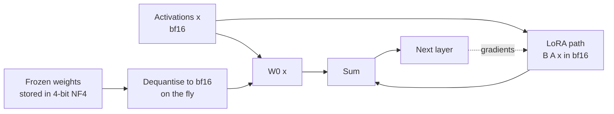

LoRA removes the cost of gradients and optimiser state for the base model, but the frozen weights still have to sit in GPU memory. In 16-bit, a 7-billion-parameter model needs about 14 GB just for those, and a 70B model about 140 GB. **QLoRA** stores the frozen base model in 4 bits and trains ordinary LoRA adapters on top of it. Gradients flow *through* the quantised weights into the adapters, which stay in 16-bit. The QLoRA paper (Dettmers et al., 2023) combined three ideas to make this work without the quality loss you might expect: a 4-bit data type called **NF4**, **double quantisation** of the scaling constants, and **paged optimisers** to survive memory spikes. With `transformers`, `peft` and `bitsandbytes`, the whole recipe is a few configuration objects.

## How a QLoRA forward and backward pass works

The 4-bit weights are a storage format. Matrix multiplications happen in a 16-bit **compute dtype**, so each layer dequantises its weights block by block just before it uses them.



Backpropagation needs the gradient with respect to the layer's *input* in order to reach earlier layers' adapters, and computing that uses the dequantised weights too. No gradient is ever stored for $W_0$ itself; only $A$ and $B$ are updated.

## NF4: a 4-bit type shaped for normal weights

Four bits give 16 representable values. Ordinary integer quantisation spaces them evenly. But trained weights are roughly normally distributed: most values cluster near zero and few lie in the tails, so evenly spaced levels waste resolution on rarely used extremes.

**NormalFloat4 (NF4)** places its 16 levels at quantiles of the standard normal distribution, so each level is used about equally often. Weights are quantised in small blocks (64 values in QLoRA): each block is divided by its absolute maximum to land in $[-1, 1]$, each value is replaced by the index of its nearest level, and the block's absmax is kept as a scaling constant. The construction described in the paper uses 8 positive and 7 negative normal quantiles plus an exact zero, normalised to $[-1, 1]$:

```python
import numpy as np
from scipy.stats import norm

offset = 0.9677
pos = norm.ppf(np.linspace(offset, 0.5, 9)[:-1])      # 8 positive quantiles
neg = -norm.ppf(np.linspace(offset, 0.5, 8)[:-1])     # 7 negative quantiles
nf4 = np.sort(np.concatenate([pos, [0.0], neg]))
nf4 = nf4 / np.abs(nf4).max()                          # scale to [-1, 1]
print(np.round(nf4, 4))
```

```output
[-1.     -0.6962 -0.5251 -0.3949 -0.2845 -0.1848 -0.0911  0.      0.0796
  0.1609  0.2461  0.3379  0.4407  0.5626  0.723   1.    ]
```

The levels are dense near zero and sparse near $\pm 1$. An exact zero matters because padding and many weights sit there. Now compare quantisation error against 16 evenly spaced levels on normally distributed weights, using the same blockwise absmax scaling for both:

```python
uniform4 = np.linspace(-1, 1, 16)                      # evenly spaced 4-bit levels

def quantise_blockwise(w, levels, block=64):
    blocks = w.reshape(-1, block)
    absmax = np.abs(blocks).max(axis=1, keepdims=True)          # one scale per block
    normed = blocks / absmax                                     # now in [-1, 1]
    idx = np.abs(normed[..., None] - levels).argmin(axis=-1)     # nearest level: a 4-bit code
    return (levels[idx] * absmax).reshape(w.shape)

rng = np.random.default_rng(0)
w = rng.normal(0, 0.02, size=64 * 4096).astype(np.float32)      # weights look roughly normal
for name, levels in [("uniform int4", uniform4), ("NF4", nf4)]:
    err = np.mean((w - quantise_blockwise(w, levels)) ** 2)
    print(f"{name:<13} mean squared error: {err:.3e}")
```

```output
uniform int4  mean squared error: 4.070e-06
NF4           mean squared error: 3.385e-06
```

Same four bits per weight, noticeably lower error, purely by placing the levels where the values are. The general theory of quantisation, including symmetric and asymmetric schemes, is in [Quantization](/learn/hugging-face-ecosystem/quantization).

## Double quantisation

Every block of 64 weights needs its absmax constant. Stored as a 32-bit float, that adds $32 / 64 = 0.5$ bits per parameter, an eighth on top of the 4 bits. **Double quantisation** quantises those constants themselves to 8 bits, in blocks of 256 constants, each block with one 32-bit constant of its own.

$$
\text{overhead} = \frac{8}{64} + \frac{32}{64 \times 256} \text{ bits per parameter}
$$

```python
single = 32 / 64
double = 8 / 64 + 32 / (64 * 256)
params = 7e9
print(f"constants, single: {single:.3f} bits/param = {params * single / 8 / 1e9:.2f} GB")
print(f"constants, double: {double:.3f} bits/param = {params * double / 8 / 1e9:.2f} GB")
print(f"4-bit weights:     {params * 4 / 8 / 1e9:.2f} GB")
```

```output
constants, single: 0.500 bits/param = 0.44 GB
constants, double: 0.127 bits/param = 0.11 GB
4-bit weights:     3.50 GB
```

Saving about 0.37 bits per parameter sounds small, but it is roughly a third of a gigabyte on a 7B model and around 3 GB on a 70B model, often the margin between fitting and not fitting.

## Paged optimisers

Memory use during training is not constant. A batch of unusually long sequences, or the recomputation done by gradient checkpointing, can spike activation memory and crash a run that was fine for hours. **Paged optimisers** put the optimiser state in unified memory that the GPU driver can page out to CPU RAM when the GPU runs short, and page back when needed. The run slows down briefly instead of failing. In `transformers` you select one by name: `optim="paged_adamw_8bit"` (which also stores Adam's moments in 8 bits) or `optim="paged_adamw_32bit"`.

| Idea | Problem it solves | Where you set it |
| --- | --- | --- |
| NF4 | 4-bit storage with less error on normally distributed weights | `bnb_4bit_quant_type="nf4"` |
| Double quantisation | Overhead of per-block scaling constants | `bnb_4bit_use_double_quant=True` |
| Compute dtype | Matmuls need a real floating-point type | `bnb_4bit_compute_dtype=torch.bfloat16` |
| Paged optimisers | Out-of-memory crashes from transient spikes | `optim="paged_adamw_8bit"` in `TrainingArguments` |

## The QLoRA recipe in code

This needs a CUDA GPU and the `bitsandbytes` package, so no output is shown.

```python
import torch
from transformers import AutoModelForCausalLM, AutoTokenizer, BitsAndBytesConfig, TrainingArguments
from peft import LoraConfig, get_peft_model, prepare_model_for_kbit_training

bnb_config = BitsAndBytesConfig(
    load_in_4bit=True,
    bnb_4bit_quant_type="nf4",
    bnb_4bit_use_double_quant=True,
    bnb_4bit_compute_dtype=torch.bfloat16,
)

checkpoint = "Qwen/Qwen2.5-7B-Instruct"
tokenizer = AutoTokenizer.from_pretrained(checkpoint)
model = AutoModelForCausalLM.from_pretrained(
    checkpoint, quantization_config=bnb_config, device_map="auto"
)

model = prepare_model_for_kbit_training(model)   # enables gradient checkpointing, stabilises norms

lora_config = LoraConfig(
    r=16, lora_alpha=32, lora_dropout=0.05,
    target_modules="all-linear", task_type="CAUSAL_LM",
)
model = get_peft_model(model, lora_config)
model.print_trainable_parameters()

args = TrainingArguments(
    output_dir="qlora-out",
    per_device_train_batch_size=4,
    gradient_accumulation_steps=4,
    learning_rate=2e-4,
    num_train_epochs=1,
    bf16=True,
    optim="paged_adamw_8bit",
    gradient_checkpointing=True,
    logging_steps=10,
)
# Then build a Trainer (or trl's SFTTrainer) with your tokenised dataset as usual.
```

`prepare_model_for_kbit_training` turns on gradient checkpointing, makes the input embeddings produce gradients (needed so gradients can flow back through a frozen model to the adapters), and keeps layer norms in higher precision for stability. The QLoRA paper applied LoRA to all linear layers, and found this mattered for matching 16-bit fine-tuning quality.

> [!WARNING]
> To ship a merged model, do not merge into the 4-bit base. Reload the base model in bf16, attach the adapter with `PeftModel.from_pretrained`, then call `merge_and_unload()`. You can quantise the merged model afterwards for serving, in whatever format your inference stack uses.

## Memory budget and trade-offs

A rough budget for QLoRA on a 7B model with the Llama 2 7B shape from [LoRA](/learn/hugging-face-ecosystem/lora), excluding activations, which depend on batch size, sequence length and checkpointing:

| Component | Approximate size |
| --- | --- |
| Linear-layer weights (about 6.5B params) in NF4 with double quantisation | about 3.3 GB |
| Embeddings and output head (about 262M params, usually left in 16-bit) | about 0.5 GB |
| LoRA adapters, r=16 on all linear layers (about 40M params, bf16) | about 0.08 GB |
| Gradients and 8-bit Adam state for the adapters | well under 1 GB |

Compare that with the 112 GB estimated for full fine-tuning in [PEFT](/learn/hugging-face-ecosystem/peft). The costs are real, though:

- **Speed.** Dequantising on every forward and backward pass makes each step slower than LoRA on a 16-bit base. QLoRA trades time for memory.
- **Hardware.** `bitsandbytes` primarily targets NVIDIA GPUs; support elsewhere is more limited.
- **Train and serve mismatch.** The adapter learned to correct a 4-bit model. Merged into 16-bit weights, the base behaves slightly differently, so evaluate the exact artefact you deploy.

> [!KEY]
> QLoRA quantises only what is frozen. The trainable adapter, the activations and the arithmetic stay in 16-bit, which is why quality holds up while memory falls to roughly a quarter.

For the engineering view (choosing between LoRA and QLoRA by hardware and budget, multi-GPU training, and evaluation) continue to [LoRA and QLoRA](/learn/advanced-llm-engineering/lora-and-qlora).

## Exercises

**1.** Using the formulas in this lesson, estimate NF4 storage including double-quantisation constants for a 70-billion-parameter model, and compare with bf16.

<details>
<summary>Show solution</summary>

```python
p = 70e9
nf4_bits = 4 + 8 / 64 + 32 / (64 * 256)
print(f"NF4 + double quant: {p * nf4_bits / 8 / 1e9:.1f} GB, bf16: {p * 2 / 1e9:.0f} GB")
```

```output
NF4 + double quant: 36.1 GB, bf16: 140 GB
```

Roughly a quarter. The 4-bit model fits on a single 48 GB or 80 GB GPU with room for adapters and activations; the bf16 model does not.

</details>

**2.** Change `quantise_blockwise` to use a block size of 256 instead of 64 and compare NF4's error. Why does the error change?

<details>
<summary>Show solution</summary>

```python
err64 = np.mean((w - quantise_blockwise(w, nf4, block=64)) ** 2)
err256 = np.mean((w - quantise_blockwise(w, nf4, block=256)) ** 2)
print(f"block 64: {err64:.3e}   block 256: {err256:.3e}")
```

```output
block 64: 3.385e-06   block 256: 3.922e-06
```

Larger blocks have larger absmax values (more chance of an extreme value), so most weights are squeezed into a smaller part of $[-1, 1]$ and resolution drops. Smaller blocks are more accurate but need more scaling constants, which is the overhead double quantisation reduces.

</details>

**3.** A QLoRA run crashes with out-of-memory errors only occasionally, on batches with very long examples. Name two settings from this lesson that address it.

<details>
<summary>Show solution</summary>

Use a paged optimiser (`optim="paged_adamw_8bit"`) so transient spikes page optimiser state to CPU instead of crashing, and keep gradient checkpointing on to cut activation memory. Reducing `max_length` or the per-device batch size (with more gradient accumulation) also helps.

</details>

```quiz
[
  {
    "q": "In QLoRA, what is stored in 4-bit precision?",
    "options": [
      "The LoRA adapters",
      "The activations",
      "The frozen base model weights",
      "The gradients"
    ],
    "answer": 2,
    "why": "Only the frozen base weights are quantised. Adapters, activations and computation stay in 16-bit."
  },
  {
    "q": "Why does NF4 give lower error than evenly spaced 4-bit levels on typical weights?",
    "options": [
      "It uses more bits",
      "Its levels are placed at normal-distribution quantiles, dense near zero where most weights lie",
      "It skips quantising small weights",
      "It stores weights as floating-point exponents"
    ],
    "answer": 1,
    "why": "Trained weights are roughly normal, so putting more levels near zero matches where values actually fall."
  },
  {
    "q": "What does double quantisation compress?",
    "options": [
      "The LoRA matrices",
      "The per-block scaling constants",
      "The optimiser states",
      "The tokenizer vocabulary"
    ],
    "answer": 1,
    "why": "The absmax constants (one per 64 weights) are quantised to 8 bits, cutting their overhead from 0.5 to about 0.127 bits per parameter."
  },
  {
    "q": "What is the main purpose of a paged optimiser?",
    "options": [
      "To speed up each training step",
      "To avoid crashes from transient GPU memory spikes by paging optimiser state to CPU memory",
      "To quantise gradients",
      "To shard the model across GPUs"
    ],
    "answer": 1,
    "why": "Paging lets optimiser state move to CPU RAM when the GPU runs short, trading a brief slowdown for not crashing."
  }
]
```
