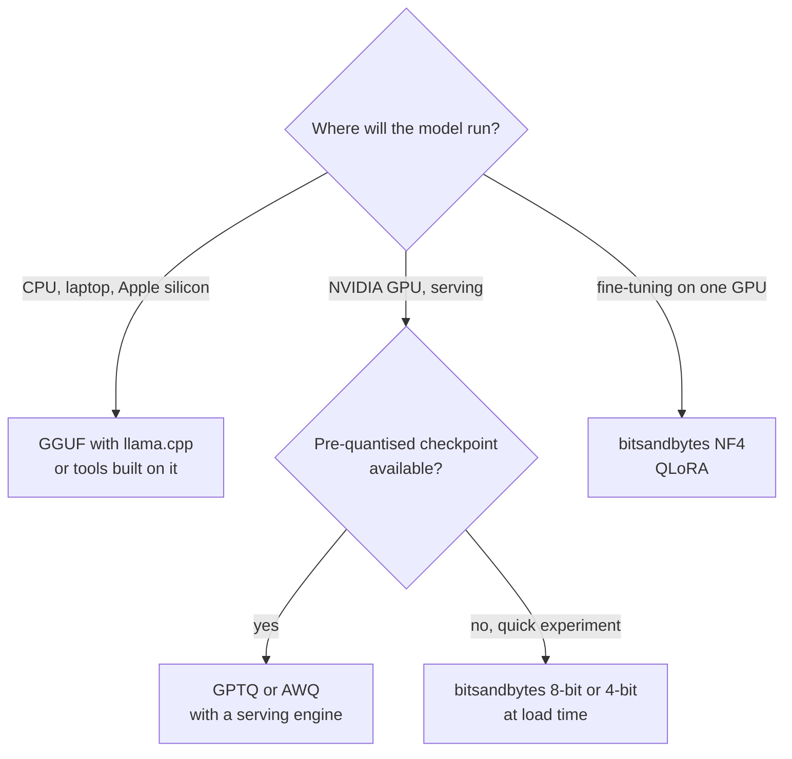

Quantisation stores a model's numbers with fewer bits: 8-bit or 4-bit integers instead of 16-bit or 32-bit floats. It is the main reason a laptop can run a model that would otherwise need a data-centre GPU. Memory falls in proportion to the bits, and because generating each token of an LLM is usually limited by how fast weights can be read from memory rather than by arithmetic, smaller weights often mean faster generation too. The cost is a small, measurable loss of accuracy that you must check rather than assume. This lesson covers the memory arithmetic, the mathematics of symmetric and asymmetric quantisation (with a NumPy implementation you can run), granularity and outliers, post-training quantisation versus quantisation-aware training, and the formats you will meet on the Hub: bitsandbytes, GPTQ, AWQ and GGUF.

## Bytes per parameter

The weight memory of a model is its parameter count multiplied by the bytes per parameter.

| Format | Bits | Bytes per parameter |
| --- | --- | --- |
| float32 | 32 | 4 |
| float16 / bfloat16 | 16 | 2 |
| int8 | 8 | 1 |
| int4 / NF4 | 4 | 0.5 (plus a small overhead for scales) |

```python
sizes = {"1B": 1e9, "7B": 7e9, "13B": 13e9, "70B": 70e9}
bytes_per_param = {"fp32": 4, "bf16": 2, "int8": 1, "int4": 0.5}

print(f"{'model':<6}" + "".join(f"{k:>9}" for k in bytes_per_param))
for name, n in sizes.items():
    print(f"{name:<6}" + "".join(f"{n * b / 1e9:>7.1f}GB" for b in bytes_per_param.values()))
```

```output
model      fp32     bf16     int8     int4
1B        4.0GB    2.0GB    1.0GB    0.5GB
7B       28.0GB   14.0GB    7.0GB    3.5GB
13B      52.0GB   26.0GB   13.0GB    6.5GB
70B     280.0GB  140.0GB   70.0GB   35.0GB
```

These are weights only. Serving also needs memory for activations and the KV cache, which grows with context length and the number of concurrent requests; see [KV caching](/learn/advanced-llm-engineering/kv-caching). A practical rule is to leave a healthy margin above the weight figure.

## Mapping real numbers to integers

Quantisation maps a range of real values onto a small set of integers using a **scale** and, optionally, a **zero point**. The general (affine) form for $b$-bit integers is

$$
q = \text{clip}\left(\text{round}\left(\frac{x}{s}\right) + z,\; q_{\min},\; q_{\max}\right), \qquad \hat{x} = s\,(q - z)
$$

where $x$ is the original value, $q$ the stored integer, $s > 0$ the scale (the real-valued size of one integer step), $z$ the integer zero point (the integer that represents real zero), $[q_{\min}, q_{\max}]$ the integer range, and $\hat{x}$ the dequantised approximation. The rounding error per value is at most $s / 2$, so a smaller scale means a more accurate representation.

**Symmetric** quantisation sets $z = 0$ and centres the range on zero, using the largest absolute value:

$$
s = \frac{\max_i |x_i|}{2^{b-1} - 1}, \qquad q \in [-(2^{b-1} - 1),\; 2^{b-1} - 1]
$$

For 8 bits that is $s = \max|x| / 127$. **Asymmetric** quantisation fits the actual minimum and maximum, using all $2^b$ levels:

$$
s = \frac{\max_i x_i - \min_i x_i}{2^b - 1}, \qquad z = \text{round}\left(-\frac{\min_i x_i}{s}\right), \qquad q \in [0,\; 2^b - 1]
$$

Step through symmetric 8-bit quantisation of four values:

```trace
{
  "title": "Symmetric int8 quantisation of a small vector",
  "code": [
    "x = np.array([0.31, -1.07, 2.54, 0.0])",
    "scale = np.abs(x).max() / 127",
    "scaled = x / scale",
    "q = np.round(scaled).astype(np.int8)",
    "x_hat = q * scale",
    "print(q, x_hat)"
  ],
  "steps": [
    { "line": 1, "vars": { "x": "[0.31, -1.07, 2.54, 0.0]" }, "note": "Four float values to store in 8 bits each." },
    { "line": 2, "vars": { "x": "[0.31, -1.07, 2.54, 0.0]", "scale": "0.02" }, "note": "The largest magnitude, 2.54, must map to 127, so one integer step is worth 0.02." },
    { "line": 3, "vars": { "scale": "0.02", "scaled": "[15.5, -53.5, 127.0, 0.0]" }, "note": "Divide by the scale. Two values fall exactly halfway between integers." },
    { "line": 4, "vars": { "scale": "0.02", "q": "[16, -54, 127, 0]" }, "note": "Round to the nearest integer (NumPy rounds halves to the nearest even number). These int8 values are what gets stored, plus the one scale." },
    { "line": 5, "vars": { "q": "[16, -54, 127, 0]", "x_hat": "[0.32, -1.08, 2.54, 0.0]" }, "note": "Dequantise by multiplying back. Each value is now off by at most scale / 2 = 0.01." },
    { "line": 6, "vars": { "q": "[16, -54, 127, 0]", "x_hat": "[0.32, -1.08, 2.54, 0.0]" }, "out": ["[ 16 -54 127   0] [ 0.32 -1.08  2.54  0.  ]"], "note": "Zero is represented exactly, which symmetric schemes guarantee." }
  ]
}
```

## Symmetric versus asymmetric in NumPy

Symmetric quantisation is simple and fast (no zero point to subtract during matrix multiplication), and suits weights, which are roughly centred on zero. Asymmetric quantisation pays off for skewed data such as activations after a ReLU, which are never negative: a symmetric range wastes half its levels on negative values that never occur.

```python
import numpy as np

def quantise_symmetric(x, bits=8):
    qmax = 2 ** (bits - 1) - 1
    scale = np.abs(x).max() / qmax
    q = np.clip(np.round(x / scale), -qmax, qmax)
    return q * scale                              # dequantised

def quantise_asymmetric(x, bits=8):
    qmax = 2 ** bits - 1
    scale = (x.max() - x.min()) / qmax
    zero_point = np.round(-x.min() / scale)
    q = np.clip(np.round(x / scale) + zero_point, 0, qmax)
    return (q - zero_point) * scale

rng = np.random.default_rng(0)
weights = rng.normal(0, 1, 10_000)                         # centred on zero
relu_acts = np.maximum(rng.normal(0.5, 1, 10_000), 0)     # all non-negative

print(f"{'data':<10}{'bits':>5}{'symmetric MSE':>16}{'asymmetric MSE':>17}")
for name, v in [("weights", weights), ("relu acts", relu_acts)]:
    for bits in (8, 4):
        sym = np.mean((v - quantise_symmetric(v, bits)) ** 2)
        asym = np.mean((v - quantise_asymmetric(v, bits)) ** 2)
        print(f"{name:<10}{bits:>5}{sym:>16.2e}{asym:>17.2e}")
```

```output
data       bits   symmetric MSE   asymmetric MSE
weights       8        7.92e-05         6.92e-05
weights       4        2.60e-02         2.04e-02
relu acts     8        6.96e-05         1.77e-05
relu acts     4        2.32e-02         5.09e-03
```

Two lessons from the table. Going from 8 to 4 bits raises error by more than two orders of magnitude, which is why 4-bit methods need extra cleverness (better level placement as in NF4, small groups, error compensation). And for the one-sided ReLU activations, asymmetric quantisation cuts error about four-fold, while for centred weights the two are close.

## Granularity and outliers

One scale for a whole tensor (**per-tensor**) is cheapest, but one extreme value inflates the scale for everything. **Per-channel** quantisation gives each output row its own scale; **per-group** quantisation gives each block of, say, 64 or 128 consecutive weights its own scale, the standard choice for 4-bit LLM weights.

```python
rng = np.random.default_rng(1)
w = rng.normal(0, 0.02, 4096)
w[100] = 1.0                         # a single outlier weight

per_tensor = quantise_symmetric(w, bits=4)
per_group = np.concatenate([quantise_symmetric(g, bits=4) for g in w.reshape(-1, 128)])

print(f"per-tensor MSE: {np.mean((w - per_tensor) ** 2):.2e}")
print(f"per-group  MSE: {np.mean((w - per_group) ** 2):.2e}")
print("weights rounded to zero, per-tensor:", int(np.sum(per_tensor == 0)), "of", w.size)
```

```output
per-tensor MSE: 4.02e-04
per-group  MSE: 1.59e-05
weights rounded to zero, per-tensor: 4093 of 4096
```

With one outlier setting the per-tensor scale, almost every other weight rounds to zero: the layer is destroyed. Per-group scaling confines the damage to the one group of 128 that contains the outlier. LLMs are known to develop a few large-magnitude activation features, and handling such outliers is the central problem that the methods below solve in different ways.

> [!KEY]
> Quantisation error is set by the scale, and the scale is set by the largest value in its group. Almost every quantisation technique is a way of keeping scales small: smaller groups, special treatment for outliers, or rescaling so outliers matter less.

## Post-training quantisation and quantisation-aware training

| | Post-training quantisation (PTQ) | Quantisation-aware training (QAT) |
| --- | --- | --- |
| When | After training, on a finished model | During training or fine-tuning |
| Data needed | None, or a small calibration set | The training data |
| Cost | Minutes to hours | A training run |
| How | Choose scales (and possibly adjust weights) to minimise error | Simulate rounding in the forward pass so the model learns to tolerate it |
| Typical use | Almost all open-weight LLM quantisation | Very low bit widths, edge devices, when PTQ loses too much |

Weight-only schemes (written like W4A16: 4-bit weights, 16-bit activations) quantise only the stored weights and dequantise for the arithmetic; they mainly save memory and bandwidth. Schemes that also quantise activations (W8A8) can use fast integer matrix units, but activations need calibration because their ranges depend on the input.

## Formats you will meet



| Method | Idea | Calibration data | Notes |
| --- | --- | --- | --- |
| bitsandbytes LLM.int8() | Int8 weights; outlier activation features computed in 16-bit, the rest in int8 | No | Quantises at load time; simple, not the fastest |
| bitsandbytes NF4 | 4-bit normal-float levels, small blocks | No | Used by [QLoRA](/learn/hugging-face-ecosystem/qlora) |
| GPTQ | Quantises weights layer by layer, adjusting the remaining weights to compensate for each rounding error, using second-order information | Yes, a small sample | PTQ; widely supported by GPU serving engines |
| AWQ | Activation-aware: identifies the weight channels that matter most for typical activations and rescales them to protect them | Yes, a small sample | PTQ; weight-only, fast kernels |
| GGUF | A single-file format for llama.cpp holding weights and metadata, with many quantisation types (for example `Q4_K_M`, `Q8_0`) | Optional | Designed for CPU and mixed CPU/GPU inference |

In `transformers`, quantising at load time is one config object:

```python
from transformers import AutoModelForCausalLM, BitsAndBytesConfig

model_8bit = AutoModelForCausalLM.from_pretrained(
    "Qwen/Qwen2.5-7B-Instruct",
    quantization_config=BitsAndBytesConfig(load_in_8bit=True),
    device_map="auto",
)
print(model_8bit.get_memory_footprint() / 1e9, "GB")
```

Pre-quantised GPTQ and AWQ checkpoints on the Hub store their settings in `config.json`, so `from_pretrained` loads them directly when the matching backend package is installed. GGUF files are normally run by llama.cpp and the tools built on it rather than by `transformers`.

> [!WARNING]
> Never assume a quantised model is "about as good". Degradation varies by model, task and method, and tends to show first in reasoning, maths, code and less common languages. Evaluate the quantised artefact on your own task, alongside the 16-bit version, before you ship it.

Production concerns (throughput, kernels, serving engines) are covered in [Quantization](/learn/production-ai-systems/quantization) for serving and [Model quantization](/learn/advanced-llm-engineering/model-quantization) for advanced methods.

## Exercises

**1.** Using `quantise_asymmetric` from this lesson, quantise `np.array([0.0, 0.5, 1.0, 3.0])` to 8 bits and print the scale, the zero point and the dequantised values.

<details>
<summary>Show solution</summary>

```python
x = np.array([0.0, 0.5, 1.0, 3.0])
scale = (x.max() - x.min()) / 255
zero_point = np.round(-x.min() / scale)
print(round(scale, 6), int(zero_point))
print(np.round(quantise_asymmetric(x), 4))
```

```output
0.011765 0
[0.     0.4941 1.     3.    ]
```

Because the minimum is 0, the zero point is 0. The value 0.5 falls between two levels (42 and 43 steps of 0.011765), so it comes back as 0.4941.

</details>

**2.** A team wants to serve a 13B model on a GPU with 16 GB of memory. Which of bf16, int8 and int4 can hold the weights, and what else must fit?

<details>
<summary>Show solution</summary>

From the table, bf16 needs 26 GB and int8 13 GB, so only int4 (about 6.5 GB plus scale overhead) leaves real room. Int8 technically fits the weights but leaves under 3 GB for activations, the KV cache and runtime overhead, which is too little for useful context lengths or concurrency.

</details>

**3.** Repeat the outlier experiment with group size 32 instead of 128. Does the error go up or down, and what is the cost?

<details>
<summary>Show solution</summary>

```python
per_group32 = np.concatenate([quantise_symmetric(g, bits=4) for g in w.reshape(-1, 32)])
print(f"group 32 MSE: {np.mean((w - per_group32) ** 2):.2e}")
```

```output
group 32 MSE: 7.25e-06
```

Error goes down because each scale covers fewer values and the outlier affects a smaller group. The cost is four times as many scales to store, which raises the effective bits per weight.

</details>

```quiz
[
  {
    "q": "Roughly how much memory do the weights of a 7-billion-parameter model take in int4?",
    "options": ["28 GB", "14 GB", "7 GB", "3.5 GB"],
    "answer": 3,
    "why": "0.5 bytes per parameter x 7 billion = 3.5 GB, plus a small overhead for scales."
  },
  {
    "q": "Why does asymmetric quantisation help for activations after a ReLU?",
    "options": [
      "It uses more bits",
      "ReLU outputs are non-negative, so a symmetric range would waste half its levels on values that never occur",
      "It removes the need for a scale",
      "It makes matrix multiplication faster"
    ],
    "answer": 1,
    "why": "Fitting the actual min and max with a zero point spends all levels on the range the data really covers."
  },
  {
    "q": "One weight in a tensor is 50 times larger than the rest. Which granularity limits the damage?",
    "options": ["Per-tensor", "Per-group with small groups", "Asymmetric per-tensor", "Rounding up instead of to nearest"],
    "answer": 1,
    "why": "With per-group scales the outlier inflates only its own group's scale, leaving every other group precise."
  },
  {
    "q": "Which statement about GPTQ and AWQ is correct?",
    "options": [
      "Both are quantisation-aware training methods",
      "Both are post-training methods that use a small calibration set",
      "Both are file formats for CPU inference",
      "Both quantise only activations"
    ],
    "answer": 1,
    "why": "Both quantise a finished model's weights using a small sample of data to decide how to minimise error; GGUF is the CPU-oriented file format."
  }
]
```
