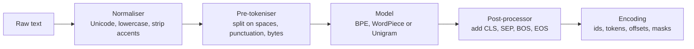

A model never sees text. It sees integer ids, produced by a tokenizer that must match the one used in pretraining exactly. Hugging Face splits this job between two libraries: `tokenizers`, a fast Rust implementation of the algorithms with Python bindings, and the tokenizer classes in `transformers`, which wrap it with model-specific conveniences such as padding, truncation and chat templates. The byte-pair encoding algorithm itself was covered in [Tokenization](/learn/generative-ai-fundamentals/tokenization). This lesson is about using the libraries well: how a tokenizer is assembled, how to train your own, and the details (offsets, padding, truncation, special tokens) that cause most real bugs.

## Fast and slow tokenizers

`AutoTokenizer.from_pretrained` returns a **fast** tokenizer whenever one exists for the model, backed by `tokenizers`. Older pure-Python "slow" tokenizers are still around for a few models.

| | Fast (`PreTrainedTokenizerFast`) | Slow (`PreTrainedTokenizer`) |
| --- | --- | --- |
| Implementation | Rust, via `tokenizers` | Python |
| Speed on large batches | Much faster, parallel | Slow |
| Offset mapping and `word_ids()` | Yes | No |
| Saved as | a single `tokenizer.json` | vocabulary and merges files |

Check with `tokenizer.is_fast`. Several features in this lesson, offsets above all, exist only on fast tokenizers.

## The four stages of a tokenizer

A `tokenizers.Tokenizer` is a pipeline of interchangeable parts. Knowing the stages tells you where to look when tokenisation surprises you.



| Stage | Example choices | Question it answers |
| --- | --- | --- |
| Normaliser | `NFKC`, `Lowercase`, `StripAccents` | Is "Café" the same as "cafe"? |
| Pre-tokeniser | `Whitespace`, `ByteLevel`, `Metaspace` | Where may a token boundary never be crossed? |
| Model | `BPE`, `WordPiece`, `Unigram` | How is each piece split into vocabulary entries? |
| Post-processor | `TemplateProcessing`, `ByteLevel` | Which special tokens wrap a sequence or pair? |

GPT-2-style tokenizers use a byte-level pre-tokeniser, which is why their tokens show a leading `Ġ` for a preceding space. BERT uses WordPiece with lowercasing, which is why its continuation pieces start with `##`.

## Training a BPE tokenizer from scratch

You train a new tokenizer when your text differs sharply from what existing tokenizers saw: a new language, source code, chemical notation, log lines. A poor fit shows up as words shattering into many tiny pieces, which wastes context length and makes learning harder.

```python
from tokenizers import Tokenizer, models, normalizers, pre_tokenizers, trainers, processors

tokenizer = Tokenizer(models.BPE(unk_token="[UNK]"))
tokenizer.normalizer = normalizers.NFKC()
tokenizer.pre_tokenizer = pre_tokenizers.Whitespace()

trainer = trainers.BpeTrainer(
    vocab_size=8000,
    min_frequency=2,
    special_tokens=["[PAD]", "[UNK]", "[CLS]", "[SEP]"],
)

def corpus():                       # any iterator of strings works
    with open("support_tickets.txt", encoding="utf-8") as f:
        for line in f:
            yield line

tokenizer.train_from_iterator(corpus(), trainer=trainer)

cls_id, sep_id = tokenizer.token_to_id("[CLS]"), tokenizer.token_to_id("[SEP]")
tokenizer.post_processor = processors.TemplateProcessing(
    single="[CLS] $A [SEP]",
    pair="[CLS] $A [SEP] $B [SEP]",
    special_tokens=[("[CLS]", cls_id), ("[SEP]", sep_id)],
)
tokenizer.save("tickets-tokenizer.json")

enc = tokenizer.encode("Printer offline again")
print(enc.tokens, enc.ids, enc.offsets)
```

Special tokens listed in the trainer get the first ids, in order, so here `[PAD]` is id 0. To use the result with `transformers` (and the `Trainer`), wrap it:

```python
from transformers import PreTrainedTokenizerFast

hf_tokenizer = PreTrainedTokenizerFast(
    tokenizer_object=tokenizer,
    unk_token="[UNK]", pad_token="[PAD]", cls_token="[CLS]", sep_token="[SEP]",
)
hf_tokenizer.save_pretrained("tickets-tokenizer")
```

If you like an existing model's pipeline (its normaliser, pre-tokeniser and special tokens) but want a vocabulary fitted to your corpus, a fast tokenizer can retrain itself: `new_tok = old_tok.train_new_from_iterator(corpus(), vocab_size=8000)`.

> [!WARNING]
> A new tokenizer means new ids, and a pretrained model's embedding table is indexed by the old ids. You cannot swap the tokenizer of a pretrained model; a custom tokenizer is for training a model from scratch, or for a model whose embeddings you are prepared to relearn.

## Encodings, offsets and word ids

Calling a fast tokenizer returns a `BatchEncoding`, a dictionary of lists or tensors plus methods that map tokens back to the text.

```python
from transformers import AutoTokenizer

tok = AutoTokenizer.from_pretrained("google-bert/bert-base-cased")
enc = tok("Ada Lovelace wrote notes.", return_offsets_mapping=True)

print(enc.tokens())          # subword strings, including [CLS] and [SEP]
print(enc["offset_mapping"]) # (start, end) character span of each token
print(enc.word_ids())        # which word each token came from; None for specials
```

Offsets are what make token-level tasks usable. A named-entity model labels tokens, but your user wants character spans in their original string: `text[start:end]` for the first and last token of an entity recovers it exactly, even if normalisation changed case or accents. Special tokens have the offset `(0, 0)`. `word_ids()` lets you align word-level labels to subword tokens, which you will do when fine-tuning a token classifier: label the first subword of each word and set the rest to `-100` so the loss ignores them.

## Padding, truncation and attention masks

Tensors must be rectangular, so a batch of different-length texts is padded to a common length, and an **attention mask** marks which positions are real (1) and which are padding (0). Here is the logic in plain Python so you can see exactly what the tokenizer produces:

```python
def pad_batch(batch, pad_id=0, max_length=None, side="right"):
    if max_length is not None:
        batch = [ids[:max_length] for ids in batch]          # truncation
    width = max(len(ids) for ids in batch)                    # pad to the longest
    input_ids, attention_mask = [], []
    for ids in batch:
        pad = [pad_id] * (width - len(ids))
        mask = [1] * len(ids)
        if side == "right":
            input_ids.append(ids + pad)
            attention_mask.append(mask + [0] * len(pad))
        else:
            input_ids.append(pad + ids)
            attention_mask.append([0] * len(pad) + mask)
    return {"input_ids": input_ids, "attention_mask": attention_mask}

batch = [[101, 7, 8, 9, 102], [101, 5, 102], [101, 4, 4, 4, 4, 4, 4, 102]]
print(pad_batch(batch, max_length=6))
print(pad_batch(batch[:2], side="left"))
```

```output
{'input_ids': [[101, 7, 8, 9, 102, 0], [101, 5, 102, 0, 0, 0], [101, 4, 4, 4, 4, 4]], 'attention_mask': [[1, 1, 1, 1, 1, 0], [1, 1, 1, 0, 0, 0], [1, 1, 1, 1, 1, 1]]}
{'input_ids': [[101, 7, 8, 9, 102], [0, 0, 101, 5, 102]], 'attention_mask': [[1, 1, 1, 1, 1], [0, 0, 1, 1, 1]]}
```

Notice the third row: naive truncation cut off the final `[SEP]` (id 102). The real tokenizer truncates the content and then adds special tokens, so they survive. That is one reason to let the library do this.

| Argument | Values and meaning |
| --- | --- |
| `padding` | `True` or `"longest"`: pad to the longest in the batch. `"max_length"`: pad to `max_length`. `False`: no padding |
| `truncation` | `True`: cut to `max_length` (or the model maximum). `"only_second"`: for pairs, cut only the second text |
| `max_length` | Target length for padding and truncation |
| `return_tensors` | `"pt"` for PyTorch tensors, `"np"` for NumPy, omitted for Python lists |
| `stride`, `return_overflowing_tokens` | Split a long text into overlapping windows instead of discarding the tail |
| `tokenizer.padding_side` | `"right"` for encoders and training; `"left"` for batched generation with decoder-only models |

> [!TIP]
> For training, pad per batch rather than to a fixed `max_length`. Tokenise without padding, and let a data collator such as `DataCollatorWithPadding` pad each batch to its own longest example. Batches of short texts then cost far less compute.

## Special tokens

| Token | Typical use |
| --- | --- |
| `[CLS]` / BOS | Start of sequence; BERT's classifier reads the `[CLS]` position |
| `[SEP]` / EOS | End of a segment; EOS also tells `generate` to stop |
| `[PAD]` | Filler for padding, masked out by the attention mask |
| `[UNK]` | Unknown piece (rare with byte-level BPE, which can encode any byte) |
| `[MASK]` | Masked position for masked-language-model pretraining |
| Chat markers | Role boundaries in chat templates, such as `<\|im_start\|>` |

Inspect them with `tokenizer.special_tokens_map` and `tokenizer.all_special_ids`. For BERT checkpoints, `[PAD]`, `[CLS]` and `[SEP]` are ids 0, 101 and 102, which is why those numbers appear in the example above.

Adding tokens changes the vocabulary size, so the model's embedding matrix must grow to match:

```python
tokenizer.add_special_tokens({"additional_special_tokens": ["<ticket>", "</ticket>"]})
model.resize_token_embeddings(len(tokenizer))   # new rows start untrained
```

Many causal LMs ship without a pad token. The common fix is `tokenizer.pad_token = tokenizer.eos_token`. It is safe for inference with an attention mask, but in training make sure padded positions get label `-100`, or the model learns to predict EOS everywhere.

## Exercises

**1.** A BERT tokenizer splits `"tokenisation"` into `["token", "##isation"]` and a GPT-2 tokenizer splits `" tokenisation"` into pieces where the first starts with `Ġ`. What do `##` and `Ġ` each signal, and which pipeline stage produces them?

<details>
<summary>Show solution</summary>

`##` is WordPiece's marker that the piece continues the previous one without a space; it comes from the model stage (WordPiece). `Ġ` is how GPT-2's byte-level pre-tokeniser represents a preceding space byte, so it marks a piece that starts a new word. Both let the decoder rebuild the original spacing.

</details>

**2.** Using `pad_batch` from this lesson, write `truncate_keep_specials(ids, max_length)` that keeps the first and last ids (the special tokens) and truncates the content between them, then show it on `[101, 4, 4, 4, 4, 4, 4, 102]` with `max_length=6`.

<details>
<summary>Show solution</summary>

```python
def truncate_keep_specials(ids, max_length):
    if len(ids) <= max_length:
        return ids
    return ids[:1] + ids[1:-1][: max_length - 2] + ids[-1:]

print(truncate_keep_specials([101, 4, 4, 4, 4, 4, 4, 102], 6))
```

```output
[101, 4, 4, 4, 4, 102]
```

</details>

**3.** In `text = "I work at  Hugging Face."` (note the double space), an entity model labels two tokens as one organisation. Their offsets are `(11, 18)` and `(19, 23)`. Write the line that extracts the entity string.

<details>
<summary>Show solution</summary>

Take the start of the first token and the end of the last:

```python
text = "I work at  Hugging Face."
print(repr(text[11:23]))
```

```output
'Hugging Face'
```

Using the offsets rather than joining token strings preserves the original casing and spacing.

</details>

```quiz
[
  {
    "q": "Which feature is available only on fast tokenizers?",
    "options": ["Padding", "Offset mapping back to character positions", "Special tokens", "Decoding ids to text"],
    "answer": 1,
    "why": "`return_offsets_mapping` and `word_ids()` come from the Rust `tokenizers` backend and are not provided by slow Python tokenizers."
  },
  {
    "q": "You add two new special tokens to a pretrained model's tokenizer. What else must you do?",
    "options": [
      "Nothing, the model handles unknown ids",
      "Retrain the tokenizer from scratch",
      "Call `model.resize_token_embeddings(len(tokenizer))` and fine-tune so the new rows learn",
      "Set `padding_side` to left"
    ],
    "answer": 2,
    "why": "New ids need rows in the embedding matrix. Resizing adds them, but they start untrained, so some fine-tuning is needed."
  },
  {
    "q": "Why is per-batch dynamic padding usually better than `padding=\"max_length\"` for training?",
    "options": [
      "It gives higher accuracy by design",
      "Batches of short texts are padded only to their own longest example, saving compute",
      "It removes the need for attention masks",
      "It prevents truncation"
    ],
    "answer": 1,
    "why": "Padding every example to a large fixed length wastes computation on pad tokens; padding per batch keeps tensors as small as possible."
  },
  {
    "q": "In a training batch where `pad_token` was set to `eos_token`, what should the labels at padded positions be?",
    "options": ["The EOS id", "0", "-100", "The pad id"],
    "answer": 2,
    "why": "-100 is ignored by the cross-entropy loss. Otherwise the model is trained to output EOS at every padded position."
  }
]
```
