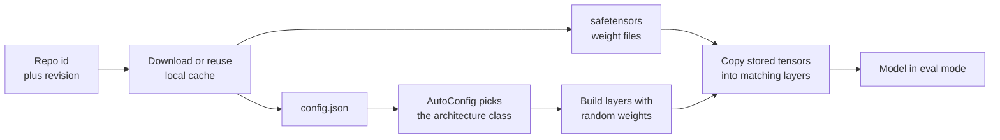
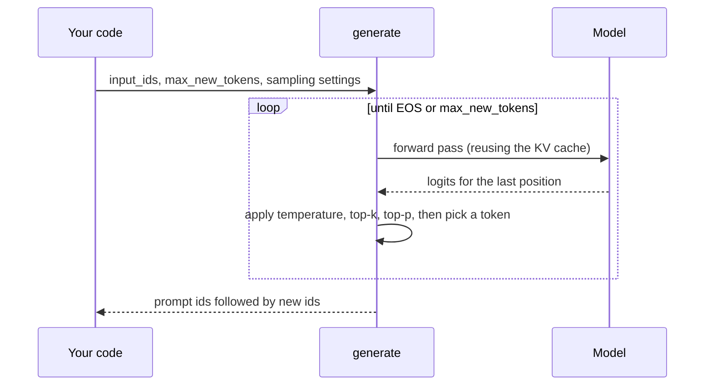

The `transformers` library is the common interface to most open-weight models. Thousands of architectures (BERT, GPT-2, Llama, Qwen, Mistral, T5, Whisper, ViT) are exposed through the same handful of classes and methods, so code that loads and runs one model usually works for another after changing a single string. You met it briefly in [Hugging Face](/learn/working-with-llms/hugging-face) and [Model loading](/learn/working-with-llms/model-loading). This lesson goes underneath: what `from_pretrained` actually builds, how model heads and outputs are organised, how `generate` works, and how chat templates turn a list of messages into the exact token sequence a model was trained on.

## Three objects behind every model

Every checkpoint on the Hub is a folder of files, and `transformers` turns that folder into three Python objects.

| Object | Built from | What it holds |
| --- | --- | --- |
| Configuration | `config.json` | Architecture hyperparameters: layer count, hidden size, number of heads, vocabulary size, label names |
| Tokenizer | `tokenizer.json`, `tokenizer_config.json` | Vocabulary, merge rules, special tokens, the chat template |
| Model | the config plus `model.safetensors` (or sharded files) | A PyTorch `nn.Module` with the trained weights loaded |

The configuration is the blueprint. The model class reads it to build empty layers of the right shapes, then fills them with the stored weights.



Files are cached on disk (under `~/.cache/huggingface` by default, or wherever the `HF_HOME` environment variable points), so the second load of the same revision does not download anything.

## Auto classes and model heads

You rarely import a model class by name. The **Auto classes** read `model_type` from the config and dispatch to the right implementation. What you choose is the **head**: the task-specific layer on top of the shared transformer body.

| Class | Head on top of the body | Output you use |
| --- | --- | --- |
| `AutoModel` | None: raw hidden states | `last_hidden_state`, shape (batch, seq, hidden) |
| `AutoModelForCausalLM` | Next-token prediction over the vocabulary | `logits`, shape (batch, seq, vocab) |
| `AutoModelForMaskedLM` | Fill in masked tokens (BERT-style) | `logits`, shape (batch, seq, vocab) |
| `AutoModelForSequenceClassification` | One label per input text | `logits`, shape (batch, num_labels) |
| `AutoModelForTokenClassification` | One label per token (NER) | `logits`, shape (batch, seq, num_labels) |
| `AutoModelForQuestionAnswering` | Start and end positions of an answer span | `start_logits`, `end_logits` |
| `AutoModelForSeq2SeqLM` | Encoder-decoder generation (T5, BART) | `logits` from the decoder |

The same body can carry different heads. Loading `bert-base-uncased` with `AutoModelForSequenceClassification` keeps the pretrained body and creates a fresh, randomly initialised classifier, and the library warns you that some weights were newly initialised. That warning is expected when you are about to fine-tune, and a red flag if you thought you were loading a finished classifier.

> [!KEY]
> The checkpoint decides the body, the Auto class decides the head. If the checkpoint was saved with the same head, every weight is restored. If not, the head starts random and must be trained.

## Loading a model and running a forward pass

```python
import torch
from transformers import AutoTokenizer, AutoModelForSequenceClassification

checkpoint = "distilbert/distilbert-base-uncased-finetuned-sst-2-english"
tokenizer = AutoTokenizer.from_pretrained(checkpoint)
model = AutoModelForSequenceClassification.from_pretrained(checkpoint)

inputs = tokenizer(
    ["The battery lasts all day.", "It broke after a week."],
    padding=True, truncation=True, return_tensors="pt",
)
with torch.no_grad():                 # inference only: skip gradient bookkeeping
    outputs = model(**inputs)

print(outputs.logits.shape)           # torch.Size([2, 2]): two texts, two labels
print(model.config.id2label)          # {0: 'NEGATIVE', 1: 'POSITIVE'}
```

`model(**inputs)` passes `input_ids` and `attention_mask` as keyword arguments. The result is a `ModelOutput` object: you can read fields by attribute (`outputs.logits`) or by key (`outputs["logits"]`). The model returns **logits**, not probabilities, so the last step is yours. Here is that post-processing on example logits, which you can run without downloading anything:

```python
import numpy as np

logits = np.array([[-3.1, 3.4], [2.8, -2.2]])     # example values for two texts
id2label = {0: "NEGATIVE", 1: "POSITIVE"}

probs = np.exp(logits) / np.exp(logits).sum(axis=1, keepdims=True)
for row in probs:
    k = int(row.argmax())
    print(id2label[k], round(float(row[k]), 4))
```

```output
POSITIVE 0.9985
NEGATIVE 0.9933
```

### Useful `from_pretrained` arguments

| Argument | Purpose |
| --- | --- |
| `revision="..."` | Pin a branch, tag or commit hash so the weights cannot change under you |
| `torch_dtype=torch.bfloat16` | Load weights in 16-bit, halving memory versus float32 (recent releases also accept the name `dtype`) |
| `device_map="auto"` | Place layers across available GPUs and CPU automatically (needs the `accelerate` package) |
| `quantization_config=...` | Load in 8-bit or 4-bit; see [Quantization](/learn/hugging-face-ecosystem/quantization) |
| `trust_remote_code=True` | Run model code shipped in the repo; only for repos you have reviewed |

`from_pretrained` returns the model in evaluation mode, so dropout is off. The `Trainer` switches it back to training mode for you; in a hand-written loop you call `model.train()` yourself.

## How `generate` works

Causal language models predict one token at a time. `generate` wraps the loop you saw in [Inference](/learn/generative-ai-fundamentals/inference): run the model, choose the next token from the last position's logits, append it, repeat until an end-of-sequence token or a length limit.



```python
from transformers import AutoTokenizer, AutoModelForCausalLM

checkpoint = "Qwen/Qwen2.5-0.5B-Instruct"
tokenizer = AutoTokenizer.from_pretrained(checkpoint)
model = AutoModelForCausalLM.from_pretrained(checkpoint, torch_dtype="auto")

inputs = tokenizer("The three primary colours are", return_tensors="pt")
output_ids = model.generate(
    **inputs,
    max_new_tokens=30,
    do_sample=True, temperature=0.7, top_p=0.9,
)
new_tokens = output_ids[0, inputs["input_ids"].shape[1]:]   # drop the echoed prompt
print(tokenizer.decode(new_tokens, skip_special_tokens=True))
```

The returned tensor contains the prompt followed by the continuation, which is why the slice removes the first `input_ids.shape[1]` positions.

| Argument | Effect |
| --- | --- |
| `max_new_tokens` | Upper limit on generated tokens (prefer it to `max_length`, which also counts the prompt) |
| `do_sample` | `False` gives greedy decoding; `True` samples from the distribution |
| `temperature`, `top_k`, `top_p` | Reshape the distribution before sampling; see [Temperature](/learn/generative-ai-fundamentals/temperature) |
| `num_beams` | Beam search when greater than 1 |
| `repetition_penalty` | Values above 1 discourage repeating earlier tokens |
| `eos_token_id`, `pad_token_id` | Which ids stop generation and fill padding |

Defaults for these live in the checkpoint's `generation_config.json`, so two models can behave differently with the same call. Set the values you care about explicitly.

## Chat templates

Instruction-tuned models were trained on conversations rendered in a specific text format with special tokens marking each role. If you send a plain string, or format messages your own way, the model sees something it was never trained on and quality drops. The tokenizer stores the correct format as a **chat template**.

```python
messages = [
    {"role": "system", "content": "You are a concise assistant."},
    {"role": "user", "content": "Name one use of a hash map."},
]

prompt_text = tokenizer.apply_chat_template(
    messages, tokenize=False, add_generation_prompt=True
)
print(prompt_text)          # inspect exactly what the model will see

input_ids = tokenizer.apply_chat_template(
    messages, add_generation_prompt=True, return_tensors="pt"
)
output_ids = model.generate(input_ids, max_new_tokens=60)
print(tokenizer.decode(output_ids[0, input_ids.shape[1]:], skip_special_tokens=True))
```

For a model using the ChatML-style format, the printed text looks roughly like this (each model family has its own markers, and some add a default system message, so treat this as illustrative):

```text
<|im_start|>system
You are a concise assistant.<|im_end|>
<|im_start|>user
Name one use of a hash map.<|im_end|>
<|im_start|>assistant
```

`add_generation_prompt=True` appends the opening of an assistant turn so the model answers instead of continuing the user's message. When building fine-tuning data you leave it off, because the assistant's reply is already in the messages.

> [!WARNING]
> Do not tokenise the output of `apply_chat_template(..., tokenize=False)` with default settings: many templates already contain the beginning-of-sequence token, and the tokenizer adds another, giving a doubled BOS. Either let `apply_chat_template` tokenise, or pass `add_special_tokens=False` when you tokenise the text yourself.

## Saving and common pitfalls

`model.save_pretrained("my-model")` and `tokenizer.save_pretrained("my-model")` write the same folder layout you downloaded, so `from_pretrained("my-model")` reloads it. `push_to_hub` uploads it, as covered in [Model Hub](/learn/hugging-face-ecosystem/model-hub).

| Symptom | Usual cause |
| --- | --- |
| Error asking for a padding token when batching a GPT-style model | Many causal LMs ship without one. Set `tokenizer.pad_token = tokenizer.eos_token` |
| Batched generation produces garbage for shorter prompts | Decoder-only models need `tokenizer.padding_side = "left"` so every prompt ends at the last position |
| Out of memory on load | Weights loading in float32. Pass a 16-bit dtype or quantise |
| Classifier predictions look random | Head was newly initialised; check the load warning |
| Rambling or role-confused chat output | Missing or wrong chat template |

## Exercises

**1.** A token-classification model returns logits of shape `(1, 7, 9)`. What do the three numbers mean, and how do you get one label per token?

<details>
<summary>Show solution</summary>

One input text, seven tokens (including special tokens), nine possible labels. Take `logits.argmax(dim=-1)` to get seven label ids, then map each through `model.config.id2label`. Ignore positions belonging to special tokens such as `[CLS]` and `[SEP]`.

</details>

**2.** You batch two prompts of different lengths into a decoder-only model and the shorter prompt's continuation is nonsense. Explain why and fix it.

<details>
<summary>Show solution</summary>

With right padding, the shorter prompt ends in pad tokens, so the model is asked to continue from padding. Pad on the left so that the real last token is at the final position for every row:

```python
tokenizer.padding_side = "left"
if tokenizer.pad_token is None:
    tokenizer.pad_token = tokenizer.eos_token
inputs = tokenizer(prompts, padding=True, return_tensors="pt")
outputs = model.generate(**inputs, max_new_tokens=40)
```

Passing the attention mask (included in `**inputs`) tells the model to ignore the padding.

</details>

**3.** Write the post-processing for a three-label sentiment model with `id2label = {0: "negative", 1: "neutral", 2: "positive"}` and logits `[[0.2, 0.1, 2.3]]`. Print the label and its probability.

<details>
<summary>Show solution</summary>

```python
import numpy as np

logits = np.array([[0.2, 0.1, 2.3]])
id2label = {0: "negative", 1: "neutral", 2: "positive"}
probs = np.exp(logits) / np.exp(logits).sum(axis=1, keepdims=True)
k = int(probs[0].argmax())
print(id2label[k], round(float(probs[0, k]), 3))
```

```output
positive 0.811
```

</details>

```quiz
[
  {
    "q": "You load `bert-base-uncased` with `AutoModelForSequenceClassification` and see a warning that some weights were newly initialised. What does it mean?",
    "options": [
      "The download was corrupted",
      "The classification head did not exist in the checkpoint and starts random",
      "The tokenizer and model do not match",
      "The model was loaded in the wrong dtype"
    ],
    "answer": 1,
    "why": "The checkpoint contains the pretrained body only. The classifier head is created fresh and must be fine-tuned before its predictions mean anything."
  },
  {
    "q": "What does `add_generation_prompt=True` do in `apply_chat_template`?",
    "options": [
      "Adds a default system prompt",
      "Turns on sampling",
      "Appends the start of an assistant turn so the model replies",
      "Removes special tokens"
    ],
    "answer": 2,
    "why": "It ends the rendered text with the assistant-turn opener, so the next tokens the model predicts are the assistant's answer."
  },
  {
    "q": "Why do you slice `output_ids[0, inputs[\"input_ids\"].shape[1]:]` after `generate`?",
    "options": [
      "To remove padding",
      "Because `generate` returns the prompt tokens followed by the new tokens",
      "To drop the end-of-sequence token",
      "To convert ids to text"
    ],
    "answer": 1,
    "why": "For decoder-only models the output includes the prompt. Slicing past its length keeps only the generated continuation."
  },
  {
    "q": "Which `generate` argument limits only the number of newly generated tokens?",
    "options": ["`max_length`", "`num_beams`", "`top_k`", "`max_new_tokens`"],
    "answer": 3,
    "why": "`max_new_tokens` counts only generated tokens; `max_length` includes the prompt, which makes it depend on prompt length."
  }
]
```
