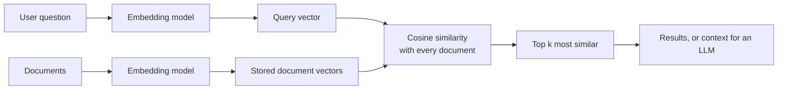

The dot product takes two vectors and returns a single number that measures how much they point the same way. It is the most used operation in AI. Every neuron computes one. Every entry of a matrix product is one. Attention in a Transformer is built from them, and semantic search, the retrieval step behind RAG systems, is little more than computing dot products between a question's embedding and millions of document embeddings and keeping the largest. Once you see the dot product as "alignment", a great deal of machine learning becomes readable.

## The algebraic definition

For two vectors of the same length $n$, multiply matching components and add the results:

$$
\mathbf{a} \cdot \mathbf{b} = \sum_{i=1}^{n} a_i b_i = a_1 b_1 + a_2 b_2 + \dots + a_n b_n
$$

$$
\begin{bmatrix} 1 \\ 2 \\ 3 \end{bmatrix} \cdot \begin{bmatrix} 4 \\ 5 \\ 6 \end{bmatrix} = 1 \cdot 4 + 2 \cdot 5 + 3 \cdot 6 = 4 + 10 + 18 = 32
$$

The result is a **scalar**, not a vector. You will also see it written $\mathbf{a}^\top \mathbf{b}$: a $1 \times n$ row times an $n \times 1$ column is a $1 \times 1$ matrix, one number. That notation shows the link to [matrix multiplication](/learn/linear-algebra/matrix-multiplication): entry $(i, j)$ of $AB$ is the dot product of row $i$ of $A$ with column $j$ of $B$.

In plain Python, `zip` and `sum` express the formula directly:

```python
def dot(a, b):
    if len(a) != len(b):
        raise ValueError("vectors must have the same length")
    return sum(x * y for x, y in zip(a, b))

print(dot([1, 2, 3], [4, 5, 6]))
```

```output
32
```

NumPy, the library we will study properly in Phase 3, offers `np.dot(a, b)` and the `@` operator, which do the same for one-axis arrays:

```python
import numpy as np

a = np.array([1, 2, 3])
b = np.array([4, 5, 6])
print(np.dot(a, b), a @ b)
```

```output
32 32
```

Do not confuse this with `a * b`, which is the element-wise product `[4, 10, 18]`. The dot product is the **sum** of that.

## The geometric meaning

The algebra hides a remarkable fact. The dot product also equals

$$
\mathbf{a} \cdot \mathbf{b} = \lVert \mathbf{a} \rVert \, \lVert \mathbf{b} \rVert \cos\theta
$$

where $\lVert \mathbf{a} \rVert$ is the length of $\mathbf{a}$ and $\theta$ is the angle between the two arrows. Lengths are always positive, so the **sign** of the dot product depends only on the angle:

| Angle $\theta$ | $\cos\theta$ | Dot product | Meaning |
| --- | --- | --- | --- |
| 0 degrees | 1 | Largest positive | Same direction |
| Under 90 degrees | Positive | Positive | Broadly aligned |
| 90 degrees | 0 | Zero | Perpendicular (**orthogonal**): unrelated |
| Over 90 degrees | Negative | Negative | Broadly opposed |
| 180 degrees | -1 | Most negative | Opposite directions |

For example, $(3, 4) \cdot (4, -3) = 12 - 12 = 0$, so those two vectors are at right angles. You can confirm it by sketching them.

### Length from the dot product

Dotting a vector with itself gives the sum of its squared components, which by Pythagoras is its squared length:

$$
\mathbf{a} \cdot \mathbf{a} = a_1^2 + a_2^2 + \dots + a_n^2 = \lVert \mathbf{a} \rVert^2
\qquad\text{so}\qquad
\lVert \mathbf{a} \rVert = \sqrt{\mathbf{a} \cdot \mathbf{a}}
$$

The length of $(3, 4)$ is $\sqrt{9 + 16} = 5$. Length, also called the norm, gets a full lesson in [norms and distances](/learn/linear-algebra/norms-and-distances).

### Projection

The dot product also measures how far one vector reaches in the direction of another. If $\mathbf{u}$ has length 1 (a **unit vector**), then $\mathbf{a} \cdot \mathbf{u}$ is the length of $\mathbf{a}$'s shadow on the line through $\mathbf{u}$: the **scalar projection**. With $\mathbf{u} = (1, 0)$, the projection of $(3, 4)$ is $3$, its horizontal component. [PCA](/learn/unsupervised-learning/principal-component-analysis-pca) uses exactly this to project data onto its most important directions.

## Cosine similarity

Rearranging the geometric formula gives the cosine of the angle on its own:

$$
\cos\theta = \frac{\mathbf{a} \cdot \mathbf{b}}{\lVert \mathbf{a} \rVert \, \lVert \mathbf{b} \rVert}
$$

This is **cosine similarity**. It ranges from $-1$ to $1$ and ignores length entirely: only direction counts. Doubling a vector does not change its cosine similarity with anything.

That property is why cosine similarity is the standard way to compare **embeddings**. An embedding model maps text to a vector so that texts with related meanings point in similar directions. Their lengths carry little meaning and can be affected by things like text length, so comparing direction is what you want.

### Semantic search in a dozen lines

Here is the core of semantic search with toy 4-dimensional embeddings. Real embeddings come from a model and have hundreds or thousands of dimensions; these are hand-made so you can see what is happening (imagine the four components loosely mean "pet", "care", "vehicle", "mechanics").

```python
import math

def dot(a, b):
    return sum(x * y for x, y in zip(a, b))

def cosine_similarity(a, b):
    return dot(a, b) / (math.sqrt(dot(a, a)) * math.sqrt(dot(b, b)))

docs = {
    "How to care for a new kitten": [0.9, 0.8, 0.1, 0.0],
    "Choosing the right cat food": [0.8, 0.9, 0.0, 0.2],
    "Fixing a noisy car engine": [0.1, 0.0, 0.9, 0.8],
    "Best family cars this year": [0.0, 0.2, 0.8, 0.9],
}
query = [0.85, 0.8, 0.05, 0.1]   # "my cat is not eating"

ranked = sorted(docs.items(), key=lambda kv: cosine_similarity(query, kv[1]), reverse=True)
for title, vec in ranked:
    print(f"{cosine_similarity(query, vec):.3f}  {title}")
```

```output
0.995  How to care for a new kitten
0.992  Choosing the right cat food
0.203  Best family cars this year
0.148  Fixing a noisy car engine
```

The query shares no words with "Choosing the right cat food", yet it ranks near the top because the vectors point the same way. That is the advantage of searching by meaning rather than by keywords.



You will build this properly in [semantic search](/learn/rag-fundamentals/semantic-search). With millions of documents, vector databases use approximate methods to avoid comparing against every vector, but the score they approximate is this one.

### Raw dot product versus cosine

Without the normalisation, long vectors win even when they point elsewhere:

```python
import numpy as np

q = np.array([1.0, 0.0])
a = np.array([1.0, 0.1])   # almost the same direction as q, short
b = np.array([3.0, 3.0])   # 45 degrees away, long

for name, v in [("a", a), ("b", b)]:
    cos = (q @ v) / (np.sqrt(q @ q) * np.sqrt(v @ v))
    print(name, "dot =", round(float(q @ v), 3), "cosine =", round(float(cos), 3))
```

```output
a dot = 1.0 cosine = 0.995
b dot = 3.0 cosine = 0.707
```

The raw dot product prefers `b`; cosine similarity correctly prefers `a`.

> [!TIP]
> If you scale every vector to length 1 once, when you store it, then the dot product **is** the cosine similarity, and the expensive division disappears from every query. Many embedding pipelines and vector databases normalise vectors for exactly this reason.

## The dot product inside models

| Where | What is dotted | What the number means |
| --- | --- | --- |
| A single neuron | Weights $\mathbf{w}$ and input $\mathbf{x}$ | How strongly the input matches the pattern the neuron detects |
| Linear and logistic regression | $\mathbf{w}^\top \mathbf{x} + b$ | The model's score before any squashing |
| Attention | A query and a key vector | How much one token should attend to another |
| Recommendation | User vector and item vector | Predicted preference |
| Semantic search | Query and document embeddings | Relevance |

A neuron computes $z = \mathbf{w} \cdot \mathbf{x} + b$, and the geometric view explains what it does: $z$ is large when the input points in the same direction as the weight vector. The weights are a template, and the neuron measures how well each input matches it. [Perceptrons](/learn/neural-network-fundamentals/perceptrons) build on exactly this.

Attention computes the dot product of every query with every key at once as the matrix product $QK^\top$, then scales the scores by $1/\sqrt{d}$ (where $d$ is the vector length) because dot products of long vectors grow large. You will meet it fully in [attention mechanisms](/learn/advanced-nlp/attention-mechanisms).

> [!KEY]
> The dot product measures alignment. Positive means "pointing the same way", zero means "unrelated", negative means "opposed". Cosine similarity is the same idea with length removed.

## Exercises

**1.** Compute $(2, -1, 3) \cdot (1, 4, 0)$ and $(2, -1, 3) \cdot (3, 0, -2)$ by hand. What does the second answer tell you about the two vectors?

<details>
<summary>Show solution</summary>

First: $2 - 4 + 0 = -2$. Second: $6 + 0 - 6 = 0$. A dot product of zero means the vectors are orthogonal: at right angles to each other.

</details>

**2.** Find the angle between $(1, 0)$ and $(1, 1)$ in degrees, using only plain Python and the `math` module.

<details>
<summary>Show solution</summary>

```python
import math

a, b = [1, 0], [1, 1]
d = sum(x * y for x, y in zip(a, b))
cos = d / (math.sqrt(sum(x * x for x in a)) * math.sqrt(sum(x * x for x in b)))
print(round(math.degrees(math.acos(cos)), 2))   # 45.0
```

$\cos\theta = 1 / (1 \cdot \sqrt{2}) \approx 0.707$, which is 45 degrees.

</details>

**3.** Write `normalise(v)` that returns `v` scaled to length 1. Then show, for `a = [3, 4]` and `b = [1, 2]`, that the dot product of the normalised vectors equals the cosine similarity of the originals.

<details>
<summary>Show solution</summary>

```python
import math

def dot(a, b):
    return sum(x * y for x, y in zip(a, b))

def normalise(v):
    length = math.sqrt(dot(v, v))
    return [x / length for x in v]

a, b = [3, 4], [1, 2]
print(round(dot(normalise(a), normalise(b)), 6))
print(round(dot(a, b) / (math.sqrt(dot(a, a)) * math.sqrt(dot(b, b))), 6))
```

Both print `0.98387`: $11 / (5\sqrt{5})$.

</details>

```quiz
[
  {
    "q": "What is `[1, 2, 3]` dotted with `[0, -1, 2]`?",
    "options": ["`[0, -2, 6]`", "6", "0", "4"],
    "answer": 3,
    "why": "1 times 0 + 2 times -1 + 3 times 2 = 0 - 2 + 6 = 4. The result is a scalar, not a vector."
  },
  {
    "q": "Two embedding vectors have a dot product of exactly 0. What does that mean geometrically?",
    "options": ["They are identical", "One of them is the zero vector or they are orthogonal", "They point in opposite directions", "They have the same length"],
    "answer": 1,
    "why": "a dot b = |a||b|cos(theta). It is zero when the angle is 90 degrees or when one vector has zero length."
  },
  {
    "q": "Why is cosine similarity usually preferred to the raw dot product for comparing embeddings?",
    "options": ["It is faster to compute", "It works on vectors of different lengths", "It depends only on direction, so long vectors do not win just by being long", "It always returns a positive number"],
    "answer": 2,
    "why": "Dividing by both lengths removes magnitude, leaving only the angle. It can still be negative."
  },
  {
    "q": "If every stored embedding and the query are normalised to length 1, the dot product equals:",
    "options": ["The cosine similarity", "The Euclidean distance", "Zero", "The sum of the entries"],
    "answer": 0,
    "why": "Cosine similarity divides the dot product by both lengths. When both lengths are 1, the division changes nothing."
  }
]
```
