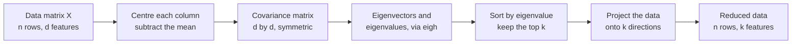

When a matrix transforms space, most vectors get knocked off their original line: they are rotated as well as stretched. But for many matrices there are a few special directions where the matrix does nothing except stretch or shrink. Those directions are the **eigenvectors**, and the stretch factors are the **eigenvalues**. They summarise what a matrix "really does" in a handful of numbers. In AI they are the engine of Principal Component Analysis (PCA), which finds the directions along which data varies most; they explain why repeated multiplication by the same matrix makes signals explode or vanish in deep and recurrent networks; and they underlie spectral methods for graphs, including the original idea behind PageRank.

## The idea in one picture

Take the matrix

$$
A = \begin{bmatrix} 2 & 1 \\ 1 & 2 \end{bmatrix}
$$

and apply it to a few vectors:

| Input $\mathbf{x}$ | Output $A\mathbf{x}$ | Same line as the input? |
| --- | --- | --- |
| $(1, 0)$ | $(2, 1)$ | No: it has turned |
| $(0, 1)$ | $(1, 2)$ | No |
| $(1, 1)$ | $(3, 3)$ | Yes: 3 times as long |
| $(1, -1)$ | $(1, -1)$ | Yes: unchanged, a factor of 1 |

Most inputs change direction. But $(1, 1)$ comes out pointing the same way, three times longer, and $(1, -1)$ comes out exactly as it went in. Those are the eigenvectors of $A$, with eigenvalues 3 and 1. Geometrically, $A$ stretches space by a factor of 3 along the diagonal line $y = x$ and leaves the perpendicular line $y = -x$ alone. Every other vector is a mix of those two directions, which is why it gets turned.

## The definition

A non-zero vector $\mathbf{v}$ is an **eigenvector** of a square matrix $A$, with **eigenvalue** $\lambda$ (the Greek letter lambda, a scalar), if

$$
A\mathbf{v} = \lambda\mathbf{v}
$$

Multiplying by the matrix has the same effect as multiplying by a single number. The eigenvalue tells you what happens along that direction:

| Eigenvalue | Effect along the eigenvector |
| --- | --- |
| $\lambda > 1$ | Stretched |
| $0 < \lambda < 1$ | Shrunk |
| $\lambda = 1$ | Unchanged |
| $\lambda = 0$ | Squashed to zero, so $A$ is singular |
| $\lambda < 0$ | Flipped to point the other way, and scaled by its size |

Any non-zero multiple of an eigenvector is also an eigenvector with the same eigenvalue: $(2, 2)$ and $(-5, -5)$ work just as well as $(1, 1)$. What matters is the **direction**, so software usually returns eigenvectors scaled to length 1, with an arbitrary sign.

## Finding them by hand

Rewrite $A\mathbf{v} = \lambda\mathbf{v}$ as $A\mathbf{v} - \lambda I\mathbf{v} = \mathbf{0}$, using the [identity matrix](/learn/linear-algebra/identity-matrix) so both terms are matrices:

$$
(A - \lambda I)\mathbf{v} = \mathbf{0}
$$

We need a **non-zero** $\mathbf{v}$ that the matrix $A - \lambda I$ sends to zero. That can only happen if $A - \lambda I$ flattens space, which means it is singular and its [determinant](/learn/linear-algebra/transpose-and-inverse) is zero:

$$
\det(A - \lambda I) = 0
$$

This is the **characteristic equation**. For our matrix:

$$
\det \begin{bmatrix} 2 - \lambda & 1 \\ 1 & 2 - \lambda \end{bmatrix} = (2 - \lambda)^2 - 1 = 0
\quad\Rightarrow\quad 2 - \lambda = \pm 1
\quad\Rightarrow\quad \lambda = 3 \text{ or } \lambda = 1
$$

To find the eigenvector for $\lambda = 3$, solve $(A - 3I)\mathbf{v} = \mathbf{0}$:

$$
\begin{bmatrix} -1 & 1 \\ 1 & -1 \end{bmatrix}\begin{bmatrix} v_1 \\ v_2 \end{bmatrix} = \mathbf{0}
\quad\Rightarrow\quad -v_1 + v_2 = 0
\quad\Rightarrow\quad \mathbf{v} = (1, 1)
$$

The same steps with $\lambda = 1$ give $v_1 + v_2 = 0$, so $\mathbf{v} = (1, -1)$.

Two useful checks: the eigenvalues add up to the sum of the diagonal entries ($3 + 1 = 2 + 2$) and multiply to the determinant ($3 \times 1 = 2 \cdot 2 - 1 \cdot 1$).

By hand this is practical only for $2 \times 2$ matrices. For anything larger, use a library.

## Eigenvalues in NumPy

NumPy, the library we will study properly in Phase 3, has `np.linalg.eigh` for **symmetric** matrices (those equal to their own transpose, like ours) and `np.linalg.eig` for general square matrices. Use `eigh` whenever the matrix is symmetric: it is faster, more accurate, and guarantees real results.

```python
import numpy as np

A = np.array([[2.0, 1.0], [1.0, 2.0]])
values, vectors = np.linalg.eigh(A)
print(values)
print(vectors.round(4))
```

```output
[1. 3.]
[[-0.7071  0.7071]
 [ 0.7071  0.7071]]
```

Read this carefully. `eigh` returns the eigenvalues in **ascending** order, and the eigenvectors are the **columns** of `vectors`, not the rows. Column 0, $(-0.7071, 0.7071)$, goes with eigenvalue 1: it is $(1, -1)$ scaled to length 1 with its sign flipped. Column 1 is $(1, 1)$ scaled to length 1, and goes with eigenvalue 3.

### Not every matrix has real eigenvectors

A rotation by 90 degrees turns **every** vector, so no real direction stays on its line. The eigenvalues come out as complex numbers:

```python
import numpy as np

rotate = np.array([[0.0, -1.0], [1.0, 0.0]])
print(np.linalg.eig(rotate)[0])
```

```output
[0.+1.j 0.-1.j]
```

You will rarely need complex eigenvalues in applied AI. The matrices you meet most, covariance matrices and other symmetric matrices, always have real eigenvalues and perpendicular eigenvectors.

## Repeated multiplication and the dominant eigenvector

What happens if you apply the same matrix again and again? Each time, the component along the eigenvector with eigenvalue 3 triples, while the component along the other stays the same size. After a few rounds the first direction dominates completely. **Power iteration** uses this to find the largest eigenvalue's eigenvector in plain Python, rescaling each step so the numbers stay manageable:

```python
import math

A = [[2, 1], [1, 2]]
v = [1.0, 0.0]                      # any starting vector

for step in range(1, 7):
    w = [sum(A[i][k] * v[k] for k in range(2)) for i in range(2)]   # w = A v
    length = math.sqrt(sum(x * x for x in w))
    v = [x / length for x in w]                                     # rescale to length 1
    print(step, [round(x, 4) for x in v])

Av = [sum(A[i][k] * v[k] for k in range(2)) for i in range(2)]
print("eigenvalue estimate:", round(sum(a * b for a, b in zip(v, Av)), 4))
```

```output
1 [0.8944, 0.4472]
2 [0.7809, 0.6247]
3 [0.7328, 0.6805]
4 [0.7158, 0.6983]
5 [0.71, 0.7042]
6 [0.7081, 0.7061]
eigenvalue estimate: 3.0
```

The vector converges towards $(0.7071, 0.7071)$, the direction of $(1, 1)$. The last line estimates the eigenvalue with the dot product $\mathbf{v} \cdot A\mathbf{v}$, which works because $\mathbf{v}$ has length 1.

This behaviour matters directly in deep learning. A recurrent network multiplies its hidden state by the same weight matrix at every time step. If the largest eigenvalue magnitude is above 1, signals (and gradients) grow exponentially and **explode**; if every magnitude is below 1, they shrink towards zero and **vanish**. That is one root of the difficulties that motivated architectures like LSTMs, covered in [sequence models](/learn/sequence-models). PageRank applies the same idea to the link structure of the web: page importance is the dominant eigenvector of a matrix describing how a random surfer moves between pages.

> [!KEY]
> Eigenvectors are the directions a matrix only stretches; eigenvalues are the stretch factors. Repeatedly applying a matrix amplifies the direction with the largest eigenvalue and suppresses the rest.

## PCA: eigenvectors of the covariance matrix

**Principal Component Analysis** reduces the number of features while keeping as much of the data's spread as possible. Its core is one eigen-decomposition. The **covariance matrix** of a dataset (introduced properly in [correlation and covariance](/learn/probability-and-statistics/correlation-and-covariance)) records how much each pair of features varies together. It is symmetric, and its eigenvectors have a precise meaning:

- The eigenvector with the largest eigenvalue is the direction along which the data varies most: the **first principal component**.
- Each eigenvalue equals the variance of the data along its eigenvector.
- The eigenvectors are perpendicular, so the components carry non-overlapping information.



Here is the whole pipeline on ten points with two strongly correlated features:

```python
import numpy as np

data = np.array([
    [2.5, 2.4], [0.5, 0.7], [2.2, 2.9], [1.9, 2.2], [3.1, 3.0],
    [2.3, 2.7], [2.0, 1.6], [1.0, 1.1], [1.5, 1.6], [1.1, 0.9],
])

centred = data - data.mean(axis=0)                 # 1. centre each feature
cov = centred.T @ centred / (len(data) - 1)        # 2. covariance matrix, 2 by 2
values, vectors = np.linalg.eigh(cov)              # 3. eigen-decomposition

order = np.argsort(values)[::-1]                   # 4. sort, largest first
values, vectors = values[order], vectors[:, order]

print("covariance:\n", cov.round(4))
print("eigenvalues:", values.round(4))
print("first component:", vectors[:, 0].round(4))
print("variance explained:", (values / values.sum()).round(4))

projected = centred @ vectors[:, 0]                # 5. project onto 1 dimension
print("1-D data:", projected.round(2))
```

```output
covariance:
 [[0.6166 0.6154]
 [0.6154 0.7166]]
eigenvalues: [1.284  0.0491]
first component: [0.6779 0.7352]
variance explained: [0.9632 0.0368]
1-D data: [ 0.83 -1.78  0.99  0.27  1.68  0.91 -0.1  -1.14 -0.44 -1.22]
```

The first component points roughly along the diagonal, the direction in which both features rise together, and it holds about 96 percent of the total variance. Projecting each point onto it, a [dot product](/learn/linear-algebra/dot-product) per point, replaces two numbers with one while losing very little. Depending on your platform, the component and the projected values may come out with the opposite sign, which describes the same line. With real data you might reduce hundreds of features, or high-dimensional embeddings, to a handful for plotting or faster models. You will use scikit-learn's implementation in [PCA](/learn/unsupervised-learning/principal-component-analysis-pca).

> [!NOTE]
> Libraries usually compute PCA through the singular value decomposition (SVD) of the centred data rather than by forming the covariance matrix, because it is more numerically stable. The answers are the same; the eigenvector picture is the way to understand them.

## Exercises

**1.** Find the eigenvalues and eigenvectors of $\begin{bmatrix} 4 & 0 \\ 0 & 2 \end{bmatrix}$ without the characteristic equation. What do you notice about diagonal matrices?

<details>
<summary>Show solution</summary>

The matrix stretches the horizontal axis by 4 and the vertical axis by 2 and does nothing else, so $(1, 0)$ is an eigenvector with eigenvalue 4 and $(0, 1)$ is an eigenvector with eigenvalue 2. For any diagonal matrix, the eigenvalues are the diagonal entries and the eigenvectors are the standard basis vectors.

</details>

**2.** Use the characteristic equation to find the eigenvalues of $\begin{bmatrix} 5 & 2 \\ 2 & 2 \end{bmatrix}$, then check with `np.linalg.eigh`.

<details>
<summary>Show solution</summary>

$(5 - \lambda)(2 - \lambda) - 4 = \lambda^2 - 7\lambda + 6 = (\lambda - 6)(\lambda - 1) = 0$, so $\lambda = 6$ or $1$. They sum to $7 = 5 + 2$ and multiply to $6 = \det$.

```python
import numpy as np
print(np.linalg.eigh(np.array([[5.0, 2.0], [2.0, 2.0]]))[0])   # [1. 6.]
```

</details>

**3.** A recurrent network's weight matrix has eigenvalues 1.1 and 0.5. Roughly how much is a signal along the first eigenvector scaled after 50 time steps, and along the second? What problem does each illustrate?

<details>
<summary>Show solution</summary>

$1.1^{50} \approx 117$: the first component grows more than a hundredfold, the exploding problem. $0.5^{50} \approx 8.9 \times 10^{-16}$: the second component effectively disappears, the vanishing problem.

</details>

```quiz
[
  {
    "q": "If `A v = 4 v` for a non-zero vector `v`, what is true?",
    "options": ["`v` is an eigenvector of `A` with eigenvalue 4", "`A` is the identity matrix", "`A` has determinant 0", "`v` must have length 4"],
    "answer": 0,
    "why": "That is the definition: A only scales v, by the factor 4. The length of v is irrelevant because any multiple of v also works."
  },
  {
    "q": "What do the eigenvectors of a covariance matrix represent in PCA?",
    "options": ["The cluster centres", "The mean of each feature", "Perpendicular directions of variation, with eigenvalues giving the variance along each", "The rows of the original data"],
    "answer": 2,
    "why": "The top eigenvector is the direction of greatest variance, the first principal component, and each eigenvalue is the variance along its direction."
  },
  {
    "q": "`np.linalg.eigh(A)` returns `values, vectors`. Where is the eigenvector for `values[0]`?",
    "options": ["`vectors[0]`, the first row", "`vectors[:, 0]`, the first column", "`vectors[-1]`", "It is not returned"],
    "answer": 1,
    "why": "Eigenvectors are the columns of the returned matrix. Reading rows is a common and silent mistake."
  },
  {
    "q": "Why can repeated multiplication by the same matrix make gradients explode?",
    "options": ["Because matrix multiplication is not commutative", "Because the matrix has no inverse", "Because eigenvalues are always above 1", "Because components along eigenvectors with eigenvalue magnitude above 1 grow exponentially"],
    "answer": 3,
    "why": "Each multiplication scales the component along an eigenvector by its eigenvalue, so after t steps it is scaled by the eigenvalue to the power t."
  }
]
```
