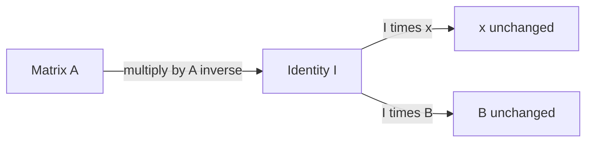
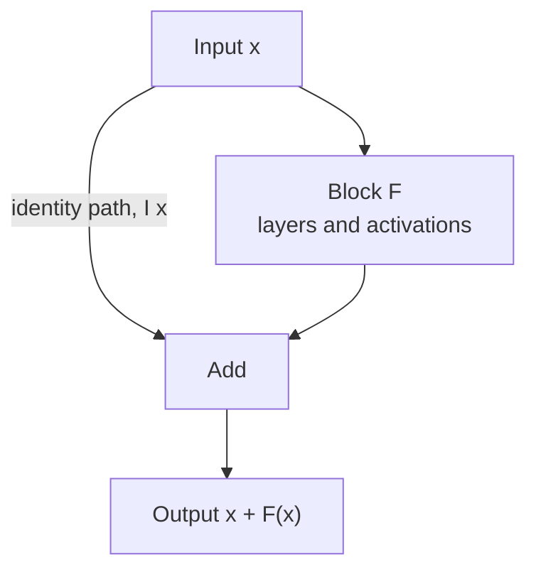

The number 1 is special because multiplying by it changes nothing. Matrices have an equivalent: the **identity matrix** $I$, the transformation that leaves every vector exactly where it is. A matrix that does nothing sounds useless, but it is the reference point for the rest of linear algebra. The inverse is defined by reaching it, eigenvalues are found by subtracting multiples of it, and in AI it shows up as one-hot vectors, as the fix that makes ridge regression solvable, and as the "do nothing" path that lets very deep networks train through residual connections.

## Definition

The $n \times n$ identity matrix $I_n$ has 1s on the main diagonal and 0s everywhere else:

$$
I_2 = \begin{bmatrix} 1 & 0 \\ 0 & 1 \end{bmatrix}
\qquad
I_3 = \begin{bmatrix} 1 & 0 & 0 \\ 0 & 1 & 0 \\ 0 & 0 & 1 \end{bmatrix}
\qquad
I_{ij} = \begin{cases} 1 & \text{if } i = j \\ 0 & \text{if } i \neq j \end{cases}
$$

The subscript $n$ is often dropped when the size is clear from context. The identity is always square.

Its defining property is that multiplying by it, on either side, changes nothing:

$$
I\mathbf{x} = \mathbf{x}, \qquad IA = AI = A
$$

for any vector $\mathbf{x}$ or matrix $A$ whose shape fits. To see why, use the row view of [matrix multiplication](/learn/linear-algebra/matrix-multiplication): row $i$ of $I$ has a single 1 in position $i$, so combining it with $\mathbf{x}$ picks out exactly $x_i$ and ignores the rest.

$$
\begin{bmatrix} 1 & 0 & 0 \\ 0 & 1 & 0 \\ 0 & 0 & 1 \end{bmatrix}
\begin{bmatrix} 7 \\ -2 \\ 5 \end{bmatrix}
=
\begin{bmatrix} 1 \cdot 7 + 0 \cdot (-2) + 0 \cdot 5 \\ 0 \cdot 7 + 1 \cdot (-2) + 0 \cdot 5 \\ 0 \cdot 7 + 0 \cdot (-2) + 1 \cdot 5 \end{bmatrix}
=
\begin{bmatrix} 7 \\ -2 \\ 5 \end{bmatrix}
$$

## The geometric picture

Recall that the columns of a matrix show where the basis arrows $(1, 0)$ and $(0, 1)$ land. The columns of $I_2$ are $(1, 0)$ and $(0, 1)$ themselves: every arrow lands exactly where it started. Nothing is stretched, rotated or flattened.

Those columns have a name. The **standard basis vectors** $\mathbf{e}_1, \mathbf{e}_2, \dots, \mathbf{e}_n$ are the columns of $I_n$: $\mathbf{e}_i$ has a 1 in position $i$ and 0s elsewhere. Every vector is a combination of them, $\mathbf{x} = x_1\mathbf{e}_1 + x_2\mathbf{e}_2 + \dots + x_n\mathbf{e}_n$, which is the starting point for [vector spaces](/learn/linear-algebra/vector-spaces).

## Building one in code

In plain Python, a nested comprehension with a condition does it:

```python
def identity(n):
    return [[1 if i == j else 0 for j in range(n)] for i in range(n)]

for row in identity(3):
    print(row)
```

```output
[1, 0, 0]
[0, 1, 0]
[0, 0, 1]
```

NumPy, the library we will study properly in Phase 3, has `np.eye`. It returns floats by default:

```python
import numpy as np

print(np.eye(3))
```

```output
[[1. 0. 0.]
 [0. 1. 0.]
 [0. 0. 1.]]
```

## The identity and the inverse

The [inverse](/learn/linear-algebra/transpose-and-inverse) is defined by reference to $I$: $A^{-1}$ is the matrix with $A^{-1}A = I$. "Undo the transformation" and "end up at the do-nothing transformation" are the same statement. Solving $A\mathbf{x} = \mathbf{b}$ by hand is a sequence of steps that turn $A$ into $I$, at which point the equation reads $I\mathbf{x} = \mathbf{x} = \text{answer}$.



## Diagonal and scaled identity matrices

Relax "1s on the diagonal" to "anything on the diagonal" and you get a **diagonal matrix**, written $\operatorname{diag}(d_1, \dots, d_n)$. It scales each axis independently:

$$
\begin{bmatrix} 2 & 0 \\ 0 & 0.5 \end{bmatrix}\begin{bmatrix} 3 \\ 4 \end{bmatrix} = \begin{bmatrix} 6 \\ 2 \end{bmatrix}
$$

```python
import numpy as np

D = np.diag([2.0, 0.5])
print(D)
print(D @ np.array([3.0, 4.0]))
```

```output
[[2.  0. ]
 [0.  0.5]]
[6. 2.]
```

Scaling each feature of a dataset by its own factor, as in standardisation, is multiplication by a diagonal matrix. A **scaled identity** $cI$ is the special case where every diagonal entry is the same: $cI\mathbf{x} = c\mathbf{x}$, a uniform zoom.

| Matrix | Effect |
| --- | --- |
| $I$ | Nothing changes |
| $cI$ | Every vector is scaled by $c$ |
| $\operatorname{diag}(d_1, \dots, d_n)$ | Axis $i$ is scaled by $d_i$ |
| $0$ (all zeros) | Every vector is sent to the origin |

## The identity in AI

### One-hot vectors and embedding lookups

A **one-hot vector** has a single 1 and 0s elsewhere, so it is a standard basis vector, a row (or column) of $I$. Models use one-hot vectors to represent categories: with a vocabulary of 4 tokens, token 2 is $(0, 0, 1, 0)$ when counting from 0.

Multiply a one-hot row vector by a matrix and you select one row of that matrix. That is exactly what an **embedding layer** does: it holds an embedding matrix $E$ with one row per token, and looking up a token's embedding is the product of its one-hot vector with $E$.

```python
import numpy as np

E = np.array([[0.1, 0.3, -0.2],     # embedding of token 0
              [0.5, -0.1, 0.4],     # token 1
              [-0.3, 0.8, 0.0],     # token 2
              [0.2, 0.2, 0.9]])     # token 3

one_hot = np.eye(4)[2]
print(one_hot)
print(one_hot @ E)
print(E[2])
```

```output
[0. 0. 1. 0.]
[-0.3  0.8  0. ]
[-0.3  0.8  0. ]
```

The multiplication and the plain index give the same answer. Real libraries use the index, because multiplying by a vector that is almost all zeros wastes work, but thinking of it as a multiplication explains why embeddings can be trained like any other weight matrix.

### Ridge regression: adding a little identity

The [previous lesson](/learn/linear-algebra/transpose-and-inverse) ended with a problem: if one feature is an exact multiple of another, $X^\top X$ is singular and the normal equation has no solution.

```python
import numpy as np

x = np.array([1.0, 2.0, 3.0, 4.0])
X = np.column_stack([np.ones(4), x, 2 * x])   # third column duplicates the second
y = np.array([3.0, 5.0, 7.0, 9.0])

print(np.linalg.det(X.T @ X))
```

```output
0.0
```

**Ridge regression** adds a small multiple of the identity before solving:

$$
\mathbf{w} = (X^\top X + \lambda I)^{-1} X^\top \mathbf{y}
$$

where $\lambda > 0$ is the regularisation strength. Adding $\lambda$ to every diagonal entry pushes the matrix away from singular, so a unique solution always exists. It also penalises large weights, which reduces overfitting, as you will see in [norms and distances](/learn/linear-algebra/norms-and-distances).

```python
import numpy as np

x = np.array([1.0, 2.0, 3.0, 4.0])
X = np.column_stack([np.ones(4), x, 2 * x])
y = np.array([3.0, 5.0, 7.0, 9.0])

lam = 0.1
w = np.linalg.solve(X.T @ X + lam * np.eye(3), X.T @ y)
print(w.round(3))
print((X @ w).round(3))
```

```output
[0.887 0.407 0.814]
[2.923 4.96  6.996 9.032]
```

The predictions are close to the true targets 3, 5, 7, 9, and the weight is shared between the duplicate features in proportion to their scale. This toy version penalises the intercept too; library implementations usually leave the intercept unpenalised.

### Residual connections

Very deep networks used to be hard to train: adding layers could make results worse, partly because each layer had to learn to pass useful information through intact. **Residual connections** solve this by adding the input back to the output of a block:

$$
\mathbf{y} = \mathbf{x} + F(\mathbf{x})
$$

where $F$ is the block's own computation. You can write the skip path as $I\mathbf{x}$. If the block's best contribution is nothing, it only needs to learn $F(\mathbf{x}) \approx \mathbf{0}$, which is easy, and the identity carries the signal through unchanged. Residual connections are a standard part of Transformers and modern convolutional networks.



> [!KEY]
> The identity is the "do nothing" transformation. Many techniques work by staying close to it: residual connections default to passing the input through, and ridge regression adds $\lambda I$ to keep a matrix safely invertible.

### Looking ahead: $A - \lambda I$

In the lesson on [eigenvalues](/learn/linear-algebra/eigenvalues-and-eigenvectors) you will look for numbers $\lambda$ that make $A - \lambda I$ singular. Subtracting $\lambda I$ subtracts $\lambda$ from each diagonal entry, and asking when that flattens space turns out to reveal the directions a matrix only stretches.

> [!TIP]
> In NumPy, `np.eye(n)` and `np.identity(n)` both build the identity. Note that `A + 1` adds 1 to **every** entry, while `A + np.eye(n)` adds 1 only to the diagonal. Only the second is "$A + I$".

## Exercises

**1.** Without code, compute $I_3 A$ and $A I_2$ for $A = \begin{bmatrix} 1 & 2 \\ 3 & 4 \\ 5 & 6 \end{bmatrix}$. Why does each identity have a different size?

<details>
<summary>Show solution</summary>

Both products equal $A$. $A$ is $3 \times 2$, so multiplying on the left needs a $3 \times 3$ identity (to match its 3 rows) and multiplying on the right needs a $2 \times 2$ identity (to match its 2 columns).

</details>

**2.** Write a plain-Python function `one_hot(index, size)` and use it to show that the one-hot vector for index 1 times the matrix `[[1, 2], [3, 4], [5, 6]]` selects the row `[3, 4]`.

<details>
<summary>Show solution</summary>

```python
def one_hot(index, size):
    return [1 if i == index else 0 for i in range(size)]

M = [[1, 2], [3, 4], [5, 6]]
v = one_hot(1, 3)
result = [sum(v[k] * M[k][j] for k in range(3)) for j in range(2)]
print(v, result)   # [0, 1, 0] [3, 4]
```

</details>

**3.** What is $\det(cI_2)$? Use the geometric meaning of the determinant to explain the answer, and then generalise to $cI_n$.

<details>
<summary>Show solution</summary>

$cI_2 = \begin{bmatrix} c & 0 \\ 0 & c \end{bmatrix}$, so $\det = c \cdot c - 0 = c^2$. Scaling both axes by $c$ scales every area by $c^2$. In $n$ dimensions each of the $n$ axes is scaled by $c$, so volumes scale by $c^n$ and $\det(cI_n) = c^n$.

</details>

```quiz
[
  {
    "q": "What is `I x` for any vector `x` of matching size?",
    "options": ["The zero vector", "`x` itself", "A vector of ones", "The sum of the entries of `x`"],
    "answer": 1,
    "why": "Each row of I picks out exactly one entry of x, so the vector is unchanged."
  },
  {
    "q": "Multiplying a one-hot row vector by an embedding matrix `E`:",
    "options": ["Averages all rows of `E`", "Transposes `E`", "Returns the identity matrix", "Selects the row of `E` for that token"],
    "answer": 3,
    "why": "Only one entry of the one-hot vector is 1, so the product is exactly that row of E. This is an embedding lookup."
  },
  {
    "q": "Why does ridge regression add `lambda * I` to `X^T X`?",
    "options": ["To make the matrix invertible and penalise large weights", "To transpose it", "To make it non-square", "To remove the intercept"],
    "answer": 0,
    "why": "Adding a positive amount to every diagonal entry moves the matrix away from singular, and the same term penalises large weights."
  },
  {
    "q": "In NumPy, how does `A + 1` differ from `A + np.eye(n)` for an n by n array `A`?",
    "options": ["They are identical", "`A + 1` raises an error", "`A + 1` adds 1 to every entry; `A + np.eye(n)` adds 1 only on the diagonal", "`A + np.eye(n)` multiplies `A` by the identity"],
    "answer": 2,
    "why": "Adding a scalar broadcasts it to every entry. Adding the identity only changes the diagonal, which is what `A + I` means."
  }
]
```
